# Polyglot Codebase Knowledge Graph

> Generated offline by **readmenator**. 31 files, 381 symbols, 305 imports. Supports C, C++, Python, Go, Rust, JS/TS, Java, C#, Shell, PHP, Dart, GDScript, Nim, ASM, Ruby, Swift, Kotlin, Scala, Lua, Elixir.
> No LLMs. No tokens. Pure static analysis. See more [here](https://github.com/grisuno/ReadMenator)

**Start here:** Statistics Dashboard for scope, God Nodes for blast radius, Architecture Reference for per-file API. Agents: prefer `readmenator-agent/INDEX.md` + `SYMBOLS.md`.

**Wiki:** prefer `readmenator-wiki/index.md` for progressive disclosure: one synthesis page per community, `connections.json` with EXTRACTED vs INFERRED confidence, `queries.md` log, `REPORT.md` audit.

**Confidence:** EXTRACTED = parsed from source, INFERRED = heuristic bridge, AMBIGUOUS = reported, never hidden. See `readmenator-wiki/REPORT.md`.

**Total Files Parsed:** 31 | **Total Symbols Extracted:** 381 | **Total Imports:** 305
 | **Resolved Imports:** 174

<!-- ranking_model: v1.0 | weights: {ppr:0.45,auth:0.2,test:0.15,doc:0.1,fresh:0.1} | alpha:0.85 | commit:720d9e2 | date:2026-07-18 -->


## Table of Contents

1. [Statistics Dashboard](#statistics-dashboard)
2. [Architectural Layers](#architectural-layers)
3. [Architecture Overview](#architecture-overview)
4. [Execution Flows](#execution-flows)
5. [Ranked Context](#ranked-context)
6. [God Nodes](#god-nodes)
7. [Community Analysis](#community-analysis)
8. [Surprising Connections](#surprising-connections)
9. [Suggested Questions](#suggested-questions)
10. [Force-Graph Explorer](#force-graph-explorer)
11. [Corpus Analytics](#corpus-analytics)
12. [Taint Propagation Map](#taint-propagation-map)
13. [Hotspot Analysis](#hotspot-analysis)
14. [Change Impact Analysis](#change-impact-analysis)
15. [Suggested Linting Rules](#suggested-linting-rules)
16. [Concept Graph](#concept-graph)
17. [Orphans](#orphans)
18. [Query Recipes](#query-recipes)
19. [Structural Knowledge Map](#structural-knowledge-map)
20. [UML Class Diagram](#uml-class-diagram)
21. [Code Property Graph](#code-property-graph)
22. [Architecture Reference](#architecture-reference)
    - [PY (30 files)](#py-30-files)
    - [SH (1 files)](#sh-1-files)

---

## Statistics Dashboard

| Metric | Value |
|--------|-------|
| Total Files | 31 |
| Total Symbols | 381 |
| Total Imports | 305 |
| Call Edges | 1800 |
| Inheritance Edges | 6 |
| Languages | 2 |
| Avg Symbols/File | 12.3 |
| Avg Imports/File | 9.8 |
| Resolved Imports | 174 |

### Top Files by Import Count (Fan-Out)

| File | Imports | Symbols | Language |
|------|---------|---------|----------|
| `test_pypi.py` | 46 | 22 | py |
| `test_runner.py` | 33 | 15 | py |
| `_app.py` | 22 | 31 | py |
| `bdd_test_deploy.py` | 22 | 10 | py |
| `_deploy.py` | 18 | 19 | py |
| `test_path_deploy.py` | 18 | 10 | py |
| `test_pipeline.py` | 15 | 12 | py |
| `test_cli_mcp.py` | 12 | 11 | py |
| `_pypi.py` | 11 | 8 | py |
| `test_toml.py` | 10 | 8 | py |

---

## Architectural Layers

Auto-detected from path patterns, naming conventions, and imported frameworks.

| Layer | Files |
|-------|-------|
| utility | 15 |
| testing | 13 |
| infrastructure | 2 |
| business_logic | 1 |

### utility

- `app.py` (py, 0 symbols)
- `__init__.py` (py, 0 symbols)
- `__main__.py` (py, 3 symbols)
- `_app.py` (py, 31 symbols)
- `_changelog.py` (py, 9 symbols)
- `_deploy.py` (py, 19 symbols)
- `_docs.py` (py, 3 symbols)
- `_git.py` (py, 21 symbols)
- `_mcp_server.py` (py, 32 symbols)
- `_platforms.py` (py, 34 symbols)
- `_pypi.py` (py, 8 symbols)
- `_runner.py` (py, 3 symbols)
- `_semver.py` (py, 9 symbols)
- `_toml.py` (py, 4 symbols)
- `install.sh` (sh, 0 symbols)

### infrastructure

- `_config.py` (py, 6 symbols)
- `setup.py` (py, 0 symbols)

### business_logic

- `_models.py` (py, 27 symbols)

### testing

- `__init__.py` (py, 0 symbols)
- `bdd_test_deploy.py` (py, 10 symbols)
- `test_changelog.py` (py, 8 symbols)
- `test_cli_mcp.py` (py, 11 symbols)
- `test_config.py` (py, 10 symbols)
- `test_deploy.py` (py, 11 symbols)
- `test_models.py` (py, 44 symbols)
- `test_path_deploy.py` (py, 10 symbols)
- `test_pipeline.py` (py, 12 symbols)
- `test_pypi.py` (py, 22 symbols)
- `test_runner.py` (py, 15 symbols)
- `test_semver.py` (py, 11 symbols)
- `test_toml.py` (py, 8 symbols)

---

## Architecture Overview

6 components stacked in 5 dependency tiers (weighted Eades-Lin-Smyth ordering: arrows point from dependent to dependency, top to bottom). Labels are import counts, thick arrows the top quartile; 4 transitively implied edges are omitted. Dashed red arrows are upward dependencies: the smallest set of imports that closes every cycle and breaks the layering. Cyan components hold entry points. Interactive version: `readmenator-apidocs/index.html#/flows`.

Upward dependencies to fix first: `deploynator: _changelog` -> `deploynator: _toml` (1 imports); `deploynator: _models` -> `deploynator: _changelog` (1 imports)

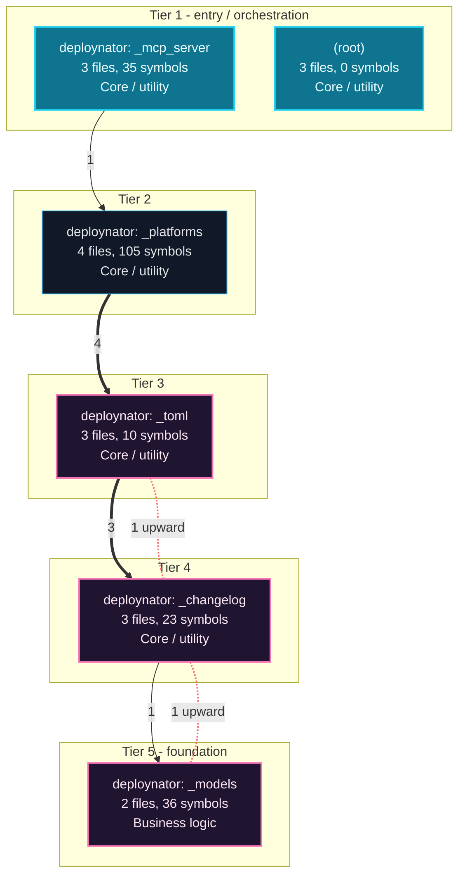

---

## Execution Flows

Entry points are scored from `__main__` guards, `main` functions, entry-style names and files, and call-graph sources. Each flow walks resolved calls in call-site order (depth <= 4, <= 40 steps); numbers give the call order, dashed arrows revisit an already expanded callee, red arrows are recursion. Interactive version with zoom and per-node docs: `readmenator-apidocs/index.html#/flows`.

### `__main__.main`

`deploynator/__main__.py:164`, score 9: entry-style name `main`; defined in entry file `__main__.py`; called from the `__main__` guard.

Control flow:

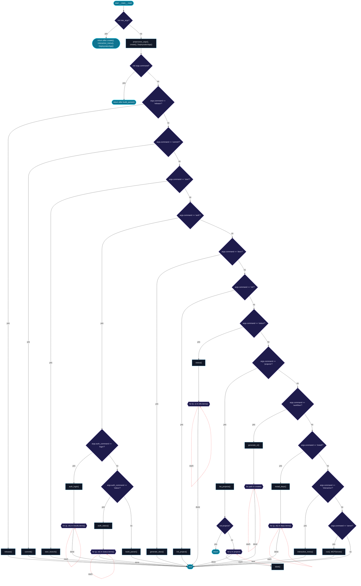

Call tree:

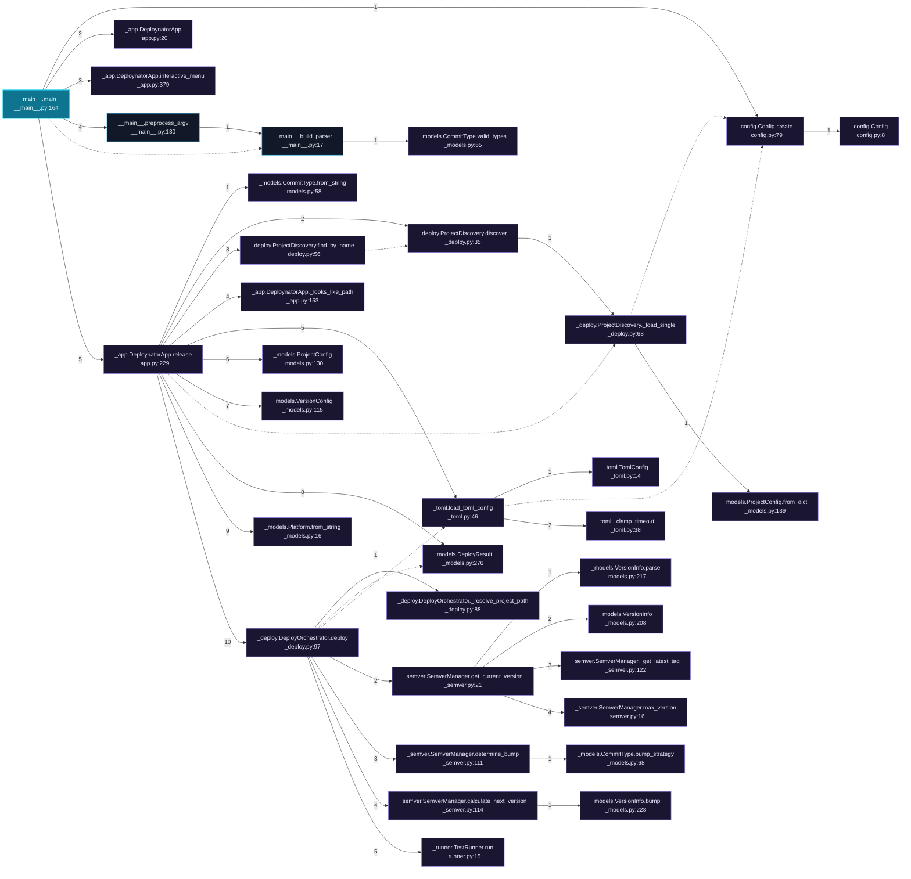

Cross-file sequence:

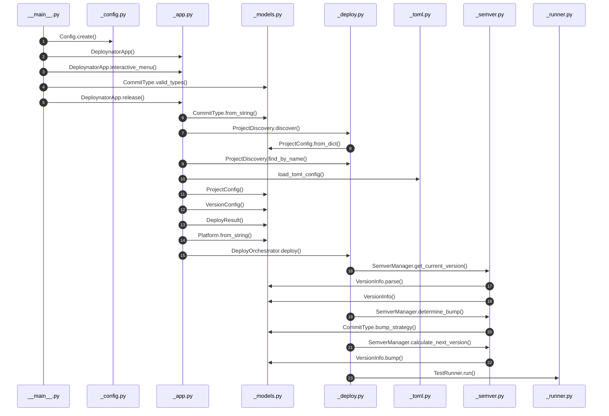

### `_mcp_server (__main__)`

`deploynator/_mcp_server.py:277`, score 8: `if __name__ == "__main__"` guard.

Call tree:

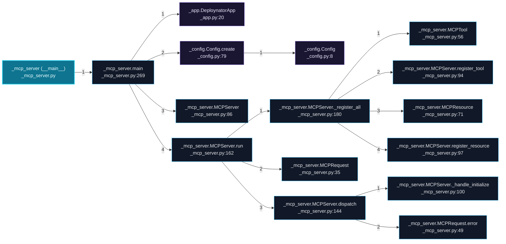

Cross-file sequence:

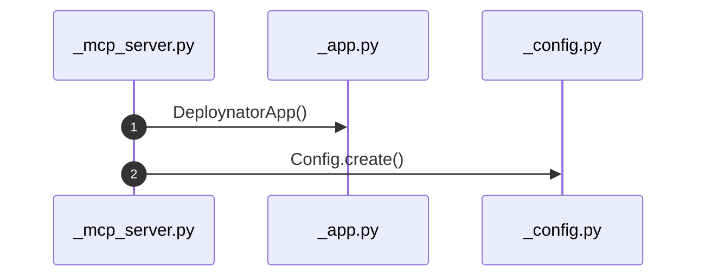

### `_pypi.PyPIRunner.run`

`deploynator/_pypi.py:107`, score 3: entry-style name `run`.

Control flow:

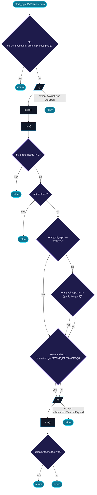

Call tree:

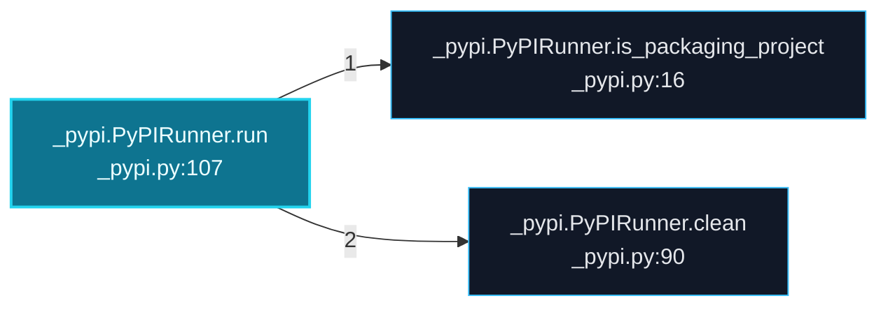

---

## Ranked Context

Files ranked by composite score for the current query context. The ranking combines Personalized PageRank (query relevance), global authority, test coverage, documentation coverage, and code freshness. Model: v1.0.

| Rank | File | Composite | PPR | Authority | Test | Doc |
|------|------|-----------|-----|-----------|------|-----|
| 1 | `_config.py` | 0.1609 | 0.2476 | 0.2476 | 0.00 | 0.00 |
| 2 | `app.py` | 0.1000 | 0.0000 | 0.0000 | 0.00 | 1.00 |
| 3 | `_models.py` | 0.0714 | 0.1099 | 0.1099 | 0.00 | 0.00 |
| 4 | `bdd_test_deploy.py` | 0.0709 | 0.0168 | 0.0168 | 0.00 | 0.60 |
| 5 | `_toml.py` | 0.0475 | 0.0731 | 0.0731 | 0.00 | 0.00 |
| 6 | `_pypi.py` | 0.0418 | 0.0258 | 0.0258 | 0.00 | 0.25 |
| 7 | `_deploy.py` | 0.0335 | 0.0434 | 0.0434 | 0.00 | 0.05 |
| 8 | `_app.py` | 0.0317 | 0.0488 | 0.0488 | 0.00 | 0.00 |
| 9 | `test_path_deploy.py` | 0.0309 | 0.0168 | 0.0168 | 0.00 | 0.20 |
| 10 | `test_toml.py` | 0.0234 | 0.0168 | 0.0168 | 0.00 | 0.12 |

---

## God Nodes

Most architecturally central files ranked by combined import/export degree and symbol richness.

| File | Score | Connections | PageRank |
|------|-------|-------------|----------|
| `_config.py` | 44.6 | | 0.2476 |
| `_deploy.py` | 33.9 | | 0.0434 |
| `_models.py` | 30.7 | | 0.1099 |
| `_toml.py` | 20.4 | | 0.0731 |
| `_app.py` | 17.1 | | 0.0488 |
| `_semver.py` | 14.9 | | 0.0000 |
| `bdd_test_deploy.py` | 13.0 | | 0.0168 |
| `test_pypi.py` | 12.2 | | 0.0000 |
| `_platforms.py` | 11.4 | | 0.0000 |
| `_mcp_server.py` | 11.2 | | 0.0000 |

---

## Community Analysis

Files grouped by import-based community detection. Cohesion measures how tightly connected each community is internally.

### deploynator: _changelog (Cohesion: 0.22)

**6 files** in this community:

- `_changelog.py` (py, 9 symbols)
- `_config.py` (py, 6 symbols)
- `_pypi.py` (py, 8 symbols)
- `test_changelog.py` (py, 8 symbols)
- `test_config.py` (py, 10 symbols)
- `test_pypi.py` (py, 22 symbols)

### deploynator: _toml (Cohesion: 0.36)

**6 files** in this community:

- `_docs.py` (py, 3 symbols)
- `_runner.py` (py, 3 symbols)
- `_toml.py` (py, 4 symbols)
- `bdd_test_deploy.py` (py, 10 symbols)
- `test_runner.py` (py, 15 symbols)
- `test_toml.py` (py, 8 symbols)

### deploynator: _models (Cohesion: 0.31)

**6 files** in this community:

- `_models.py` (py, 27 symbols)
- `_semver.py` (py, 9 symbols)
- `test_models.py` (py, 44 symbols)
- `test_path_deploy.py` (py, 10 symbols)
- `test_pipeline.py` (py, 12 symbols)
- `test_semver.py` (py, 11 symbols)

### deploynator: _platforms (Cohesion: 0.22)

**5 files** in this community:

- `_app.py` (py, 31 symbols)
- `_deploy.py` (py, 19 symbols)
- `_git.py` (py, 21 symbols)
- `_platforms.py` (py, 34 symbols)
- `test_deploy.py` (py, 11 symbols)

### deploynator: _mcp_server (Cohesion: 0.50)

**4 files** in this community:

- `__init__.py` (py, 0 symbols)
- `__main__.py` (py, 3 symbols)
- `_mcp_server.py` (py, 32 symbols)
- `test_cli_mcp.py` (py, 11 symbols)

---

## Surprising Connections

Files in different communities connected through 3+ indirect hops.

- `test_config.py` <-> `test_models.py` (4 hops, across 3 communities)
- `test_models.py` <-> `test_runner.py` (4 hops, across 4 communities)
- `test_models.py` <-> `test_toml.py` (4 hops, across 3 communities)
- `__init__.py` <-> `_changelog.py` (3 hops, across 2 communities)
- `__init__.py` <-> `_docs.py` (3 hops, across 3 communities)

---

## Suggested Questions

Auto-generated exploration prompts based on graph structure:

- What does _config.py depend on, and what depends on it? (22 connections)
- What does _deploy.py depend on, and what depends on it? (16 connections)
- What does _models.py depend on, and what depends on it? (14 connections)
- How are the 6 files in 'deploynator: _changelog' related to each other?
- Why are test_config.py and test_models.py connected through 4 hops across 3 communities?

---

## Force-Graph Explorer

Heterogeneous explorer payload (files, communities, layers, externals) rendered with force-graph physics, stable family colors, log2 node sizing, and convex-hull community overlays. Open `readmenator-maps/graph-force.html` (linked from the maps gallery) or run `explorer`.

- Nodes: 65 (community: 5, external: 25, file: 31, layer: 4)
- Edges: 363

---

## Corpus Analytics

Attribution funnel and distributions for the explorer dashboard.

- Files: 31 | With symbols: 26 | Attributed: 27 | God nodes: 10 | Symbols: 381

- Layer `utility`: 15 files
- Layer `testing`: 13 files
- Layer `infrastructure`: 2 files
- Layer `business_logic`: 1 files

- Language `py`: 30 files
- Language `sh`: 1 files

---

## Taint Propagation Map

Taint analysis traces how dangerous imports propagate through the codebase via transitive dependencies. Source files import dangerous modules directly; sink files receive the danger indirectly.

**Taint Sources:** 1 | **Taint Sinks:** 12 | **Propagation Paths:** 20

- `_app.py` imports `subprocess` (0 hop to `_app.py`) [high]
  Path: _app.py
- `_app.py` imports `subprocess` (1 hop to `_git.py`) [high]
  Path: _app.py -> _git.py
- `_app.py` imports `subprocess` (1 hop to `_deploy.py`) [high]
  Path: _app.py -> _deploy.py
- `_app.py` imports `subprocess` (1 hop to `_models.py`) [high]
  Path: _app.py -> _models.py
- `_app.py` imports `subprocess` (1 hop to `_platforms.py`) [high]
  Path: _app.py -> _platforms.py
- `_app.py` imports `subprocess` (1 hop to `_toml.py`) [high]
  Path: _app.py -> _toml.py
- `_app.py` imports `subprocess` (1 hop to `_config.py`) [high]
  Path: _app.py -> _config.py
- `_app.py` imports `subprocess` (2 hops to `_semver.py`) [high]
  Path: _app.py -> _deploy.py -> _semver.py
- `_app.py` imports `subprocess` (2 hops to `_docs.py`) [high]
  Path: _app.py -> _deploy.py -> _docs.py
- `_app.py` imports `subprocess` (2 hops to `_pypi.py`) [high]
  Path: _app.py -> _deploy.py -> _pypi.py
- `_app.py` imports `subprocess` (2 hops to `_changelog.py`) [high]
  Path: _app.py -> _deploy.py -> _changelog.py
- `_app.py` imports `subprocess` (2 hops to `_runner.py`) [high]
  Path: _app.py -> _deploy.py -> _runner.py
- `_app.py` imports `subprocess` (0 hop to `_app.py`) [high]
  Path: _app.py
- `_app.py` imports `subprocess` (1 hop to `_git.py`) [high]
  Path: _app.py -> _git.py
- `_app.py` imports `subprocess` (1 hop to `_deploy.py`) [high]
  Path: _app.py -> _deploy.py
- `_app.py` imports `subprocess` (1 hop to `_models.py`) [high]
  Path: _app.py -> _models.py
- `_app.py` imports `subprocess` (1 hop to `_platforms.py`) [high]
  Path: _app.py -> _platforms.py
- `_app.py` imports `subprocess` (1 hop to `_toml.py`) [high]
  Path: _app.py -> _toml.py
- `_app.py` imports `subprocess` (1 hop to `_config.py`) [high]
  Path: _app.py -> _config.py
- `_app.py` imports `subprocess` (2 hops to `_semver.py`) [high]
  Path: _app.py -> _deploy.py -> _semver.py

---

## Hotspot Analysis

Files ranked by combined complexity (symbol count) and centrality (connection count). High-scoring files are architecturally critical and may need refactoring attention.

| File | Complexity | Centrality | Combined | Symbols | Connections |
|------|-----------|------------|----------|---------|-------------|
| `_config.py` | 0.136 | 0.691 | 0.469 | 6 | 56 |
| `app.py` | 0.000 | 0.000 | 0.000 | 0 | 0 |
| `_models.py` | 0.614 | 0.370 | 0.468 | 27 | 30 |
| `bdd_test_deploy.py` | 0.227 | 0.420 | 0.343 | 10 | 34 |
| `_toml.py` | 0.091 | 0.296 | 0.214 | 4 | 24 |
| `_pypi.py` | 0.182 | 0.333 | 0.273 | 8 | 27 |
| `_deploy.py` | 0.432 | 0.531 | 0.491 | 19 | 43 |
| `_app.py` | 0.705 | 0.457 | 0.556 | 31 | 37 |
| `test_path_deploy.py` | 0.227 | 0.395 | 0.328 | 10 | 32 |
| `test_toml.py` | 0.182 | 0.210 | 0.199 | 8 | 17 |
| `test_pypi.py` | 0.500 | 1.000 | 0.800 | 22 | 81 |
| `test_runner.py` | 0.341 | 0.753 | 0.588 | 15 | 61 |
| `test_models.py` | 1.000 | 0.049 | 0.430 | 44 | 4 |
| `_platforms.py` | 0.773 | 0.161 | 0.405 | 34 | 13 |
| `_mcp_server.py` | 0.727 | 0.185 | 0.402 | 32 | 15 |

---

## Concept Graph

Semantic second-brain layer: nouns are concept nodes, verbs are edges. Each noun maps atomically to a file set (EXTRACTED); each verb aggregates structural imports, calls, and inherits into consumes, invokes, extends, depends_on, or bridges (INFERRED).

**50 concepts, 100 relations.**

| Concept | Files | Mentions |
|---------|-------|----------|
| `deploynator` | 18 | 28 |
| `release` | 11 | 30 |
| `project` | 10 | 16 |
| `git` | 9 | 17 |
| `deploy` | 8 | 21 |
| `run` | 8 | 11 |
| `version` | 7 | 27 |
| `commit` | 7 | 18 |
| `docs` | 6 | 20 |
| `config` | 6 | 19 |
| `bump` | 6 | 17 |
| `tag` | 6 | 14 |
| `file` | 6 | 13 |
| `semver` | 6 | 10 |
| `name` | 6 | 9 |
| `valid` | 6 | 8 |
| `create` | 5 | 18 |
| `toml` | 5 | 16 |
| `type` | 5 | 14 |
| `path` | 5 | 11 |
| `format` | 5 | 9 |
| `current` | 5 | 6 |
| `red` | 5 | 5 |
| `platform` | 4 | 13 |
| `runner` | 4 | 12 |
| `auth` | 4 | 10 |
| `generate` | 4 | 10 |
| `changelog` | 4 | 9 |
| `cli` | 4 | 8 |
| `get` | 4 | 8 |

### Verb Edges

| Source | Verb | Target | Strength | Evidence |
|--------|------|--------|----------|----------|
| `release` | `depends_on` | `deploynator` | 1.00 | 10 |
| `project` | `depends_on` | `deploynator` | 0.93 | 10 |
| `deploy` | `depends_on` | `deploynator` | 0.76 | 10 |
| `deploynator` | `depends_on` | `config` | 0.71 | 10 |
| `git` | `depends_on` | `deploynator` | 0.63 | 10 |
| `docs` | `depends_on` | `deploynator` | 0.59 | 10 |
| `run` | `depends_on` | `deploynator` | 0.59 | 10 |
| `file` | `depends_on` | `deploynator` | 0.56 | 10 |
| `path` | `depends_on` | `deploynator` | 0.54 | 10 |
| `deploynator` | `depends_on` | `create` | 0.51 | 10 |
| `generate` | `depends_on` | `deploynator` | 0.51 | 10 |
| `name` | `depends_on` | `deploynator` | 0.51 | 10 |
| `version` | `depends_on` | `deploynator` | 0.51 | 10 |
| `project` | `depends_on` | `config` | 0.49 | 10 |
| `release` | `depends_on` | `config` | 0.49 | 10 |
| `tag` | `depends_on` | `deploynator` | 0.49 | 10 |
| `create` | `depends_on` | `deploynator` | 0.46 | 10 |
| `failure` | `depends_on` | `deploynator` | 0.46 | 10 |
| `install` | `depends_on` | `deploynator` | 0.46 | 10 |
| `deploynator` | `depends_on` | `path` | 0.44 | 10 |
| `deploynator` | `depends_on` | `resolve` | 0.44 | 10 |
| `red` | `depends_on` | `deploynator` | 0.44 | 10 |
| `semver` | `depends_on` | `deploynator` | 0.44 | 10 |
| `commit` | `depends_on` | `deploynator` | 0.41 | 10 |
| `pipeline` | `depends_on` | `deploynator` | 0.41 | 10 |
| `resolve` | `depends_on` | `deploynator` | 0.41 | 10 |
| `bump` | `depends_on` | `deploynator` | 0.39 | 10 |
| `current` | `depends_on` | `deploynator` | 0.39 | 10 |
| `deploynator` | `depends_on` | `release` | 0.39 | 10 |
| `get` | `depends_on` | `deploynator` | 0.39 | 10 |

### Dialectic Prompts

- Thesis: `all` centralizes 4 files; Antithesis: `commit` pulls 7 files with 3 shared (Jaccard 0.38); Synthesis: should they merge, split by layer, or keep `bridges` explicit?
- Thesis: `all` centralizes 4 files; Antithesis: `push` pulls 3 files with 3 shared (Jaccard 0.75); Synthesis: should they merge, split by layer, or keep `bridges` explicit?
- Thesis: `auth` centralizes 4 files; Antithesis: `changelog` pulls 4 files with 2 shared (Jaccard 0.33); Synthesis: should they merge, split by layer, or keep `bridges` explicit?
- Thesis: `auth` centralizes 4 files; Antithesis: `cli` pulls 4 files with 2 shared (Jaccard 0.33); Synthesis: should they merge, split by layer, or keep `bridges` explicit?
- Thesis: `auth` centralizes 4 files; Antithesis: `commit` pulls 7 files with 4 shared (Jaccard 0.57); Synthesis: should they merge, split by layer, or keep `bridges` explicit?
- Thesis: `auth` centralizes 4 files; Antithesis: `config` pulls 6 files with 3 shared (Jaccard 0.43); Synthesis: should they merge, split by layer, or keep `bridges` explicit?
- Thesis: `auth` centralizes 4 files; Antithesis: `contract` pulls 3 files with 2 shared (Jaccard 0.40); Synthesis: should they merge, split by layer, or keep `bridges` explicit?
- Thesis: `auth` centralizes 4 files; Antithesis: `header` pulls 4 files with 2 shared (Jaccard 0.33); Synthesis: should they merge, split by layer, or keep `bridges` explicit?
- Thesis: `auth` centralizes 4 files; Antithesis: `log` pulls 4 files with 2 shared (Jaccard 0.33); Synthesis: should they merge, split by layer, or keep `bridges` explicit?
- Thesis: `auth` centralizes 4 files; Antithesis: `platform` pulls 4 files with 2 shared (Jaccard 0.33); Synthesis: should they merge, split by layer, or keep `bridges` explicit?

---

## Change Impact Analysis

Files sorted by how many other files would be affected if they changed. High-impact files should be changed with caution.

| File | Direct Dependents | Transitive Dependents | Total Impact |
|------|------------------|----------------------|--------------|
| `_config.py` | 22 | 2 | 24 |
| `_models.py` | 14 | 3 | 17 |
| `_toml.py` | 9 | 7 | 16 |
| `_changelog.py` | 2 | 10 | 12 |
| `_docs.py` | 3 | 9 | 12 |
| `_runner.py` | 2 | 10 | 12 |
| `_semver.py` | 5 | 7 | 12 |
| `_git.py` | 2 | 9 | 11 |
| `_platforms.py` | 2 | 9 | 11 |
| `_pypi.py` | 2 | 9 | 11 |
| `_deploy.py` | 6 | 4 | 10 |
| `_app.py` | 1 | 4 | 5 |
| `__init__.py` | 4 | 0 | 4 |
| `_mcp_server.py` | 2 | 0 | 2 |
| `__main__.py` | 1 | 0 | 1 |

---

## Suggested Linting Rules

Automatically suggested linting and security rules based on patterns detected in the codebase. These can be exported as Semgrep rules using the `--export-rules` flag.

| Rule ID | Severity | Description | Language | Matches |
|---------|----------|-------------|----------|---------|
| `RM001` | info | Large number of functions in py: 321 total | py | 321 |
| `RM002` | info | Print statement found (consider logging instead) | python | 78 |

---

## Orphans

Files with no documentation or low connectivity. These are candidates for documentation investment or cleanup.

- `_config.py` (6 symbols, no doc)
- `_models.py` (27 symbols, no doc)
- `_toml.py` (4 symbols, no doc)
- `_app.py` (31 symbols, no doc)
- `__init__.py` (0 symbols, no doc)
- `__main__.py` (3 symbols, no doc)
- `_changelog.py` (9 symbols, no doc)
- `_docs.py` (3 symbols, no doc)
- `_git.py` (21 symbols, no doc)
- `_platforms.py` (34 symbols, no doc)
- `_runner.py` (3 symbols, no doc)
- `_semver.py` (9 symbols, no doc)
- `install.sh` (0 symbols, no doc)
- `setup.py` (0 symbols, no doc)
- `__init__.py` (0 symbols, no doc)
- `test_changelog.py` (8 symbols, no doc)
- `test_config.py` (10 symbols, no doc)
- `test_deploy.py` (11 symbols, no doc)
- `test_models.py` (44 symbols, no doc)
- `test_semver.py` (11 symbols, no doc)

---

## Query Recipes

Example queries you can run against this knowledge base using the ranking engine:

```
# Find files most relevant to a concept
readmenator query "Where is the import resolver implemented?"

# Rank files by relevance to a topic
readmenator query "How does documentation generation work?"

# Explain why a file ranks highly
readmenator query "explain readmenator/_documentation.py"

# Trace dependency paths with ranked context
readmenator query "path from CLI to exporter"
```

The ranking model uses the following signals:

- **Personalized PageRank** (45% weight): query-specific relevance via seed propagation
- **Global Authority** (20% weight): structural importance via standard PageRank
- **Test Coverage** (15% weight): fraction of symbols referenced in test files
- **Doc Coverage** (10% weight): presence of docstrings and file-level docs
- **Freshness** (10% weight): recent modification activity

Results include score decomposition and justification paths for each ranked item.

---

## Structural Knowledge Map

> **Note:** The visual graph below has been intelligently pruned to the top 300 most relevant nodes to prevent rendering crashes. Full details of all files are documented in the Architecture Reference.

```mermaid
graph LR
    classDef mod fill:#1e1e1e,stroke:#ff6666,stroke-width:2px,color:#fff;
    classDef cls fill:#2d2d2d,stroke:#4ec9b0,stroke-width:2px,color:#fff;
    classDef fn fill:#333,stroke:#dcdcaa,stroke-width:1px,color:#dcdcaa;
    classDef ext fill:#111,stroke:#666,stroke-dasharray:5 5,color:#aaa;
    subgraph community_0 ["deploynator: _changelog"]
    tests_test_pypi_py["test_pypi.py (py)"]
    class tests_test_pypi_py mod;
    tests_test_pypi_py__git_init["_git_init"]
    class tests_test_pypi_py__git_init fn;
    tests_test_pypi_py --> tests_test_pypi_py__git_init
    tests_test_pypi_py_TestDetect["TestDetect"]
    class tests_test_pypi_py_TestDetect cls;
    tests_test_pypi_py --> tests_test_pypi_py_TestDetect
    tests_test_pypi_py_TestPromptCredentials["TestPromptCredentials"]
    class tests_test_pypi_py_TestPromptCredentials cls;
    tests_test_pypi_py --> tests_test_pypi_py_TestPromptCredentials
    tests_test_pypi_py_TestCleanAndRun["TestCleanAndRun"]
    class tests_test_pypi_py_TestCleanAndRun cls;
    tests_test_pypi_py --> tests_test_pypi_py_TestCleanAndRun
    tests_test_pypi_py_TestPipelinePyPI["TestPipelinePyPI"]
    class tests_test_pypi_py_TestPipelinePyPI cls;
    tests_test_pypi_py --> tests_test_pypi_py_TestPipelinePyPI
    end
    subgraph community_1 ["deploynator: _toml"]
    tests_test_runner_py["test_runner.py (py)"]
    class tests_test_runner_py mod;
    end
    subgraph community_3 ["deploynator: _platforms"]
    deploynator__app_py["_app.py (py)"]
    class deploynator__app_py mod;
    tests_bdd_test_deploy_py["bdd_test_deploy.py (py)"]
    class tests_bdd_test_deploy_py mod;
    end
    subgraph community_2 ["deploynator: _models"]
    tests_test_path_deploy_py["test_path_deploy.py (py)"]
    class tests_test_path_deploy_py mod;
    deploynator__deploy_py["_deploy.py (py)"]
    class deploynator__deploy_py mod;
    tests_test_pipeline_py["test_pipeline.py (py)"]
    class tests_test_pipeline_py mod;
    end
    subgraph community_4 ["deploynator: _mcp_server"]
    tests_test_cli_mcp_py["test_cli_mcp.py (py)"]
    class tests_test_cli_mcp_py mod;
    tests_test_toml_py["test_toml.py (py)"]
    class tests_test_toml_py mod;
    deploynator__pypi_py["_pypi.py (py)"]
    class deploynator__pypi_py mod;
    tests_test_deploy_py["test_deploy.py (py)"]
    class tests_test_deploy_py mod;
    deploynator___main___py["__main__.py (py)"]
    class deploynator___main___py mod;
    deploynator__platforms_py["_platforms.py (py)"]
    class deploynator__platforms_py mod;
    tests_test_semver_py["test_semver.py (py)"]
    class tests_test_semver_py mod;
    deploynator__changelog_py["_changelog.py (py)"]
    class deploynator__changelog_py mod;
    deploynator__semver_py["_semver.py (py)"]
    class deploynator__semver_py mod;
    deploynator__mcp_server_py["_mcp_server.py (py)"]
    class deploynator__mcp_server_py mod;
    deploynator__runner_py["_runner.py (py)"]
    class deploynator__runner_py mod;
    tests_test_changelog_py["test_changelog.py (py)"]
    class tests_test_changelog_py mod;
    deploynator__docs_py["_docs.py (py)"]
    class deploynator__docs_py mod;
    deploynator__models_py["_models.py (py)"]
    class deploynator__models_py mod;
    deploynator__git_py["_git.py (py)"]
    class deploynator__git_py mod;
    deploynator__toml_py["_toml.py (py)"]
    class deploynator__toml_py mod;
    tests_test_config_py["test_config.py (py)"]
    class tests_test_config_py mod;
    tests_test_models_py["test_models.py (py)"]
    class tests_test_models_py mod;
    deploynator__config_py["_config.py (py)"]
    class deploynator__config_py mod;
    deploynator___init___py["__init__.py (py)"]
    class deploynator___init___py mod;
    setup_py["setup.py (py)"]
    class setup_py mod;
    app_py["app.py (py)"]
    class app_py mod;
    install_sh["install.sh (sh)"]
    class install_sh mod;
    tests___init___py["__init__.py (py)"]
    class tests___init___py mod;
    end
    deploynator___init___py -- resolved_imports --> deploynator__app_py
    deploynator___main___py -- resolved_imports --> deploynator___init___py
    deploynator___main___py -- resolved_imports --> deploynator__config_py
    deploynator___main___py -- resolved_imports --> deploynator__models_py
    deploynator___main___py -- resolved_imports --> deploynator__mcp_server_py
    deploynator__app_py -- resolved_imports --> deploynator__config_py
    deploynator__app_py -- resolved_imports --> deploynator__models_py
    deploynator__app_py -- resolved_imports --> deploynator__deploy_py
    deploynator__app_py -- resolved_imports --> deploynator__platforms_py
    deploynator__app_py -- resolved_imports --> deploynator__git_py
    deploynator__app_py -- resolved_imports --> deploynator__models_py
    deploynator__app_py -- resolved_imports --> deploynator__deploy_py
    deploynator__app_py -- resolved_imports --> deploynator__git_py
    deploynator__app_py -- resolved_imports --> deploynator__models_py
    deploynator__app_py -- resolved_imports --> deploynator__git_py
    deploynator__app_py -- resolved_imports --> deploynator__git_py
    deploynator__app_py -- resolved_imports --> deploynator__deploy_py
    deploynator__app_py -- resolved_imports --> deploynator__models_py
    deploynator__app_py -- resolved_imports --> deploynator__toml_py
    deploynator__changelog_py -- resolved_imports --> deploynator__config_py
    deploynator__changelog_py -- resolved_imports --> deploynator__models_py
    deploynator__deploy_py -- resolved_imports --> deploynator__config_py
    deploynator__deploy_py -- resolved_imports --> deploynator__models_py
    deploynator__deploy_py -- resolved_imports --> deploynator__git_py
    deploynator__deploy_py -- resolved_imports --> deploynator__semver_py
    deploynator__deploy_py -- resolved_imports --> deploynator__changelog_py
    deploynator__deploy_py -- resolved_imports --> deploynator__platforms_py
    deploynator__deploy_py -- resolved_imports --> deploynator__toml_py
    deploynator__deploy_py -- resolved_imports --> deploynator__runner_py
    deploynator__deploy_py -- resolved_imports --> deploynator__docs_py
    deploynator__deploy_py -- resolved_imports --> deploynator__pypi_py
    deploynator__docs_py -- resolved_imports --> deploynator__config_py
    deploynator__docs_py -- resolved_imports --> deploynator__toml_py
    deploynator__git_py -- resolved_imports --> deploynator__config_py
    deploynator__mcp_server_py -- resolved_imports --> deploynator__config_py
    deploynator__mcp_server_py -- resolved_imports --> deploynator___init___py
    deploynator__platforms_py -- resolved_imports --> deploynator__config_py
    deploynator__platforms_py -- resolved_imports --> deploynator__models_py
    deploynator__pypi_py -- resolved_imports --> deploynator__config_py
    deploynator__pypi_py -- resolved_imports --> deploynator__toml_py
    deploynator__runner_py -- resolved_imports --> deploynator__config_py
    deploynator__runner_py -- resolved_imports --> deploynator__toml_py
    deploynator__semver_py -- resolved_imports --> deploynator__config_py
    deploynator__semver_py -- resolved_imports --> deploynator__models_py
    deploynator__toml_py -- resolved_imports --> deploynator__config_py
    tests_bdd_test_deploy_py -- resolved_imports --> deploynator__models_py
    tests_bdd_test_deploy_py -- resolved_imports --> deploynator__models_py
    tests_bdd_test_deploy_py -- resolved_imports --> deploynator__models_py
    tests_bdd_test_deploy_py -- resolved_imports --> deploynator__config_py
    tests_bdd_test_deploy_py -- resolved_imports --> deploynator__deploy_py
    tests_bdd_test_deploy_py -- resolved_imports --> deploynator__models_py
    tests_bdd_test_deploy_py -- resolved_imports --> deploynator__config_py
    tests_bdd_test_deploy_py -- resolved_imports --> deploynator__docs_py
    tests_bdd_test_deploy_py -- resolved_imports --> deploynator__toml_py
    tests_bdd_test_deploy_py -- resolved_imports --> deploynator__models_py
    tests_bdd_test_deploy_py -- resolved_imports --> deploynator__config_py
    tests_bdd_test_deploy_py -- resolved_imports --> deploynator__semver_py
    tests_test_changelog_py -- resolved_imports --> deploynator__config_py
    tests_test_changelog_py -- resolved_imports --> deploynator__changelog_py
    tests_test_changelog_py -- resolved_imports --> deploynator__models_py
    tests_test_cli_mcp_py -- resolved_imports --> deploynator___init___py
    tests_test_cli_mcp_py -- resolved_imports --> deploynator___main___py
    tests_test_cli_mcp_py -- resolved_imports --> deploynator___main___py
    tests_test_cli_mcp_py -- resolved_imports --> deploynator___main___py
    tests_test_cli_mcp_py -- resolved_imports --> deploynator__mcp_server_py
    tests_test_cli_mcp_py -- resolved_imports --> deploynator__config_py
    tests_test_cli_mcp_py -- resolved_imports --> deploynator___init___py
    tests_test_cli_mcp_py -- resolved_imports --> deploynator__mcp_server_py
    tests_test_cli_mcp_py -- resolved_imports --> deploynator__mcp_server_py
    tests_test_cli_mcp_py -- resolved_imports --> deploynator__mcp_server_py
    tests_test_cli_mcp_py -- resolved_imports --> deploynator__mcp_server_py
    tests_test_config_py -- resolved_imports --> deploynator__config_py
    tests_test_deploy_py -- resolved_imports --> deploynator__config_py
    tests_test_deploy_py -- resolved_imports --> deploynator__deploy_py
    tests_test_deploy_py -- resolved_imports --> deploynator__models_py
    tests_test_deploy_py -- resolved_imports --> deploynator__deploy_py
    tests_test_models_py -- resolved_imports --> deploynator__models_py
    tests_test_path_deploy_py -- resolved_imports --> deploynator__semver_py
    tests_test_path_deploy_py -- resolved_imports --> deploynator__config_py
    tests_test_path_deploy_py -- resolved_imports --> deploynator__semver_py
    tests_test_path_deploy_py -- resolved_imports --> deploynator__config_py
    tests_test_path_deploy_py -- resolved_imports --> deploynator__semver_py
    tests_test_path_deploy_py -- resolved_imports --> deploynator__config_py
    tests_test_path_deploy_py -- resolved_imports --> deploynator__models_py
    tests_test_path_deploy_py -- resolved_imports --> deploynator___init___py
    tests_test_path_deploy_py -- resolved_imports --> deploynator__config_py
    tests_test_path_deploy_py -- resolved_imports --> deploynator__deploy_py
    tests_test_path_deploy_py -- resolved_imports --> deploynator__config_py
    tests_test_path_deploy_py -- resolved_imports --> deploynator__models_py
    tests_test_path_deploy_py -- resolved_imports --> deploynator___init___py
    tests_test_path_deploy_py -- resolved_imports --> deploynator__config_py
    tests_test_pipeline_py -- resolved_imports --> deploynator__config_py
    tests_test_pipeline_py -- resolved_imports --> deploynator__models_py
    tests_test_pipeline_py -- resolved_imports --> deploynator__semver_py
    tests_test_pipeline_py -- resolved_imports --> deploynator__semver_py
    tests_test_pipeline_py -- resolved_imports --> deploynator__semver_py
    tests_test_pipeline_py -- resolved_imports --> deploynator__deploy_py
    tests_test_pipeline_py -- resolved_imports --> deploynator__deploy_py
    tests_test_pipeline_py -- resolved_imports --> deploynator__deploy_py
    tests_test_pipeline_py -- resolved_imports --> deploynator__deploy_py
    ext_deploynator__app["deploynator._app"]
    class ext_deploynator__app ext;
    deploynator___init___py -.->|imports| ext_deploynator__app
    ext___future__["__future__"]
    class ext___future__ ext;
    deploynator___main___py -.->|imports| ext___future__
    ext_argparse["argparse"]
    class ext_argparse ext;
    deploynator___main___py -.->|imports| ext_argparse
    ext_sys["sys"]
    class ext_sys ext;
    deploynator___main___py -.->|imports| ext_sys
    ext_typing["typing"]
    class ext_typing ext;
    deploynator___main___py -.->|imports| ext_typing
    ext_deploynator["deploynator"]
    class ext_deploynator ext;
    deploynator___main___py -.->|imports| ext_deploynator
    ext_deploynator__config["deploynator._config"]
    class ext_deploynator__config ext;
    deploynator___main___py -.->|imports| ext_deploynator__config
    ext_deploynator__models["deploynator._models"]
    class ext_deploynator__models ext;
    deploynator___main___py -.->|imports| ext_deploynator__models
    ext_deploynator__mcp_server["deploynator._mcp_server"]
    class ext_deploynator__mcp_server ext;
    deploynator___main___py -.->|imports| ext_deploynator__mcp_server
    deploynator__app_py -.->|imports| ext___future__
    ext_json["json"]
    class ext_json ext;
    deploynator__app_py -.->|imports| ext_json
    ext_os["os"]
    class ext_os ext;
    deploynator__app_py -.->|imports| ext_os
    ext_re["re"]
    class ext_re ext;
    deploynator__app_py -.->|imports| ext_re
    deploynator__app_py -.->|imports| ext_sys
    deploynator__app_py -.->|imports| ext_typing
    deploynator__app_py -.->|imports| ext_deploynator__config
    deploynator__app_py -.->|imports| ext_deploynator__models
    ext_deploynator__deploy["deploynator._deploy"]
    class ext_deploynator__deploy ext;
    deploynator__app_py -.->|imports| ext_deploynator__deploy
    ext_deploynator__platforms["deploynator._platforms"]
    class ext_deploynator__platforms ext;
    deploynator__app_py -.->|imports| ext_deploynator__platforms
    ext_subprocess["subprocess"]
    class ext_subprocess ext;
    deploynator__app_py -.->|imports| ext_subprocess
    deploynator__app_py -.->|imports| ext_subprocess
    ext_deploynator__git["deploynator._git"]
    class ext_deploynator__git ext;
    deploynator__app_py -.->|imports| ext_deploynator__git
    deploynator__app_py -.->|imports| ext_deploynator__models
    deploynator__app_py -.->|imports| ext_deploynator__deploy
    deploynator__app_py -.->|imports| ext_deploynator__git
    deploynator__app_py -.->|imports| ext_deploynator__models
    deploynator__app_py -.->|imports| ext_deploynator__git
    deploynator__app_py -.->|imports| ext_deploynator__git
    deploynator__app_py -.->|imports| ext_deploynator__deploy
    deploynator__app_py -.->|imports| ext_deploynator__models
    ext_deploynator__toml["deploynator._toml"]
    class ext_deploynator__toml ext;
    deploynator__app_py -.->|imports| ext_deploynator__toml
    deploynator__changelog_py -.->|imports| ext___future__
    deploynator__changelog_py -.->|imports| ext_os
    deploynator__changelog_py -.->|imports| ext_subprocess
    ext_collections["collections"]
    class ext_collections ext;
    deploynator__changelog_py -.->|imports| ext_collections
    deploynator__changelog_py -.->|imports| ext_typing
    deploynator__changelog_py -.->|imports| ext_deploynator__config
    deploynator__changelog_py -.->|imports| ext_deploynator__models
    deploynator__changelog_py -.->|imports| ext_os
    deploynator__config_py -.->|imports| ext___future__
    deploynator__config_py -.->|imports| ext_os
    ext_dataclasses["dataclasses"]
    class ext_dataclasses ext;
    deploynator__config_py -.->|imports| ext_dataclasses
    deploynator__deploy_py -.->|imports| ext___future__
    deploynator__deploy_py -.->|imports| ext_os
    ext_shutil["shutil"]
    class ext_shutil ext;
    deploynator__deploy_py -.->|imports| ext_shutil
    deploynator__deploy_py -.->|imports| ext_subprocess
    ext_tempfile["tempfile"]
    class ext_tempfile ext;
    deploynator__deploy_py -.->|imports| ext_tempfile
    deploynator__deploy_py -.->|imports| ext_typing
    deploynator__deploy_py -.->|imports| ext_deploynator__config
    deploynator__deploy_py -.->|imports| ext_deploynator__models
    deploynator__deploy_py -.->|imports| ext_deploynator__git
    ext_deploynator__semver["deploynator._semver"]
    class ext_deploynator__semver ext;
    deploynator__deploy_py -.->|imports| ext_deploynator__semver
    ext_deploynator__changelog["deploynator._changelog"]
    class ext_deploynator__changelog ext;
    deploynator__deploy_py -.->|imports| ext_deploynator__changelog
    deploynator__deploy_py -.->|imports| ext_deploynator__platforms
    deploynator__deploy_py -.->|imports| ext_deploynator__toml
    ext_deploynator__runner["deploynator._runner"]
    class ext_deploynator__runner ext;
    deploynator__deploy_py -.->|imports| ext_deploynator__runner
```

---

## UML Class Diagram

Auto-generated Mermaid class diagrams from parsed class-level symbols, split into groups of at most 6 classes so each diagram stays readable. Per-module class diagrams with exact members live in `readmenator-apidocs/modules/`.

#### `deploynator/_app.py`, `deploynator/_changelog.py`, `deploynator/_config.py`, `deploynator/_deploy.py`, `deploynator/_docs.py`

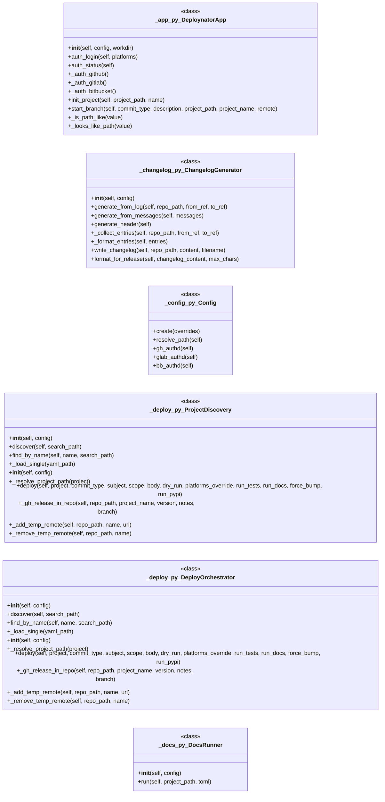

#### `deploynator/_git.py`, `deploynator/_mcp_server.py`

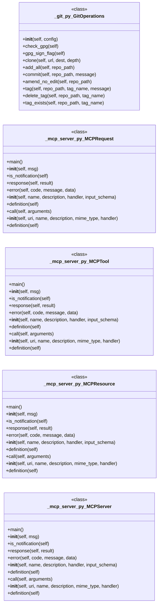

#### `deploynator/_models.py`

```mermaid
classDiagram
  direction LR
  class _models_py_Platform {
    <<class>>
    +from_string(cls, name)
    +label(self)
    +cli_name(self)
    +auth_env_var(self)
    +from_string(cls, value)
    +valid_types(cls)
    +bump_strategy(self)
    +section_header(self)
    +from_dict(cls, data)
    +from_dict(cls, data)
  }
  class _models_py_CommitType {
    <<class>>
    +from_string(cls, name)
    +label(self)
    +cli_name(self)
    +auth_env_var(self)
    +from_string(cls, value)
    +valid_types(cls)
    +bump_strategy(self)
    +section_header(self)
    +from_dict(cls, data)
    +from_dict(cls, data)
  }
  class _models_py_PlatformConfig {
    <<class>>
    +from_string(cls, name)
    +label(self)
    +cli_name(self)
    +auth_env_var(self)
    +from_string(cls, value)
    +valid_types(cls)
    +bump_strategy(self)
    +section_header(self)
    +from_dict(cls, data)
    +from_dict(cls, data)
  }
  class _models_py_VersionConfig {
    <<class>>
    +from_string(cls, name)
    +label(self)
    +cli_name(self)
    +auth_env_var(self)
    +from_string(cls, value)
    +valid_types(cls)
    +bump_strategy(self)
    +section_header(self)
    +from_dict(cls, data)
    +from_dict(cls, data)
  }
  class _models_py_ProjectConfig {
    <<class>>
    +from_string(cls, name)
    +label(self)
    +cli_name(self)
    +auth_env_var(self)
    +from_string(cls, value)
    +valid_types(cls)
    +bump_strategy(self)
    +section_header(self)
    +from_dict(cls, data)
    +from_dict(cls, data)
  }
  class _models_py_CommitMessage {
    <<class>>
    +from_string(cls, name)
    +label(self)
    +cli_name(self)
    +auth_env_var(self)
    +from_string(cls, value)
    +valid_types(cls)
    +bump_strategy(self)
    +section_header(self)
    +from_dict(cls, data)
    +from_dict(cls, data)
  }
  class _models_py_VersionInfo {
    <<class>>
    +from_string(cls, name)
    +label(self)
    +cli_name(self)
    +auth_env_var(self)
    +from_string(cls, value)
    +valid_types(cls)
    +bump_strategy(self)
    +section_header(self)
    +from_dict(cls, data)
    +from_dict(cls, data)
  }
  class _models_py_ChangelogEntry {
    <<class>>
    +from_string(cls, name)
    +label(self)
    +cli_name(self)
    +auth_env_var(self)
    +from_string(cls, value)
    +valid_types(cls)
    +bump_strategy(self)
    +section_header(self)
    +from_dict(cls, data)
    +from_dict(cls, data)
  }
  class _models_py_ReleaseInfo {
    <<class>>
    +from_string(cls, name)
    +label(self)
    +cli_name(self)
    +auth_env_var(self)
    +from_string(cls, value)
    +valid_types(cls)
    +bump_strategy(self)
    +section_header(self)
    +from_dict(cls, data)
    +from_dict(cls, data)
  }
  class _models_py_DeployResult {
    <<class>>
    +from_string(cls, name)
    +label(self)
    +cli_name(self)
    +auth_env_var(self)
    +from_string(cls, value)
    +valid_types(cls)
    +bump_strategy(self)
    +section_header(self)
    +from_dict(cls, data)
    +from_dict(cls, data)
  }
```

#### `deploynator/_platforms.py`, `deploynator/_pypi.py`

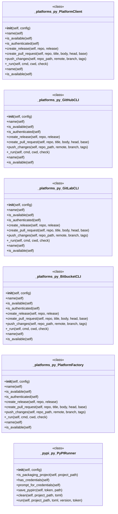

#### `deploynator/_runner.py`, `deploynator/_semver.py`, `deploynator/_toml.py`, `tests/bdd_test_deploy.py`, `tests/test_changelog.py`

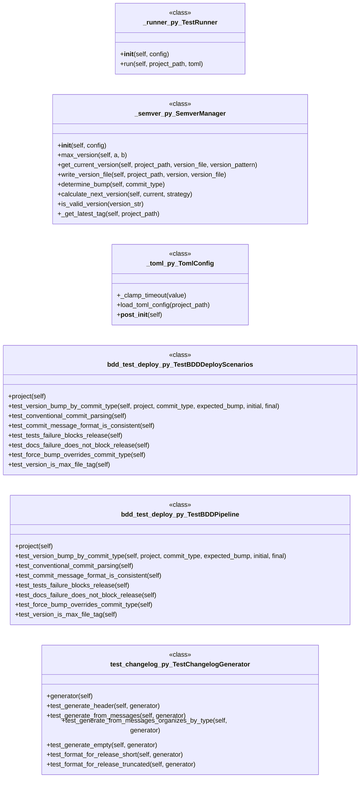

#### `tests/test_cli_mcp.py`, `tests/test_config.py`, `tests/test_deploy.py`

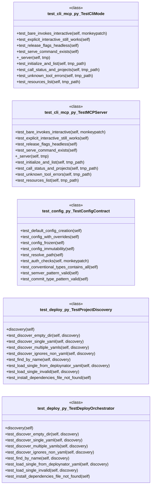

#### `tests/test_models.py`

```mermaid
classDiagram
  direction LR
  class test_models_py_TestPlatformContract {
    <<class>>
    +test_platform_from_string(self)
    +test_platform_from_string_case(self)
    +test_platform_from_string_invalid(self)
    +test_platform_cli_name(self)
    +test_platform_auth_env(self)
    +test_commit_type_from_string(self)
    +test_commit_type_invalid(self)
    +test_commit_type_valid_types(self)
    +test_bump_strategy(self)
    +test_section_header(self)
  }
  class test_models_py_TestCommitTypeContract {
    <<class>>
    +test_platform_from_string(self)
    +test_platform_from_string_case(self)
    +test_platform_from_string_invalid(self)
    +test_platform_cli_name(self)
    +test_platform_auth_env(self)
    +test_commit_type_from_string(self)
    +test_commit_type_invalid(self)
    +test_commit_type_valid_types(self)
    +test_bump_strategy(self)
    +test_section_header(self)
  }
  class test_models_py_TestCommitMessageContract {
    <<class>>
    +test_platform_from_string(self)
    +test_platform_from_string_case(self)
    +test_platform_from_string_invalid(self)
    +test_platform_cli_name(self)
    +test_platform_auth_env(self)
    +test_commit_type_from_string(self)
    +test_commit_type_invalid(self)
    +test_commit_type_valid_types(self)
    +test_bump_strategy(self)
    +test_section_header(self)
  }
  class test_models_py_TestVersionInfoContract {
    <<class>>
    +test_platform_from_string(self)
    +test_platform_from_string_case(self)
    +test_platform_from_string_invalid(self)
    +test_platform_cli_name(self)
    +test_platform_auth_env(self)
    +test_commit_type_from_string(self)
    +test_commit_type_invalid(self)
    +test_commit_type_valid_types(self)
    +test_bump_strategy(self)
    +test_section_header(self)
  }
  class test_models_py_TestPlatformConfigContract {
    <<class>>
    +test_platform_from_string(self)
    +test_platform_from_string_case(self)
    +test_platform_from_string_invalid(self)
    +test_platform_cli_name(self)
    +test_platform_auth_env(self)
    +test_commit_type_from_string(self)
    +test_commit_type_invalid(self)
    +test_commit_type_valid_types(self)
    +test_bump_strategy(self)
    +test_section_header(self)
  }
  class test_models_py_TestProjectConfigContract {
    <<class>>
    +test_platform_from_string(self)
    +test_platform_from_string_case(self)
    +test_platform_from_string_invalid(self)
    +test_platform_cli_name(self)
    +test_platform_auth_env(self)
    +test_commit_type_from_string(self)
    +test_commit_type_invalid(self)
    +test_commit_type_valid_types(self)
    +test_bump_strategy(self)
    +test_section_header(self)
  }
  class test_models_py_TestChangelogEntryContract {
    <<class>>
    +test_platform_from_string(self)
    +test_platform_from_string_case(self)
    +test_platform_from_string_invalid(self)
    +test_platform_cli_name(self)
    +test_platform_auth_env(self)
    +test_commit_type_from_string(self)
    +test_commit_type_invalid(self)
    +test_commit_type_valid_types(self)
    +test_bump_strategy(self)
    +test_section_header(self)
  }
  class test_models_py_TestReleaseInfoContract {
    <<class>>
    +test_platform_from_string(self)
    +test_platform_from_string_case(self)
    +test_platform_from_string_invalid(self)
    +test_platform_cli_name(self)
    +test_platform_auth_env(self)
    +test_commit_type_from_string(self)
    +test_commit_type_invalid(self)
    +test_commit_type_valid_types(self)
    +test_bump_strategy(self)
    +test_section_header(self)
  }
  class test_models_py_TestDeployResultContract {
    <<class>>
    +test_platform_from_string(self)
    +test_platform_from_string_case(self)
    +test_platform_from_string_invalid(self)
    +test_platform_cli_name(self)
    +test_platform_auth_env(self)
    +test_commit_type_from_string(self)
    +test_commit_type_invalid(self)
    +test_commit_type_valid_types(self)
    +test_bump_strategy(self)
    +test_section_header(self)
  }
```

#### `tests/test_path_deploy.py`

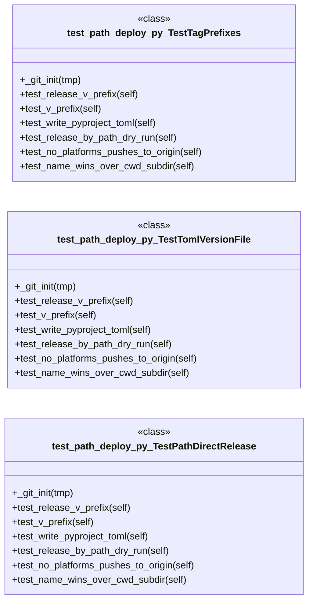

---

## Code Property Graph

Machine-readable Code Property Graph (CPG) in JSON-LD format. This block allows AI agents to parse the full structural graph without additional file reads. Compatible with GraphRAG pipelines.

```json
{"@context": "https://schema.org", "analysis": {"communities": [{"cohesion": 0.219, "id": 0, "label": "deploynator: _changelog", "size": 6}, {"cohesion": 0.364, "id": 1, "label": "deploynator: _toml", "size": 6}, {"cohesion": 0.308, "id": 2, "label": "deploynator: _models", "size": 6}, {"cohesion": 0.222, "id": 3, "label": "deploynator: _platforms", "size": 5}, {"cohesion": 0.5, "id": 4, "label": "deploynator: _mcp_server", "size": 4}], "god_nodes": [{"node_id": "deploynator/_config.py", "score": 44.6}, {"node_id": "deploynator/_deploy.py", "score": 33.9}, {"node_id": "deploynator/_models.py", "score": 30.7}, {"node_id": "deploynator/_toml.py", "score": 20.4}, {"node_id": "deploynator/_app.py", "score": 17.1}, {"node_id": "deploynator/_semver.py", "score": 14.9}, {"node_id": "tests/bdd_test_deploy.py", "score": 13.0}, {"node_id": "tests/test_pypi.py", "score": 12.2}, {"node_id": "deploynator/_platforms.py", "score": 11.4}, {"node_id": "deploynator/_mcp_server.py", "score": 11.2}], "surprising_connections": [{"hops": 4, "source": "tests/test_config.py", "target": "tests/test_models.py"}, {"hops": 4, "source": "tests/test_models.py", "target": "tests/test_runner.py"}, {"hops": 4, "source": "tests/test_models.py", "target": "tests/test_toml.py"}, {"hops": 3, "source": "deploynator/__init__.py", "target": "deploynator/_changelog.py"}, {"hops": 3, "source": "deploynator/__init__.py", "target": "deploynator/_docs.py"}]}, "edges": [{"confidence": "EXTRACTED", "relation": "imports", "source": "deploynator/__init__.py", "target": "deploynator._app"}, {"confidence": "EXTRACTED", "relation": "imports", "source": "deploynator/__main__.py", "target": "__future__"}, {"confidence": "EXTRACTED", "relation": "imports", "source": "deploynator/__main__.py", "target": "argparse"}, {"confidence": "EXTRACTED", "relation": "imports", "source": "deploynator/__main__.py", "target": "sys"}, {"confidence": "EXTRACTED", "relation": "imports", "source": "deploynator/__main__.py", "target": "typing"}, {"confidence": "EXTRACTED", "relation": "imports", "source": "deploynator/__main__.py", "target": "deploynator"}, {"confidence": "EXTRACTED", "relation": "imports", "source": "deploynator/__main__.py", "target": "deploynator._config"}, {"confidence": "EXTRACTED", "relation": "imports", "source": "deploynator/__main__.py", "target": "deploynator._models"}, {"confidence": "EXTRACTED", "relation": "imports", "source": "deploynator/__main__.py", "target": "deploynator._mcp_server"}, {"confidence": "EXTRACTED", "relation": "imports", "source": "deploynator/_app.py", "target": "__future__"}, {"confidence": "EXTRACTED", "relation": "imports", "source": "deploynator/_app.py", "target": "json"}, {"confidence": "EXTRACTED", "relation": "imports", "source": "deploynator/_app.py", "target": "os"}, {"confidence": "EXTRACTED", "relation": "imports", "source": "deploynator/_app.py", "target": "re"}, {"confidence": "EXTRACTED", "relation": "imports", "source": "deploynator/_app.py", "target": "sys"}, {"confidence": "EXTRACTED", "relation": "imports", "source": "deploynator/_app.py", "target": "typing"}, {"confidence": "EXTRACTED", "relation": "imports", "source": "deploynator/_app.py", "target": "deploynator._config"}, {"confidence": "EXTRACTED", "relation": "imports", "source": "deploynator/_app.py", "target": "deploynator._models"}, {"confidence": "EXTRACTED", "relation": "imports", "source": "deploynator/_app.py", "target": "deploynator._deploy"}, {"confidence": "EXTRACTED", "relation": "imports", "source": "deploynator/_app.py", "target": "deploynator._platforms"}, {"confidence": "EXTRACTED", "relation": "imports", "source": "deploynator/_app.py", "target": "subprocess"}, {"confidence": "EXTRACTED", "relation": "imports", "source": "deploynator/_app.py", "target": "subprocess"}, {"confidence": "EXTRACTED", "relation": "imports", "source": "deploynator/_app.py", "target": "deploynator._git"}, {"confidence": "EXTRACTED", "relation": "imports", "source": "deploynator/_app.py", "target": "deploynator._models"}, {"confidence": "EXTRACTED", "relation": "imports", "source": "deploynator/_app.py", "target": "deploynator._deploy"}, {"confidence": "EXTRACTED", "relation": "imports", "source": "deploynator/_app.py", "target": "deploynator._git"}, {"confidence": "EXTRACTED", "relation": "imports", "source": "deploynator/_app.py", "target": "deploynator._models"}, {"confidence": "EXTRACTED", "relation": "imports", "source": "deploynator/_app.py", "target": "deploynator._git"}, {"confidence": "EXTRACTED", "relation": "imports", "source": "deploynator/_app.py", "target": "deploynator._git"}, {"confidence": "EXTRACTED", "relation": "imports", "source": "deploynator/_app.py", "target": "deploynator._deploy"}, {"confidence": "EXTRACTED", "relation": "imports", "source": "deploynator/_app.py", "target": "deploynator._models"}, {"confidence": "EXTRACTED", "relation": "imports", "source": "deploynator/_app.py", "target": "deploynator._toml"}, {"confidence": "EXTRACTED", "relation": "imports", "source": "deploynator/_changelog.py", "target": "__future__"}, {"confidence": "EXTRACTED", "relation": "imports", "source": "deploynator/_changelog.py", "target": "os"}, {"confidence": "EXTRACTED", "relation": "imports", "source": "deploynator/_changelog.py", "target": "subprocess"}, {"confidence": "EXTRACTED", "relation": "imports", "source": "deploynator/_changelog.py", "target": "collections"}, {"confidence": "EXTRACTED", "relation": "imports", "source": "deploynator/_changelog.py", "target": "typing"}, {"confidence": "EXTRACTED", "relation": "imports", "source": "deploynator/_changelog.py", "target": "deploynator._config"}, {"confidence": "EXTRACTED", "relation": "imports", "source": "deploynator/_changelog.py", "target": "deploynator._models"}, {"confidence": "EXTRACTED", "relation": "imports", "source": "deploynator/_changelog.py", "target": "os"}, {"confidence": "EXTRACTED", "relation": "imports", "source": "deploynator/_config.py", "target": "__future__"}, {"confidence": "EXTRACTED", "relation": "imports", "source": "deploynator/_config.py", "target": "os"}, {"confidence": "EXTRACTED", "relation": "imports", "source": "deploynator/_config.py", "target": "dataclasses"}, {"confidence": "EXTRACTED", "relation": "imports", "source": "deploynator/_deploy.py", "target": "__future__"}, {"confidence": "EXTRACTED", "relation": "imports", "source": "deploynator/_deploy.py", "target": "os"}, {"confidence": "EXTRACTED", "relation": "imports", "source": "deploynator/_deploy.py", "target": "shutil"}, {"confidence": "EXTRACTED", "relation": "imports", "source": "deploynator/_deploy.py", "target": "subprocess"}, {"confidence": "EXTRACTED", "relation": "imports", "source": "deploynator/_deploy.py", "target": "tempfile"}, {"confidence": "EXTRACTED", "relation": "imports", "source": "deploynator/_deploy.py", "target": "typing"}, {"confidence": "EXTRACTED", "relation": "imports", "source": "deploynator/_deploy.py", "target": "deploynator._config"}, {"confidence": "EXTRACTED", "relation": "imports", "source": "deploynator/_deploy.py", "target": "deploynator._models"}, {"confidence": "EXTRACTED", "relation": "imports", "source": "deploynator/_deploy.py", "target": "deploynator._git"}, {"confidence": "EXTRACTED", "relation": "imports", "source": "deploynator/_deploy.py", "target": "deploynator._semver"}, {"confidence": "EXTRACTED", "relation": "imports", "source": "deploynator/_deploy.py", "target": "deploynator._changelog"}, {"confidence": "EXTRACTED", "relation": "imports", "source": "deploynator/_deploy.py", "target": "deploynator._platforms"}, {"confidence": "EXTRACTED", "relation": "imports", "source": "deploynator/_deploy.py", "target": "deploynator._toml"}, {"confidence": "EXTRACTED", "relation": "imports", "source": "deploynator/_deploy.py", "target": "deploynator._runner"}, {"confidence": "EXTRACTED", "relation": "imports", "source": "deploynator/_deploy.py", "target": "deploynator._docs"}, {"confidence": "EXTRACTED", "relation": "imports", "source": "deploynator/_deploy.py", "target": "deploynator._pypi"}, {"confidence": "EXTRACTED", "relation": "imports", "source": "deploynator/_deploy.py", "target": "yaml"}, {"confidence": "EXTRACTED", "relation": "imports", "source": "deploynator/_deploy.py", "target": "readmenator"}, {"confidence": "EXTRACTED", "relation": "imports", "source": "deploynator/_docs.py", "target": "__future__"}, {"confidence": "EXTRACTED", "relation": "imports", "source": "deploynator/_docs.py", "target": "shlex"}, {"confidence": "EXTRACTED", "relation": "imports", "source": "deploynator/_docs.py", "target": "subprocess"}, {"confidence": "EXTRACTED", "relation": "imports", "source": "deploynator/_docs.py", "target": "deploynator._config"}, {"confidence": "EXTRACTED", "relation": "imports", "source": "deploynator/_docs.py", "target": "deploynator._toml"}, {"confidence": "EXTRACTED", "relation": "imports", "source": "deploynator/_git.py", "target": "__future__"}, {"confidence": "EXTRACTED", "relation": "imports", "source": "deploynator/_git.py", "target": "os"}, {"confidence": "EXTRACTED", "relation": "imports", "source": "deploynator/_git.py", "target": "subprocess"}, {"confidence": "EXTRACTED", "relation": "imports", "source": "deploynator/_git.py", "target": "typing"}, {"confidence": "EXTRACTED", "relation": "imports", "source": "deploynator/_git.py", "target": "deploynator._config"}, {"confidence": "EXTRACTED", "relation": "imports", "source": "deploynator/_mcp_server.py", "target": "__future__"}, {"confidence": "EXTRACTED", "relation": "imports", "source": "deploynator/_mcp_server.py", "target": "json"}, {"confidence": "EXTRACTED", "relation": "imports", "source": "deploynator/_mcp_server.py", "target": "logging"}, {"confidence": "EXTRACTED", "relation": "imports", "source": "deploynator/_mcp_server.py", "target": "sys"}, {"confidence": "EXTRACTED", "relation": "imports", "source": "deploynator/_mcp_server.py", "target": "typing"}, {"confidence": "EXTRACTED", "relation": "imports", "source": "deploynator/_mcp_server.py", "target": "deploynator._config"}, {"confidence": "EXTRACTED", "relation": "imports", "source": "deploynator/_mcp_server.py", "target": "deploynator"}, {"confidence": "EXTRACTED", "relation": "imports", "source": "deploynator/_models.py", "target": "__future__"}, {"confidence": "EXTRACTED", "relation": "imports", "source": "deploynator/_models.py", "target": "re"}, {"confidence": "EXTRACTED", "relation": "imports", "source": "deploynator/_models.py", "target": "dataclasses"}, {"confidence": "EXTRACTED", "relation": "imports", "source": "deploynator/_models.py", "target": "datetime"}, {"confidence": "EXTRACTED", "relation": "imports", "source": "deploynator/_models.py", "target": "enum"}, {"confidence": "EXTRACTED", "relation": "imports", "source": "deploynator/_models.py", "target": "typing"}, {"confidence": "EXTRACTED", "relation": "imports", "source": "deploynator/_platforms.py", "target": "__future__"}, {"confidence": "EXTRACTED", "relation": "imports", "source": "deploynator/_platforms.py", "target": "json"}, {"confidence": "EXTRACTED", "relation": "imports", "source": "deploynator/_platforms.py", "target": "os"}, {"confidence": "EXTRACTED", "relation": "imports", "source": "deploynator/_platforms.py", "target": "subprocess"}, {"confidence": "EXTRACTED", "relation": "imports", "source": "deploynator/_platforms.py", "target": "tempfile"}, {"confidence": "EXTRACTED", "relation": "imports", "source": "deploynator/_platforms.py", "target": "abc"}, {"confidence": "EXTRACTED", "relation": "imports", "source": "deploynator/_platforms.py", "target": "typing"}, {"confidence": "EXTRACTED", "relation": "imports", "source": "deploynator/_platforms.py", "target": "deploynator._config"}, {"confidence": "EXTRACTED", "relation": "imports", "source": "deploynator/_platforms.py", "target": "deploynator._models"}, {"confidence": "EXTRACTED", "relation": "imports", "source": "deploynator/_pypi.py", "target": "__future__"}, {"confidence": "EXTRACTED", "relation": "imports", "source": "deploynator/_pypi.py", "target": "os"}, {"confidence": "EXTRACTED", "relation": "imports", "source": "deploynator/_pypi.py", "target": "shutil"}, {"confidence": "EXTRACTED", "relation": "imports", "source": "deploynator/_pypi.py", "target": "subprocess"}, {"confidence": "EXTRACTED", "relation": "imports", "source": "deploynator/_pypi.py", "target": "sys"}, {"confidence": "EXTRACTED", "relation": "imports", "source": "deploynator/_pypi.py", "target": "deploynator._config"}, {"confidence": "EXTRACTED", "relation": "imports", "source": "deploynator/_pypi.py", "target": "deploynator._toml"}, {"confidence": "EXTRACTED", "relation": "imports", "source": "deploynator/_pypi.py", "target": "sys"}, {"confidence": "EXTRACTED", "relation": "imports", "source": "deploynator/_pypi.py", "target": "getpass"}, {"confidence": "EXTRACTED", "relation": "imports", "source": "deploynator/_pypi.py", "target": "configparser"}, {"confidence": "EXTRACTED", "relation": "imports", "source": "deploynator/_pypi.py", "target": "tomllib"}, {"confidence": "EXTRACTED", "relation": "imports", "source": "deploynator/_runner.py", "target": "__future__"}, {"confidence": "EXTRACTED", "relation": "imports", "source": "deploynator/_runner.py", "target": "os"}, {"confidence": "EXTRACTED", "relation": "imports", "source": "deploynator/_runner.py", "target": "shlex"}, {"confidence": "EXTRACTED", "relation": "imports", "source": "deploynator/_runner.py", "target": "subprocess"}, {"confidence": "EXTRACTED", "relation": "imports", "source": "deploynator/_runner.py", "target": "deploynator._config"}, {"confidence": "EXTRACTED", "relation": "imports", "source": "deploynator/_runner.py", "target": "deploynator._toml"}, {"confidence": "EXTRACTED", "relation": "imports", "source": "deploynator/_semver.py", "target": "__future__"}, {"confidence": "EXTRACTED", "relation": "imports", "source": "deploynator/_semver.py", "target": "json"}, {"confidence": "EXTRACTED", "relation": "imports", "source": "deploynator/_semver.py", "target": "os"}, {"confidence": "EXTRACTED", "relation": "imports", "source": "deploynator/_semver.py", "target": "re"}, {"confidence": "EXTRACTED", "relation": "imports", "source": "deploynator/_semver.py", "target": "typing"}, {"confidence": "EXTRACTED", "relation": "imports", "source": "deploynator/_semver.py", "target": "deploynator._config"}, {"confidence": "EXTRACTED", "relation": "imports", "source": "deploynator/_semver.py", "target": "deploynator._models"}, {"confidence": "EXTRACTED", "relation": "imports", "source": "deploynator/_semver.py", "target": "subprocess"}, {"confidence": "EXTRACTED", "relation": "imports", "source": "deploynator/_toml.py", "target": "__future__"}, {"confidence": "EXTRACTED", "relation": "imports", "source": "deploynator/_toml.py", "target": "os"}, {"confidence": "EXTRACTED", "relation": "imports", "source": "deploynator/_toml.py", "target": "dataclasses"}, {"confidence": "EXTRACTED", "relation": "imports", "source": "deploynator/_toml.py", "target": "deploynator._config"}, {"confidence": "EXTRACTED", "relation": "imports", "source": "deploynator/_toml.py", "target": "tomllib"}, {"confidence": "EXTRACTED", "relation": "imports", "source": "setup.py", "target": "setuptools"}, {"confidence": "EXTRACTED", "relation": "imports", "source": "tests/bdd_test_deploy.py", "target": "pytest"}, {"confidence": "EXTRACTED", "relation": "imports", "source": "tests/bdd_test_deploy.py", "target": "deploynator._models"}, {"confidence": "EXTRACTED", "relation": "imports", "source": "tests/bdd_test_deploy.py", "target": "deploynator._models"}, {"confidence": "EXTRACTED", "relation": "imports", "source": "tests/bdd_test_deploy.py", "target": "deploynator._models"}, {"confidence": "EXTRACTED", "relation": "imports", "source": "tests/bdd_test_deploy.py", "target": "os"}, {"confidence": "EXTRACTED", "relation": "imports", "source": "tests/bdd_test_deploy.py", "target": "subprocess"}, {"confidence": "EXTRACTED", "relation": "imports", "source": "tests/bdd_test_deploy.py", "target": "tempfile"}, {"confidence": "EXTRACTED", "relation": "imports", "source": "tests/bdd_test_deploy.py", "target": "deploynator._config"}, {"confidence": "EXTRACTED", "relation": "imports", "source": "tests/bdd_test_deploy.py", "target": "deploynator._deploy"}, {"confidence": "EXTRACTED", "relation": "imports", "source": "tests/bdd_test_deploy.py", "target": "deploynator._models"}, {"confidence": "EXTRACTED", "relation": "imports", "source": "tests/bdd_test_deploy.py", "target": "os"}, {"confidence": "EXTRACTED", "relation": "imports", "source": "tests/bdd_test_deploy.py", "target": "tempfile"}, {"confidence": "EXTRACTED", "relation": "imports", "source": "tests/bdd_test_deploy.py", "target": "deploynator._config"}, {"confidence": "EXTRACTED", "relation": "imports", "source": "tests/bdd_test_deploy.py", "target": "deploynator._docs"}, {"confidence": "EXTRACTED", "relation": "imports", "source": "tests/bdd_test_deploy.py", "target": "deploynator._toml"}, {"confidence": "EXTRACTED", "relation": "imports", "source": "tests/bdd_test_deploy.py", "target": "deploynator._models"}, {"confidence": "EXTRACTED", "relation": "imports", "source": "tests/bdd_test_deploy.py", "target": "json"}, {"confidence": "EXTRACTED", "relation": "imports", "source": "tests/bdd_test_deploy.py", "target": "os"}, {"confidence": "EXTRACTED", "relation": "imports", "source": "tests/bdd_test_deploy.py", "target": "subprocess"}, {"confidence": "EXTRACTED", "relation": "imports", "source": "tests/bdd_test_deploy.py", "target": "tempfile"}, {"confidence": "EXTRACTED", "relation": "imports", "source": "tests/bdd_test_deploy.py", "target": "deploynator._config"}, {"confidence": "EXTRACTED", "relation": "imports", "source": "tests/bdd_test_deploy.py", "target": "deploynator._semver"}, {"confidence": "EXTRACTED", "relation": "imports", "source": "tests/test_changelog.py", "target": "pytest"}, {"confidence": "EXTRACTED", "relation": "imports", "source": "tests/test_changelog.py", "target": "deploynator._config"}, {"confidence": "EXTRACTED", "relation": "imports", "source": "tests/test_changelog.py", "target": "deploynator._changelog"}, {"confidence": "EXTRACTED", "relation": "imports", "source": "tests/test_changelog.py", "target": "deploynator._models"}, {"confidence": "EXTRACTED", "relation": "imports", "source": "tests/test_cli_mcp.py", "target": "pytest"}, {"confidence": "EXTRACTED", "relation": "imports", "source": "tests/test_cli_mcp.py", "target": "deploynator"}, {"confidence": "EXTRACTED", "relation": "imports", "source": "tests/test_cli_mcp.py", "target": "deploynator.__main__"}, {"confidence": "EXTRACTED", "relation": "imports", "source": "tests/test_cli_mcp.py", "target": "deploynator.__main__"}, {"confidence": "EXTRACTED", "relation": "imports", "source": "tests/test_cli_mcp.py", "target": "deploynator.__main__"}, {"confidence": "EXTRACTED", "relation": "imports", "source": "tests/test_cli_mcp.py", "target": "deploynator._mcp_server"}, {"confidence": "EXTRACTED", "relation": "imports", "source": "tests/test_cli_mcp.py", "target": "deploynator._config"}, {"confidence": "EXTRACTED", "relation": "imports", "source": "tests/test_cli_mcp.py", "target": "deploynator"}, {"confidence": "EXTRACTED", "relation": "imports", "source": "tests/test_cli_mcp.py", "target": "deploynator._mcp_server"}, {"confidence": "EXTRACTED", "relation": "imports", "source": "tests/test_cli_mcp.py", "target": "deploynator._mcp_server"}, {"confidence": "EXTRACTED", "relation": "imports", "source": "tests/test_cli_mcp.py", "target": "deploynator._mcp_server"}, {"confidence": "EXTRACTED", "relation": "imports", "source": "tests/test_cli_mcp.py", "target": "deploynator._mcp_server"}, {"confidence": "EXTRACTED", "relation": "imports", "source": "tests/test_config.py", "target": "pytest"}, {"confidence": "EXTRACTED", "relation": "imports", "source": "tests/test_config.py", "target": "deploynator._config"}, {"confidence": "EXTRACTED", "relation": "imports", "source": "tests/test_config.py", "target": "re"}, {"confidence": "EXTRACTED", "relation": "imports", "source": "tests/test_config.py", "target": "re"}, {"confidence": "EXTRACTED", "relation": "imports", "source": "tests/test_deploy.py", "target": "os"}, {"confidence": "EXTRACTED", "relation": "imports", "source": "tests/test_deploy.py", "target": "json"}, {"confidence": "EXTRACTED", "relation": "imports", "source": "tests/test_deploy.py", "target": "tempfile"}, {"confidence": "EXTRACTED", "relation": "imports", "source": "tests/test_deploy.py", "target": "pytest"}, {"confidence": "EXTRACTED", "relation": "imports", "source": "tests/test_deploy.py", "target": "deploynator._config"}, {"confidence": "EXTRACTED", "relation": "imports", "source": "tests/test_deploy.py", "target": "deploynator._deploy"}, {"confidence": "EXTRACTED", "relation": "imports", "source": "tests/test_deploy.py", "target": "deploynator._models"}, {"confidence": "EXTRACTED", "relation": "imports", "source": "tests/test_deploy.py", "target": "deploynator._deploy"}, {"confidence": "EXTRACTED", "relation": "imports", "source": "tests/test_models.py", "target": "pytest"}, {"confidence": "EXTRACTED", "relation": "imports", "source": "tests/test_models.py", "target": "datetime"}, {"confidence": "EXTRACTED", "relation": "imports", "source": "tests/test_models.py", "target": "deploynator._models"}, {"confidence": "EXTRACTED", "relation": "imports", "source": "tests/test_path_deploy.py", "target": "json"}, {"confidence": "EXTRACTED", "relation": "imports", "source": "tests/test_path_deploy.py", "target": "os"}, {"confidence": "EXTRACTED", "relation": "imports", "source": "tests/test_path_deploy.py", "target": "subprocess"}, {"confidence": "EXTRACTED", "relation": "imports", "source": "tests/test_path_deploy.py", "target": "tempfile"}, {"confidence": "EXTRACTED", "relation": "imports", "source": "tests/test_path_deploy.py", "target": "deploynator._semver"}, {"confidence": "EXTRACTED", "relation": "imports", "source": "tests/test_path_deploy.py", "target": "deploynator._config"}, {"confidence": "EXTRACTED", "relation": "imports", "source": "tests/test_path_deploy.py", "target": "deploynator._semver"}, {"confidence": "EXTRACTED", "relation": "imports", "source": "tests/test_path_deploy.py", "target": "deploynator._config"}, {"confidence": "EXTRACTED", "relation": "imports", "source": "tests/test_path_deploy.py", "target": "deploynator._semver"}, {"confidence": "EXTRACTED", "relation": "imports", "source": "tests/test_path_deploy.py", "target": "deploynator._config"}, {"confidence": "EXTRACTED", "relation": "imports", "source": "tests/test_path_deploy.py", "target": "deploynator._models"}, {"confidence": "EXTRACTED", "relation": "imports", "source": "tests/test_path_deploy.py", "target": "deploynator"}, {"confidence": "EXTRACTED", "relation": "imports", "source": "tests/test_path_deploy.py", "target": "deploynator._config"}, {"confidence": "EXTRACTED", "relation": "imports", "source": "tests/test_path_deploy.py", "target": "deploynator._deploy"}, {"confidence": "EXTRACTED", "relation": "imports", "source": "tests/test_path_deploy.py", "target": "deploynator._config"}, {"confidence": "EXTRACTED", "relation": "imports", "source": "tests/test_path_deploy.py", "target": "deploynator._models"}, {"confidence": "EXTRACTED", "relation": "imports", "source": "tests/test_path_deploy.py", "target": "deploynator"}, {"confidence": "EXTRACTED", "relation": "imports", "source": "tests/test_path_deploy.py", "target": "deploynator._config"}, {"confidence": "EXTRACTED", "relation": "imports", "source": "tests/test_pipeline.py", "target": "json"}, {"confidence": "EXTRACTED", "relation": "imports", "source": "tests/test_pipeline.py", "target": "os"}, {"confidence": "EXTRACTED", "relation": "imports", "source": "tests/test_pipeline.py", "target": "subprocess"}, {"confidence": "EXTRACTED", "relation": "imports", "source": "tests/test_pipeline.py", "target": "tempfile"}, {"confidence": "EXTRACTED", "relation": "imports", "source": "tests/test_pipeline.py", "target": "pytest"}, {"confidence": "EXTRACTED", "relation": "imports", "source": "tests/test_pipeline.py", "target": "deploynator._config"}, {"confidence": "EXTRACTED", "relation": "imports", "source": "tests/test_pipeline.py", "target": "deploynator._models"}, {"confidence": "EXTRACTED", "relation": "imports", "source": "tests/test_pipeline.py", "target": "deploynator._semver"}, {"confidence": "EXTRACTED", "relation": "imports", "source": "tests/test_pipeline.py", "target": "deploynator._semver"}, {"confidence": "EXTRACTED", "relation": "imports", "source": "tests/test_pipeline.py", "target": "deploynator._semver"}, {"confidence": "EXTRACTED", "relation": "imports", "source": "tests/test_pipeline.py", "target": "deploynator._deploy"}, {"confidence": "EXTRACTED", "relation": "imports", "source": "tests/test_pipeline.py", "target": "deploynator._deploy"}, {"confidence": "EXTRACTED", "relation": "imports", "source": "tests/test_pipeline.py", "target": "deploynator._deploy"}, {"confidence": "EXTRACTED", "relation": "imports", "source": "tests/test_pipeline.py", "target": "deploynator._deploy"}, {"confidence": "EXTRACTED", "relation": "imports", "source": "tests/test_pipeline.py", "target": "deploynator._deploy"}, {"confidence": "EXTRACTED", "relation": "imports", "source": "tests/test_pypi.py", "target": "os"}, {"confidence": "EXTRACTED", "relation": "imports", "source": "tests/test_pypi.py", "target": "subprocess"}, {"confidence": "EXTRACTED", "relation": "imports", "source": "tests/test_pypi.py", "target": "tempfile"}, {"confidence": "EXTRACTED", "relation": "imports", "source": "tests/test_pypi.py", "target": "deploynator._pypi"}, {"confidence": "EXTRACTED", "relation": "imports", "source": "tests/test_pypi.py", "target": "deploynator._config"}, {"confidence": "EXTRACTED", "relation": "imports", "source": "tests/test_pypi.py", "target": "deploynator._pypi"}, {"confidence": "EXTRACTED", "relation": "imports", "source": "tests/test_pypi.py", "target": "deploynator._config"}, {"confidence": "EXTRACTED", "relation": "imports", "source": "tests/test_pypi.py", "target": "deploynator._pypi"}, {"confidence": "EXTRACTED", "relation": "imports", "source": "tests/test_pypi.py", "target": "deploynator._config"}, {"confidence": "EXTRACTED", "relation": "imports", "source": "tests/test_pypi.py", "target": "deploynator._pypi"}, {"confidence": "EXTRACTED", "relation": "imports", "source": "tests/test_pypi.py", "target": "deploynator._config"}, {"confidence": "EXTRACTED", "relation": "imports", "source": "tests/test_pypi.py", "target": "inspect"}, {"confidence": "EXTRACTED", "relation": "imports", "source": "tests/test_pypi.py", "target": "deploynator._pypi"}, {"confidence": "EXTRACTED", "relation": "imports", "source": "tests/test_pypi.py", "target": "sys"}, {"confidence": "EXTRACTED", "relation": "imports", "source": "tests/test_pypi.py", "target": "deploynator._pypi"}, {"confidence": "EXTRACTED", "relation": "imports", "source": "tests/test_pypi.py", "target": "deploynator._config"}, {"confidence": "EXTRACTED", "relation": "imports", "source": "tests/test_pypi.py", "target": "sys"}, {"confidence": "EXTRACTED", "relation": "imports", "source": "tests/test_pypi.py", "target": "deploynator._pypi"}, {"confidence": "EXTRACTED", "relation": "imports", "source": "tests/test_pypi.py", "target": "deploynator._config"}, {"confidence": "EXTRACTED", "relation": "imports", "source": "tests/test_pypi.py", "target": "sys"}, {"confidence": "EXTRACTED", "relation": "imports", "source": "tests/test_pypi.py", "target": "deploynator._pypi"}, {"confidence": "EXTRACTED", "relation": "imports", "source": "tests/test_pypi.py", "target": "deploynator._config"}, {"confidence": "EXTRACTED", "relation": "imports", "source": "tests/test_pypi.py", "target": "configparser"}, {"confidence": "EXTRACTED", "relation": "imports", "source": "tests/test_pypi.py", "target": "deploynator._pypi"}, {"confidence": "EXTRACTED", "relation": "imports", "source": "tests/test_pypi.py", "target": "deploynator._config"}, {"confidence": "EXTRACTED", "relation": "imports", "source": "tests/test_pypi.py", "target": "tempfile"}, {"confidence": "EXTRACTED", "relation": "imports", "source": "tests/test_pypi.py", "target": "deploynator._pypi"}, {"confidence": "EXTRACTED", "relation": "imports", "source": "tests/test_pypi.py", "target": "deploynator._config"}, {"confidence": "EXTRACTED", "relation": "imports", "source": "tests/test_pypi.py", "target": "tempfile"}, {"confidence": "EXTRACTED", "relation": "imports", "source": "tests/test_pypi.py", "target": "pytest"}, {"confidence": "EXTRACTED", "relation": "imports", "source": "tests/test_pypi.py", "target": "deploynator._deploy"}, {"confidence": "EXTRACTED", "relation": "imports", "source": "tests/test_pypi.py", "target": "deploynator._config"}, {"confidence": "EXTRACTED", "relation": "imports", "source": "tests/test_pypi.py", "target": "deploynator._models"}, {"confidence": "EXTRACTED", "relation": "imports", "source": "tests/test_pypi.py", "target": "deploynator._toml"}, {"confidence": "EXTRACTED", "relation": "imports", "source": "tests/test_pypi.py", "target": "deploynator._pypi"}, {"confidence": "EXTRACTED", "relation": "imports", "source": "tests/test_pypi.py", "target": "deploynator._config"}, {"confidence": "EXTRACTED", "relation": "imports", "source": "tests/test_pypi.py", "target": "deploynator._pypi"}, {"confidence": "EXTRACTED", "relation": "imports", "source": "tests/test_pypi.py", "target": "deploynator._config"}, {"confidence": "EXTRACTED", "relation": "imports", "source": "tests/test_pypi.py", "target": "deploynator._pypi"}, {"confidence": "EXTRACTED", "relation": "imports", "source": "tests/test_pypi.py", "target": "deploynator._config"}, {"confidence": "EXTRACTED", "relation": "imports", "source": "tests/test_pypi.py", "target": "deploynator._deploy"}, {"confidence": "EXTRACTED", "relation": "imports", "source": "tests/test_pypi.py", "target": "deploynator._config"}, {"confidence": "EXTRACTED", "relation": "imports", "source": "tests/test_pypi.py", "target": "deploynator._models"}, {"confidence": "EXTRACTED", "relation": "imports", "source": "tests/test_pypi.py", "target": "deploynator._deploy"}, {"confidence": "EXTRACTED", "relation": "imports", "source": "tests/test_pypi.py", "target": "deploynator._config"}, {"confidence": "EXTRACTED", "relation": "imports", "source": "tests/test_pypi.py", "target": "deploynator._models"}, {"confidence": "EXTRACTED", "relation": "imports", "source": "tests/test_runner.py", "target": "os"}, {"confidence": "EXTRACTED", "relation": "imports", "source": "tests/test_runner.py", "target": "tempfile"}, {"confidence": "EXTRACTED", "relation": "imports", "source": "tests/test_runner.py", "target": "pytest"}, {"confidence": "EXTRACTED", "relation": "imports", "source": "tests/test_runner.py", "target": "deploynator._toml"}, {"confidence": "EXTRACTED", "relation": "imports", "source": "tests/test_runner.py", "target": "deploynator._runner"}, {"confidence": "EXTRACTED", "relation": "imports", "source": "tests/test_runner.py", "target": "deploynator._config"}, {"confidence": "EXTRACTED", "relation": "imports", "source": "tests/test_runner.py", "target": "deploynator._runner"}, {"confidence": "EXTRACTED", "relation": "imports", "source": "tests/test_runner.py", "target": "deploynator._config"}, {"confidence": "EXTRACTED", "relation": "imports", "source": "tests/test_runner.py", "target": "deploynator._runner"}, {"confidence": "EXTRACTED", "relation": "imports", "source": "tests/test_runner.py", "target": "deploynator._config"}, {"confidence": "EXTRACTED", "relation": "imports", "source": "tests/test_runner.py", "target": "deploynator._runner"}, {"confidence": "EXTRACTED", "relation": "imports", "source": "tests/test_runner.py", "target": "deploynator._config"}, {"confidence": "EXTRACTED", "relation": "imports", "source": "tests/test_runner.py", "target": "deploynator._runner"}, {"confidence": "EXTRACTED", "relation": "imports", "source": "tests/test_runner.py", "target": "deploynator._config"}, {"confidence": "EXTRACTED", "relation": "imports", "source": "tests/test_runner.py", "target": "deploynator._toml"}, {"confidence": "EXTRACTED", "relation": "imports", "source": "tests/test_runner.py", "target": "deploynator._runner"}, {"confidence": "EXTRACTED", "relation": "imports", "source": "tests/test_runner.py", "target": "deploynator._config"}, {"confidence": "EXTRACTED", "relation": "imports", "source": "tests/test_runner.py", "target": "deploynator._runner"}, {"confidence": "EXTRACTED", "relation": "imports", "source": "tests/test_runner.py", "target": "inspect"}, {"confidence": "EXTRACTED", "relation": "imports", "source": "tests/test_runner.py", "target": "deploynator._runner"}, {"confidence": "EXTRACTED", "relation": "imports", "source": "tests/test_runner.py", "target": "deploynator._config"}, {"confidence": "EXTRACTED", "relation": "imports", "source": "tests/test_runner.py", "target": "deploynator._runner"}, {"confidence": "EXTRACTED", "relation": "imports", "source": "tests/test_runner.py", "target": "deploynator._config"}, {"confidence": "EXTRACTED", "relation": "imports", "source": "tests/test_runner.py", "target": "deploynator._docs"}, {"confidence": "EXTRACTED", "relation": "imports", "source": "tests/test_runner.py", "target": "deploynator._config"}, {"confidence": "EXTRACTED", "relation": "imports", "source": "tests/test_runner.py", "target": "deploynator._docs"}, {"confidence": "EXTRACTED", "relation": "imports", "source": "tests/test_runner.py", "target": "deploynator._config"}, {"confidence": "EXTRACTED", "relation": "imports", "source": "tests/test_runner.py", "target": "deploynator._toml"}, {"confidence": "EXTRACTED", "relation": "imports", "source": "tests/test_runner.py", "target": "deploynator._docs"}, {"confidence": "EXTRACTED", "relation": "imports", "source": "tests/test_runner.py", "target": "deploynator._config"}, {"confidence": "EXTRACTED", "relation": "imports", "source": "tests/test_runner.py", "target": "deploynator._toml"}, {"confidence": "EXTRACTED", "relation": "imports", "source": "tests/test_runner.py", "target": "deploynator._docs"}, {"confidence": "EXTRACTED", "relation": "imports", "source": "tests/test_runner.py", "target": "inspect"}, {"confidence": "EXTRACTED", "relation": "imports", "source": "tests/test_semver.py", "target": "json"}, {"confidence": "EXTRACTED", "relation": "imports", "source": "tests/test_semver.py", "target": "os"}, {"confidence": "EXTRACTED", "relation": "imports", "source": "tests/test_semver.py", "target": "tempfile"}, {"confidence": "EXTRACTED", "relation": "imports", "source": "tests/test_semver.py", "target": "pytest"}, {"confidence": "EXTRACTED", "relation": "imports", "source": "tests/test_semver.py", "target": "deploynator._config"}, {"confidence": "EXTRACTED", "relation": "imports", "source": "tests/test_semver.py", "target": "deploynator._semver"}, {"confidence": "EXTRACTED", "relation": "imports", "source": "tests/test_semver.py", "target": "deploynator._models"}, {"confidence": "EXTRACTED", "relation": "imports", "source": "tests/test_toml.py", "target": "os"}, {"confidence": "EXTRACTED", "relation": "imports", "source": "tests/test_toml.py", "target": "tempfile"}, {"confidence": "EXTRACTED", "relation": "imports", "source": "tests/test_toml.py", "target": "pytest"}, {"confidence": "EXTRACTED", "relation": "imports", "source": "tests/test_toml.py", "target": "deploynator._toml"}, {"confidence": "EXTRACTED", "relation": "imports", "source": "tests/test_toml.py", "target": "deploynator._toml"}, {"confidence": "EXTRACTED", "relation": "imports", "source": "tests/test_toml.py", "target": "deploynator._toml"}, {"confidence": "EXTRACTED", "relation": "imports", "source": "tests/test_toml.py", "target": "deploynator._toml"}, {"confidence": "EXTRACTED", "relation": "imports", "source": "tests/test_toml.py", "target": "deploynator._toml"}, {"confidence": "EXTRACTED", "relation": "imports", "source": "tests/test_toml.py", "target": "deploynator._toml"}, {"confidence": "EXTRACTED", "relation": "imports", "source": "tests/test_toml.py", "target": "deploynator._toml"}, {"confidence": "EXTRACTED", "relation": "resolved_imports", "source": "deploynator/__init__.py", "target": "deploynator/_app.py"}, {"confidence": "EXTRACTED", "relation": "resolved_imports", "source": "deploynator/__main__.py", "target": "deploynator/__init__.py"}, {"confidence": "EXTRACTED", "relation": "resolved_imports", "source": "deploynator/__main__.py", "target": "deploynator/_config.py"}, {"confidence": "EXTRACTED", "relation": "resolved_imports", "source": "deploynator/__main__.py", "target": "deploynator/_models.py"}, {"confidence": "EXTRACTED", "relation": "resolved_imports", "source": "deploynator/__main__.py", "target": "deploynator/_mcp_server.py"}, {"confidence": "EXTRACTED", "relation": "resolved_imports", "source": "deploynator/_app.py", "target": "deploynator/_config.py"}, {"confidence": "EXTRACTED", "relation": "resolved_imports", "source": "deploynator/_app.py", "target": "deploynator/_models.py"}, {"confidence": "EXTRACTED", "relation": "resolved_imports", "source": "deploynator/_app.py", "target": "deploynator/_deploy.py"}, {"confidence": "EXTRACTED", "relation": "resolved_imports", "source": "deploynator/_app.py", "target": "deploynator/_platforms.py"}, {"confidence": "EXTRACTED", "relation": "resolved_imports", "source": "deploynator/_app.py", "target": "deploynator/_git.py"}, {"confidence": "EXTRACTED", "relation": "resolved_imports", "source": "deploynator/_app.py", "target": "deploynator/_models.py"}, {"confidence": "EXTRACTED", "relation": "resolved_imports", "source": "deploynator/_app.py", "target": "deploynator/_deploy.py"}, {"confidence": "EXTRACTED", "relation": "resolved_imports", "source": "deploynator/_app.py", "target": "deploynator/_git.py"}, {"confidence": "EXTRACTED", "relation": "resolved_imports", "source": "deploynator/_app.py", "target": "deploynator/_models.py"}, {"confidence": "EXTRACTED", "relation": "resolved_imports", "source": "deploynator/_app.py", "target": "deploynator/_git.py"}, {"confidence": "EXTRACTED", "relation": "resolved_imports", "source": "deploynator/_app.py", "target": "deploynator/_git.py"}, {"confidence": "EXTRACTED", "relation": "resolved_imports", "source": "deploynator/_app.py", "target": "deploynator/_deploy.py"}, {"confidence": "EXTRACTED", "relation": "resolved_imports", "source": "deploynator/_app.py", "target": "deploynator/_models.py"}, {"confidence": "EXTRACTED", "relation": "resolved_imports", "source": "deploynator/_app.py", "target": "deploynator/_toml.py"}, {"confidence": "EXTRACTED", "relation": "resolved_imports", "source": "deploynator/_changelog.py", "target": "deploynator/_config.py"}, {"confidence": "EXTRACTED", "relation": "resolved_imports", "source": "deploynator/_changelog.py", "target": "deploynator/_models.py"}, {"confidence": "EXTRACTED", "relation": "resolved_imports", "source": "deploynator/_deploy.py", "target": "deploynator/_config.py"}, {"confidence": "EXTRACTED", "relation": "resolved_imports", "source": "deploynator/_deploy.py", "target": "deploynator/_models.py"}, {"confidence": "EXTRACTED", "relation": "resolved_imports", "source": "deploynator/_deploy.py", "target": "deploynator/_git.py"}, {"confidence": "EXTRACTED", "relation": "resolved_imports", "source": "deploynator/_deploy.py", "target": "deploynator/_semver.py"}, {"confidence": "EXTRACTED", "relation": "resolved_imports", "source": "deploynator/_deploy.py", "target": "deploynator/_changelog.py"}, {"confidence": "EXTRACTED", "relation": "resolved_imports", "source": "deploynator/_deploy.py", "target": "deploynator/_platforms.py"}, {"confidence": "EXTRACTED", "relation": "resolved_imports", "source": "deploynator/_deploy.py", "target": "deploynator/_toml.py"}, {"confidence": "EXTRACTED", "relation": "resolved_imports", "source": "deploynator/_deploy.py", "target": "deploynator/_runner.py"}, {"confidence": "EXTRACTED", "relation": "resolved_imports", "source": "deploynator/_deploy.py", "target": "deploynator/_docs.py"}, {"confidence": "EXTRACTED", "relation": "resolved_imports", "source": "deploynator/_deploy.py", "target": "deploynator/_pypi.py"}, {"confidence": "EXTRACTED", "relation": "resolved_imports", "source": "deploynator/_docs.py", "target": "deploynator/_config.py"}, {"confidence": "EXTRACTED", "relation": "resolved_imports", "source": "deploynator/_docs.py", "target": "deploynator/_toml.py"}, {"confidence": "EXTRACTED", "relation": "resolved_imports", "source": "deploynator/_git.py", "target": "deploynator/_config.py"}, {"confidence": "EXTRACTED", "relation": "resolved_imports", "source": "deploynator/_mcp_server.py", "target": "deploynator/_config.py"}, {"confidence": "EXTRACTED", "relation": "resolved_imports", "source": "deploynator/_mcp_server.py", "target": "deploynator/__init__.py"}, {"confidence": "EXTRACTED", "relation": "resolved_imports", "source": "deploynator/_platforms.py", "target": "deploynator/_config.py"}, {"confidence": "EXTRACTED", "relation": "resolved_imports", "source": "deploynator/_platforms.py", "target": "deploynator/_models.py"}, {"confidence": "EXTRACTED", "relation": "resolved_imports", "source": "deploynator/_pypi.py", "target": "deploynator/_config.py"}, {"confidence": "EXTRACTED", "relation": "resolved_imports", "source": "deploynator/_pypi.py", "target": "deploynator/_toml.py"}, {"confidence": "EXTRACTED", "relation": "resolved_imports", "source": "deploynator/_runner.py", "target": "deploynator/_config.py"}, {"confidence": "EXTRACTED", "relation": "resolved_imports", "source": "deploynator/_runner.py", "target": "deploynator/_toml.py"}, {"confidence": "EXTRACTED", "relation": "resolved_imports", "source": "deploynator/_semver.py", "target": "deploynator/_config.py"}, {"confidence": "EXTRACTED", "relation": "resolved_imports", "source": "deploynator/_semver.py", "target": "deploynator/_models.py"}, {"confidence": "EXTRACTED", "relation": "resolved_imports", "source": "deploynator/_toml.py", "target": "deploynator/_config.py"}, {"confidence": "EXTRACTED", "relation": "resolved_imports", "source": "tests/bdd_test_deploy.py", "target": "deploynator/_models.py"}, {"confidence": "EXTRACTED", "relation": "resolved_imports", "source": "tests/bdd_test_deploy.py", "target": "deploynator/_models.py"}, {"confidence": "EXTRACTED", "relation": "resolved_imports", "source": "tests/bdd_test_deploy.py", "target": "deploynator/_models.py"}, {"confidence": "EXTRACTED", "relation": "resolved_imports", "source": "tests/bdd_test_deploy.py", "target": "deploynator/_config.py"}, {"confidence": "EXTRACTED", "relation": "resolved_imports", "source": "tests/bdd_test_deploy.py", "target": "deploynator/_deploy.py"}, {"confidence": "EXTRACTED", "relation": "resolved_imports", "source": "tests/bdd_test_deploy.py", "target": "deploynator/_models.py"}, {"confidence": "EXTRACTED", "relation": "resolved_imports", "source": "tests/bdd_test_deploy.py", "target": "deploynator/_config.py"}, {"confidence": "EXTRACTED", "relation": "resolved_imports", "source": "tests/bdd_test_deploy.py", "target": "deploynator/_docs.py"}, {"confidence": "EXTRACTED", "relation": "resolved_imports", "source": "tests/bdd_test_deploy.py", "target": "deploynator/_toml.py"}, {"confidence": "EXTRACTED", "relation": "resolved_imports", "source": "tests/bdd_test_deploy.py", "target": "deploynator/_models.py"}, {"confidence": "EXTRACTED", "relation": "resolved_imports", "source": "tests/bdd_test_deploy.py", "target": "deploynator/_config.py"}, {"confidence": "EXTRACTED", "relation": "resolved_imports", "source": "tests/bdd_test_deploy.py", "target": "deploynator/_semver.py"}, {"confidence": "EXTRACTED", "relation": "resolved_imports", "source": "tests/test_changelog.py", "target": "deploynator/_config.py"}, {"confidence": "EXTRACTED", "relation": "resolved_imports", "source": "tests/test_changelog.py", "target": "deploynator/_changelog.py"}, {"confidence": "EXTRACTED", "relation": "resolved_imports", "source": "tests/test_changelog.py", "target": "deploynator/_models.py"}, {"confidence": "EXTRACTED", "relation": "resolved_imports", "source": "tests/test_cli_mcp.py", "target": "deploynator/__init__.py"}, {"confidence": "EXTRACTED", "relation": "resolved_imports", "source": "tests/test_cli_mcp.py", "target": "deploynator/__main__.py"}, {"confidence": "EXTRACTED", "relation": "resolved_imports", "source": "tests/test_cli_mcp.py", "target": "deploynator/__main__.py"}, {"confidence": "EXTRACTED", "relation": "resolved_imports", "source": "tests/test_cli_mcp.py", "target": "deploynator/__main__.py"}, {"confidence": "EXTRACTED", "relation": "resolved_imports", "source": "tests/test_cli_mcp.py", "target": "deploynator/_mcp_server.py"}, {"confidence": "EXTRACTED", "relation": "resolved_imports", "source": "tests/test_cli_mcp.py", "target": "deploynator/_config.py"}, {"confidence": "EXTRACTED", "relation": "resolved_imports", "source": "tests/test_cli_mcp.py", "target": "deploynator/__init__.py"}, {"confidence": "EXTRACTED", "relation": "resolved_imports", "source": "tests/test_cli_mcp.py", "target": "deploynator/_mcp_server.py"}, {"confidence": "EXTRACTED", "relation": "resolved_imports", "source": "tests/test_cli_mcp.py", "target": "deploynator/_mcp_server.py"}, {"confidence": "EXTRACTED", "relation": "resolved_imports", "source": "tests/test_cli_mcp.py", "target": "deploynator/_mcp_server.py"}, {"confidence": "EXTRACTED", "relation": "resolved_imports", "source": "tests/test_cli_mcp.py", "target": "deploynator/_mcp_server.py"}, {"confidence": "EXTRACTED", "relation": "resolved_imports", "source": "tests/test_config.py", "target": "deploynator/_config.py"}, {"confidence": "EXTRACTED", "relation": "resolved_imports", "source": "tests/test_deploy.py", "target": "deploynator/_config.py"}, {"confidence": "EXTRACTED", "relation": "resolved_imports", "source": "tests/test_deploy.py", "target": "deploynator/_deploy.py"}, {"confidence": "EXTRACTED", "relation": "resolved_imports", "source": "tests/test_deploy.py", "target": "deploynator/_models.py"}, {"confidence": "EXTRACTED", "relation": "resolved_imports", "source": "tests/test_deploy.py", "target": "deploynator/_deploy.py"}, {"confidence": "EXTRACTED", "relation": "resolved_imports", "source": "tests/test_models.py", "target": "deploynator/_models.py"}, {"confidence": "EXTRACTED", "relation": "resolved_imports", "source": "tests/test_path_deploy.py", "target": "deploynator/_semver.py"}, {"confidence": "EXTRACTED", "relation": "resolved_imports", "source": "tests/test_path_deploy.py", "target": "deploynator/_config.py"}, {"confidence": "EXTRACTED", "relation": "resolved_imports", "source": "tests/test_path_deploy.py", "target": "deploynator/_semver.py"}, {"confidence": "EXTRACTED", "relation": "resolved_imports", "source": "tests/test_path_deploy.py", "target": "deploynator/_config.py"}, {"confidence": "EXTRACTED", "relation": "resolved_imports", "source": "tests/test_path_deploy.py", "target": "deploynator/_semver.py"}, {"confidence": "EXTRACTED", "relation": "resolved_imports", "source": "tests/test_path_deploy.py", "target": "deploynator/_config.py"}, {"confidence": "EXTRACTED", "relation": "resolved_imports", "source": "tests/test_path_deploy.py", "target": "deploynator/_models.py"}, {"confidence": "EXTRACTED", "relation": "resolved_imports", "source": "tests/test_path_deploy.py", "target": "deploynator/__init__.py"}, {"confidence": "EXTRACTED", "relation": "resolved_imports", "source": "tests/test_path_deploy.py", "target": "deploynator/_config.py"}, {"confidence": "EXTRACTED", "relation": "resolved_imports", "source": "tests/test_path_deploy.py", "target": "deploynator/_deploy.py"}, {"confidence": "EXTRACTED", "relation": "resolved_imports", "source": "tests/test_path_deploy.py", "target": "deploynator/_config.py"}, {"confidence": "EXTRACTED", "relation": "resolved_imports", "source": "tests/test_path_deploy.py", "target": "deploynator/_models.py"}, {"confidence": "EXTRACTED", "relation": "resolved_imports", "source": "tests/test_path_deploy.py", "target": "deploynator/__init__.py"}, {"confidence": "EXTRACTED", "relation": "resolved_imports", "source": "tests/test_path_deploy.py", "target": "deploynator/_config.py"}, {"confidence": "EXTRACTED", "relation": "resolved_imports", "source": "tests/test_pipeline.py", "target": "deploynator/_config.py"}, {"confidence": "EXTRACTED", "relation": "resolved_imports", "source": "tests/test_pipeline.py", "target": "deploynator/_models.py"}, {"confidence": "EXTRACTED", "relation": "resolved_imports", "source": "tests/test_pipeline.py", "target": "deploynator/_semver.py"}, {"confidence": "EXTRACTED", "relation": "resolved_imports", "source": "tests/test_pipeline.py", "target": "deploynator/_semver.py"}, {"confidence": "EXTRACTED", "relation": "resolved_imports", "source": "tests/test_pipeline.py", "target": "deploynator/_semver.py"}, {"confidence": "EXTRACTED", "relation": "resolved_imports", "source": "tests/test_pipeline.py", "target": "deploynator/_deploy.py"}, {"confidence": "EXTRACTED", "relation": "resolved_imports", "source": "tests/test_pipeline.py", "target": "deploynator/_deploy.py"}, {"confidence": "EXTRACTED", "relation": "resolved_imports", "source": "tests/test_pipeline.py", "target": "deploynator/_deploy.py"}, {"confidence": "EXTRACTED", "relation": "resolved_imports", "source": "tests/test_pipeline.py", "target": "deploynator/_deploy.py"}, {"confidence": "EXTRACTED", "relation": "resolved_imports", "source": "tests/test_pipeline.py", "target": "deploynator/_deploy.py"}, {"confidence": "EXTRACTED", "relation": "resolved_imports", "source": "tests/test_pypi.py", "target": "deploynator/_pypi.py"}, {"confidence": "EXTRACTED", "relation": "resolved_imports", "source": "tests/test_pypi.py", "target": "deploynator/_config.py"}, {"confidence": "EXTRACTED", "relation": "resolved_imports", "source": "tests/test_pypi.py", "target": "deploynator/_pypi.py"}, {"confidence": "EXTRACTED", "relation": "resolved_imports", "source": "tests/test_pypi.py", "target": "deploynator/_config.py"}, {"confidence": "EXTRACTED", "relation": "resolved_imports", "source": "tests/test_pypi.py", "target": "deploynator/_pypi.py"}, {"confidence": "EXTRACTED", "relation": "resolved_imports", "source": "tests/test_pypi.py", "target": "deploynator/_config.py"}, {"confidence": "EXTRACTED", "relation": "resolved_imports", "source": "tests/test_pypi.py", "target": "deploynator/_pypi.py"}, {"confidence": "EXTRACTED", "relation": "resolved_imports", "source": "tests/test_pypi.py", "target": "deploynator/_config.py"}, {"confidence": "EXTRACTED", "relation": "resolved_imports", "source": "tests/test_pypi.py", "target": "deploynator/_pypi.py"}, {"confidence": "EXTRACTED", "relation": "resolved_imports", "source": "tests/test_pypi.py", "target": "deploynator/_pypi.py"}, {"confidence": "EXTRACTED", "relation": "resolved_imports", "source": "tests/test_pypi.py", "target": "deploynator/_config.py"}, {"confidence": "EXTRACTED", "relation": "resolved_imports", "source": "tests/test_pypi.py", "target": "deploynator/_pypi.py"}, {"confidence": "EXTRACTED", "relation": "resolved_imports", "source": "tests/test_pypi.py", "target": "deploynator/_config.py"}, {"confidence": "EXTRACTED", "relation": "resolved_imports", "source": "tests/test_pypi.py", "target": "deploynator/_pypi.py"}, {"confidence": "EXTRACTED", "relation": "resolved_imports", "source": "tests/test_pypi.py", "target": "deploynator/_config.py"}, {"confidence": "EXTRACTED", "relation": "resolved_imports", "source": "tests/test_pypi.py", "target": "deploynator/_pypi.py"}, {"confidence": "EXTRACTED", "relation": "resolved_imports", "source": "tests/test_pypi.py", "target": "deploynator/_config.py"}, {"confidence": "EXTRACTED", "relation": "resolved_imports", "source": "tests/test_pypi.py", "target": "deploynator/_pypi.py"}, {"confidence": "EXTRACTED", "relation": "resolved_imports", "source": "tests/test_pypi.py", "target": "deploynator/_config.py"}, {"confidence": "EXTRACTED", "relation": "resolved_imports", "source": "tests/test_pypi.py", "target": "deploynator/_deploy.py"}, {"confidence": "EXTRACTED", "relation": "resolved_imports", "source": "tests/test_pypi.py", "target": "deploynator/_config.py"}, {"confidence": "EXTRACTED", "relation": "resolved_imports", "source": "tests/test_pypi.py", "target": "deploynator/_models.py"}, {"confidence": "EXTRACTED", "relation": "resolved_imports", "source": "tests/test_pypi.py", "target": "deploynator/_toml.py"}, {"confidence": "EXTRACTED", "relation": "resolved_imports", "source": "tests/test_pypi.py", "target": "deploynator/_pypi.py"}, {"confidence": "EXTRACTED", "relation": "resolved_imports", "source": "tests/test_pypi.py", "target": "deploynator/_config.py"}, {"confidence": "EXTRACTED", "relation": "resolved_imports", "source": "tests/test_pypi.py", "target": "deploynator/_pypi.py"}, {"confidence": "EXTRACTED", "relation": "resolved_imports", "source": "tests/test_pypi.py", "target": "deploynator/_config.py"}, {"confidence": "EXTRACTED", "relation": "resolved_imports", "source": "tests/test_pypi.py", "target": "deploynator/_pypi.py"}, {"confidence": "EXTRACTED", "relation": "resolved_imports", "source": "tests/test_pypi.py", "target": "deploynator/_config.py"}, {"confidence": "EXTRACTED", "relation": "resolved_imports", "source": "tests/test_pypi.py", "target": "deploynator/_deploy.py"}, {"confidence": "EXTRACTED", "relation": "resolved_imports", "source": "tests/test_pypi.py", "target": "deploynator/_config.py"}, {"confidence": "EXTRACTED", "relation": "resolved_imports", "source": "tests/test_pypi.py", "target": "deploynator/_models.py"}, {"confidence": "EXTRACTED", "relation": "resolved_imports", "source": "tests/test_pypi.py", "target": "deploynator/_deploy.py"}, {"confidence": "EXTRACTED", "relation": "resolved_imports", "source": "tests/test_pypi.py", "target": "deploynator/_config.py"}, {"confidence": "EXTRACTED", "relation": "resolved_imports", "source": "tests/test_pypi.py", "target": "deploynator/_models.py"}, {"confidence": "EXTRACTED", "relation": "resolved_imports", "source": "tests/test_runner.py", "target": "deploynator/_toml.py"}, {"confidence": "EXTRACTED", "relation": "resolved_imports", "source": "tests/test_runner.py", "target": "deploynator/_runner.py"}, {"confidence": "EXTRACTED", "relation": "resolved_imports", "source": "tests/test_runner.py", "target": "deploynator/_config.py"}, {"confidence": "EXTRACTED", "relation": "resolved_imports", "source": "tests/test_runner.py", "target": "deploynator/_runner.py"}, {"confidence": "EXTRACTED", "relation": "resolved_imports", "source": "tests/test_runner.py", "target": "deploynator/_config.py"}, {"confidence": "EXTRACTED", "relation": "resolved_imports", "source": "tests/test_runner.py", "target": "deploynator/_runner.py"}, {"confidence": "EXTRACTED", "relation": "resolved_imports", "source": "tests/test_runner.py", "target": "deploynator/_config.py"}, {"confidence": "EXTRACTED", "relation": "resolved_imports", "source": "tests/test_runner.py", "target": "deploynator/_runner.py"}, {"confidence": "EXTRACTED", "relation": "resolved_imports", "source": "tests/test_runner.py", "target": "deploynator/_config.py"}, {"confidence": "EXTRACTED", "relation": "resolved_imports", "source": "tests/test_runner.py", "target": "deploynator/_runner.py"}, {"confidence": "EXTRACTED", "relation": "resolved_imports", "source": "tests/test_runner.py", "target": "deploynator/_config.py"}, {"confidence": "EXTRACTED", "relation": "resolved_imports", "source": "tests/test_runner.py", "target": "deploynator/_toml.py"}, {"confidence": "EXTRACTED", "relation": "resolved_imports", "source": "tests/test_runner.py", "target": "deploynator/_runner.py"}, {"confidence": "EXTRACTED", "relation": "resolved_imports", "source": "tests/test_runner.py", "target": "deploynator/_config.py"}, {"confidence": "EXTRACTED", "relation": "resolved_imports", "source": "tests/test_runner.py", "target": "deploynator/_runner.py"}, {"confidence": "EXTRACTED", "relation": "resolved_imports", "source": "tests/test_runner.py", "target": "deploynator/_runner.py"}, {"confidence": "EXTRACTED", "relation": "resolved_imports", "source": "tests/test_runner.py", "target": "deploynator/_config.py"}, {"confidence": "EXTRACTED", "relation": "resolved_imports", "source": "tests/test_runner.py", "target": "deploynator/_runner.py"}, {"confidence": "EXTRACTED", "relation": "resolved_imports", "source": "tests/test_runner.py", "target": "deploynator/_config.py"}, {"confidence": "EXTRACTED", "relation": "resolved_imports", "source": "tests/test_runner.py", "target": "deploynator/_docs.py"}, {"confidence": "EXTRACTED", "relation": "resolved_imports", "source": "tests/test_runner.py", "target": "deploynator/_config.py"}, {"confidence": "EXTRACTED", "relation": "resolved_imports", "source": "tests/test_runner.py", "target": "deploynator/_docs.py"}, {"confidence": "EXTRACTED", "relation": "resolved_imports", "source": "tests/test_runner.py", "target": "deploynator/_config.py"}, {"confidence": "EXTRACTED", "relation": "resolved_imports", "source": "tests/test_runner.py", "target": "deploynator/_toml.py"}, {"confidence": "EXTRACTED", "relation": "resolved_imports", "source": "tests/test_runner.py", "target": "deploynator/_docs.py"}, {"confidence": "EXTRACTED", "relation": "resolved_imports", "source": "tests/test_runner.py", "target": "deploynator/_config.py"}, {"confidence": "EXTRACTED", "relation": "resolved_imports", "source": "tests/test_runner.py", "target": "deploynator/_toml.py"}, {"confidence": "EXTRACTED", "relation": "resolved_imports", "source": "tests/test_runner.py", "target": "deploynator/_docs.py"}, {"confidence": "EXTRACTED", "relation": "resolved_imports", "source": "tests/test_semver.py", "target": "deploynator/_config.py"}, {"confidence": "EXTRACTED", "relation": "resolved_imports", "source": "tests/test_semver.py", "target": "deploynator/_semver.py"}, {"confidence": "EXTRACTED", "relation": "resolved_imports", "source": "tests/test_semver.py", "target": "deploynator/_models.py"}, {"confidence": "EXTRACTED", "relation": "resolved_imports", "source": "tests/test_toml.py", "target": "deploynator/_toml.py"}, {"confidence": "EXTRACTED", "relation": "resolved_imports", "source": "tests/test_toml.py", "target": "deploynator/_toml.py"}, {"confidence": "EXTRACTED", "relation": "resolved_imports", "source": "tests/test_toml.py", "target": "deploynator/_toml.py"}, {"confidence": "EXTRACTED", "relation": "resolved_imports", "source": "tests/test_toml.py", "target": "deploynator/_toml.py"}, {"confidence": "EXTRACTED", "relation": "resolved_imports", "source": "tests/test_toml.py", "target": "deploynator/_toml.py"}, {"confidence": "EXTRACTED", "relation": "resolved_imports", "source": "tests/test_toml.py", "target": "deploynator/_toml.py"}, {"confidence": "EXTRACTED", "relation": "resolved_imports", "source": "tests/test_toml.py", "target": "deploynator/_toml.py"}], "generator": "readmenator", "metadata": {"edge_count": 2285, "file_count": 31, "language_count": 2, "symbol_count": 381}, "nodes": [{"doc": "app.py  Autor: Gris Iscomeback Correo electrónico: grisiscomeback[at]gmail[dot]com Fecha de creación: xx/xx/xxxx Licencia: GPL v3  Descripción:", "id": "app.py", "kind": "module", "label": "app.py", "language": "py", "sha256": "57b21bdb023585b8", "symbol_count": 0, "symbols": []}, {"id": "deploynator/__init__.py", "kind": "module", "label": "__init__.py", "language": "py", "sha256": "57092ecbe99105a6", "symbol_count": 0, "symbols": []}, {"id": "deploynator/__main__.py", "kind": "module", "label": "__main__.py", "language": "py", "sha256": "aa3652a621b60f2b", "symbol_count": 3, "symbols": [{"kind": "function", "line": 17, "name": "build_parser", "signature": "def build_parser()"}, {"kind": "function", "line": 130, "name": "preprocess_argv", "signature": "def preprocess_argv(argv)"}, {"kind": "function", "line": 164, "name": "main", "signature": "def main(argv)"}]}, {"id": "deploynator/_app.py", "kind": "module", "label": "_app.py", "language": "py", "sha256": "68392f156f0aa208", "symbol_count": 31, "symbols": [{"kind": "class", "line": 20, "name": "DeploynatorApp", "signature": "class DeploynatorApp"}, {"kind": "method", "line": 21, "name": "__init__", "signature": "def __init__(self, config, workdir)"}, {"kind": "method", "line": 31, "name": "auth_login", "signature": "def auth_login(self, platforms)"}, {"kind": "method", "line": 45, "name": "auth_status", "signature": "def auth_status(self)"}, {"kind": "method", "line": 56, "name": "_auth_github", "signature": "def _auth_github()"}, {"kind": "method", "line": 69, "name": "_auth_gitlab", "signature": "def _auth_gitlab()"}, {"kind": "method", "line": 86, "name": "_auth_bitbucket", "signature": "def _auth_bitbucket()"}, {"kind": "method", "line": 96, "name": "init_project", "signature": "def init_project(self, project_path, name)"}, {"kind": "method", "line": 131, "name": "start_branch", "signature": "def start_branch(self, commit_type, description, project_path, project_name, remote)"}, {"kind": "method", "line": 149, "name": "_is_path_like", "signature": "def _is_path_like(value)"}, {"kind": "method", "line": 153, "name": "_looks_like_path", "signature": "def _looks_like_path(value)"}, {"kind": "method", "line": 160, "name": "_resolve_project_path", "signature": "def _resolve_project_path(self, project_name)"}, {"kind": "method", "line": 174, "name": "_smart_prepare", "signature": "def _smart_prepare(self, base, changelog_content, dry_run)"}, {"kind": "method", "line": 189, "name": "commit", "signature": "def commit(self, commit_type, subject, scope, body, project_path, project_name, dry_run)"}, {"kind": "method", "line": 229, "name": "release", "signature": "def release(self, commit_type, subject, scope, body, project_name, bump, dry_run, platforms, all_projects, no_test, no_docs, no_pypi)"}, {"kind": "method", "line": 319, "name": "generate_docs", "signature": "def generate_docs(self, project_path, project_name)"}, {"kind": "method", "line": 325, "name": "status", "signature": "def status(self, project_path, project_name)"}, {"kind": "method", "line": 345, "name": "list_projects", "signature": "def list_projects(self, search_path)"}, {"kind": "method", "line": 350, "name": "generate_ci", "signature": "def generate_ci(self, project_name, all_projects)"}, {"kind": "method", "line": 366, "name": "install_deps", "signature": "def install_deps(self, project_name)"}, {"kind": "method", "line": 379, "name": "interactive_menu", "signature": "def interactive_menu(self)"}, {"kind": "method", "line": 415, "name": "_interactive_release", "signature": "def _interactive_release(self)"}, {"kind": "method", "line": 457, "name": "_interactive_commit", "signature": "def _interactive_commit(self)"}, {"kind": "method", "line": 484, "name": "_interactive_start", "signature": "def _interactive_start(self)"}, {"kind": "method", "line": 508, "name": "_interactive_auth", "signature": "def _interactive_auth(self)"}, {"kind": "method", "line": 531, "name": "_interactive_auth_status", "signature": "def _interactive_auth_status(self)"}, {"kind": "method", "line": 537, "name": "_interactive_docs", "signature": "def _interactive_docs(self)"}, {"kind": "method", "line": 544, "name": "_interactive_ci", "signature": "def _interactive_ci(self)"}, {"kind": "method", "line": 553, "name": "_interactive_status", "signature": "def _interactive_status(self)"}, {"kind": "method", "line": 558, "name": "_interactive_init", "signature": "def _interactive_init(self)"}, {"kind": "method", "line": 564, "name": "_print_result", "signature": "def _print_result(result)"}]}, {"id": "deploynator/_changelog.py", "kind": "module", "label": "_changelog.py", "language": "py", "sha256": "f6347b72881750d3", "symbol_count": 9, "symbols": [{"kind": "class", "line": 12, "name": "ChangelogGenerator", "signature": "class ChangelogGenerator"}, {"kind": "method", "line": 13, "name": "__init__", "signature": "def __init__(self, config)"}, {"kind": "method", "line": 16, "name": "generate_from_log", "signature": "def generate_from_log(self, repo_path, from_ref, to_ref)"}, {"kind": "method", "line": 25, "name": "generate_from_messages", "signature": "def generate_from_messages(self, messages)"}, {"kind": "method", "line": 45, "name": "generate_header", "signature": "def generate_header(self)"}, {"kind": "method", "line": 48, "name": "_collect_entries", "signature": "def _collect_entries(self, repo_path, from_ref, to_ref)"}, {"kind": "method", "line": 69, "name": "_format_entries", "signature": "def _format_entries(self, entries)"}, {"kind": "method", "line": 100, "name": "write_changelog", "signature": "def write_changelog(self, repo_path, content, filename)"}, {"kind": "method", "line": 110, "name": "format_for_release", "signature": "def format_for_release(self, changelog_content, max_chars)"}]}, {"id": "deploynator/_config.py", "kind": "module", "label": "_config.py", "language": "py", "sha256": "ada967c1692b299c", "symbol_count": 6, "symbols": [{"kind": "class", "line": 8, "name": "Config", "signature": "class Config"}, {"kind": "method", "line": 79, "name": "create", "signature": "def create(overrides)"}, {"kind": "method", "line": 85, "name": "resolve_path", "signature": "def resolve_path(self)"}, {"kind": "method", "line": 91, "name": "gh_authd", "signature": "def gh_authd(self)"}, {"kind": "method", "line": 95, "name": "glab_authd", "signature": "def glab_authd(self)"}, {"kind": "method", "line": 99, "name": "bb_authd", "signature": "def bb_authd(self)"}]}, {"id": "deploynator/_deploy.py", "kind": "module", "label": "_deploy.py", "language": "py", "sha256": "1ed9fb021ab90768", "symbol_count": 19, "symbols": [{"kind": "class", "line": 31, "name": "ProjectDiscovery", "signature": "class ProjectDiscovery"}, {"kind": "class", "line": 76, "name": "DeployOrchestrator", "signature": "class DeployOrchestrator"}, {"kind": "method", "line": 32, "name": "__init__", "signature": "def __init__(self, config)"}, {"kind": "method", "line": 35, "name": "discover", "signature": "def discover(self, search_path)"}, {"kind": "method", "line": 56, "name": "find_by_name", "signature": "def find_by_name(self, name, search_path)"}, {"kind": "method", "line": 63, "name": "_load_single", "signature": "def _load_single(yaml_path)"}, {"kind": "method", "line": 77, "name": "__init__", "signature": "def __init__(self, config)"}, {"kind": "method", "line": 88, "name": "_resolve_project_path", "signature": "def _resolve_project_path(project)"}, {"kind": "method", "line": 97, "name": "deploy", "signature": "def deploy(self, project, commit_type, subject, scope, body, dry_run, platforms_override, run_tests, run_docs, force_bump, run_pypi)"}, {"doc": "Best-effort `gh release create` inferring repo from origin. Never raises.", "kind": "method", "line": 351, "name": "_gh_release_in_repo", "signature": "def _gh_release_in_repo(self, repo_path, project_name, version, notes, branch)"}, {"kind": "method", "line": 384, "name": "_add_temp_remote", "signature": "def _add_temp_remote(self, repo_path, name, url)"}, {"kind": "method", "line": 393, "name": "_remove_temp_remote", "signature": "def _remove_temp_remote(self, repo_path, name)"}, {"kind": "method", "line": 403, "name": "_get_remote_url", "signature": "def _get_remote_url(repo_path, pc)"}, {"kind": "method", "line": 412, "name": "generate_workflows", "signature": "def generate_workflows(self, project, output_dir)"}, {"kind": "method", "line": 431, "name": "_ci_workflow_content", "signature": "def _ci_workflow_content(self, project)"}, {"kind": "method", "line": 452, "name": "_release_workflow_content", "signature": "def _release_workflow_content(self, project)"}, {"kind": "method", "line": 480, "name": "install_dependencies", "signature": "def install_dependencies(self, project)"}, {"kind": "method", "line": 490, "name": "integrate_readmenator", "signature": "def integrate_readmenator(self, project_path)"}, {"kind": "method", "line": 524, "name": "install_lazygit", "signature": "def install_lazygit(self)"}]}, {"id": "deploynator/_docs.py", "kind": "module", "label": "_docs.py", "language": "py", "sha256": "c8fde15197e0d9a6", "symbol_count": 3, "symbols": [{"kind": "class", "line": 10, "name": "DocsRunner", "signature": "class DocsRunner"}, {"kind": "method", "line": 11, "name": "__init__", "signature": "def __init__(self, config)"}, {"kind": "method", "line": 14, "name": "run", "signature": "def run(self, project_path, toml)"}]}, {"id": "deploynator/_git.py", "kind": "module", "label": "_git.py", "language": "py", "sha256": "0157c321631f6701", "symbol_count": 21, "symbols": [{"kind": "class", "line": 10, "name": "GitOperations", "signature": "class GitOperations"}, {"kind": "method", "line": 11, "name": "__init__", "signature": "def __init__(self, config)"}, {"kind": "method", "line": 14, "name": "check_gpg", "signature": "def check_gpg(self)"}, {"kind": "method", "line": 32, "name": "gpg_sign_flag", "signature": "def gpg_sign_flag(self)"}, {"kind": "method", "line": 36, "name": "clone", "signature": "def clone(self, url, dest, depth)"}, {"kind": "method", "line": 46, "name": "add_all", "signature": "def add_all(self, repo_path)"}, {"kind": "method", "line": 56, "name": "commit", "signature": "def commit(self, repo_path, message)"}, {"kind": "method", "line": 68, "name": "amend_no_edit", "signature": "def amend_no_edit(self, repo_path)"}, {"kind": "method", "line": 77, "name": "tag", "signature": "def tag(self, repo_path, tag_name, message)"}, {"kind": "method", "line": 87, "name": "delete_tag", "signature": "def delete_tag(self, repo_path, tag_name)"}, {"kind": "method", "line": 97, "name": "tag_exists", "signature": "def tag_exists(self, repo_path, tag_name)"}, {"kind": "method", "line": 107, "name": "push", "signature": "def push(self, repo_path, remote, branch, follow_tags)"}, {"kind": "method", "line": 117, "name": "push_tags", "signature": "def push_tags(self, repo_path, remote)"}, {"kind": "method", "line": 127, "name": "create_branch", "signature": "def create_branch(self, repo_path, branch_name, base)"}, {"kind": "method", "line": 143, "name": "checkout", "signature": "def checkout(self, repo_path, branch)"}, {"kind": "method", "line": 153, "name": "get_changed_files", "signature": "def get_changed_files(self, repo_path, from_ref, to_ref)"}, {"kind": "method", "line": 184, "name": "get_log", "signature": "def get_log(self, repo_path, from_ref, to_ref, format_str)"}, {"kind": "method", "line": 196, "name": "get_start_ref", "signature": "def get_start_ref(self, repo_path)"}, {"kind": "method", "line": 214, "name": "current_branch", "signature": "def current_branch(self, repo_path)"}, {"kind": "method", "line": 226, "name": "is_dirty", "signature": "def is_dirty(self, repo_path)"}, {"kind": "method", "line": 236, "name": "has_remote", "signature": "def has_remote(self, repo_path, remote)"}]}, {"doc": "MCP (Model Context Protocol) stdio server for deploynator.  Exposes headless deploy operations as MCP tools so AI harnesses (claude code, codex, opencode) can release without interactive prompts.  Tools: deploynator.release  — full pipeline (tests gate, docs, semver, tag, push) deploynator.commit   — conventional commit only deploynator.status   — repo status JSON deploynator.projects — list discovered projects deploynator.docs     — regenerate docs via readmenator  Resources: deploynator://projects — discovered projects JSON deploynator://status   — status JSON  Rule: bare `deploynator` (no args) = interactive menu. Any flags = headless. MCP tools always headless (dry_run supported).", "id": "deploynator/_mcp_server.py", "kind": "module", "label": "_mcp_server.py", "language": "py", "sha256": "6832cb5dc81aeaf6", "symbol_count": 32, "symbols": [{"kind": "class", "line": 35, "name": "MCPRequest", "signature": "class MCPRequest"}, {"kind": "class", "line": 56, "name": "MCPTool", "signature": "class MCPTool"}, {"kind": "class", "line": 71, "name": "MCPResource", "signature": "class MCPResource"}, {"kind": "class", "line": 86, "name": "MCPServer", "signature": "class MCPServer"}, {"kind": "function", "line": 269, "name": "main", "signature": "def main()"}, {"kind": "method", "line": 36, "name": "__init__", "signature": "def __init__(self, msg)"}, {"kind": "method", "line": 43, "name": "is_notification", "signature": "def is_notification(self)"}, {"kind": "method", "line": 46, "name": "response", "signature": "def response(self, result)"}, {"kind": "method", "line": 49, "name": "error", "signature": "def error(self, code, message, data)"}, {"kind": "method", "line": 57, "name": "__init__", "signature": "def __init__(self, name, description, handler, input_schema)"}, {"kind": "method", "line": 64, "name": "definition", "signature": "def definition(self)"}, {"kind": "method", "line": 67, "name": "call", "signature": "def call(self, arguments)"}, {"kind": "method", "line": 72, "name": "__init__", "signature": "def __init__(self, uri, name, description, mime_type, handler)"}, {"kind": "method", "line": 79, "name": "definition", "signature": "def definition(self)"}, {"kind": "method", "line": 82, "name": "read", "signature": "def read(self)"}, {"kind": "method", "line": 87, "name": "__init__", "signature": "def __init__(self, app, target_dir)"}, {"kind": "method", "line": 94, "name": "register_tool", "signature": "def register_tool(self, tool)"}, {"kind": "method", "line": 97, "name": "register_resource", "signature": "def register_resource(self, resource)"}, {"kind": "method", "line": 100, "name": "_handle_initialize", "signature": "def _handle_initialize(self, req)"}, {"kind": "method", "line": 108, "name": "_handle_list_tools", "signature": "def _handle_list_tools(self, req)"}, {"kind": "method", "line": 111, "name": "_handle_call_tool", "signature": "def _handle_call_tool(self, req)"}, {"kind": "method", "line": 128, "name": "_handle_list_resources", "signature": "def _handle_list_resources(self, req)"}, {"kind": "method", "line": 131, "name": "_handle_read_resource", "signature": "def _handle_read_resource(self, req)"}, {"kind": "method", "line": 144, "name": "dispatch", "signature": "def dispatch(self, req)"}, {"kind": "method", "line": 162, "name": "run", "signature": "def run(self)"}, {"kind": "method", "line": 180, "name": "_register_all", "signature": "def _register_all(self)"}, {"kind": "method", "line": 233, "name": "_tool_release", "signature": "def _tool_release(self, project, commit_type, subject, scope, body, bump, dry_run, no_test, no_docs, no_pypi)"}, {"kind": "method", "line": 248, "name": "_tool_commit", "signature": "def _tool_commit(self, commit_type, subject, project, scope, body, dry_run)"}, {"kind": "method", "line": 252, "name": "_tool_status", "signature": "def _tool_status(self, project)"}, {"kind": "method", "line": 255, "name": "_tool_projects", "signature": "def _tool_projects(self)"}, {"kind": "method", "line": 261, "name": "_tool_docs", "signature": "def _tool_docs(self, project)"}, {"kind": "method", "line": 265, "name": "_resource_projects", "signature": "def _resource_projects(self)"}]}, {"id": "deploynator/_models.py", "kind": "module", "label": "_models.py", "language": "py", "sha256": "23948b6245153bc8", "symbol_count": 27, "symbols": [{"kind": "class", "line": 10, "name": "Platform", "signature": "class Platform(Enum)"}, {"kind": "class", "line": 45, "name": "CommitType", "signature": "class CommitType(Enum)"}, {"kind": "class", "line": 98, "name": "PlatformConfig", "signature": "class PlatformConfig"}, {"kind": "class", "line": 115, "name": "VersionConfig", "signature": "class VersionConfig"}, {"kind": "class", "line": 130, "name": "ProjectConfig", "signature": "class ProjectConfig"}, {"kind": "class", "line": 175, "name": "CommitMessage", "signature": "class CommitMessage"}, {"kind": "class", "line": 208, "name": "VersionInfo", "signature": "class VersionInfo"}, {"kind": "class", "line": 239, "name": "ChangelogEntry", "signature": "class ChangelogEntry"}, {"kind": "class", "line": 266, "name": "ReleaseInfo", "signature": "class ReleaseInfo"}, {"kind": "class", "line": 276, "name": "DeployResult", "signature": "class DeployResult"}, {"kind": "method", "line": 16, "name": "from_string", "signature": "def from_string(cls, name)"}, {"kind": "method", "line": 27, "name": "label", "signature": "def label(self)"}, {"kind": "method", "line": 30, "name": "cli_name", "signature": "def cli_name(self)"}, {"kind": "method", "line": 37, "name": "auth_env_var", "signature": "def auth_env_var(self)"}, {"kind": "method", "line": 58, "name": "from_string", "signature": "def from_string(cls, value)"}, {"kind": "method", "line": 65, "name": "valid_types", "signature": "def valid_types(cls)"}, {"kind": "method", "line": 68, "name": "bump_strategy", "signature": "def bump_strategy(self)"}, {"kind": "method", "line": 82, "name": "section_header", "signature": "def section_header(self)"}, {"kind": "method", "line": 105, "name": "from_dict", "signature": "def from_dict(cls, data)"}, {"kind": "method", "line": 121, "name": "from_dict", "signature": "def from_dict(cls, data)"}, {"kind": "method", "line": 139, "name": "from_dict", "signature": "def from_dict(cls, data)"}, {"kind": "method", "line": 183, "name": "format", "signature": "def format(self)"}, {"kind": "method", "line": 195, "name": "parse", "signature": "def parse(cls, raw)"}, {"kind": "method", "line": 213, "name": "__str__", "signature": "def __str__(self)"}, {"kind": "method", "line": 217, "name": "parse", "signature": "def parse(cls, version_str)"}, {"kind": "method", "line": 228, "name": "bump", "signature": "def bump(self, strategy)"}, {"kind": "method", "line": 247, "name": "from_git_log_line", "signature": "def from_git_log_line(cls, line, author, sha)"}]}, {"id": "deploynator/_platforms.py", "kind": "module", "label": "_platforms.py", "language": "py", "sha256": "73f0e2dfe8de7719", "symbol_count": 34, "symbols": [{"kind": "class", "line": 14, "name": "PlatformClient", "signature": "class PlatformClient(ABC)"}, {"kind": "class", "line": 49, "name": "GitHubCLI", "signature": "class GitHubCLI(PlatformClient)"}, {"kind": "class", "line": 113, "name": "GitLabCLI", "signature": "class GitLabCLI(PlatformClient)"}, {"kind": "class", "line": 164, "name": "BitbucketCLI", "signature": "class BitbucketCLI(PlatformClient)"}, {"kind": "class", "line": 223, "name": "PlatformFactory", "signature": "class PlatformFactory"}, {"kind": "method", "line": 15, "name": "__init__", "signature": "def __init__(self, config)"}, {"kind": "method", "line": 19, "name": "name", "signature": "def name(self)"}, {"kind": "method", "line": 23, "name": "is_available", "signature": "def is_available(self)"}, {"kind": "method", "line": 27, "name": "is_authenticated", "signature": "def is_authenticated(self)"}, {"kind": "method", "line": 31, "name": "create_release", "signature": "def create_release(self, repo, release)"}, {"kind": "method", "line": 35, "name": "create_pull_request", "signature": "def create_pull_request(self, repo, title, body, head, base)"}, {"kind": "method", "line": 39, "name": "push_changes", "signature": "def push_changes(self, repo_path, remote, branch, tags)"}, {"kind": "method", "line": 42, "name": "_run", "signature": "def _run(self, cmd, cwd, check)"}, {"kind": "method", "line": 50, "name": "name", "signature": "def name(self)"}, {"kind": "method", "line": 53, "name": "is_available", "signature": "def is_available(self)"}, {"kind": "method", "line": 60, "name": "is_authenticated", "signature": "def is_authenticated(self)"}, {"kind": "method", "line": 67, "name": "create_release", "signature": "def create_release(self, repo, release)"}, {"kind": "method", "line": 91, "name": "create_pull_request", "signature": "def create_pull_request(self, repo, title, body, head, base)"}, {"kind": "method", "line": 105, "name": "push_changes", "signature": "def push_changes(self, repo_path, remote, branch, tags)"}, {"kind": "method", "line": 114, "name": "name", "signature": "def name(self)"}, {"kind": "method", "line": 117, "name": "is_available", "signature": "def is_available(self)"}, {"kind": "method", "line": 124, "name": "is_authenticated", "signature": "def is_authenticated(self)"}, {"kind": "method", "line": 131, "name": "create_release", "signature": "def create_release(self, repo, release)"}, {"kind": "method", "line": 142, "name": "create_pull_request", "signature": "def create_pull_request(self, repo, title, body, head, base)"}, {"kind": "method", "line": 156, "name": "push_changes", "signature": "def push_changes(self, repo_path, remote, branch, tags)"}, {"kind": "method", "line": 165, "name": "name", "signature": "def name(self)"}, {"kind": "method", "line": 168, "name": "is_available", "signature": "def is_available(self)"}, {"kind": "method", "line": 178, "name": "is_authenticated", "signature": "def is_authenticated(self)"}, {"kind": "method", "line": 181, "name": "create_release", "signature": "def create_release(self, repo, release)"}, {"kind": "method", "line": 201, "name": "create_pull_request", "signature": "def create_pull_request(self, repo, title, body, head, base)"}, {"kind": "method", "line": 215, "name": "push_changes", "signature": "def push_changes(self, repo_path, remote, branch, tags)"}, {"kind": "method", "line": 231, "name": "register", "signature": "def register(cls, platform, client_class)"}, {"kind": "method", "line": 235, "name": "create", "signature": "def create(cls, platform, config)"}, {"kind": "method", "line": 242, "name": "create_all_available", "signature": "def create_all_available(cls, config)"}]}, {"id": "deploynator/_pypi.py", "kind": "module", "label": "_pypi.py", "language": "py", "sha256": "95baeec28a67481e", "symbol_count": 8, "symbols": [{"kind": "class", "line": 12, "name": "PyPIRunner", "signature": "class PyPIRunner"}, {"kind": "method", "line": 13, "name": "__init__", "signature": "def __init__(self, config)"}, {"kind": "method", "line": 16, "name": "is_packaging_project", "signature": "def is_packaging_project(self, project_path)"}, {"kind": "method", "line": 33, "name": "has_credentials", "signature": "def has_credentials(self)"}, {"doc": "Pide el token PyPI por input oculto solo si hay TTY.\n\nSin TTY (harness, CI, MCP) devuelve None para no bloquear.\nPregunta si guardar en ~/.pypirc (modo 600, fuera de git).", "kind": "method", "line": 39, "name": "prompt_for_credentials", "signature": "def prompt_for_credentials(self)"}, {"doc": "Guarda el token en ~/.pypirc (username __token__, modo 600).", "kind": "method", "line": 72, "name": "save_pypirc", "signature": "def save_pypirc(self, token, path)"}, {"kind": "method", "line": 90, "name": "clean", "signature": "def clean(self, project_path, toml)"}, {"kind": "method", "line": 107, "name": "run", "signature": "def run(self, project_path, toml, version, token)"}]}, {"id": "deploynator/_runner.py", "kind": "module", "label": "_runner.py", "language": "py", "sha256": "59794769d2a0aa08", "symbol_count": 3, "symbols": [{"kind": "class", "line": 11, "name": "TestRunner", "signature": "class TestRunner"}, {"kind": "method", "line": 12, "name": "__init__", "signature": "def __init__(self, config)"}, {"kind": "method", "line": 15, "name": "run", "signature": "def run(self, project_path, toml)"}]}, {"id": "deploynator/_semver.py", "kind": "module", "label": "_semver.py", "language": "py", "sha256": "52d6f1db4ec10add", "symbol_count": 9, "symbols": [{"kind": "class", "line": 12, "name": "SemverManager", "signature": "class SemverManager"}, {"kind": "method", "line": 13, "name": "__init__", "signature": "def __init__(self, config)"}, {"kind": "method", "line": 16, "name": "max_version", "signature": "def max_version(self, a, b)"}, {"kind": "method", "line": 21, "name": "get_current_version", "signature": "def get_current_version(self, project_path, version_file, version_pattern)"}, {"kind": "method", "line": 66, "name": "write_version_file", "signature": "def write_version_file(self, project_path, version, version_file)"}, {"kind": "method", "line": 111, "name": "determine_bump", "signature": "def determine_bump(self, commit_type)"}, {"kind": "method", "line": 114, "name": "calculate_next_version", "signature": "def calculate_next_version(self, current, strategy)"}, {"kind": "method", "line": 118, "name": "is_valid_version", "signature": "def is_valid_version(version_str)"}, {"kind": "method", "line": 122, "name": "_get_latest_tag", "signature": "def _get_latest_tag(self, project_path)"}]}, {"id": "deploynator/_toml.py", "kind": "module", "label": "_toml.py", "language": "py", "sha256": "b4fbc41eccfd3117", "symbol_count": 4, "symbols": [{"kind": "class", "line": 14, "name": "TomlConfig", "signature": "class TomlConfig"}, {"kind": "function", "line": 38, "name": "_clamp_timeout", "signature": "def _clamp_timeout(value)"}, {"kind": "function", "line": 46, "name": "load_toml_config", "signature": "def load_toml_config(project_path)"}, {"kind": "method", "line": 30, "name": "__post_init__", "signature": "def __post_init__(self)"}]}, {"id": "install.sh", "kind": "module", "label": "install.sh", "language": "sh", "sha256": "c907d80fd6734993", "symbol_count": 0, "symbols": []}, {"id": "setup.py", "kind": "module", "label": "setup.py", "language": "py", "sha256": "9b546ab490841195", "symbol_count": 0, "symbols": []}, {"id": "tests/__init__.py", "kind": "module", "label": "__init__.py", "language": "py", "sha256": "f813c53b4d1cc74f", "symbol_count": 0, "symbols": []}, {"doc": "BDD-style tests for deploynator using behavior-driven patterns.  Feature: Multi-platform deployment As a developer I want to deploy my project to multiple git platforms So that I can release software consistently  Scenario: Create a release with correct version bumping Given a project configured for GitHub When I create a release of type \"feat\" Then the version should bump by \"minor\"  Scenario: Create a release of type fix Given a project configured for GitHub When I create a release of type \"fix\" Then the version should bump by \"patch\"  Scenario: Documentation changes don't bump version Given a project configured for GitHub When I create a release of type \"docs\" Then the version should NOT change", "id": "tests/bdd_test_deploy.py", "kind": "module", "label": "bdd_test_deploy.py", "language": "py", "sha256": "d610bfa69096a16e", "symbol_count": 10, "symbols": [{"kind": "class", "line": 28, "name": "TestBDDDeployScenarios", "signature": "class TestBDDDeployScenarios"}, {"doc": "Feature: Pipeline release con tests + docs + semver secuencial\n  Como dev que jubila DEPLOY.sh\n  Quiero tests que bloqueen, docs que no bloqueen y versión = max(file, tag)\n  Para desplegar secuencialmente sin fragilidad", "kind": "class", "line": 84, "name": "TestBDDPipeline", "signature": "class TestBDDPipeline"}, {"kind": "method", "line": 30, "name": "project", "signature": "def project(self)"}, {"kind": "method", "line": 46, "name": "test_version_bump_by_commit_type", "signature": "def test_version_bump_by_commit_type(self, project, commit_type, expected_bump, initial, final)"}, {"kind": "method", "line": 55, "name": "test_conventional_commit_parsing", "signature": "def test_conventional_commit_parsing(self)"}, {"kind": "method", "line": 69, "name": "test_commit_message_format_is_consistent", "signature": "def test_commit_message_format_is_consistent(self)"}, {"doc": "Given tests fallan, When deploy sin --no-test, Then abort sin tag.", "kind": "method", "line": 92, "name": "test_tests_failure_blocks_release", "signature": "def test_tests_failure_blocks_release(self)"}, {"doc": "Given docs fallan, When deploy, Then continúa (solo warning).", "kind": "method", "line": 120, "name": "test_docs_failure_does_not_block_release", "signature": "def test_docs_failure_does_not_block_release(self)"}, {"doc": "Given type fix (patch), When --bump major, Then 1.2.3 -> 2.0.0.", "kind": "method", "line": 137, "name": "test_force_bump_overrides_commit_type", "signature": "def test_force_bump_overrides_commit_type(self)"}, {"doc": "Given file 1.2.3 y tag 1.4.0, When current, Then 1.4.0.", "kind": "method", "line": 144, "name": "test_version_is_max_file_tag", "signature": "def test_version_is_max_file_tag(self)"}]}, {"id": "tests/test_changelog.py", "kind": "module", "label": "test_changelog.py", "language": "py", "sha256": "d966ca9cebb33153", "symbol_count": 8, "symbols": [{"kind": "class", "line": 7, "name": "TestChangelogGenerator", "signature": "class TestChangelogGenerator"}, {"kind": "method", "line": 9, "name": "generator", "signature": "def generator(self)"}, {"kind": "method", "line": 13, "name": "test_generate_header", "signature": "def test_generate_header(self, generator)"}, {"kind": "method", "line": 17, "name": "test_generate_from_messages", "signature": "def test_generate_from_messages(self, generator)"}, {"kind": "method", "line": 32, "name": "test_generate_from_messages_organizes_by_type", "signature": "def test_generate_from_messages_organizes_by_type(self, generator)"}, {"kind": "method", "line": 43, "name": "test_generate_empty", "signature": "def test_generate_empty(self, generator)"}, {"kind": "method", "line": 47, "name": "test_format_for_release_short", "signature": "def test_format_for_release_short(self, generator)"}, {"kind": "method", "line": 52, "name": "test_format_for_release_truncated", "signature": "def test_format_for_release_truncated(self, generator)"}]}, {"doc": "RED: bare = interactive, flags = headless + MCP server.", "id": "tests/test_cli_mcp.py", "kind": "module", "label": "test_cli_mcp.py", "language": "py", "sha256": "6440b4ea05342726", "symbol_count": 11, "symbols": [{"kind": "class", "line": 5, "name": "TestCliMode", "signature": "class TestCliMode"}, {"kind": "class", "line": 36, "name": "TestMCPServer", "signature": "class TestMCPServer"}, {"kind": "method", "line": 6, "name": "test_bare_invokes_interactive", "signature": "def test_bare_invokes_interactive(self, monkeypatch)"}, {"kind": "method", "line": 16, "name": "test_explicit_interactive_still_works", "signature": "def test_explicit_interactive_still_works(self)"}, {"kind": "method", "line": 21, "name": "test_release_flags_headless", "signature": "def test_release_flags_headless(self)"}, {"kind": "method", "line": 30, "name": "test_serve_command_exists", "signature": "def test_serve_command_exists(self)"}, {"kind": "method", "line": 37, "name": "_server", "signature": "def _server(self, tmp)"}, {"kind": "method", "line": 44, "name": "test_initialize_and_list", "signature": "def test_initialize_and_list(self, tmp_path)"}, {"kind": "method", "line": 56, "name": "test_call_status_and_projects", "signature": "def test_call_status_and_projects(self, tmp_path)"}, {"kind": "method", "line": 72, "name": "test_unknown_tool_errors", "signature": "def test_unknown_tool_errors(self, tmp_path)"}, {"kind": "method", "line": 83, "name": "test_resources_list", "signature": "def test_resources_list(self, tmp_path)"}]}, {"id": "tests/test_config.py", "kind": "module", "label": "test_config.py", "language": "py", "sha256": "1a8e489262102356", "symbol_count": 10, "symbols": [{"kind": "class", "line": 5, "name": "TestConfigContract", "signature": "class TestConfigContract"}, {"kind": "method", "line": 6, "name": "test_default_config_creation", "signature": "def test_default_config_creation(self)"}, {"kind": "method", "line": 13, "name": "test_config_with_overrides", "signature": "def test_config_with_overrides(self)"}, {"kind": "method", "line": 19, "name": "test_config_frozen", "signature": "def test_config_frozen(self)"}, {"kind": "method", "line": 24, "name": "test_config_immutability", "signature": "def test_config_immutability(self)"}, {"kind": "method", "line": 30, "name": "test_resolve_path", "signature": "def test_resolve_path(self)"}, {"kind": "method", "line": 34, "name": "test_auth_checks", "signature": "def test_auth_checks(self, monkeypatch)"}, {"kind": "method", "line": 40, "name": "test_conventional_types_contains_all", "signature": "def test_conventional_types_contains_all(self)"}, {"kind": "method", "line": 45, "name": "test_semver_pattern_valid", "signature": "def test_semver_pattern_valid(self)"}, {"kind": "method", "line": 52, "name": "test_commit_type_pattern_valid", "signature": "def test_commit_type_pattern_valid(self)"}]}, {"id": "tests/test_deploy.py", "kind": "module", "label": "test_deploy.py", "language": "py", "sha256": "dcd5adcc15adcb2a", "symbol_count": 11, "symbols": [{"kind": "class", "line": 10, "name": "TestProjectDiscovery", "signature": "class TestProjectDiscovery"}, {"kind": "class", "line": 81, "name": "TestDeployOrchestrator", "signature": "class TestDeployOrchestrator"}, {"kind": "method", "line": 12, "name": "discovery", "signature": "def discovery(self)"}, {"kind": "method", "line": 16, "name": "test_discover_empty_dir", "signature": "def test_discover_empty_dir(self, discovery)"}, {"kind": "method", "line": 21, "name": "test_discover_single_yaml", "signature": "def test_discover_single_yaml(self, discovery)"}, {"kind": "method", "line": 32, "name": "test_discover_multiple_yamls", "signature": "def test_discover_multiple_yamls(self, discovery)"}, {"kind": "method", "line": 42, "name": "test_discover_ignores_non_yaml", "signature": "def test_discover_ignores_non_yaml(self, discovery)"}, {"kind": "method", "line": 53, "name": "test_find_by_name", "signature": "def test_find_by_name(self, discovery)"}, {"kind": "method", "line": 64, "name": "test_load_single_from_deploynator_yaml", "signature": "def test_load_single_from_deploynator_yaml(self, discovery)"}, {"kind": "method", "line": 72, "name": "test_load_single_invalid", "signature": "def test_load_single_invalid(self, discovery)"}, {"kind": "method", "line": 82, "name": "test_install_dependencies_file_not_found", "signature": "def test_install_dependencies_file_not_found(self)"}]}, {"id": "tests/test_models.py", "kind": "module", "label": "test_models.py", "language": "py", "sha256": "fde3c31d56d2728a", "symbol_count": 44, "symbols": [{"kind": "class", "line": 10, "name": "TestPlatformContract", "signature": "class TestPlatformContract"}, {"kind": "class", "line": 34, "name": "TestCommitTypeContract", "signature": "class TestCommitTypeContract"}, {"kind": "class", "line": 65, "name": "TestCommitMessageContract", "signature": "class TestCommitMessageContract"}, {"kind": "class", "line": 107, "name": "TestVersionInfoContract", "signature": "class TestVersionInfoContract"}, {"kind": "class", "line": 145, "name": "TestPlatformConfigContract", "signature": "class TestPlatformConfigContract"}, {"kind": "class", "line": 160, "name": "TestProjectConfigContract", "signature": "class TestProjectConfigContract"}, {"kind": "class", "line": 196, "name": "TestChangelogEntryContract", "signature": "class TestChangelogEntryContract"}, {"kind": "class", "line": 213, "name": "TestReleaseInfoContract", "signature": "class TestReleaseInfoContract"}, {"kind": "class", "line": 230, "name": "TestDeployResultContract", "signature": "class TestDeployResultContract"}, {"kind": "method", "line": 11, "name": "test_platform_from_string", "signature": "def test_platform_from_string(self)"}, {"kind": "method", "line": 16, "name": "test_platform_from_string_case", "signature": "def test_platform_from_string_case(self)"}, {"kind": "method", "line": 20, "name": "test_platform_from_string_invalid", "signature": "def test_platform_from_string_invalid(self)"}, {"kind": "method", "line": 24, "name": "test_platform_cli_name", "signature": "def test_platform_cli_name(self)"}, {"kind": "method", "line": 29, "name": "test_platform_auth_env", "signature": "def test_platform_auth_env(self)"}, {"kind": "method", "line": 35, "name": "test_commit_type_from_string", "signature": "def test_commit_type_from_string(self)"}, {"kind": "method", "line": 40, "name": "test_commit_type_invalid", "signature": "def test_commit_type_invalid(self)"}, {"kind": "method", "line": 44, "name": "test_commit_type_valid_types", "signature": "def test_commit_type_valid_types(self)"}, {"kind": "method", "line": 51, "name": "test_bump_strategy", "signature": "def test_bump_strategy(self)"}, {"kind": "method", "line": 59, "name": "test_section_header", "signature": "def test_section_header(self)"}, {"kind": "method", "line": 66, "name": "test_format_basic", "signature": "def test_format_basic(self)"}, {"kind": "method", "line": 71, "name": "test_format_with_version", "signature": "def test_format_with_version(self)"}, {"kind": "method", "line": 80, "name": "test_format_with_body_and_footer", "signature": "def test_format_with_body_and_footer(self)"}, {"kind": "method", "line": 90, "name": "test_parse_valid", "signature": "def test_parse_valid(self)"}, {"kind": "method", "line": 96, "name": "test_parse_no_scope", "signature": "def test_parse_no_scope(self)"}, {"kind": "method", "line": 102, "name": "test_parse_invalid", "signature": "def test_parse_invalid(self)"}, {"kind": "method", "line": 108, "name": "test_parse", "signature": "def test_parse(self)"}, {"kind": "method", "line": 114, "name": "test_str", "signature": "def test_str(self)"}, {"kind": "method", "line": 118, "name": "test_bump_major", "signature": "def test_bump_major(self)"}, {"kind": "method", "line": 123, "name": "test_bump_minor", "signature": "def test_bump_minor(self)"}, {"kind": "method", "line": 128, "name": "test_bump_patch", "signature": "def test_bump_patch(self)"}, {"kind": "method", "line": 133, "name": "test_bump_none", "signature": "def test_bump_none(self)"}, {"kind": "method", "line": 138, "name": "test_parse_invalid", "signature": "def test_parse_invalid(self)"}, {"kind": "method", "line": 146, "name": "test_from_dict_full", "signature": "def test_from_dict_full(self)"}, {"kind": "method", "line": 153, "name": "test_from_dict_defaults", "signature": "def test_from_dict_defaults(self)"}, {"kind": "method", "line": 161, "name": "test_from_dict_minimal", "signature": "def test_from_dict_minimal(self)"}, {"kind": "method", "line": 169, "name": "test_from_dict_full", "signature": "def test_from_dict_full(self)"}, {"kind": "method", "line": 185, "name": "test_from_dict_platform_string", "signature": "def test_from_dict_platform_string(self)"}, {"kind": "method", "line": 197, "name": "test_from_git_log_line", "signature": "def test_from_git_log_line(self)"}, {"kind": "method", "line": 204, "name": "test_from_git_log_line_unparseable", "signature": "def test_from_git_log_line_unparseable(self)"}, {"kind": "method", "line": 208, "name": "test_from_git_log_line_scope", "signature": "def test_from_git_log_line_scope(self)"}, {"kind": "method", "line": 214, "name": "test_defaults", "signature": "def test_defaults(self)"}, {"kind": "method", "line": 220, "name": "test_custom", "signature": "def test_custom(self)"}, {"kind": "method", "line": 231, "name": "test_defaults", "signature": "def test_defaults(self)"}, {"kind": "method", "line": 239, "name": "test_with_data", "signature": "def test_with_data(self)"}]}, {"doc": "Path-direct deploy + tag prefijos + version_file toml (ReadMenator real).", "id": "tests/test_path_deploy.py", "kind": "module", "label": "test_path_deploy.py", "language": "py", "sha256": "5aaa0626aa6aa152", "symbol_count": 10, "symbols": [{"kind": "function", "line": 8, "name": "_git_init", "signature": "def _git_init(tmp)"}, {"kind": "class", "line": 18, "name": "TestTagPrefixes", "signature": "class TestTagPrefixes"}, {"kind": "class", "line": 38, "name": "TestTomlVersionFile", "signature": "class TestTomlVersionFile"}, {"kind": "class", "line": 52, "name": "TestPathDirectRelease", "signature": "class TestPathDirectRelease"}, {"kind": "method", "line": 19, "name": "test_release_v_prefix", "signature": "def test_release_v_prefix(self)"}, {"kind": "method", "line": 28, "name": "test_v_prefix", "signature": "def test_v_prefix(self)"}, {"kind": "method", "line": 39, "name": "test_write_pyproject_toml", "signature": "def test_write_pyproject_toml(self)"}, {"kind": "method", "line": 53, "name": "test_release_by_path_dry_run", "signature": "def test_release_by_path_dry_run(self)"}, {"kind": "method", "line": 64, "name": "test_no_platforms_pushes_to_origin", "signature": "def test_no_platforms_pushes_to_origin(self)"}, {"doc": "Un nombre de proyecto no debe secuestrarse por un subdir relativo homónimo.", "kind": "method", "line": 95, "name": "test_name_wins_over_cwd_subdir", "signature": "def test_name_wins_over_cwd_subdir(self)"}]}, {"doc": "RED: pipeline deploy — tests gate + docs non-blocking + bump override + max(file,tag).", "id": "tests/test_pipeline.py", "kind": "module", "label": "test_pipeline.py", "language": "py", "sha256": "69657c74d7f7e17f", "symbol_count": 12, "symbols": [{"kind": "function", "line": 11, "name": "_git_init", "signature": "def _git_init(tmp)"}, {"kind": "class", "line": 21, "name": "TestSemverMax", "signature": "class TestSemverMax"}, {"kind": "class", "line": 53, "name": "TestDeployPipeline", "signature": "class TestDeployPipeline"}, {"kind": "method", "line": 22, "name": "test_current_is_max_of_file_and_tag", "signature": "def test_current_is_max_of_file_and_tag(self)"}, {"kind": "method", "line": 33, "name": "test_file_ahead_of_tag", "signature": "def test_file_ahead_of_tag(self)"}, {"kind": "method", "line": 44, "name": "test_max_version_helper", "signature": "def test_max_version_helper(self)"}, {"kind": "method", "line": 54, "name": "_project", "signature": "def _project(self, path)"}, {"kind": "method", "line": 62, "name": "test_aborts_on_test_failure", "signature": "def test_aborts_on_test_failure(self)"}, {"kind": "method", "line": 86, "name": "test_no_test_skips_failing_tests", "signature": "def test_no_test_skips_failing_tests(self)"}, {"kind": "method", "line": 103, "name": "test_docs_failure_does_not_block", "signature": "def test_docs_failure_does_not_block(self)"}, {"kind": "method", "line": 121, "name": "test_force_bump_overrides", "signature": "def test_force_bump_overrides(self)"}, {"kind": "method", "line": 144, "name": "test_dry_run_prints_would", "signature": "def test_dry_run_prints_would(self, capsys)"}]}, {"doc": "RED: PyPI runner — detecta packaging, build limpio, upload twine.", "id": "tests/test_pypi.py", "kind": "module", "label": "test_pypi.py", "language": "py", "sha256": "65eea739338eeadf", "symbol_count": 22, "symbols": [{"kind": "function", "line": 7, "name": "_git_init", "signature": "def _git_init(tmp)"}, {"kind": "class", "line": 17, "name": "TestDetect", "signature": "class TestDetect"}, {"kind": "class", "line": 56, "name": "TestPromptCredentials", "signature": "class TestPromptCredentials"}, {"kind": "class", "line": 146, "name": "TestCleanAndRun", "signature": "class TestCleanAndRun"}, {"kind": "class", "line": 188, "name": "TestPipelinePyPI", "signature": "class TestPipelinePyPI"}, {"kind": "method", "line": 18, "name": "test_pyproject_with_project_table", "signature": "def test_pyproject_with_project_table(self)"}, {"kind": "method", "line": 26, "name": "test_empty_dir_no_packaging", "signature": "def test_empty_dir_no_packaging(self)"}, {"kind": "method", "line": 32, "name": "test_setup_py_counts", "signature": "def test_setup_py_counts(self)"}, {"kind": "method", "line": 40, "name": "test_credentials_from_env", "signature": "def test_credentials_from_env(self, monkeypatch)"}, {"kind": "method", "line": 50, "name": "test_no_shell_in_runner", "signature": "def test_no_shell_in_runner(self)"}, {"kind": "method", "line": 57, "name": "test_no_tty_returns_none", "signature": "def test_no_tty_returns_none(self, monkeypatch)"}, {"kind": "method", "line": 64, "name": "test_prompt_returns_token_without_save", "signature": "def test_prompt_returns_token_without_save(self, monkeypatch)"}, {"kind": "method", "line": 73, "name": "test_prompt_empty_token_returns_none", "signature": "def test_prompt_empty_token_returns_none(self, monkeypatch)"}, {"kind": "method", "line": 81, "name": "test_save_pypirc_roundtrip", "signature": "def test_save_pypirc_roundtrip(self)"}, {"kind": "method", "line": 95, "name": "test_save_pypirc_rejects_symlink", "signature": "def test_save_pypirc_rejects_symlink(self)"}, {"kind": "method", "line": 109, "name": "test_prompted_token_used_for_upload", "signature": "def test_prompted_token_used_for_upload(self, monkeypatch)"}, {"kind": "method", "line": 147, "name": "_toml", "signature": "def _toml(self)"}, {"kind": "method", "line": 156, "name": "test_clean_removes_dist", "signature": "def test_clean_removes_dist(self)"}, {"kind": "method", "line": 168, "name": "test_run_fails_on_broken_build", "signature": "def test_run_fails_on_broken_build(self, monkeypatch)"}, {"kind": "method", "line": 179, "name": "test_run_skips_without_packaging", "signature": "def test_run_skips_without_packaging(self)"}, {"kind": "method", "line": 189, "name": "test_pypi_failure_aborts_with_error", "signature": "def test_pypi_failure_aborts_with_error(self, monkeypatch)"}, {"kind": "method", "line": 221, "name": "test_no_credentials_skips_pypi", "signature": "def test_no_credentials_skips_pypi(self, monkeypatch)"}]}, {"doc": "RED: TestRunner + DocsRunner contracts.", "id": "tests/test_runner.py", "kind": "module", "label": "test_runner.py", "language": "py", "sha256": "ea3572087934e47a", "symbol_count": 15, "symbols": [{"kind": "function", "line": 7, "name": "_toml", "signature": "def _toml(commands, timeout)"}, {"kind": "class", "line": 23, "name": "TestTestRunner", "signature": "class TestTestRunner"}, {"kind": "class", "line": 105, "name": "TestDocsRunner", "signature": "class TestDocsRunner"}, {"kind": "method", "line": 24, "name": "test_passing_command", "signature": "def test_passing_command(self)"}, {"kind": "method", "line": 32, "name": "test_failing_command", "signature": "def test_failing_command(self)"}, {"kind": "method", "line": 41, "name": "test_multiple_commands_stop_on_first_failure", "signature": "def test_multiple_commands_stop_on_first_failure(self)"}, {"kind": "method", "line": 49, "name": "test_empty_commands_no_tests_dir_fails", "signature": "def test_empty_commands_no_tests_dir_fails(self)"}, {"kind": "method", "line": 58, "name": "test_empty_commands_allow_no_tests_passes", "signature": "def test_empty_commands_allow_no_tests_passes(self)"}, {"kind": "method", "line": 73, "name": "test_no_shell_injection", "signature": "def test_no_shell_injection(self)"}, {"kind": "method", "line": 87, "name": "test_timeout_fails", "signature": "def test_timeout_fails(self)"}, {"kind": "method", "line": 96, "name": "test_empty_string_command_rejected", "signature": "def test_empty_string_command_rejected(self)"}, {"kind": "method", "line": 106, "name": "test_passing_docs", "signature": "def test_passing_docs(self)"}, {"kind": "method", "line": 113, "name": "test_failing_docs_returns_false", "signature": "def test_failing_docs_returns_false(self)"}, {"kind": "method", "line": 127, "name": "test_auto_false_skips", "signature": "def test_auto_false_skips(self)"}, {"kind": "method", "line": 141, "name": "test_no_shell_injection", "signature": "def test_no_shell_injection(self)"}]}, {"id": "tests/test_semver.py", "kind": "module", "label": "test_semver.py", "language": "py", "sha256": "d908b019b5560c8c", "symbol_count": 11, "symbols": [{"kind": "class", "line": 10, "name": "TestSemverManager", "signature": "class TestSemverManager"}, {"kind": "method", "line": 12, "name": "manager", "signature": "def manager(self)"}, {"kind": "method", "line": 16, "name": "test_get_current_version_from_file", "signature": "def test_get_current_version_from_file(self, manager)"}, {"kind": "method", "line": 24, "name": "test_get_current_version_no_file", "signature": "def test_get_current_version_no_file(self, manager)"}, {"kind": "method", "line": 29, "name": "test_write_version_file", "signature": "def test_write_version_file(self, manager)"}, {"kind": "method", "line": 37, "name": "test_determine_bump", "signature": "def test_determine_bump(self, manager)"}, {"kind": "method", "line": 43, "name": "test_calculate_next_version_major", "signature": "def test_calculate_next_version_major(self, manager)"}, {"kind": "method", "line": 48, "name": "test_calculate_next_version_minor", "signature": "def test_calculate_next_version_minor(self, manager)"}, {"kind": "method", "line": 53, "name": "test_calculate_next_version_patch", "signature": "def test_calculate_next_version_patch(self, manager)"}, {"kind": "method", "line": 58, "name": "test_calculate_next_version_none", "signature": "def test_calculate_next_version_none(self, manager)"}, {"kind": "method", "line": 72, "name": "test_is_valid_version", "signature": "def test_is_valid_version(self, manager, ver_str, expected)"}]}, {"doc": "RED: TomlConfig contract — deploynator.toml per-project.", "id": "tests/test_toml.py", "kind": "module", "label": "test_toml.py", "language": "py", "sha256": "73021ecd34b00c02", "symbol_count": 8, "symbols": [{"kind": "class", "line": 7, "name": "TestTomlConfig", "signature": "class TestTomlConfig"}, {"kind": "method", "line": 8, "name": "test_load_missing_returns_defaults", "signature": "def test_load_missing_returns_defaults(self)"}, {"kind": "method", "line": 18, "name": "test_load_valid_toml", "signature": "def test_load_valid_toml(self)"}, {"kind": "method", "line": 37, "name": "test_symlink_rejected", "signature": "def test_symlink_rejected(self)"}, {"kind": "method", "line": 48, "name": "test_oversize_rejected", "signature": "def test_oversize_rejected(self)"}, {"kind": "method", "line": 56, "name": "test_malformed_toml_raises", "signature": "def test_malformed_toml_raises(self)"}, {"kind": "method", "line": 64, "name": "test_timeout_clamped", "signature": "def test_timeout_clamped(self)"}, {"kind": "method", "line": 76, "name": "test_frozen", "signature": "def test_frozen(self)"}]}], "type": "CodePropertyGraph", "version": "1.0"}
```

---

## Architecture Reference

### PY (30 files)

#### `app.py`
**Path:** `app.py`
**File Doc:** *app.py  Autor: Gris Iscomeback Correo electrónico: grisiscomeback[at]gmail[dot]com Fecha de creación: xx/xx/xxxx Licencia: GPL v3  Descripción:*

*No symbols extracted*

#### `__init__.py`
**Path:** `deploynator/__init__.py`

*No symbols extracted*

#### `__main__.py`
**Path:** `deploynator/__main__.py`

**Functions:**
- `build_parser` (line 17) `def build_parser()`
- `preprocess_argv` (line 130) `def preprocess_argv(argv)`
- `main` (line 164) `def main(argv)`

#### `_app.py`
**Path:** `deploynator/_app.py`

**Classes:**
- `DeploynatorApp` (line 20) `class DeploynatorApp`

**Methods:**
- `__init__` (line 21) `def __init__(self, config, workdir)`
- `auth_login` (line 31) `def auth_login(self, platforms)`
- `auth_status` (line 45) `def auth_status(self)`
- `_auth_github` (line 56) `def _auth_github()`
- `_auth_gitlab` (line 69) `def _auth_gitlab()`
- `_auth_bitbucket` (line 86) `def _auth_bitbucket()`
- `init_project` (line 96) `def init_project(self, project_path, name)`
- `start_branch` (line 131) `def start_branch(self, commit_type, description, project_path, project_name, remote)`
- `_is_path_like` (line 149) `def _is_path_like(value)`
- `_looks_like_path` (line 153) `def _looks_like_path(value)`
- `_resolve_project_path` (line 160) `def _resolve_project_path(self, project_name)`
- `_smart_prepare` (line 174) `def _smart_prepare(self, base, changelog_content, dry_run)`
- `commit` (line 189) `def commit(self, commit_type, subject, scope, body, project_path, project_name, dry_run)`
- `release` (line 229) `def release(self, commit_type, subject, scope, body, project_name, bump, dry_run, platforms, all_projects, no_test, no_docs, no_pypi)`
- `generate_docs` (line 319) `def generate_docs(self, project_path, project_name)`
- `status` (line 325) `def status(self, project_path, project_name)`
- `list_projects` (line 345) `def list_projects(self, search_path)`
- `generate_ci` (line 350) `def generate_ci(self, project_name, all_projects)`
- `install_deps` (line 366) `def install_deps(self, project_name)`
- `interactive_menu` (line 379) `def interactive_menu(self)`
- `_interactive_release` (line 415) `def _interactive_release(self)`
- `_interactive_commit` (line 457) `def _interactive_commit(self)`
- `_interactive_start` (line 484) `def _interactive_start(self)`
- `_interactive_auth` (line 508) `def _interactive_auth(self)`
- `_interactive_auth_status` (line 531) `def _interactive_auth_status(self)`
- `_interactive_docs` (line 537) `def _interactive_docs(self)`
- `_interactive_ci` (line 544) `def _interactive_ci(self)`
- `_interactive_status` (line 553) `def _interactive_status(self)`
- `_interactive_init` (line 558) `def _interactive_init(self)`
- `_print_result` (line 564) `def _print_result(result)`

#### `_changelog.py`
**Path:** `deploynator/_changelog.py`

**Classes:**
- `ChangelogGenerator` (line 12) `class ChangelogGenerator`

**Methods:**
- `__init__` (line 13) `def __init__(self, config)`
- `generate_from_log` (line 16) `def generate_from_log(self, repo_path, from_ref, to_ref)`
- `generate_from_messages` (line 25) `def generate_from_messages(self, messages)`
- `generate_header` (line 45) `def generate_header(self)`
- `_collect_entries` (line 48) `def _collect_entries(self, repo_path, from_ref, to_ref)`
- `_format_entries` (line 69) `def _format_entries(self, entries)`
- `write_changelog` (line 100) `def write_changelog(self, repo_path, content, filename)`
- `format_for_release` (line 110) `def format_for_release(self, changelog_content, max_chars)`

#### `_config.py`
**Path:** `deploynator/_config.py`

**Classes:**
- `Config` (line 8) `class Config`

**Methods:**
- `create` (line 79) `def create(overrides)`
- `resolve_path` (line 85) `def resolve_path(self)`
- `gh_authd` (line 91) `def gh_authd(self)`
- `glab_authd` (line 95) `def glab_authd(self)`
- `bb_authd` (line 99) `def bb_authd(self)`

#### `_deploy.py`
**Path:** `deploynator/_deploy.py`

**Classes:**
- `ProjectDiscovery` (line 31) `class ProjectDiscovery`
- `DeployOrchestrator` (line 76) `class DeployOrchestrator`

**Methods:**
- `__init__` (line 32) `def __init__(self, config)`
- `discover` (line 35) `def discover(self, search_path)`
- `find_by_name` (line 56) `def find_by_name(self, name, search_path)`
- `_load_single` (line 63) `def _load_single(yaml_path)`
- `__init__` (line 77) `def __init__(self, config)`
- `_resolve_project_path` (line 88) `def _resolve_project_path(project)`
- `deploy` (line 97) `def deploy(self, project, commit_type, subject, scope, body, dry_run, platforms_override, run_tests, run_docs, force_bump, run_pypi)`
- `_gh_release_in_repo` (line 351) `def _gh_release_in_repo(self, repo_path, project_name, version, notes, branch)` - *Best-effort `gh release create` inferring repo from origin. Never raises.*
- `_add_temp_remote` (line 384) `def _add_temp_remote(self, repo_path, name, url)`
- `_remove_temp_remote` (line 393) `def _remove_temp_remote(self, repo_path, name)`
- `_get_remote_url` (line 403) `def _get_remote_url(repo_path, pc)`
- `generate_workflows` (line 412) `def generate_workflows(self, project, output_dir)`
- `_ci_workflow_content` (line 431) `def _ci_workflow_content(self, project)`
- `_release_workflow_content` (line 452) `def _release_workflow_content(self, project)`
- `install_dependencies` (line 480) `def install_dependencies(self, project)`
- `integrate_readmenator` (line 490) `def integrate_readmenator(self, project_path)`
- `install_lazygit` (line 524) `def install_lazygit(self)`

#### `_docs.py`
**Path:** `deploynator/_docs.py`

**Classes:**
- `DocsRunner` (line 10) `class DocsRunner`

**Methods:**
- `__init__` (line 11) `def __init__(self, config)`
- `run` (line 14) `def run(self, project_path, toml)`

#### `_git.py`
**Path:** `deploynator/_git.py`

**Classes:**
- `GitOperations` (line 10) `class GitOperations`

**Methods:**
- `__init__` (line 11) `def __init__(self, config)`
- `check_gpg` (line 14) `def check_gpg(self)`
- `gpg_sign_flag` (line 32) `def gpg_sign_flag(self)`
- `clone` (line 36) `def clone(self, url, dest, depth)`
- `add_all` (line 46) `def add_all(self, repo_path)`
- `commit` (line 56) `def commit(self, repo_path, message)`
- `amend_no_edit` (line 68) `def amend_no_edit(self, repo_path)`
- `tag` (line 77) `def tag(self, repo_path, tag_name, message)`
- `delete_tag` (line 87) `def delete_tag(self, repo_path, tag_name)`
- `tag_exists` (line 97) `def tag_exists(self, repo_path, tag_name)`
- `push` (line 107) `def push(self, repo_path, remote, branch, follow_tags)`
- `push_tags` (line 117) `def push_tags(self, repo_path, remote)`
- `create_branch` (line 127) `def create_branch(self, repo_path, branch_name, base)`
- `checkout` (line 143) `def checkout(self, repo_path, branch)`
- `get_changed_files` (line 153) `def get_changed_files(self, repo_path, from_ref, to_ref)`
- `get_log` (line 184) `def get_log(self, repo_path, from_ref, to_ref, format_str)`
- `get_start_ref` (line 196) `def get_start_ref(self, repo_path)`
- `current_branch` (line 214) `def current_branch(self, repo_path)`
- `is_dirty` (line 226) `def is_dirty(self, repo_path)`
- `has_remote` (line 236) `def has_remote(self, repo_path, remote)`

#### `_mcp_server.py`
**Path:** `deploynator/_mcp_server.py`
**File Doc:** *MCP (Model Context Protocol) stdio server for deploynator.  Exposes headless deploy operations as MCP tools so AI harnesses (claude code, codex, opencode) can release without interactive prompts.  Tools: deploynator.release  — full pipeline (tests gate, docs, semver, tag, push) deploynator.commit   — conventional commit only deploynator.status   — repo status JSON deploynator.projects — list discovered projects deploynator.docs     — regenerate docs via readmenator  Resources: deploynator://projects — discovered projects JSON deploynator://status   — status JSON  Rule: bare `deploynator` (no args) = interactive menu. Any flags = headless. MCP tools always headless (dry_run supported).*

**Classes:**
- `MCPRequest` (line 35) `class MCPRequest`
- `MCPTool` (line 56) `class MCPTool`
- `MCPResource` (line 71) `class MCPResource`
- `MCPServer` (line 86) `class MCPServer`

**Functions:**
- `main` (line 269) `def main()`

**Methods:**
- `__init__` (line 36) `def __init__(self, msg)`
- `is_notification` (line 43) `def is_notification(self)`
- `response` (line 46) `def response(self, result)`
- `error` (line 49) `def error(self, code, message, data)`
- `__init__` (line 57) `def __init__(self, name, description, handler, input_schema)`
- `definition` (line 64) `def definition(self)`
- `call` (line 67) `def call(self, arguments)`
- `__init__` (line 72) `def __init__(self, uri, name, description, mime_type, handler)`
- `definition` (line 79) `def definition(self)`
- `read` (line 82) `def read(self)`
- `__init__` (line 87) `def __init__(self, app, target_dir)`
- `register_tool` (line 94) `def register_tool(self, tool)`
- `register_resource` (line 97) `def register_resource(self, resource)`
- `_handle_initialize` (line 100) `def _handle_initialize(self, req)`
- `_handle_list_tools` (line 108) `def _handle_list_tools(self, req)`
- `_handle_call_tool` (line 111) `def _handle_call_tool(self, req)`
- `_handle_list_resources` (line 128) `def _handle_list_resources(self, req)`
- `_handle_read_resource` (line 131) `def _handle_read_resource(self, req)`
- `dispatch` (line 144) `def dispatch(self, req)`
- `run` (line 162) `def run(self)`
- `_register_all` (line 180) `def _register_all(self)`
- `_tool_release` (line 233) `def _tool_release(self, project, commit_type, subject, scope, body, bump, dry_run, no_test, no_docs, no_pypi)`
- `_tool_commit` (line 248) `def _tool_commit(self, commit_type, subject, project, scope, body, dry_run)`
- `_tool_status` (line 252) `def _tool_status(self, project)`
- `_tool_projects` (line 255) `def _tool_projects(self)`
- `_tool_docs` (line 261) `def _tool_docs(self, project)`
- `_resource_projects` (line 265) `def _resource_projects(self)`

#### `_models.py`
**Path:** `deploynator/_models.py`

**Classes:**
- `Platform` (line 10) `class Platform(Enum)`
- `CommitType` (line 45) `class CommitType(Enum)`
- `PlatformConfig` (line 98) `class PlatformConfig`
- `VersionConfig` (line 115) `class VersionConfig`
- `ProjectConfig` (line 130) `class ProjectConfig`
- `CommitMessage` (line 175) `class CommitMessage`
- `VersionInfo` (line 208) `class VersionInfo`
- `ChangelogEntry` (line 239) `class ChangelogEntry`
- `ReleaseInfo` (line 266) `class ReleaseInfo`
- `DeployResult` (line 276) `class DeployResult`

**Methods:**
- `from_string` (line 16) `def from_string(cls, name)`
- `label` (line 27) `def label(self)`
- `cli_name` (line 30) `def cli_name(self)`
- `auth_env_var` (line 37) `def auth_env_var(self)`
- `from_string` (line 58) `def from_string(cls, value)`
- `valid_types` (line 65) `def valid_types(cls)`
- `bump_strategy` (line 68) `def bump_strategy(self)`
- `section_header` (line 82) `def section_header(self)`
- `from_dict` (line 105) `def from_dict(cls, data)`
- `from_dict` (line 121) `def from_dict(cls, data)`
- `from_dict` (line 139) `def from_dict(cls, data)`
- `format` (line 183) `def format(self)`
- `parse` (line 195) `def parse(cls, raw)`
- `__str__` (line 213) `def __str__(self)`
- `parse` (line 217) `def parse(cls, version_str)`
- `bump` (line 228) `def bump(self, strategy)`
- `from_git_log_line` (line 247) `def from_git_log_line(cls, line, author, sha)`

#### `_platforms.py`
**Path:** `deploynator/_platforms.py`

**Classes:**
- `PlatformClient` (line 14) `class PlatformClient(ABC)`
- `GitHubCLI` (line 49) `class GitHubCLI(PlatformClient)`
- `GitLabCLI` (line 113) `class GitLabCLI(PlatformClient)`
- `BitbucketCLI` (line 164) `class BitbucketCLI(PlatformClient)`
- `PlatformFactory` (line 223) `class PlatformFactory`

**Methods:**
- `__init__` (line 15) `def __init__(self, config)`
- `name` (line 19) `def name(self)`
- `is_available` (line 23) `def is_available(self)`
- `is_authenticated` (line 27) `def is_authenticated(self)`
- `create_release` (line 31) `def create_release(self, repo, release)`
- `create_pull_request` (line 35) `def create_pull_request(self, repo, title, body, head, base)`
- `push_changes` (line 39) `def push_changes(self, repo_path, remote, branch, tags)`
- `_run` (line 42) `def _run(self, cmd, cwd, check)`
- `name` (line 50) `def name(self)`
- `is_available` (line 53) `def is_available(self)`
- `is_authenticated` (line 60) `def is_authenticated(self)`
- `create_release` (line 67) `def create_release(self, repo, release)`
- `create_pull_request` (line 91) `def create_pull_request(self, repo, title, body, head, base)`
- `push_changes` (line 105) `def push_changes(self, repo_path, remote, branch, tags)`
- `name` (line 114) `def name(self)`
- `is_available` (line 117) `def is_available(self)`
- `is_authenticated` (line 124) `def is_authenticated(self)`
- `create_release` (line 131) `def create_release(self, repo, release)`
- `create_pull_request` (line 142) `def create_pull_request(self, repo, title, body, head, base)`
- `push_changes` (line 156) `def push_changes(self, repo_path, remote, branch, tags)`
- `name` (line 165) `def name(self)`
- `is_available` (line 168) `def is_available(self)`
- `is_authenticated` (line 178) `def is_authenticated(self)`
- `create_release` (line 181) `def create_release(self, repo, release)`
- `create_pull_request` (line 201) `def create_pull_request(self, repo, title, body, head, base)`
- `push_changes` (line 215) `def push_changes(self, repo_path, remote, branch, tags)`
- `register` (line 231) `def register(cls, platform, client_class)`
- `create` (line 235) `def create(cls, platform, config)`
- `create_all_available` (line 242) `def create_all_available(cls, config)`

#### `_pypi.py`
**Path:** `deploynator/_pypi.py`

**Classes:**
- `PyPIRunner` (line 12) `class PyPIRunner`

**Methods:**
- `__init__` (line 13) `def __init__(self, config)`
- `is_packaging_project` (line 16) `def is_packaging_project(self, project_path)`
- `has_credentials` (line 33) `def has_credentials(self)`
- `prompt_for_credentials` (line 39) `def prompt_for_credentials(self)` - *Pide el token PyPI por input oculto solo si hay TTY.

Sin TTY (harness, CI, MCP) devuelve None para no bloquear.
Pregunta si guardar en ~/.pypirc (modo 600, fuera de git).*
- `save_pypirc` (line 72) `def save_pypirc(self, token, path)` - *Guarda el token en ~/.pypirc (username __token__, modo 600).*
- `clean` (line 90) `def clean(self, project_path, toml)`
- `run` (line 107) `def run(self, project_path, toml, version, token)`

#### `_runner.py`
**Path:** `deploynator/_runner.py`

**Classes:**
- `TestRunner` (line 11) `class TestRunner`

**Methods:**
- `__init__` (line 12) `def __init__(self, config)`
- `run` (line 15) `def run(self, project_path, toml)`

#### `_semver.py`
**Path:** `deploynator/_semver.py`

**Classes:**
- `SemverManager` (line 12) `class SemverManager`

**Methods:**
- `__init__` (line 13) `def __init__(self, config)`
- `max_version` (line 16) `def max_version(self, a, b)`
- `get_current_version` (line 21) `def get_current_version(self, project_path, version_file, version_pattern)`
- `write_version_file` (line 66) `def write_version_file(self, project_path, version, version_file)`
- `determine_bump` (line 111) `def determine_bump(self, commit_type)`
- `calculate_next_version` (line 114) `def calculate_next_version(self, current, strategy)`
- `is_valid_version` (line 118) `def is_valid_version(version_str)`
- `_get_latest_tag` (line 122) `def _get_latest_tag(self, project_path)`

#### `_toml.py`
**Path:** `deploynator/_toml.py`

**Classes:**
- `TomlConfig` (line 14) `class TomlConfig`

**Functions:**
- `_clamp_timeout` (line 38) `def _clamp_timeout(value)`
- `load_toml_config` (line 46) `def load_toml_config(project_path)`

**Methods:**
- `__post_init__` (line 30) `def __post_init__(self)`

#### `setup.py`
**Path:** `setup.py`

*No symbols extracted*

#### `__init__.py`
**Path:** `tests/__init__.py`

*No symbols extracted*

#### `bdd_test_deploy.py`
**Path:** `tests/bdd_test_deploy.py`
**File Doc:** *BDD-style tests for deploynator using behavior-driven patterns.  Feature: Multi-platform deployment As a developer I want to deploy my project to multiple git platforms So that I can release software consistently  Scenario: Create a release with correct version bumping Given a project configured for GitHub When I create a release of type "feat" Then the version should bump by "minor"  Scenario: Create a release of type fix Given a project configured for GitHub When I create a release of type "fix" Then the version should bump by "patch"  Scenario: Documentation changes don't bump version Given a project configured for GitHub When I create a release of type "docs" Then the version should NOT change*

**Classes:**
- `TestBDDDeployScenarios` (line 28) `class TestBDDDeployScenarios`
- `TestBDDPipeline` (line 84) `class TestBDDPipeline` - *Feature: Pipeline release con tests + docs + semver secuencial
  Como dev que jubila DEPLOY.sh
  Quiero tests que bloqueen, docs que no bloqueen y versión = max(file, tag)
  Para desplegar secuencialmente sin fragilidad*

**Methods:**
- `project` (line 30) `def project(self)`
- `test_version_bump_by_commit_type` (line 46) `def test_version_bump_by_commit_type(self, project, commit_type, expected_bump, initial, final)`
- `test_conventional_commit_parsing` (line 55) `def test_conventional_commit_parsing(self)`
- `test_commit_message_format_is_consistent` (line 69) `def test_commit_message_format_is_consistent(self)`
- `test_tests_failure_blocks_release` (line 92) `def test_tests_failure_blocks_release(self)` - *Given tests fallan, When deploy sin --no-test, Then abort sin tag.*
- `test_docs_failure_does_not_block_release` (line 120) `def test_docs_failure_does_not_block_release(self)` - *Given docs fallan, When deploy, Then continúa (solo warning).*
- `test_force_bump_overrides_commit_type` (line 137) `def test_force_bump_overrides_commit_type(self)` - *Given type fix (patch), When --bump major, Then 1.2.3 -> 2.0.0.*
- `test_version_is_max_file_tag` (line 144) `def test_version_is_max_file_tag(self)` - *Given file 1.2.3 y tag 1.4.0, When current, Then 1.4.0.*

#### `test_changelog.py`
**Path:** `tests/test_changelog.py`

**Classes:**
- `TestChangelogGenerator` (line 7) `class TestChangelogGenerator`

**Methods:**
- `generator` (line 9) `def generator(self)`
- `test_generate_header` (line 13) `def test_generate_header(self, generator)`
- `test_generate_from_messages` (line 17) `def test_generate_from_messages(self, generator)`
- `test_generate_from_messages_organizes_by_type` (line 32) `def test_generate_from_messages_organizes_by_type(self, generator)`
- `test_generate_empty` (line 43) `def test_generate_empty(self, generator)`
- `test_format_for_release_short` (line 47) `def test_format_for_release_short(self, generator)`
- `test_format_for_release_truncated` (line 52) `def test_format_for_release_truncated(self, generator)`

#### `test_cli_mcp.py`
**Path:** `tests/test_cli_mcp.py`
**File Doc:** *RED: bare = interactive, flags = headless + MCP server.*

**Classes:**
- `TestCliMode` (line 5) `class TestCliMode`
- `TestMCPServer` (line 36) `class TestMCPServer`

**Methods:**
- `test_bare_invokes_interactive` (line 6) `def test_bare_invokes_interactive(self, monkeypatch)`
- `test_explicit_interactive_still_works` (line 16) `def test_explicit_interactive_still_works(self)`
- `test_release_flags_headless` (line 21) `def test_release_flags_headless(self)`
- `test_serve_command_exists` (line 30) `def test_serve_command_exists(self)`
- `_server` (line 37) `def _server(self, tmp)`
- `test_initialize_and_list` (line 44) `def test_initialize_and_list(self, tmp_path)`
- `test_call_status_and_projects` (line 56) `def test_call_status_and_projects(self, tmp_path)`
- `test_unknown_tool_errors` (line 72) `def test_unknown_tool_errors(self, tmp_path)`
- `test_resources_list` (line 83) `def test_resources_list(self, tmp_path)`

#### `test_config.py`
**Path:** `tests/test_config.py`

**Classes:**
- `TestConfigContract` (line 5) `class TestConfigContract`

**Methods:**
- `test_default_config_creation` (line 6) `def test_default_config_creation(self)`
- `test_config_with_overrides` (line 13) `def test_config_with_overrides(self)`
- `test_config_frozen` (line 19) `def test_config_frozen(self)`
- `test_config_immutability` (line 24) `def test_config_immutability(self)`
- `test_resolve_path` (line 30) `def test_resolve_path(self)`
- `test_auth_checks` (line 34) `def test_auth_checks(self, monkeypatch)`
- `test_conventional_types_contains_all` (line 40) `def test_conventional_types_contains_all(self)`
- `test_semver_pattern_valid` (line 45) `def test_semver_pattern_valid(self)`
- `test_commit_type_pattern_valid` (line 52) `def test_commit_type_pattern_valid(self)`

#### `test_deploy.py`
**Path:** `tests/test_deploy.py`

**Classes:**
- `TestProjectDiscovery` (line 10) `class TestProjectDiscovery`
- `TestDeployOrchestrator` (line 81) `class TestDeployOrchestrator`

**Methods:**
- `discovery` (line 12) `def discovery(self)`
- `test_discover_empty_dir` (line 16) `def test_discover_empty_dir(self, discovery)`
- `test_discover_single_yaml` (line 21) `def test_discover_single_yaml(self, discovery)`
- `test_discover_multiple_yamls` (line 32) `def test_discover_multiple_yamls(self, discovery)`
- `test_discover_ignores_non_yaml` (line 42) `def test_discover_ignores_non_yaml(self, discovery)`
- `test_find_by_name` (line 53) `def test_find_by_name(self, discovery)`
- `test_load_single_from_deploynator_yaml` (line 64) `def test_load_single_from_deploynator_yaml(self, discovery)`
- `test_load_single_invalid` (line 72) `def test_load_single_invalid(self, discovery)`
- `test_install_dependencies_file_not_found` (line 82) `def test_install_dependencies_file_not_found(self)`

#### `test_models.py`
**Path:** `tests/test_models.py`

**Classes:**
- `TestPlatformContract` (line 10) `class TestPlatformContract`
- `TestCommitTypeContract` (line 34) `class TestCommitTypeContract`
- `TestCommitMessageContract` (line 65) `class TestCommitMessageContract`
- `TestVersionInfoContract` (line 107) `class TestVersionInfoContract`
- `TestPlatformConfigContract` (line 145) `class TestPlatformConfigContract`
- `TestProjectConfigContract` (line 160) `class TestProjectConfigContract`
- `TestChangelogEntryContract` (line 196) `class TestChangelogEntryContract`
- `TestReleaseInfoContract` (line 213) `class TestReleaseInfoContract`
- `TestDeployResultContract` (line 230) `class TestDeployResultContract`

**Methods:**
- `test_platform_from_string` (line 11) `def test_platform_from_string(self)`
- `test_platform_from_string_case` (line 16) `def test_platform_from_string_case(self)`
- `test_platform_from_string_invalid` (line 20) `def test_platform_from_string_invalid(self)`
- `test_platform_cli_name` (line 24) `def test_platform_cli_name(self)`
- `test_platform_auth_env` (line 29) `def test_platform_auth_env(self)`
- `test_commit_type_from_string` (line 35) `def test_commit_type_from_string(self)`
- `test_commit_type_invalid` (line 40) `def test_commit_type_invalid(self)`
- `test_commit_type_valid_types` (line 44) `def test_commit_type_valid_types(self)`
- `test_bump_strategy` (line 51) `def test_bump_strategy(self)`
- `test_section_header` (line 59) `def test_section_header(self)`
- `test_format_basic` (line 66) `def test_format_basic(self)`
- `test_format_with_version` (line 71) `def test_format_with_version(self)`
- `test_format_with_body_and_footer` (line 80) `def test_format_with_body_and_footer(self)`
- `test_parse_valid` (line 90) `def test_parse_valid(self)`
- `test_parse_no_scope` (line 96) `def test_parse_no_scope(self)`
- `test_parse_invalid` (line 102) `def test_parse_invalid(self)`
- `test_parse` (line 108) `def test_parse(self)`
- `test_str` (line 114) `def test_str(self)`
- `test_bump_major` (line 118) `def test_bump_major(self)`
- `test_bump_minor` (line 123) `def test_bump_minor(self)`
- `test_bump_patch` (line 128) `def test_bump_patch(self)`
- `test_bump_none` (line 133) `def test_bump_none(self)`
- `test_parse_invalid` (line 138) `def test_parse_invalid(self)`
- `test_from_dict_full` (line 146) `def test_from_dict_full(self)`
- `test_from_dict_defaults` (line 153) `def test_from_dict_defaults(self)`
- `test_from_dict_minimal` (line 161) `def test_from_dict_minimal(self)`
- `test_from_dict_full` (line 169) `def test_from_dict_full(self)`
- `test_from_dict_platform_string` (line 185) `def test_from_dict_platform_string(self)`
- `test_from_git_log_line` (line 197) `def test_from_git_log_line(self)`
- `test_from_git_log_line_unparseable` (line 204) `def test_from_git_log_line_unparseable(self)`
- `test_from_git_log_line_scope` (line 208) `def test_from_git_log_line_scope(self)`
- `test_defaults` (line 214) `def test_defaults(self)`
- `test_custom` (line 220) `def test_custom(self)`
- `test_defaults` (line 231) `def test_defaults(self)`
- `test_with_data` (line 239) `def test_with_data(self)`

#### `test_path_deploy.py`
**Path:** `tests/test_path_deploy.py`
**File Doc:** *Path-direct deploy + tag prefijos + version_file toml (ReadMenator real).*

**Classes:**
- `TestTagPrefixes` (line 18) `class TestTagPrefixes`
- `TestTomlVersionFile` (line 38) `class TestTomlVersionFile`
- `TestPathDirectRelease` (line 52) `class TestPathDirectRelease`

**Functions:**
- `_git_init` (line 8) `def _git_init(tmp)`

**Methods:**
- `test_release_v_prefix` (line 19) `def test_release_v_prefix(self)`
- `test_v_prefix` (line 28) `def test_v_prefix(self)`
- `test_write_pyproject_toml` (line 39) `def test_write_pyproject_toml(self)`
- `test_release_by_path_dry_run` (line 53) `def test_release_by_path_dry_run(self)`
- `test_no_platforms_pushes_to_origin` (line 64) `def test_no_platforms_pushes_to_origin(self)`
- `test_name_wins_over_cwd_subdir` (line 95) `def test_name_wins_over_cwd_subdir(self)` - *Un nombre de proyecto no debe secuestrarse por un subdir relativo homónimo.*

#### `test_pipeline.py`
**Path:** `tests/test_pipeline.py`
**File Doc:** *RED: pipeline deploy — tests gate + docs non-blocking + bump override + max(file,tag).*

**Classes:**
- `TestSemverMax` (line 21) `class TestSemverMax`
- `TestDeployPipeline` (line 53) `class TestDeployPipeline`

**Functions:**
- `_git_init` (line 11) `def _git_init(tmp)`

**Methods:**
- `test_current_is_max_of_file_and_tag` (line 22) `def test_current_is_max_of_file_and_tag(self)`
- `test_file_ahead_of_tag` (line 33) `def test_file_ahead_of_tag(self)`
- `test_max_version_helper` (line 44) `def test_max_version_helper(self)`
- `_project` (line 54) `def _project(self, path)`
- `test_aborts_on_test_failure` (line 62) `def test_aborts_on_test_failure(self)`
- `test_no_test_skips_failing_tests` (line 86) `def test_no_test_skips_failing_tests(self)`
- `test_docs_failure_does_not_block` (line 103) `def test_docs_failure_does_not_block(self)`
- `test_force_bump_overrides` (line 121) `def test_force_bump_overrides(self)`
- `test_dry_run_prints_would` (line 144) `def test_dry_run_prints_would(self, capsys)`

#### `test_pypi.py`
**Path:** `tests/test_pypi.py`
**File Doc:** *RED: PyPI runner — detecta packaging, build limpio, upload twine.*

**Classes:**
- `TestDetect` (line 17) `class TestDetect`
- `TestPromptCredentials` (line 56) `class TestPromptCredentials`
- `TestCleanAndRun` (line 146) `class TestCleanAndRun`
- `TestPipelinePyPI` (line 188) `class TestPipelinePyPI`

**Functions:**
- `_git_init` (line 7) `def _git_init(tmp)`

**Methods:**
- `test_pyproject_with_project_table` (line 18) `def test_pyproject_with_project_table(self)`
- `test_empty_dir_no_packaging` (line 26) `def test_empty_dir_no_packaging(self)`
- `test_setup_py_counts` (line 32) `def test_setup_py_counts(self)`
- `test_credentials_from_env` (line 40) `def test_credentials_from_env(self, monkeypatch)`
- `test_no_shell_in_runner` (line 50) `def test_no_shell_in_runner(self)`
- `test_no_tty_returns_none` (line 57) `def test_no_tty_returns_none(self, monkeypatch)`
- `test_prompt_returns_token_without_save` (line 64) `def test_prompt_returns_token_without_save(self, monkeypatch)`
- `test_prompt_empty_token_returns_none` (line 73) `def test_prompt_empty_token_returns_none(self, monkeypatch)`
- `test_save_pypirc_roundtrip` (line 81) `def test_save_pypirc_roundtrip(self)`
- `test_save_pypirc_rejects_symlink` (line 95) `def test_save_pypirc_rejects_symlink(self)`
- `test_prompted_token_used_for_upload` (line 109) `def test_prompted_token_used_for_upload(self, monkeypatch)`
- `_toml` (line 147) `def _toml(self)`
- `test_clean_removes_dist` (line 156) `def test_clean_removes_dist(self)`
- `test_run_fails_on_broken_build` (line 168) `def test_run_fails_on_broken_build(self, monkeypatch)`
- `test_run_skips_without_packaging` (line 179) `def test_run_skips_without_packaging(self)`
- `test_pypi_failure_aborts_with_error` (line 189) `def test_pypi_failure_aborts_with_error(self, monkeypatch)`
- `test_no_credentials_skips_pypi` (line 221) `def test_no_credentials_skips_pypi(self, monkeypatch)`

#### `test_runner.py`
**Path:** `tests/test_runner.py`
**File Doc:** *RED: TestRunner + DocsRunner contracts.*

**Classes:**
- `TestTestRunner` (line 23) `class TestTestRunner`
- `TestDocsRunner` (line 105) `class TestDocsRunner`

**Functions:**
- `_toml` (line 7) `def _toml(commands, timeout)`

**Methods:**
- `test_passing_command` (line 24) `def test_passing_command(self)`
- `test_failing_command` (line 32) `def test_failing_command(self)`
- `test_multiple_commands_stop_on_first_failure` (line 41) `def test_multiple_commands_stop_on_first_failure(self)`
- `test_empty_commands_no_tests_dir_fails` (line 49) `def test_empty_commands_no_tests_dir_fails(self)`
- `test_empty_commands_allow_no_tests_passes` (line 58) `def test_empty_commands_allow_no_tests_passes(self)`
- `test_no_shell_injection` (line 73) `def test_no_shell_injection(self)`
- `test_timeout_fails` (line 87) `def test_timeout_fails(self)`
- `test_empty_string_command_rejected` (line 96) `def test_empty_string_command_rejected(self)`
- `test_passing_docs` (line 106) `def test_passing_docs(self)`
- `test_failing_docs_returns_false` (line 113) `def test_failing_docs_returns_false(self)`
- `test_auto_false_skips` (line 127) `def test_auto_false_skips(self)`
- `test_no_shell_injection` (line 141) `def test_no_shell_injection(self)`

#### `test_semver.py`
**Path:** `tests/test_semver.py`

**Classes:**
- `TestSemverManager` (line 10) `class TestSemverManager`

**Methods:**
- `manager` (line 12) `def manager(self)`
- `test_get_current_version_from_file` (line 16) `def test_get_current_version_from_file(self, manager)`
- `test_get_current_version_no_file` (line 24) `def test_get_current_version_no_file(self, manager)`
- `test_write_version_file` (line 29) `def test_write_version_file(self, manager)`
- `test_determine_bump` (line 37) `def test_determine_bump(self, manager)`
- `test_calculate_next_version_major` (line 43) `def test_calculate_next_version_major(self, manager)`
- `test_calculate_next_version_minor` (line 48) `def test_calculate_next_version_minor(self, manager)`
- `test_calculate_next_version_patch` (line 53) `def test_calculate_next_version_patch(self, manager)`
- `test_calculate_next_version_none` (line 58) `def test_calculate_next_version_none(self, manager)`
- `test_is_valid_version` (line 72) `def test_is_valid_version(self, manager, ver_str, expected)`

#### `test_toml.py`
**Path:** `tests/test_toml.py`
**File Doc:** *RED: TomlConfig contract — deploynator.toml per-project.*

**Classes:**
- `TestTomlConfig` (line 7) `class TestTomlConfig`

**Methods:**
- `test_load_missing_returns_defaults` (line 8) `def test_load_missing_returns_defaults(self)`
- `test_load_valid_toml` (line 18) `def test_load_valid_toml(self)`
- `test_symlink_rejected` (line 37) `def test_symlink_rejected(self)`
- `test_oversize_rejected` (line 48) `def test_oversize_rejected(self)`
- `test_malformed_toml_raises` (line 56) `def test_malformed_toml_raises(self)`
- `test_timeout_clamped` (line 64) `def test_timeout_clamped(self)`
- `test_frozen` (line 76) `def test_frozen(self)`

### SH (1 files)

#### `install.sh`
**Path:** `install.sh`

*No symbols extracted*
