# Polyglot Codebase Knowledge Graph

> Generated offline by **readmenator**. 40 files, 581 symbols, 442 imports. Supports C, C++, Python, Go, Rust, JS/TS, Java, C#, Shell, PHP, Dart, GDScript, Nim, ASM, Ruby, Swift, Kotlin, Scala, Lua, Elixir.
> No LLMs. No tokens. Pure static analysis. See more [here](https://github.com/grisuno/ReadMenator)

**Start here:** Statistics Dashboard for scope, God Nodes for blast radius, Architecture Reference for per-file API. Agents: prefer `readmenator-agent/INDEX.md` + `SYMBOLS.md`.

**Wiki:** prefer `readmenator-wiki/index.md` for progressive disclosure: one synthesis page per community, `connections.json` with EXTRACTED vs INFERRED confidence, `queries.md` log, `REPORT.md` audit.

**Confidence:** EXTRACTED = parsed from source, INFERRED = heuristic bridge, AMBIGUOUS = reported, never hidden. See `readmenator-wiki/REPORT.md`.

**Total Files Parsed:** 40 | **Total Symbols Extracted:** 581 | **Total Imports:** 442
 | **Resolved Imports:** 272

<!-- ranking_model: v1.0 | weights: {ppr:0.45,auth:0.2,test:0.15,doc:0.1,fresh:0.1} | alpha:0.85 | commit:ebdbaa4 | date:2026-07-18 -->


## Table of Contents

1. [Statistics Dashboard](#statistics-dashboard)
2. [Architectural Layers](#architectural-layers)
3. [Architecture Overview](#architecture-overview)
4. [Execution Flows](#execution-flows)
5. [Ranked Context](#ranked-context)
6. [God Nodes](#god-nodes)
7. [Community Analysis](#community-analysis)
8. [Surprising Connections](#surprising-connections)
9. [Suggested Questions](#suggested-questions)
10. [Force-Graph Explorer](#force-graph-explorer)
11. [Corpus Analytics](#corpus-analytics)
12. [Taint Propagation Map](#taint-propagation-map)
13. [Hotspot Analysis](#hotspot-analysis)
14. [Change Impact Analysis](#change-impact-analysis)
15. [Suggested Linting Rules](#suggested-linting-rules)
16. [Concept Graph](#concept-graph)
17. [Orphans](#orphans)
18. [Query Recipes](#query-recipes)
19. [Structural Knowledge Map](#structural-knowledge-map)
20. [UML Class Diagram](#uml-class-diagram)
21. [Code Property Graph](#code-property-graph)
22. [Architecture Reference](#architecture-reference)
    - [PY (38 files)](#py-38-files)
    - [SH (2 files)](#sh-2-files)

---

## Statistics Dashboard

| Metric | Value |
|--------|-------|
| Total Files | 40 |
| Total Symbols | 581 |
| Total Imports | 442 |
| Call Edges | 2997 |
| Inheritance Edges | 6 |
| Languages | 2 |
| Avg Symbols/File | 14.5 |
| Avg Imports/File | 11.1 |
| Resolved Imports | 272 |

### Top Files by Import Count (Fan-Out)

| File | Imports | Symbols | Language |
|------|---------|---------|----------|
| `test_pypi.py` | 53 | 25 | py |
| `test_deb.py` | 39 | 24 | py |
| `test_runner.py` | 36 | 16 | py |
| `test_toml.py` | 26 | 27 | py |
| `_app.py` | 25 | 33 | py |
| `bdd_test_deploy.py` | 21 | 10 | py |
| `_deploy.py` | 20 | 23 | py |
| `test_init.py` | 19 | 6 | py |
| `test_path_deploy.py` | 17 | 10 | py |
| `test_pipeline.py` | 14 | 12 | py |

---

## Architectural Layers

Auto-detected from path patterns, naming conventions, and imported frameworks.

| Layer | Files |
|-------|-------|
| utility | 19 |
| testing | 19 |
| infrastructure | 1 |
| business_logic | 1 |

### utility

- `app.py` (py, 1 symbols)
- `deploy.sh` (sh, 1 symbols)
- `__init__.py` (py, 0 symbols)
- `__main__.py` (py, 3 symbols)
- `_app.py` (py, 33 symbols)
- `_changelog.py` (py, 9 symbols)
- `_deb.py` (py, 9 symbols)
- `_deploy.py` (py, 23 symbols)
- `_docs.py` (py, 3 symbols)
- `_git.py` (py, 25 symbols)
- `_mcp_server.py` (py, 32 symbols)
- `_platforms.py` (py, 36 symbols)
- `_pypi.py` (py, 8 symbols)
- `_readme.py` (py, 4 symbols)
- `_receipt.py` (py, 43 symbols)
- *... and 4 more*

### infrastructure

- `_config.py` (py, 6 symbols)

### business_logic

- `_models.py` (py, 27 symbols)

### testing

- `__init__.py` (py, 0 symbols)
- `bdd_test_deploy.py` (py, 10 symbols)
- `test_changelog.py` (py, 8 symbols)
- `test_cli_mcp.py` (py, 11 symbols)
- `test_config.py` (py, 10 symbols)
- `test_deb.py` (py, 24 symbols)
- `test_deploy.py` (py, 11 symbols)
- `test_git_sync.py` (py, 6 symbols)
- `test_init.py` (py, 6 symbols)
- `test_install_example.py` (py, 12 symbols)
- `test_models.py` (py, 44 symbols)
- `test_path_deploy.py` (py, 10 symbols)
- `test_pipeline.py` (py, 12 symbols)
- `test_pypi.py` (py, 25 symbols)
- `test_readme_footer.py` (py, 6 symbols)
- *... and 4 more*

---

## Architecture Overview

6 components stacked in 4 dependency tiers (weighted Eades-Lin-Smyth ordering: arrows point from dependent to dependency, top to bottom). Labels are import counts, thick arrows the top quartile; 3 transitively implied edges are omitted. Dashed red arrows are upward dependencies: the smallest set of imports that closes every cycle and breaks the layering. Cyan components hold entry points. Interactive version: `readmenator-apidocs/index.html#/flows`.

Upward dependencies to fix first: `deploynator: _changelog` -> `deploynator: _models` (1 imports)

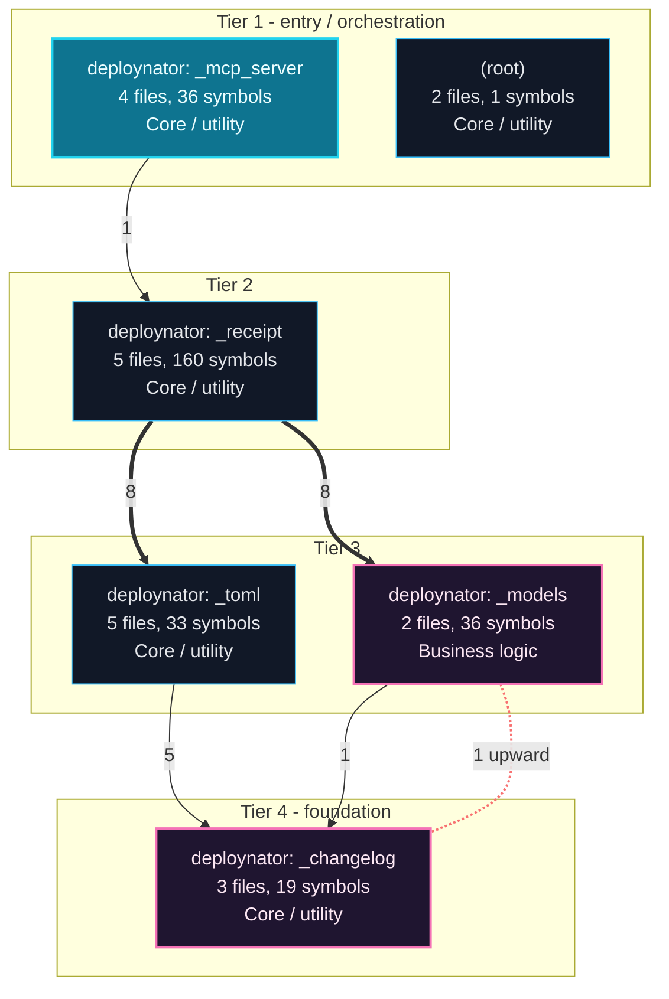

---

## Execution Flows

Entry points are scored from `__main__` guards, `main` functions, entry-style names and files, and call-graph sources. Each flow walks resolved calls in call-site order (depth <= 4, <= 40 steps); numbers give the call order, dashed arrows revisit an already expanded callee, red arrows are recursion. Interactive version with zoom and per-node docs: `readmenator-apidocs/index.html#/flows`.

### `app.main`

`app.py:12`, score 9: entry-style name `main`; defined in entry file `app.py`; called from the `__main__` guard.

Control flow:

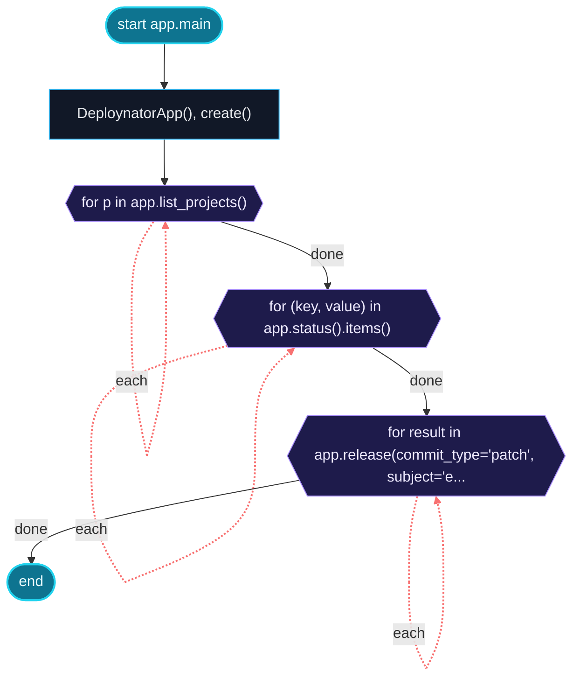

Call tree:

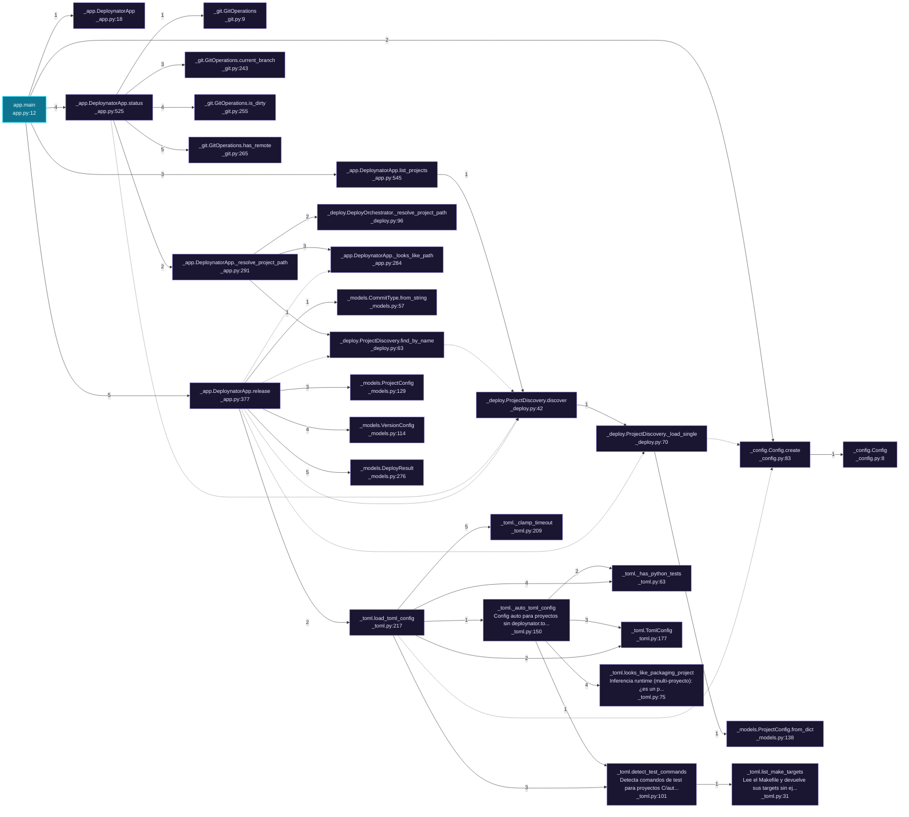

Cross-file sequence:

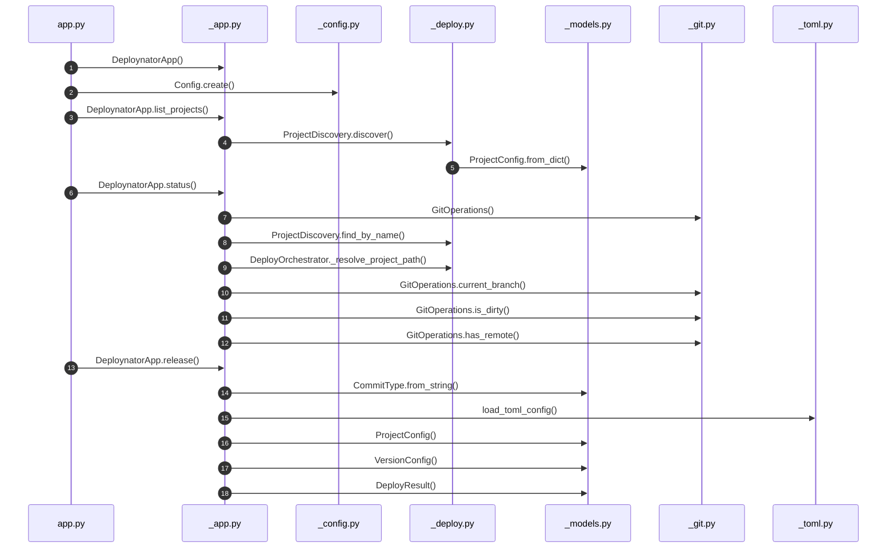

### `__main__.main`

`deploynator/__main__.py:185`, score 9: entry-style name `main`; defined in entry file `__main__.py`; called from the `__main__` guard.

Control flow:

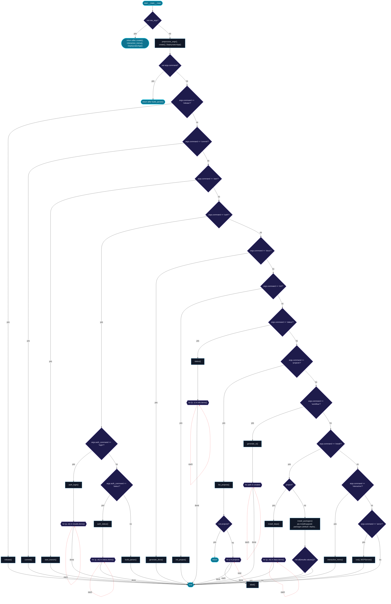

Call tree:

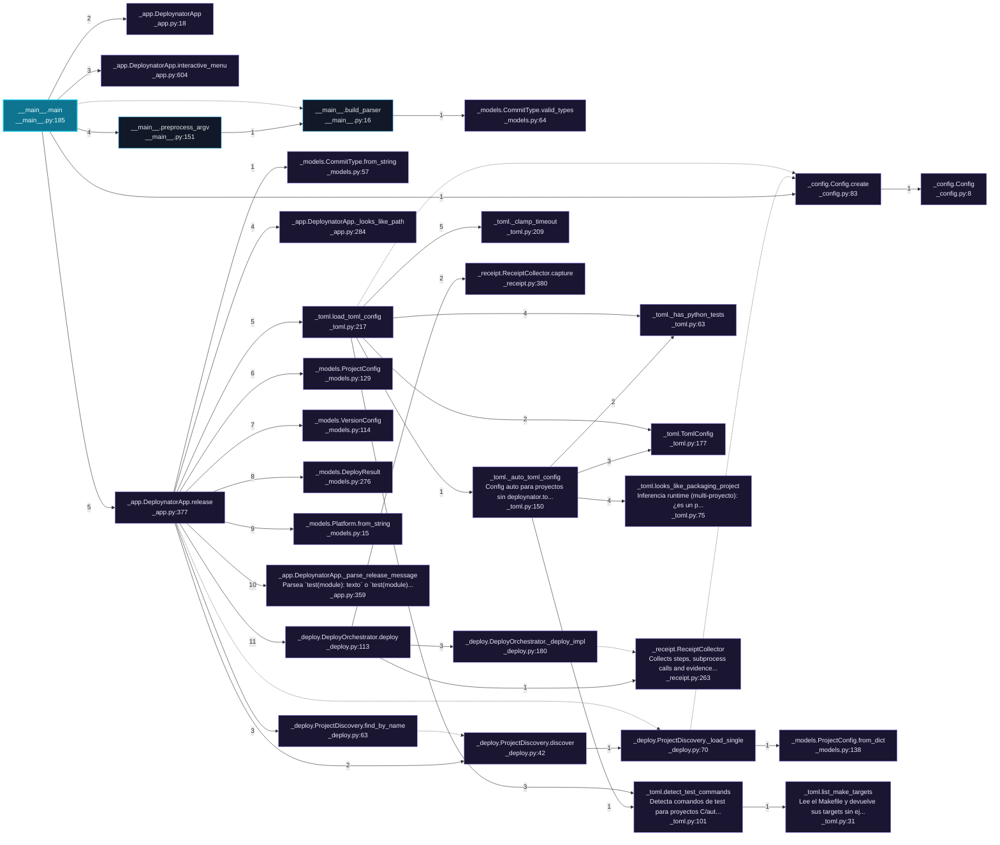

Cross-file sequence:

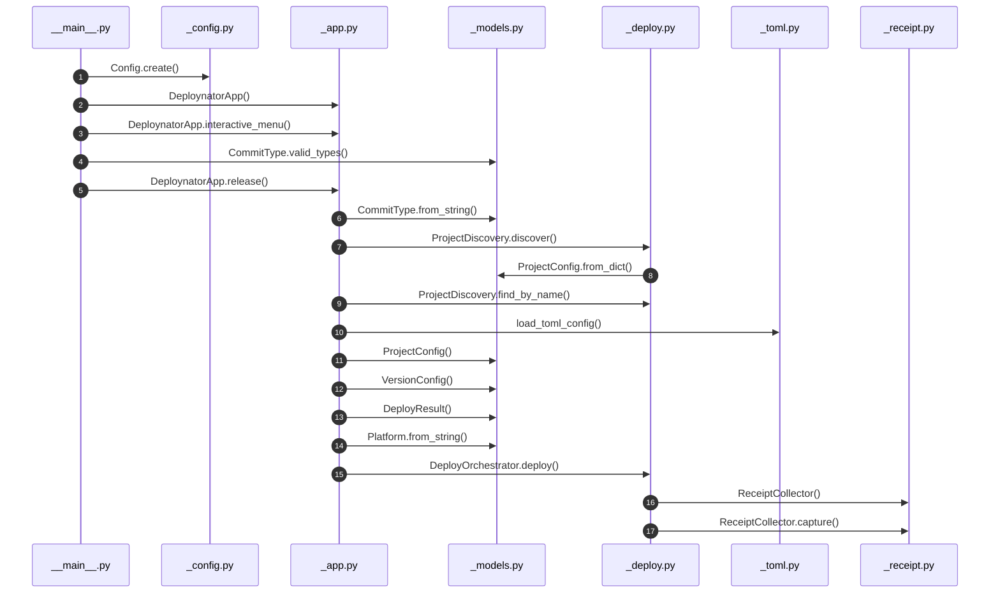

### `_mcp_server (__main__)`

`deploynator/_mcp_server.py:285`, score 8: `if __name__ == "__main__"` guard.

Call tree:


Cross-file sequence:

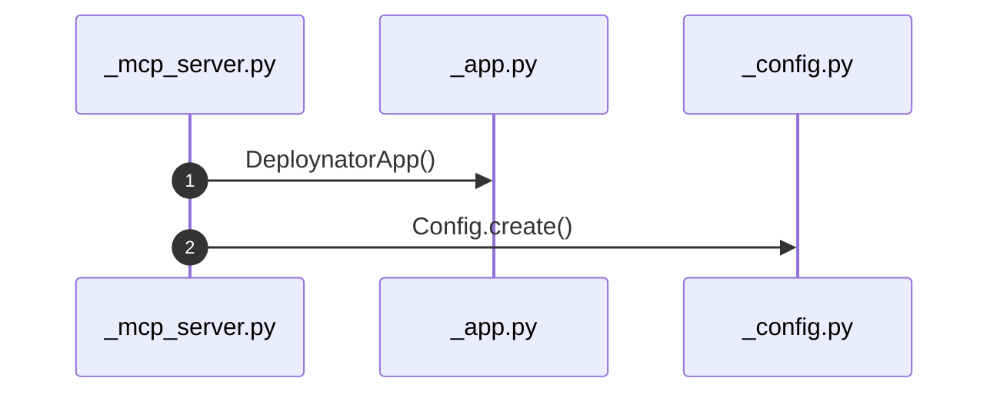

---

## Ranked Context

Files ranked by composite score for the current query context. The ranking combines Personalized PageRank (query relevance), global authority, test coverage, documentation coverage, and code freshness. Model: v1.0.

| Rank | File | Composite | PPR | Authority | Test | Doc |
|------|------|-----------|-----|-----------|------|-----|
| 1 | `deploy.sh` | 0.2000 | 0.0000 | 0.0000 | 0.00 | 2.00 |
| 2 | `_config.py` | 0.1714 | 0.2637 | 0.2637 | 0.00 | 0.00 |
| 3 | `test_readme_footer.py` | 0.1245 | 0.0120 | 0.0120 | 0.00 | 1.17 |
| 4 | `_readme.py` | 0.1127 | 0.0195 | 0.0195 | 0.00 | 1.00 |
| 5 | `app.py` | 0.1078 | 0.0120 | 0.0120 | 0.00 | 1.00 |
| 6 | `_toml.py` | 0.0848 | 0.0690 | 0.0690 | 0.00 | 0.40 |
| 7 | `bdd_test_deploy.py` | 0.0678 | 0.0120 | 0.0120 | 0.00 | 0.60 |
| 8 | `_models.py` | 0.0529 | 0.0813 | 0.0813 | 0.00 | 0.00 |
| 9 | `_receipt.py` | 0.0438 | 0.0173 | 0.0173 | 0.00 | 0.33 |
| 10 | `_deploy.py` | 0.0374 | 0.0374 | 0.0374 | 0.00 | 0.13 |

---

## God Nodes

Most architecturally central files ranked by combined import/export degree and symbol richness.

| File | Score | Connections | PageRank |
|------|-------|-------------|----------|
| `_config.py` | 64.6 | | 0.2637 |
| `_deploy.py` | 46.3 | | 0.0374 |
| `_models.py` | 32.7 | | 0.0813 |
| `_toml.py` | 29.0 | | 0.0690 |
| `_app.py` | 17.3 | | 0.0000 |
| `__init__.py` | 16.0 | | 0.0000 |
| `_semver.py` | 14.9 | | 0.0000 |
| `test_receipt.py` | 14.7 | | 0.0000 |
| `bdd_test_deploy.py` | 13.0 | | 0.0120 |
| `test_pypi.py` | 12.5 | | 0.0000 |

---

## Community Analysis

Files grouped by import-based community detection. Cohesion measures how tightly connected each community is internally.

### deploynator: _toml (Cohesion: 0.37)

**10 files** in this community:

- `_deb.py` (py, 9 symbols)
- `_docs.py` (py, 3 symbols)
- `_pypi.py` (py, 8 symbols)
- `_runner.py` (py, 3 symbols)
- `_toml.py` (py, 10 symbols)
- `bdd_test_deploy.py` (py, 10 symbols)
- `test_deb.py` (py, 24 symbols)
- `test_pypi.py` (py, 25 symbols)
- `test_runner.py` (py, 16 symbols)
- `test_toml.py` (py, 27 symbols)

### deploynator: _mcp_server (Cohesion: 0.50)

**7 files** in this community:

- `app.py` (py, 1 symbols)
- `__init__.py` (py, 0 symbols)
- `__main__.py` (py, 3 symbols)
- `_mcp_server.py` (py, 32 symbols)
- `test_cli_mcp.py` (py, 11 symbols)
- `test_init.py` (py, 6 symbols)
- `test_install_example.py` (py, 12 symbols)

### deploynator: _receipt (Cohesion: 0.26)

**7 files** in this community:

- `_app.py` (py, 33 symbols)
- `_deploy.py` (py, 23 symbols)
- `_git.py` (py, 25 symbols)
- `_platforms.py` (py, 36 symbols)
- `_receipt.py` (py, 43 symbols)
- `test_git_sync.py` (py, 6 symbols)
- `test_receipt.py` (py, 47 symbols)

### deploynator: _models (Cohesion: 0.31)

**7 files** in this community:

- `_models.py` (py, 27 symbols)
- `_semver.py` (py, 9 symbols)
- `test_deploy.py` (py, 11 symbols)
- `test_models.py` (py, 44 symbols)
- `test_path_deploy.py` (py, 10 symbols)
- `test_pipeline.py` (py, 12 symbols)
- `test_semver.py` (py, 11 symbols)

### deploynator: _changelog (Cohesion: 0.19)

**6 files** in this community:

- `_changelog.py` (py, 9 symbols)
- `_config.py` (py, 6 symbols)
- `_readme.py` (py, 4 symbols)
- `test_changelog.py` (py, 8 symbols)
- `test_config.py` (py, 10 symbols)
- `test_readme_footer.py` (py, 6 symbols)

---

## Surprising Connections

Files in different communities connected through 3+ indirect hops.

- `app.py` <-> `test_models.py` (4 hops, across 2 communities)
- `test_config.py` <-> `test_models.py` (4 hops, across 3 communities)
- `test_init.py` <-> `test_models.py` (4 hops, across 2 communities)
- `test_models.py` <-> `test_readme_footer.py` (4 hops, across 3 communities)
- `test_models.py` <-> `test_runner.py` (4 hops, across 4 communities)

---

## Suggested Questions

Auto-generated exploration prompts based on graph structure:

- What does _config.py depend on, and what depends on it? (32 connections)
- What does _deploy.py depend on, and what depends on it? (22 connections)
- What does _models.py depend on, and what depends on it? (15 connections)
- How are the 10 files in 'deploynator: _toml' related to each other?
- Why are app.py and test_models.py connected through 4 hops across 2 communities?

---

## Force-Graph Explorer

Heterogeneous explorer payload (files, communities, layers, externals) rendered with force-graph physics, stable family colors, log2 node sizing, and convex-hull community overlays. Open `readmenator-maps/graph-force.html` (linked from the maps gallery) or run `explorer`.

- Nodes: 79 (community: 5, external: 30, file: 40, layer: 4)
- Edges: 519

---

## Corpus Analytics

Attribution funnel and distributions for the explorer dashboard.

- Files: 40 | With symbols: 37 | Attributed: 37 | God nodes: 10 | Symbols: 581

- Layer `testing`: 19 files
- Layer `utility`: 19 files
- Layer `business_logic`: 1 files
- Layer `infrastructure`: 1 files

- Language `py`: 38 files
- Language `sh`: 2 files

---

## Taint Propagation Map

Taint analysis traces how dangerous imports propagate through the codebase via transitive dependencies. Source files import dangerous modules directly; sink files receive the danger indirectly.

**Taint Sources:** 1 | **Taint Sinks:** 15 | **Propagation Paths:** 20

- `_app.py` imports `subprocess` (0 hop to `_app.py`) [high]
  Path: _app.py
- `_app.py` imports `subprocess` (1 hop to `_models.py`) [high]
  Path: _app.py -> _models.py
- `_app.py` imports `subprocess` (1 hop to `_deploy.py`) [high]
  Path: _app.py -> _deploy.py
- `_app.py` imports `subprocess` (1 hop to `_config.py`) [high]
  Path: _app.py -> _config.py
- `_app.py` imports `subprocess` (1 hop to `_toml.py`) [high]
  Path: _app.py -> _toml.py
- `_app.py` imports `subprocess` (1 hop to `_git.py`) [high]
  Path: _app.py -> _git.py
- `_app.py` imports `subprocess` (1 hop to `_platforms.py`) [high]
  Path: _app.py -> _platforms.py
- `_app.py` imports `subprocess` (2 hops to `_pypi.py`) [high]
  Path: _app.py -> _deploy.py -> _pypi.py
- `_app.py` imports `subprocess` (2 hops to `_changelog.py`) [high]
  Path: _app.py -> _deploy.py -> _changelog.py
- `_app.py` imports `subprocess` (2 hops to `_runner.py`) [high]
  Path: _app.py -> _deploy.py -> _runner.py
- `_app.py` imports `subprocess` (2 hops to `_docs.py`) [high]
  Path: _app.py -> _deploy.py -> _docs.py
- `_app.py` imports `subprocess` (2 hops to `_receipt.py`) [high]
  Path: _app.py -> _deploy.py -> _receipt.py
- `_app.py` imports `subprocess` (2 hops to `_deb.py`) [high]
  Path: _app.py -> _deploy.py -> _deb.py
- `_app.py` imports `subprocess` (2 hops to `_readme.py`) [high]
  Path: _app.py -> _deploy.py -> _readme.py
- `_app.py` imports `subprocess` (2 hops to `_semver.py`) [high]
  Path: _app.py -> _deploy.py -> _semver.py
- `_app.py` imports `subprocess` (0 hop to `_app.py`) [high]
  Path: _app.py
- `_app.py` imports `subprocess` (1 hop to `_models.py`) [high]
  Path: _app.py -> _models.py
- `_app.py` imports `subprocess` (1 hop to `_deploy.py`) [high]
  Path: _app.py -> _deploy.py
- `_app.py` imports `subprocess` (1 hop to `_config.py`) [high]
  Path: _app.py -> _config.py
- `_app.py` imports `subprocess` (1 hop to `_toml.py`) [high]
  Path: _app.py -> _toml.py

---

## Hotspot Analysis

Files ranked by combined complexity (symbol count) and centrality (connection count). High-scoring files are architecturally critical and may need refactoring attention.

| File | Complexity | Centrality | Combined | Symbols | Connections |
|------|-----------|------------|----------|---------|-------------|
| `deploy.sh` | 0.021 | 0.000 | 0.009 | 1 | 0 |
| `_config.py` | 0.128 | 0.957 | 0.625 | 6 | 88 |
| `test_readme_footer.py` | 0.128 | 0.054 | 0.084 | 6 | 5 |
| `_readme.py` | 0.085 | 0.065 | 0.073 | 4 | 6 |
| `app.py` | 0.021 | 0.043 | 0.035 | 1 | 4 |
| `_toml.py` | 0.213 | 0.543 | 0.411 | 10 | 50 |
| `bdd_test_deploy.py` | 0.213 | 0.359 | 0.300 | 10 | 33 |
| `_models.py` | 0.575 | 0.359 | 0.445 | 27 | 33 |
| `_receipt.py` | 0.915 | 0.163 | 0.464 | 43 | 15 |
| `_deploy.py` | 0.489 | 0.576 | 0.541 | 23 | 53 |
| `test_pypi.py` | 0.532 | 1.000 | 0.813 | 25 | 92 |
| `test_deb.py` | 0.511 | 0.804 | 0.687 | 24 | 74 |
| `test_runner.py` | 0.340 | 0.717 | 0.567 | 16 | 66 |
| `_app.py` | 0.702 | 0.467 | 0.561 | 33 | 43 |
| `test_toml.py` | 0.575 | 0.522 | 0.543 | 27 | 48 |

---

## Concept Graph

Semantic second-brain layer: nouns are concept nodes, verbs are edges. Each noun maps atomically to a file set (EXTRACTED); each verb aggregates structural imports, calls, and inherits into consumes, invokes, extends, depends_on, or bridges (INFERRED).

**50 concepts, 100 relations.**

| Concept | Files | Mentions |
|---------|-------|----------|
| `deploynator` | 25 | 41 |
| `run` | 16 | 30 |
| `deploy` | 15 | 42 |
| `release` | 14 | 44 |
| `project` | 14 | 23 |
| `git` | 13 | 25 |
| `config` | 10 | 29 |
| `tag` | 9 | 17 |
| `default` | 9 | 12 |
| `current` | 9 | 11 |
| `toml` | 8 | 25 |
| `commit` | 8 | 21 |
| `path` | 8 | 16 |
| `failure` | 8 | 12 |
| `repo` | 8 | 12 |
| `red` | 8 | 8 |
| `version` | 7 | 27 |
| `docs` | 7 | 22 |
| `bump` | 7 | 18 |
| `build` | 7 | 17 |
| `install` | 7 | 17 |
| `file` | 7 | 14 |
| `make` | 7 | 12 |
| `empty` | 7 | 10 |
| `name` | 7 | 10 |
| `none` | 7 | 9 |
| `valid` | 7 | 9 |
| `platform` | 6 | 20 |
| `runner` | 6 | 15 |
| `type` | 6 | 15 |

### Verb Edges

| Source | Verb | Target | Strength | Evidence |
|--------|------|--------|----------|----------|
| `project` | `depends_on` | `deploynator` | 1.00 | 10 |
| `deploy` | `depends_on` | `deploynator` | 0.94 | 10 |
| `release` | `depends_on` | `deploynator` | 0.91 | 10 |
| `run` | `depends_on` | `deploynator` | 0.81 | 10 |
| `deploynator` | `depends_on` | `config` | 0.72 | 10 |
| `tag` | `depends_on` | `deploynator` | 0.67 | 10 |
| `git` | `depends_on` | `deploynator` | 0.65 | 10 |
| `failure` | `depends_on` | `deploynator` | 0.61 | 10 |
| `path` | `depends_on` | `deploynator` | 0.59 | 10 |
| `project` | `depends_on` | `config` | 0.59 | 10 |
| `run` | `depends_on` | `config` | 0.56 | 10 |
| `deploy` | `depends_on` | `config` | 0.54 | 10 |
| `docs` | `depends_on` | `deploynator` | 0.54 | 10 |
| `red` | `depends_on` | `deploynator` | 0.54 | 10 |
| `toml` | `depends_on` | `deploynator` | 0.54 | 10 |
| `deploynator` | `depends_on` | `create` | 0.50 | 10 |
| `empty` | `depends_on` | `deploynator` | 0.50 | 10 |
| `install` | `depends_on` | `deploynator` | 0.50 | 10 |
| `repo` | `depends_on` | `deploynator` | 0.50 | 10 |
| `default` | `depends_on` | `deploynator` | 0.48 | 10 |
| `deploynator` | `depends_on` | `path` | 0.48 | 10 |
| `release` | `depends_on` | `config` | 0.48 | 10 |
| `name` | `depends_on` | `deploynator` | 0.46 | 10 |
| `upload` | `depends_on` | `deploynator` | 0.46 | 10 |
| `current` | `depends_on` | `deploynator` | 0.44 | 10 |
| `file` | `depends_on` | `deploynator` | 0.44 | 10 |
| `load` | `depends_on` | `deploynator` | 0.44 | 10 |
| `not` | `depends_on` | `deploynator` | 0.44 | 10 |
| `para` | `depends_on` | `deploynator` | 0.44 | 10 |
| `build` | `depends_on` | `deploynator` | 0.43 | 10 |

### Dialectic Prompts

- Thesis: `build` centralizes 7 files; Antithesis: `command` pulls 6 files with 4 shared (Jaccard 0.44); Synthesis: should they merge, split by layer, or keep `bridges` explicit?
- Thesis: `build` centralizes 7 files; Antithesis: `default` pulls 9 files with 5 shared (Jaccard 0.45); Synthesis: should they merge, split by layer, or keep `bridges` explicit?
- Thesis: `build` centralizes 7 files; Antithesis: `dir` pulls 6 files with 4 shared (Jaccard 0.44); Synthesis: should they merge, split by layer, or keep `bridges` explicit?
- Thesis: `build` centralizes 7 files; Antithesis: `failure` pulls 8 files with 4 shared (Jaccard 0.36); Synthesis: should they merge, split by layer, or keep `bridges` explicit?
- Thesis: `build` centralizes 7 files; Antithesis: `load` pulls 6 files with 3 shared (Jaccard 0.30); Synthesis: should they merge, split by layer, or keep `bridges` explicit?
- Thesis: `build` centralizes 7 files; Antithesis: `make` pulls 7 files with 4 shared (Jaccard 0.40); Synthesis: should they merge, split by layer, or keep `bridges` explicit?
- Thesis: `build` centralizes 7 files; Antithesis: `not` pulls 6 files with 3 shared (Jaccard 0.30); Synthesis: should they merge, split by layer, or keep `bridges` explicit?
- Thesis: `build` centralizes 7 files; Antithesis: `packaging` pulls 5 files with 3 shared (Jaccard 0.33); Synthesis: should they merge, split by layer, or keep `bridges` explicit?
- Thesis: `build` centralizes 7 files; Antithesis: `project` pulls 14 files with 5 shared (Jaccard 0.31); Synthesis: should they merge, split by layer, or keep `bridges` explicit?
- Thesis: `build` centralizes 7 files; Antithesis: `runner` pulls 6 files with 3 shared (Jaccard 0.30); Synthesis: should they merge, split by layer, or keep `bridges` explicit?

---

## Change Impact Analysis

Files sorted by how many other files would be affected if they changed. High-impact files should be changed with caution.

| File | Direct Dependents | Transitive Dependents | Total Impact |
|------|------------------|----------------------|--------------|
| `_config.py` | 32 | 2 | 34 |
| `_models.py` | 15 | 8 | 23 |
| `_toml.py` | 13 | 10 | 23 |
| `_changelog.py` | 2 | 16 | 18 |
| `_docs.py` | 3 | 15 | 18 |
| `_readme.py` | 2 | 16 | 18 |
| `_runner.py` | 2 | 16 | 18 |
| `_semver.py` | 5 | 13 | 18 |
| `_deb.py` | 2 | 15 | 17 |
| `_git.py` | 3 | 14 | 17 |
| `_platforms.py` | 2 | 15 | 17 |
| `_pypi.py` | 2 | 15 | 17 |
| `_receipt.py` | 2 | 15 | 17 |
| `_deploy.py` | 9 | 7 | 16 |
| `_app.py` | 1 | 7 | 8 |

---

## Suggested Linting Rules

Automatically suggested linting and security rules based on patterns detected in the codebase. These can be exported as Semgrep rules using the `--export-rules` flag.

| Rule ID | Severity | Description | Language | Matches |
|---------|----------|-------------|----------|---------|
| `RM001` | info | Large number of functions in py: 492 total | py | 492 |
| `RM002` | info | Print statement found (consider logging instead) | python | 103 |

---

## Orphans

Files with no documentation or low connectivity. These are candidates for documentation investment or cleanup.

- `_config.py` (6 symbols, no doc)
- `_models.py` (27 symbols, no doc)
- `__init__.py` (0 symbols, no doc)
- `__main__.py` (3 symbols, no doc)
- `_changelog.py` (9 symbols, no doc)
- `_docs.py` (3 symbols, no doc)
- `_runner.py` (3 symbols, no doc)
- `_semver.py` (9 symbols, no doc)
- `install.sh` (0 symbols, no doc)
- `__init__.py` (0 symbols, no doc)
- `test_changelog.py` (8 symbols, no doc)
- `test_config.py` (10 symbols, no doc)
- `test_deploy.py` (11 symbols, no doc)
- `test_git_sync.py` (6 symbols, no doc)
- `test_models.py` (44 symbols, no doc)
- `test_receipt.py` (47 symbols, no doc)
- `test_semver.py` (11 symbols, no doc)

---

## Query Recipes

Example queries you can run against this knowledge base using the ranking engine:

```
# Find files most relevant to a concept
readmenator query "Where is the import resolver implemented?"

# Rank files by relevance to a topic
readmenator query "How does documentation generation work?"

# Explain why a file ranks highly
readmenator query "explain readmenator/_documentation.py"

# Trace dependency paths with ranked context
readmenator query "path from CLI to exporter"
```

The ranking model uses the following signals:

- **Personalized PageRank** (45% weight): query-specific relevance via seed propagation
- **Global Authority** (20% weight): structural importance via standard PageRank
- **Test Coverage** (15% weight): fraction of symbols referenced in test files
- **Doc Coverage** (10% weight): presence of docstrings and file-level docs
- **Freshness** (10% weight): recent modification activity

Results include score decomposition and justification paths for each ranked item.

---

## Structural Knowledge Map

> **Note:** The visual graph below has been intelligently pruned to the top 300 most relevant nodes to prevent rendering crashes. Full details of all files are documented in the Architecture Reference.

```mermaid
graph LR
    classDef mod fill:#1e1e1e,stroke:#ff6666,stroke-width:2px,color:#fff;
    classDef cls fill:#2d2d2d,stroke:#4ec9b0,stroke-width:2px,color:#fff;
    classDef fn fill:#333,stroke:#dcdcaa,stroke-width:1px,color:#dcdcaa;
    classDef ext fill:#111,stroke:#666,stroke-dasharray:5 5,color:#aaa;
    subgraph community_0 ["deploynator: _toml"]
    tests_test_pypi_py["test_pypi.py (py)"]
    class tests_test_pypi_py mod;
    tests_test_pypi_py__isolated_home["_isolated_home"]
    class tests_test_pypi_py__isolated_home fn;
    tests_test_pypi_py --> tests_test_pypi_py__isolated_home
    tests_test_pypi_py__git_init["_git_init"]
    class tests_test_pypi_py__git_init fn;
    tests_test_pypi_py --> tests_test_pypi_py__git_init
    tests_test_pypi_py_TestDetect["TestDetect"]
    class tests_test_pypi_py_TestDetect cls;
    tests_test_pypi_py --> tests_test_pypi_py_TestDetect
    tests_test_pypi_py_TestPromptCredentials["TestPromptCredentials"]
    class tests_test_pypi_py_TestPromptCredentials cls;
    tests_test_pypi_py --> tests_test_pypi_py_TestPromptCredentials
    tests_test_pypi_py_TestCleanAndRun["TestCleanAndRun"]
    class tests_test_pypi_py_TestCleanAndRun cls;
    tests_test_pypi_py --> tests_test_pypi_py_TestCleanAndRun
    tests_test_deb_py["test_deb.py (py)"]
    class tests_test_deb_py mod;
    tests_test_runner_py["test_runner.py (py)"]
    class tests_test_runner_py mod;
    tests_test_toml_py["test_toml.py (py)"]
    class tests_test_toml_py mod;
    end
    subgraph community_2 ["deploynator: _receipt"]
    deploynator__app_py["_app.py (py)"]
    class deploynator__app_py mod;
    deploynator__deploy_py["_deploy.py (py)"]
    class deploynator__deploy_py mod;
    tests_bdd_test_deploy_py["bdd_test_deploy.py (py)"]
    class tests_bdd_test_deploy_py mod;
    end
    subgraph community_3 ["deploynator: _models"]
    tests_test_path_deploy_py["test_path_deploy.py (py)"]
    class tests_test_path_deploy_py mod;
    end
    subgraph community_1 ["deploynator: _mcp_server"]
    tests_test_init_py["test_init.py (py)"]
    class tests_test_init_py mod;
    tests_test_pipeline_py["test_pipeline.py (py)"]
    class tests_test_pipeline_py mod;
    tests_test_cli_mcp_py["test_cli_mcp.py (py)"]
    class tests_test_cli_mcp_py mod;
    tests_test_install_example_py["test_install_example.py (py)"]
    class tests_test_install_example_py mod;
    tests_test_receipt_py["test_receipt.py (py)"]
    class tests_test_receipt_py mod;
    deploynator__pypi_py["_pypi.py (py)"]
    class deploynator__pypi_py mod;
    deploynator__receipt_py["_receipt.py (py)"]
    class deploynator__receipt_py mod;
    tests_test_deploy_py["test_deploy.py (py)"]
    class tests_test_deploy_py mod;
    deploynator___main___py["__main__.py (py)"]
    class deploynator___main___py mod;
    deploynator__platforms_py["_platforms.py (py)"]
    class deploynator__platforms_py mod;
    deploynator__mcp_server_py["_mcp_server.py (py)"]
    class deploynator__mcp_server_py mod;
    tests_test_semver_py["test_semver.py (py)"]
    class tests_test_semver_py mod;
    deploynator__deb_py["_deb.py (py)"]
    class deploynator__deb_py mod;
    deploynator__semver_py["_semver.py (py)"]
    class deploynator__semver_py mod;
    tests_test_git_sync_py["test_git_sync.py (py)"]
    class tests_test_git_sync_py mod;
    deploynator__toml_py["_toml.py (py)"]
    class deploynator__toml_py mod;
    end
    subgraph community_4 ["deploynator: _changelog"]
    deploynator__changelog_py["_changelog.py (py)"]
    class deploynator__changelog_py mod;
    deploynator__runner_py["_runner.py (py)"]
    class deploynator__runner_py mod;
    deploynator__docs_py["_docs.py (py)"]
    class deploynator__docs_py mod;
    deploynator__git_py["_git.py (py)"]
    class deploynator__git_py mod;
    tests_test_config_py["test_config.py (py)"]
    class tests_test_config_py mod;
    deploynator__models_py["_models.py (py)"]
    class deploynator__models_py mod;
    tests_test_changelog_py["test_changelog.py (py)"]
    class tests_test_changelog_py mod;
    tests_test_readme_footer_py["test_readme_footer.py (py)"]
    class tests_test_readme_footer_py mod;
    deploynator__readme_py["_readme.py (py)"]
    class deploynator__readme_py mod;
    app_py["app.py (py)"]
    class app_py mod;
    tests_test_models_py["test_models.py (py)"]
    class tests_test_models_py mod;
    deploynator__config_py["_config.py (py)"]
    class deploynator__config_py mod;
    deploynator___init___py["__init__.py (py)"]
    class deploynator___init___py mod;
    deploy_sh["deploy.sh (sh)"]
    class deploy_sh mod;
    install_sh["install.sh (sh)"]
    class install_sh mod;
    tests___init___py["__init__.py (py)"]
    class tests___init___py mod;
    end
    tests_test_pypi_py ~~~ deploynator__deb_py
    tests_test_deb_py ~~~ deploynator__toml_py
    tests_test_runner_py ~~~ deploynator__runner_py
    tests_test_toml_py ~~~ deploynator__docs_py
    deploynator__app_py ~~~ deploynator__git_py
    tests_test_path_deploy_py ~~~ tests_test_models_py
    tests_test_init_py ~~~ deploynator___init___py
    app_py -- resolved_imports --> deploynator___init___py
    app_py -- resolved_imports --> deploynator__config_py
    deploynator___init___py -- resolved_imports --> deploynator__app_py
    deploynator___main___py -- resolved_imports --> deploynator___init___py
    deploynator___main___py -- resolved_imports --> deploynator__config_py
    deploynator___main___py -- resolved_imports --> deploynator__models_py
    deploynator___main___py -- resolved_imports --> deploynator__mcp_server_py
    deploynator__app_py -- resolved_imports --> deploynator__config_py
    deploynator__app_py -- resolved_imports --> deploynator__deploy_py
    deploynator__app_py -- resolved_imports --> deploynator__models_py
    deploynator__app_py -- resolved_imports --> deploynator__platforms_py
    deploynator__app_py -- resolved_imports --> deploynator__git_py
    deploynator__app_py -- resolved_imports --> deploynator__models_py
    deploynator__app_py -- resolved_imports --> deploynator__git_py
    deploynator__app_py -- resolved_imports --> deploynator__git_py
    deploynator__app_py -- resolved_imports --> deploynator__models_py
    deploynator__app_py -- resolved_imports --> deploynator__models_py
    deploynator__app_py -- resolved_imports --> deploynator__git_py
    deploynator__app_py -- resolved_imports --> deploynator__toml_py
    deploynator__app_py -- resolved_imports --> deploynator__deploy_py
    deploynator__app_py -- resolved_imports --> deploynator__deploy_py
    deploynator__app_py -- resolved_imports --> deploynator__toml_py
    deploynator__app_py -- resolved_imports --> deploynator__models_py
    deploynator__app_py -- resolved_imports --> deploynator__toml_py
    deploynator__changelog_py -- resolved_imports --> deploynator__config_py
    deploynator__changelog_py -- resolved_imports --> deploynator__models_py
    deploynator__deb_py -- resolved_imports --> deploynator__config_py
    deploynator__deb_py -- resolved_imports --> deploynator__toml_py
    deploynator__deploy_py -- resolved_imports --> deploynator__changelog_py
    deploynator__deploy_py -- resolved_imports --> deploynator__config_py
    deploynator__deploy_py -- resolved_imports --> deploynator__deb_py
    deploynator__deploy_py -- resolved_imports --> deploynator__docs_py
    deploynator__deploy_py -- resolved_imports --> deploynator__git_py
    deploynator__deploy_py -- resolved_imports --> deploynator__models_py
    deploynator__deploy_py -- resolved_imports --> deploynator__platforms_py
    deploynator__deploy_py -- resolved_imports --> deploynator__pypi_py
    deploynator__deploy_py -- resolved_imports --> deploynator__receipt_py
    deploynator__deploy_py -- resolved_imports --> deploynator__runner_py
    deploynator__deploy_py -- resolved_imports --> deploynator__semver_py
    deploynator__deploy_py -- resolved_imports --> deploynator__toml_py
    deploynator__deploy_py -- resolved_imports --> deploynator__readme_py
    deploynator__docs_py -- resolved_imports --> deploynator__config_py
    deploynator__docs_py -- resolved_imports --> deploynator__toml_py
    deploynator__git_py -- resolved_imports --> deploynator__config_py
    deploynator__mcp_server_py -- resolved_imports --> deploynator___init___py
    deploynator__mcp_server_py -- resolved_imports --> deploynator__config_py
    deploynator__platforms_py -- resolved_imports --> deploynator__config_py
    deploynator__platforms_py -- resolved_imports --> deploynator__models_py
    deploynator__pypi_py -- resolved_imports --> deploynator__config_py
    deploynator__pypi_py -- resolved_imports --> deploynator__toml_py
    deploynator__readme_py -- resolved_imports --> deploynator__config_py
    deploynator__receipt_py -- resolved_imports --> deploynator__config_py
    deploynator__runner_py -- resolved_imports --> deploynator__config_py
    deploynator__runner_py -- resolved_imports --> deploynator__toml_py
    deploynator__semver_py -- resolved_imports --> deploynator__config_py
    deploynator__semver_py -- resolved_imports --> deploynator__models_py
    deploynator__toml_py -- resolved_imports --> deploynator__config_py
    tests_bdd_test_deploy_py -- resolved_imports --> deploynator__models_py
    tests_bdd_test_deploy_py -- resolved_imports --> deploynator__models_py
    tests_bdd_test_deploy_py -- resolved_imports --> deploynator__models_py
    tests_bdd_test_deploy_py -- resolved_imports --> deploynator__config_py
    tests_bdd_test_deploy_py -- resolved_imports --> deploynator__deploy_py
    tests_bdd_test_deploy_py -- resolved_imports --> deploynator__models_py
    tests_bdd_test_deploy_py -- resolved_imports --> deploynator__config_py
    tests_bdd_test_deploy_py -- resolved_imports --> deploynator__docs_py
    tests_bdd_test_deploy_py -- resolved_imports --> deploynator__toml_py
    tests_bdd_test_deploy_py -- resolved_imports --> deploynator__models_py
    tests_bdd_test_deploy_py -- resolved_imports --> deploynator__config_py
    tests_bdd_test_deploy_py -- resolved_imports --> deploynator__semver_py
    tests_test_changelog_py -- resolved_imports --> deploynator__changelog_py
    tests_test_changelog_py -- resolved_imports --> deploynator__config_py
    tests_test_cli_mcp_py -- resolved_imports --> deploynator___init___py
    tests_test_cli_mcp_py -- resolved_imports --> deploynator___main___py
    tests_test_cli_mcp_py -- resolved_imports --> deploynator___main___py
    tests_test_cli_mcp_py -- resolved_imports --> deploynator___main___py
    tests_test_cli_mcp_py -- resolved_imports --> deploynator___init___py
    tests_test_cli_mcp_py -- resolved_imports --> deploynator__config_py
    tests_test_cli_mcp_py -- resolved_imports --> deploynator__mcp_server_py
    tests_test_cli_mcp_py -- resolved_imports --> deploynator__mcp_server_py
    tests_test_cli_mcp_py -- resolved_imports --> deploynator__mcp_server_py
    tests_test_cli_mcp_py -- resolved_imports --> deploynator__mcp_server_py
    tests_test_cli_mcp_py -- resolved_imports --> deploynator__mcp_server_py
    tests_test_config_py -- resolved_imports --> deploynator__config_py
    tests_test_deb_py -- resolved_imports --> deploynator__toml_py
    tests_test_deb_py -- resolved_imports --> deploynator__config_py
    tests_test_deb_py -- resolved_imports --> deploynator__deb_py
    tests_test_deb_py -- resolved_imports --> deploynator__config_py
    tests_test_deb_py -- resolved_imports --> deploynator__deb_py
    tests_test_deb_py -- resolved_imports --> deploynator__config_py
    tests_test_deb_py -- resolved_imports --> deploynator__deb_py
    tests_test_deb_py -- resolved_imports --> deploynator__config_py
    tests_test_deb_py -- resolved_imports --> deploynator__deb_py
    tests_test_deb_py -- resolved_imports --> deploynator__deb_py
    tests_test_deb_py -- resolved_imports --> deploynator__config_py
    tests_test_deb_py -- resolved_imports --> deploynator__deb_py
    tests_test_deb_py -- resolved_imports --> deploynator__config_py
    tests_test_deb_py -- resolved_imports --> deploynator__deb_py
    tests_test_deb_py -- resolved_imports --> deploynator__config_py
    tests_test_deb_py -- resolved_imports --> deploynator__deb_py
    tests_test_deb_py -- resolved_imports --> deploynator__config_py
    ext_deploynator["deploynator"]
    class ext_deploynator ext;
    app_py -.->|imports| ext_deploynator
    ext_deploynator__config["deploynator._config"]
    class ext_deploynator__config ext;
    app_py -.->|imports| ext_deploynator__config
    ext_deploynator__app["deploynator._app"]
    class ext_deploynator__app ext;
    deploynator___init___py -.->|imports| ext_deploynator__app
    ext___future__["__future__"]
    class ext___future__ ext;
    deploynator___main___py -.->|imports| ext___future__
    ext_argparse["argparse"]
    class ext_argparse ext;
    deploynator___main___py -.->|imports| ext_argparse
    ext_sys["sys"]
    class ext_sys ext;
    deploynator___main___py -.->|imports| ext_sys
    deploynator___main___py -.->|imports| ext_deploynator
    deploynator___main___py -.->|imports| ext_deploynator__config
    ext_deploynator__models["deploynator._models"]
    class ext_deploynator__models ext;
    deploynator___main___py -.->|imports| ext_deploynator__models
    ext_deploynator__mcp_server["deploynator._mcp_server"]
    class ext_deploynator__mcp_server ext;
    deploynator___main___py -.->|imports| ext_deploynator__mcp_server
    deploynator__app_py -.->|imports| ext___future__
    ext_os["os"]
    class ext_os ext;
    deploynator__app_py -.->|imports| ext_os
    ext_re["re"]
    class ext_re ext;
    deploynator__app_py -.->|imports| ext_re
    deploynator__app_py -.->|imports| ext_sys
    deploynator__app_py -.->|imports| ext_deploynator__config
    ext_deploynator__deploy["deploynator._deploy"]
    class ext_deploynator__deploy ext;
    deploynator__app_py -.->|imports| ext_deploynator__deploy
    deploynator__app_py -.->|imports| ext_deploynator__models
    ext_deploynator__platforms["deploynator._platforms"]
    class ext_deploynator__platforms ext;
    deploynator__app_py -.->|imports| ext_deploynator__platforms
    ext_subprocess["subprocess"]
    class ext_subprocess ext;
    deploynator__app_py -.->|imports| ext_subprocess
    deploynator__app_py -.->|imports| ext_subprocess
    ext_deploynator__git["deploynator._git"]
    class ext_deploynator__git ext;
    deploynator__app_py -.->|imports| ext_deploynator__git
    deploynator__app_py -.->|imports| ext_deploynator__models
    deploynator__app_py -.->|imports| ext_deploynator__git
    deploynator__app_py -.->|imports| ext_deploynator__git
    deploynator__app_py -.->|imports| ext_deploynator__models
    deploynator__app_py -.->|imports| ext_re
    deploynator__app_py -.->|imports| ext_deploynator__models
    deploynator__app_py -.->|imports| ext_deploynator__git
    deploynator__app_py -.->|imports| ext_subprocess
    ext_deploynator__toml["deploynator._toml"]
    class ext_deploynator__toml ext;
    deploynator__app_py -.->|imports| ext_deploynator__toml
    deploynator__app_py -.->|imports| ext_deploynator__deploy
    deploynator__app_py -.->|imports| ext_deploynator__deploy
    deploynator__app_py -.->|imports| ext_deploynator__toml
    deploynator__app_py -.->|imports| ext_deploynator__models
    deploynator__app_py -.->|imports| ext_deploynator__toml
    deploynator__changelog_py -.->|imports| ext___future__
    deploynator__changelog_py -.->|imports| ext_os
    deploynator__changelog_py -.->|imports| ext_subprocess
    ext_collections["collections"]
    class ext_collections ext;
    deploynator__changelog_py -.->|imports| ext_collections
    deploynator__changelog_py -.->|imports| ext_deploynator__config
    deploynator__changelog_py -.->|imports| ext_deploynator__models
    deploynator__config_py -.->|imports| ext___future__
    deploynator__config_py -.->|imports| ext_os
    ext_dataclasses["dataclasses"]
    class ext_dataclasses ext;
    deploynator__config_py -.->|imports| ext_dataclasses
    deploynator__deb_py -.->|imports| ext___future__
    deploynator__deb_py -.->|imports| ext_os
    ext_shlex["shlex"]
    class ext_shlex ext;
    deploynator__deb_py -.->|imports| ext_shlex
    ext_shutil["shutil"]
    class ext_shutil ext;
    deploynator__deb_py -.->|imports| ext_shutil
    deploynator__deb_py -.->|imports| ext_subprocess
    deploynator__deb_py -.->|imports| ext_deploynator__config
    deploynator__deb_py -.->|imports| ext_deploynator__toml
    deploynator__deploy_py -.->|imports| ext___future__
    deploynator__deploy_py -.->|imports| ext_os
    deploynator__deploy_py -.->|imports| ext_shutil
    deploynator__deploy_py -.->|imports| ext_subprocess
    ext_tempfile["tempfile"]
    class ext_tempfile ext;
    deploynator__deploy_py -.->|imports| ext_tempfile
    ext_deploynator__changelog["deploynator._changelog"]
    class ext_deploynator__changelog ext;
    deploynator__deploy_py -.->|imports| ext_deploynator__changelog
    deploynator__deploy_py -.->|imports| ext_deploynator__config
    ext_deploynator__deb["deploynator._deb"]
    class ext_deploynator__deb ext;
    deploynator__deploy_py -.->|imports| ext_deploynator__deb
    ext_deploynator__docs["deploynator._docs"]
    class ext_deploynator__docs ext;
    deploynator__deploy_py -.->|imports| ext_deploynator__docs
    deploynator__deploy_py -.->|imports| ext_deploynator__git
    deploynator__deploy_py -.->|imports| ext_deploynator__models
    deploynator__deploy_py -.->|imports| ext_deploynator__platforms
    ext_deploynator__pypi["deploynator._pypi"]
    class ext_deploynator__pypi ext;
    deploynator__deploy_py -.->|imports| ext_deploynator__pypi
```

---

## UML Class Diagram

Auto-generated Mermaid class diagrams from parsed class-level symbols, split into groups of at most 6 classes so each diagram stays readable. Per-module class diagrams with exact members live in `readmenator-apidocs/modules/`.

#### `deploynator/_app.py`, `deploynator/_changelog.py`, `deploynator/_config.py`, `deploynator/_deb.py`, `deploynator/_deploy.py`

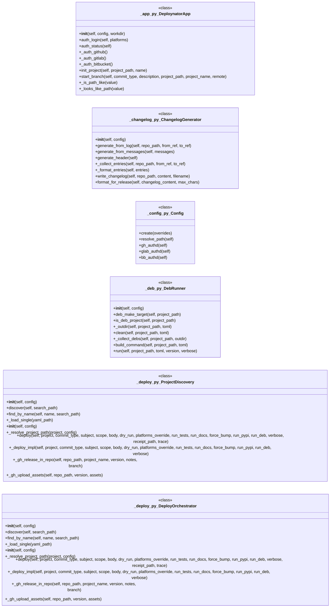

#### `deploynator/_docs.py`, `deploynator/_git.py`, `deploynator/_mcp_server.py`

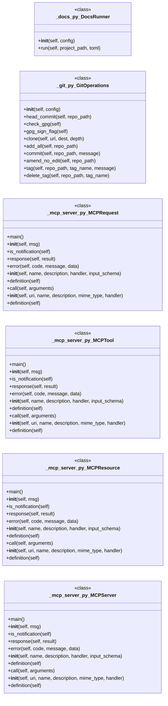

#### `deploynator/_models.py`

```mermaid
classDiagram
  direction LR
  class _models_py_Platform {
    <<class>>
    +from_string(cls, name)
    +label(self)
    +cli_name(self)
    +auth_env_var(self)
    +from_string(cls, value)
    +valid_types(cls)
    +bump_strategy(self)
    +section_header(self)
    +from_dict(cls, data)
    +from_dict(cls, data)
  }
  class _models_py_CommitType {
    <<class>>
    +from_string(cls, name)
    +label(self)
    +cli_name(self)
    +auth_env_var(self)
    +from_string(cls, value)
    +valid_types(cls)
    +bump_strategy(self)
    +section_header(self)
    +from_dict(cls, data)
    +from_dict(cls, data)
  }
  class _models_py_PlatformConfig {
    <<class>>
    +from_string(cls, name)
    +label(self)
    +cli_name(self)
    +auth_env_var(self)
    +from_string(cls, value)
    +valid_types(cls)
    +bump_strategy(self)
    +section_header(self)
    +from_dict(cls, data)
    +from_dict(cls, data)
  }
  class _models_py_VersionConfig {
    <<class>>
    +from_string(cls, name)
    +label(self)
    +cli_name(self)
    +auth_env_var(self)
    +from_string(cls, value)
    +valid_types(cls)
    +bump_strategy(self)
    +section_header(self)
    +from_dict(cls, data)
    +from_dict(cls, data)
  }
  class _models_py_ProjectConfig {
    <<class>>
    +from_string(cls, name)
    +label(self)
    +cli_name(self)
    +auth_env_var(self)
    +from_string(cls, value)
    +valid_types(cls)
    +bump_strategy(self)
    +section_header(self)
    +from_dict(cls, data)
    +from_dict(cls, data)
  }
  class _models_py_CommitMessage {
    <<class>>
    +from_string(cls, name)
    +label(self)
    +cli_name(self)
    +auth_env_var(self)
    +from_string(cls, value)
    +valid_types(cls)
    +bump_strategy(self)
    +section_header(self)
    +from_dict(cls, data)
    +from_dict(cls, data)
  }
  class _models_py_VersionInfo {
    <<class>>
    +from_string(cls, name)
    +label(self)
    +cli_name(self)
    +auth_env_var(self)
    +from_string(cls, value)
    +valid_types(cls)
    +bump_strategy(self)
    +section_header(self)
    +from_dict(cls, data)
    +from_dict(cls, data)
  }
  class _models_py_ChangelogEntry {
    <<class>>
    +from_string(cls, name)
    +label(self)
    +cli_name(self)
    +auth_env_var(self)
    +from_string(cls, value)
    +valid_types(cls)
    +bump_strategy(self)
    +section_header(self)
    +from_dict(cls, data)
    +from_dict(cls, data)
  }
  class _models_py_ReleaseInfo {
    <<class>>
    +from_string(cls, name)
    +label(self)
    +cli_name(self)
    +auth_env_var(self)
    +from_string(cls, value)
    +valid_types(cls)
    +bump_strategy(self)
    +section_header(self)
    +from_dict(cls, data)
    +from_dict(cls, data)
  }
  class _models_py_DeployResult {
    <<class>>
    +from_string(cls, name)
    +label(self)
    +cli_name(self)
    +auth_env_var(self)
    +from_string(cls, value)
    +valid_types(cls)
    +bump_strategy(self)
    +section_header(self)
    +from_dict(cls, data)
    +from_dict(cls, data)
  }
```

#### `deploynator/_platforms.py`, `deploynator/_pypi.py`

```mermaid
classDiagram
  direction LR
  class _platforms_py_PlatformClient {
    <<class>>
    +__init__(self, config)
    +name(self)
    +is_available(self)
    +is_authenticated(self)
    +create_release(self, repo, release)
    +create_pull_request(self, repo, title, body, head, base)
    +push_changes(self, repo_path, remote, branch, tags)
    +upload_release_assets(self, repo, version, assets)
    +_run(self, cmd, cwd, check)
    +name(self)
  }
  class _platforms_py_GitHubCLI {
    <<class>>
    +__init__(self, config)
    +name(self)
    +is_available(self)
    +is_authenticated(self)
    +create_release(self, repo, release)
    +create_pull_request(self, repo, title, body, head, base)
    +push_changes(self, repo_path, remote, branch, tags)
    +upload_release_assets(self, repo, version, assets)
    +_run(self, cmd, cwd, check)
    +name(self)
  }
  class _platforms_py_GitLabCLI {
    <<class>>
    +__init__(self, config)
    +name(self)
    +is_available(self)
    +is_authenticated(self)
    +create_release(self, repo, release)
    +create_pull_request(self, repo, title, body, head, base)
    +push_changes(self, repo_path, remote, branch, tags)
    +upload_release_assets(self, repo, version, assets)
    +_run(self, cmd, cwd, check)
    +name(self)
  }
  class _platforms_py_BitbucketCLI {
    <<class>>
    +__init__(self, config)
    +name(self)
    +is_available(self)
    +is_authenticated(self)
    +create_release(self, repo, release)
    +create_pull_request(self, repo, title, body, head, base)
    +push_changes(self, repo_path, remote, branch, tags)
    +upload_release_assets(self, repo, version, assets)
    +_run(self, cmd, cwd, check)
    +name(self)
  }
  class _platforms_py_PlatformFactory {
    <<class>>
    +__init__(self, config)
    +name(self)
    +is_available(self)
    +is_authenticated(self)
    +create_release(self, repo, release)
    +create_pull_request(self, repo, title, body, head, base)
    +push_changes(self, repo_path, remote, branch, tags)
    +upload_release_assets(self, repo, version, assets)
    +_run(self, cmd, cwd, check)
    +name(self)
  }
  class _pypi_py_PyPIRunner {
    <<class>>
    +__init__(self, config)
    +is_packaging_project(self, project_path)
    +has_credentials(self)
    +prompt_for_credentials(self)
    +save_pypirc(self, token, path)
    +clean(self, project_path, toml)
    +run(self, project_path, toml, version, token, verbose)
  }
```

#### `deploynator/_receipt.py`

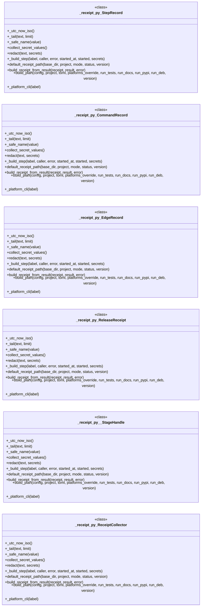

#### `deploynator/_runner.py`, `deploynator/_semver.py`, `deploynator/_toml.py`, `tests/bdd_test_deploy.py`, `tests/test_changelog.py`

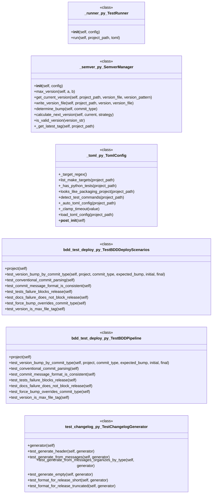

#### `tests/test_cli_mcp.py`, `tests/test_config.py`

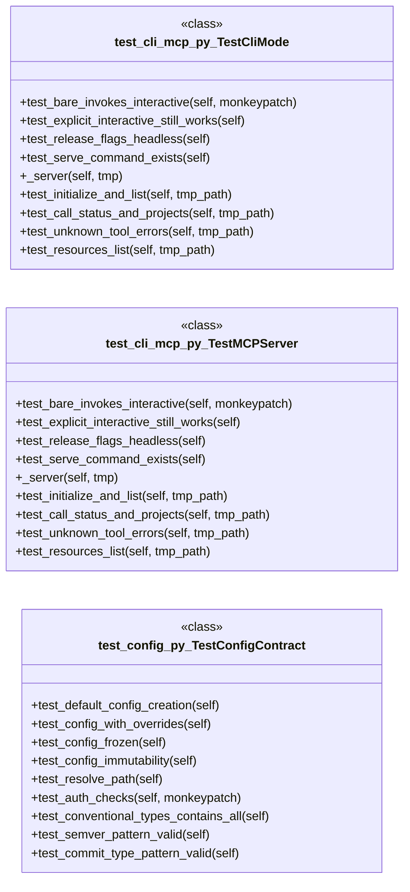

#### `tests/test_deb.py`

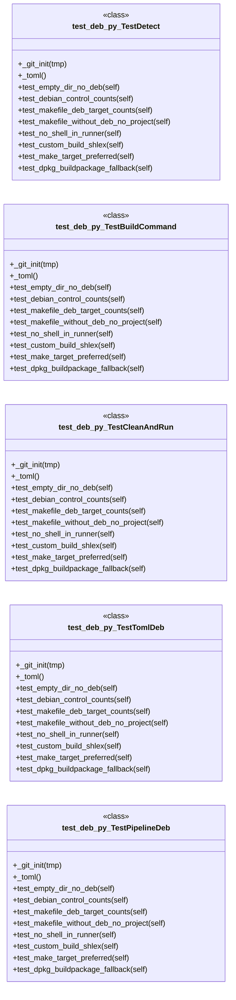

#### `tests/test_deploy.py`

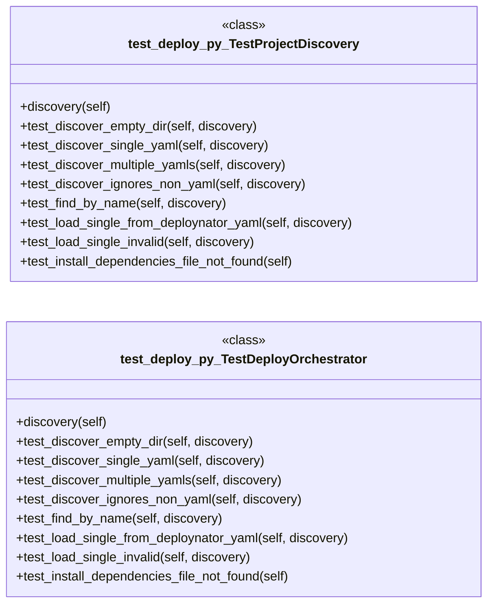

---

## Code Property Graph

Machine-readable Code Property Graph (CPG) in JSON-LD format. This block allows AI agents to parse the full structural graph without additional file reads. Compatible with GraphRAG pipelines.

```json
{"@context": "https://schema.org", "analysis": {"communities": [{"cohesion": 0.368, "id": 0, "label": "deploynator: _toml", "size": 10}, {"cohesion": 0.5, "id": 1, "label": "deploynator: _mcp_server", "size": 7}, {"cohesion": 0.263, "id": 2, "label": "deploynator: _receipt", "size": 7}, {"cohesion": 0.31, "id": 3, "label": "deploynator: _models", "size": 7}, {"cohesion": 0.189, "id": 4, "label": "deploynator: _changelog", "size": 6}], "god_nodes": [{"node_id": "deploynator/_config.py", "score": 64.6}, {"node_id": "deploynator/_deploy.py", "score": 46.3}, {"node_id": "deploynator/_models.py", "score": 32.7}, {"node_id": "deploynator/_toml.py", "score": 29.0}, {"node_id": "deploynator/_app.py", "score": 17.3}, {"node_id": "deploynator/__init__.py", "score": 16.0}, {"node_id": "deploynator/_semver.py", "score": 14.9}, {"node_id": "tests/test_receipt.py", "score": 14.7}, {"node_id": "tests/bdd_test_deploy.py", "score": 13.0}, {"node_id": "tests/test_pypi.py", "score": 12.5}], "surprising_connections": [{"hops": 4, "source": "app.py", "target": "tests/test_models.py"}, {"hops": 4, "source": "tests/test_config.py", "target": "tests/test_models.py"}, {"hops": 4, "source": "tests/test_init.py", "target": "tests/test_models.py"}, {"hops": 4, "source": "tests/test_models.py", "target": "tests/test_readme_footer.py"}, {"hops": 4, "source": "tests/test_models.py", "target": "tests/test_runner.py"}]}, "edges": [{"confidence": "EXTRACTED", "relation": "imports", "source": "app.py", "target": "deploynator"}, {"confidence": "EXTRACTED", "relation": "imports", "source": "app.py", "target": "deploynator._config"}, {"confidence": "EXTRACTED", "relation": "imports", "source": "deploynator/__init__.py", "target": "deploynator._app"}, {"confidence": "EXTRACTED", "relation": "imports", "source": "deploynator/__main__.py", "target": "__future__"}, {"confidence": "EXTRACTED", "relation": "imports", "source": "deploynator/__main__.py", "target": "argparse"}, {"confidence": "EXTRACTED", "relation": "imports", "source": "deploynator/__main__.py", "target": "sys"}, {"confidence": "EXTRACTED", "relation": "imports", "source": "deploynator/__main__.py", "target": "deploynator"}, {"confidence": "EXTRACTED", "relation": "imports", "source": "deploynator/__main__.py", "target": "deploynator._config"}, {"confidence": "EXTRACTED", "relation": "imports", "source": "deploynator/__main__.py", "target": "deploynator._models"}, {"confidence": "EXTRACTED", "relation": "imports", "source": "deploynator/__main__.py", "target": "deploynator._mcp_server"}, {"confidence": "EXTRACTED", "relation": "imports", "source": "deploynator/_app.py", "target": "__future__"}, {"confidence": "EXTRACTED", "relation": "imports", "source": "deploynator/_app.py", "target": "os"}, {"confidence": "EXTRACTED", "relation": "imports", "source": "deploynator/_app.py", "target": "re"}, {"confidence": "EXTRACTED", "relation": "imports", "source": "deploynator/_app.py", "target": "sys"}, {"confidence": "EXTRACTED", "relation": "imports", "source": "deploynator/_app.py", "target": "deploynator._config"}, {"confidence": "EXTRACTED", "relation": "imports", "source": "deploynator/_app.py", "target": "deploynator._deploy"}, {"confidence": "EXTRACTED", "relation": "imports", "source": "deploynator/_app.py", "target": "deploynator._models"}, {"confidence": "EXTRACTED", "relation": "imports", "source": "deploynator/_app.py", "target": "deploynator._platforms"}, {"confidence": "EXTRACTED", "relation": "imports", "source": "deploynator/_app.py", "target": "subprocess"}, {"confidence": "EXTRACTED", "relation": "imports", "source": "deploynator/_app.py", "target": "subprocess"}, {"confidence": "EXTRACTED", "relation": "imports", "source": "deploynator/_app.py", "target": "deploynator._git"}, {"confidence": "EXTRACTED", "relation": "imports", "source": "deploynator/_app.py", "target": "deploynator._models"}, {"confidence": "EXTRACTED", "relation": "imports", "source": "deploynator/_app.py", "target": "deploynator._git"}, {"confidence": "EXTRACTED", "relation": "imports", "source": "deploynator/_app.py", "target": "deploynator._git"}, {"confidence": "EXTRACTED", "relation": "imports", "source": "deploynator/_app.py", "target": "deploynator._models"}, {"confidence": "EXTRACTED", "relation": "imports", "source": "deploynator/_app.py", "target": "re"}, {"confidence": "EXTRACTED", "relation": "imports", "source": "deploynator/_app.py", "target": "deploynator._models"}, {"confidence": "EXTRACTED", "relation": "imports", "source": "deploynator/_app.py", "target": "deploynator._git"}, {"confidence": "EXTRACTED", "relation": "imports", "source": "deploynator/_app.py", "target": "subprocess"}, {"confidence": "EXTRACTED", "relation": "imports", "source": "deploynator/_app.py", "target": "deploynator._toml"}, {"confidence": "EXTRACTED", "relation": "imports", "source": "deploynator/_app.py", "target": "deploynator._deploy"}, {"confidence": "EXTRACTED", "relation": "imports", "source": "deploynator/_app.py", "target": "deploynator._deploy"}, {"confidence": "EXTRACTED", "relation": "imports", "source": "deploynator/_app.py", "target": "deploynator._toml"}, {"confidence": "EXTRACTED", "relation": "imports", "source": "deploynator/_app.py", "target": "deploynator._models"}, {"confidence": "EXTRACTED", "relation": "imports", "source": "deploynator/_app.py", "target": "deploynator._toml"}, {"confidence": "EXTRACTED", "relation": "imports", "source": "deploynator/_changelog.py", "target": "__future__"}, {"confidence": "EXTRACTED", "relation": "imports", "source": "deploynator/_changelog.py", "target": "os"}, {"confidence": "EXTRACTED", "relation": "imports", "source": "deploynator/_changelog.py", "target": "subprocess"}, {"confidence": "EXTRACTED", "relation": "imports", "source": "deploynator/_changelog.py", "target": "collections"}, {"confidence": "EXTRACTED", "relation": "imports", "source": "deploynator/_changelog.py", "target": "deploynator._config"}, {"confidence": "EXTRACTED", "relation": "imports", "source": "deploynator/_changelog.py", "target": "deploynator._models"}, {"confidence": "EXTRACTED", "relation": "imports", "source": "deploynator/_config.py", "target": "__future__"}, {"confidence": "EXTRACTED", "relation": "imports", "source": "deploynator/_config.py", "target": "os"}, {"confidence": "EXTRACTED", "relation": "imports", "source": "deploynator/_config.py", "target": "dataclasses"}, {"confidence": "EXTRACTED", "relation": "imports", "source": "deploynator/_deb.py", "target": "__future__"}, {"confidence": "EXTRACTED", "relation": "imports", "source": "deploynator/_deb.py", "target": "os"}, {"confidence": "EXTRACTED", "relation": "imports", "source": "deploynator/_deb.py", "target": "shlex"}, {"confidence": "EXTRACTED", "relation": "imports", "source": "deploynator/_deb.py", "target": "shutil"}, {"confidence": "EXTRACTED", "relation": "imports", "source": "deploynator/_deb.py", "target": "subprocess"}, {"confidence": "EXTRACTED", "relation": "imports", "source": "deploynator/_deb.py", "target": "deploynator._config"}, {"confidence": "EXTRACTED", "relation": "imports", "source": "deploynator/_deb.py", "target": "deploynator._toml"}, {"confidence": "EXTRACTED", "relation": "imports", "source": "deploynator/_deploy.py", "target": "__future__"}, {"confidence": "EXTRACTED", "relation": "imports", "source": "deploynator/_deploy.py", "target": "os"}, {"confidence": "EXTRACTED", "relation": "imports", "source": "deploynator/_deploy.py", "target": "shutil"}, {"confidence": "EXTRACTED", "relation": "imports", "source": "deploynator/_deploy.py", "target": "subprocess"}, {"confidence": "EXTRACTED", "relation": "imports", "source": "deploynator/_deploy.py", "target": "tempfile"}, {"confidence": "EXTRACTED", "relation": "imports", "source": "deploynator/_deploy.py", "target": "deploynator._changelog"}, {"confidence": "EXTRACTED", "relation": "imports", "source": "deploynator/_deploy.py", "target": "deploynator._config"}, {"confidence": "EXTRACTED", "relation": "imports", "source": "deploynator/_deploy.py", "target": "deploynator._deb"}, {"confidence": "EXTRACTED", "relation": "imports", "source": "deploynator/_deploy.py", "target": "deploynator._docs"}, {"confidence": "EXTRACTED", "relation": "imports", "source": "deploynator/_deploy.py", "target": "deploynator._git"}, {"confidence": "EXTRACTED", "relation": "imports", "source": "deploynator/_deploy.py", "target": "deploynator._models"}, {"confidence": "EXTRACTED", "relation": "imports", "source": "deploynator/_deploy.py", "target": "deploynator._platforms"}, {"confidence": "EXTRACTED", "relation": "imports", "source": "deploynator/_deploy.py", "target": "deploynator._pypi"}, {"confidence": "EXTRACTED", "relation": "imports", "source": "deploynator/_deploy.py", "target": "deploynator._receipt"}, {"confidence": "EXTRACTED", "relation": "imports", "source": "deploynator/_deploy.py", "target": "deploynator._runner"}, {"confidence": "EXTRACTED", "relation": "imports", "source": "deploynator/_deploy.py", "target": "deploynator._semver"}, {"confidence": "EXTRACTED", "relation": "imports", "source": "deploynator/_deploy.py", "target": "deploynator._toml"}, {"confidence": "EXTRACTED", "relation": "imports", "source": "deploynator/_deploy.py", "target": "yaml"}, {"confidence": "EXTRACTED", "relation": "imports", "source": "deploynator/_deploy.py", "target": "importlib.util"}, {"confidence": "EXTRACTED", "relation": "imports", "source": "deploynator/_deploy.py", "target": "deploynator._readme"}, {"confidence": "EXTRACTED", "relation": "imports", "source": "deploynator/_docs.py", "target": "__future__"}, {"confidence": "EXTRACTED", "relation": "imports", "source": "deploynator/_docs.py", "target": "shlex"}, {"confidence": "EXTRACTED", "relation": "imports", "source": "deploynator/_docs.py", "target": "subprocess"}, {"confidence": "EXTRACTED", "relation": "imports", "source": "deploynator/_docs.py", "target": "deploynator._config"}, {"confidence": "EXTRACTED", "relation": "imports", "source": "deploynator/_docs.py", "target": "deploynator._toml"}, {"confidence": "EXTRACTED", "relation": "imports", "source": "deploynator/_git.py", "target": "__future__"}, {"confidence": "EXTRACTED", "relation": "imports", "source": "deploynator/_git.py", "target": "os"}, {"confidence": "EXTRACTED", "relation": "imports", "source": "deploynator/_git.py", "target": "subprocess"}, {"confidence": "EXTRACTED", "relation": "imports", "source": "deploynator/_git.py", "target": "deploynator._config"}, {"confidence": "EXTRACTED", "relation": "imports", "source": "deploynator/_git.py", "target": "tempfile"}, {"confidence": "EXTRACTED", "relation": "imports", "source": "deploynator/_mcp_server.py", "target": "__future__"}, {"confidence": "EXTRACTED", "relation": "imports", "source": "deploynator/_mcp_server.py", "target": "json"}, {"confidence": "EXTRACTED", "relation": "imports", "source": "deploynator/_mcp_server.py", "target": "logging"}, {"confidence": "EXTRACTED", "relation": "imports", "source": "deploynator/_mcp_server.py", "target": "sys"}, {"confidence": "EXTRACTED", "relation": "imports", "source": "deploynator/_mcp_server.py", "target": "collections.abc"}, {"confidence": "EXTRACTED", "relation": "imports", "source": "deploynator/_mcp_server.py", "target": "typing"}, {"confidence": "EXTRACTED", "relation": "imports", "source": "deploynator/_mcp_server.py", "target": "deploynator"}, {"confidence": "EXTRACTED", "relation": "imports", "source": "deploynator/_mcp_server.py", "target": "deploynator._config"}, {"confidence": "EXTRACTED", "relation": "imports", "source": "deploynator/_models.py", "target": "__future__"}, {"confidence": "EXTRACTED", "relation": "imports", "source": "deploynator/_models.py", "target": "re"}, {"confidence": "EXTRACTED", "relation": "imports", "source": "deploynator/_models.py", "target": "dataclasses"}, {"confidence": "EXTRACTED", "relation": "imports", "source": "deploynator/_models.py", "target": "datetime"}, {"confidence": "EXTRACTED", "relation": "imports", "source": "deploynator/_models.py", "target": "enum"}, {"confidence": "EXTRACTED", "relation": "imports", "source": "deploynator/_platforms.py", "target": "__future__"}, {"confidence": "EXTRACTED", "relation": "imports", "source": "deploynator/_platforms.py", "target": "os"}, {"confidence": "EXTRACTED", "relation": "imports", "source": "deploynator/_platforms.py", "target": "subprocess"}, {"confidence": "EXTRACTED", "relation": "imports", "source": "deploynator/_platforms.py", "target": "tempfile"}, {"confidence": "EXTRACTED", "relation": "imports", "source": "deploynator/_platforms.py", "target": "abc"}, {"confidence": "EXTRACTED", "relation": "imports", "source": "deploynator/_platforms.py", "target": "typing"}, {"confidence": "EXTRACTED", "relation": "imports", "source": "deploynator/_platforms.py", "target": "deploynator._config"}, {"confidence": "EXTRACTED", "relation": "imports", "source": "deploynator/_platforms.py", "target": "deploynator._models"}, {"confidence": "EXTRACTED", "relation": "imports", "source": "deploynator/_pypi.py", "target": "__future__"}, {"confidence": "EXTRACTED", "relation": "imports", "source": "deploynator/_pypi.py", "target": "os"}, {"confidence": "EXTRACTED", "relation": "imports", "source": "deploynator/_pypi.py", "target": "shutil"}, {"confidence": "EXTRACTED", "relation": "imports", "source": "deploynator/_pypi.py", "target": "subprocess"}, {"confidence": "EXTRACTED", "relation": "imports", "source": "deploynator/_pypi.py", "target": "sys"}, {"confidence": "EXTRACTED", "relation": "imports", "source": "deploynator/_pypi.py", "target": "deploynator._config"}, {"confidence": "EXTRACTED", "relation": "imports", "source": "deploynator/_pypi.py", "target": "deploynator._toml"}, {"confidence": "EXTRACTED", "relation": "imports", "source": "deploynator/_pypi.py", "target": "sys"}, {"confidence": "EXTRACTED", "relation": "imports", "source": "deploynator/_pypi.py", "target": "getpass"}, {"confidence": "EXTRACTED", "relation": "imports", "source": "deploynator/_pypi.py", "target": "configparser"}, {"confidence": "EXTRACTED", "relation": "imports", "source": "deploynator/_pypi.py", "target": "tomllib"}, {"confidence": "EXTRACTED", "relation": "imports", "source": "deploynator/_readme.py", "target": "__future__"}, {"confidence": "EXTRACTED", "relation": "imports", "source": "deploynator/_readme.py", "target": "pathlib"}, {"confidence": "EXTRACTED", "relation": "imports", "source": "deploynator/_readme.py", "target": "deploynator._config"}, {"confidence": "EXTRACTED", "relation": "imports", "source": "deploynator/_receipt.py", "target": "__future__"}, {"confidence": "EXTRACTED", "relation": "imports", "source": "deploynator/_receipt.py", "target": "json"}, {"confidence": "EXTRACTED", "relation": "imports", "source": "deploynator/_receipt.py", "target": "os"}, {"confidence": "EXTRACTED", "relation": "imports", "source": "deploynator/_receipt.py", "target": "re"}, {"confidence": "EXTRACTED", "relation": "imports", "source": "deploynator/_receipt.py", "target": "subprocess"}, {"confidence": "EXTRACTED", "relation": "imports", "source": "deploynator/_receipt.py", "target": "tempfile"}, {"confidence": "EXTRACTED", "relation": "imports", "source": "deploynator/_receipt.py", "target": "time"}, {"confidence": "EXTRACTED", "relation": "imports", "source": "deploynator/_receipt.py", "target": "contextlib"}, {"confidence": "EXTRACTED", "relation": "imports", "source": "deploynator/_receipt.py", "target": "dataclasses"}, {"confidence": "EXTRACTED", "relation": "imports", "source": "deploynator/_receipt.py", "target": "datetime"}, {"confidence": "EXTRACTED", "relation": "imports", "source": "deploynator/_receipt.py", "target": "deploynator._config"}, {"confidence": "EXTRACTED", "relation": "imports", "source": "deploynator/_runner.py", "target": "__future__"}, {"confidence": "EXTRACTED", "relation": "imports", "source": "deploynator/_runner.py", "target": "os"}, {"confidence": "EXTRACTED", "relation": "imports", "source": "deploynator/_runner.py", "target": "shlex"}, {"confidence": "EXTRACTED", "relation": "imports", "source": "deploynator/_runner.py", "target": "subprocess"}, {"confidence": "EXTRACTED", "relation": "imports", "source": "deploynator/_runner.py", "target": "deploynator._config"}, {"confidence": "EXTRACTED", "relation": "imports", "source": "deploynator/_runner.py", "target": "deploynator._toml"}, {"confidence": "EXTRACTED", "relation": "imports", "source": "deploynator/_semver.py", "target": "__future__"}, {"confidence": "EXTRACTED", "relation": "imports", "source": "deploynator/_semver.py", "target": "json"}, {"confidence": "EXTRACTED", "relation": "imports", "source": "deploynator/_semver.py", "target": "os"}, {"confidence": "EXTRACTED", "relation": "imports", "source": "deploynator/_semver.py", "target": "re"}, {"confidence": "EXTRACTED", "relation": "imports", "source": "deploynator/_semver.py", "target": "deploynator._config"}, {"confidence": "EXTRACTED", "relation": "imports", "source": "deploynator/_semver.py", "target": "deploynator._models"}, {"confidence": "EXTRACTED", "relation": "imports", "source": "deploynator/_semver.py", "target": "subprocess"}, {"confidence": "EXTRACTED", "relation": "imports", "source": "deploynator/_toml.py", "target": "__future__"}, {"confidence": "EXTRACTED", "relation": "imports", "source": "deploynator/_toml.py", "target": "os"}, {"confidence": "EXTRACTED", "relation": "imports", "source": "deploynator/_toml.py", "target": "dataclasses"}, {"confidence": "EXTRACTED", "relation": "imports", "source": "deploynator/_toml.py", "target": "deploynator._config"}, {"confidence": "EXTRACTED", "relation": "imports", "source": "deploynator/_toml.py", "target": "re"}, {"confidence": "EXTRACTED", "relation": "imports", "source": "deploynator/_toml.py", "target": "tomllib"}, {"confidence": "EXTRACTED", "relation": "imports", "source": "deploynator/_toml.py", "target": "tomllib"}, {"confidence": "EXTRACTED", "relation": "imports", "source": "tests/bdd_test_deploy.py", "target": "pytest"}, {"confidence": "EXTRACTED", "relation": "imports", "source": "tests/bdd_test_deploy.py", "target": "deploynator._models"}, {"confidence": "EXTRACTED", "relation": "imports", "source": "tests/bdd_test_deploy.py", "target": "deploynator._models"}, {"confidence": "EXTRACTED", "relation": "imports", "source": "tests/bdd_test_deploy.py", "target": "deploynator._models"}, {"confidence": "EXTRACTED", "relation": "imports", "source": "tests/bdd_test_deploy.py", "target": "os"}, {"confidence": "EXTRACTED", "relation": "imports", "source": "tests/bdd_test_deploy.py", "target": "subprocess"}, {"confidence": "EXTRACTED", "relation": "imports", "source": "tests/bdd_test_deploy.py", "target": "tempfile"}, {"confidence": "EXTRACTED", "relation": "imports", "source": "tests/bdd_test_deploy.py", "target": "deploynator._config"}, {"confidence": "EXTRACTED", "relation": "imports", "source": "tests/bdd_test_deploy.py", "target": "deploynator._deploy"}, {"confidence": "EXTRACTED", "relation": "imports", "source": "tests/bdd_test_deploy.py", "target": "deploynator._models"}, {"confidence": "EXTRACTED", "relation": "imports", "source": "tests/bdd_test_deploy.py", "target": "tempfile"}, {"confidence": "EXTRACTED", "relation": "imports", "source": "tests/bdd_test_deploy.py", "target": "deploynator._config"}, {"confidence": "EXTRACTED", "relation": "imports", "source": "tests/bdd_test_deploy.py", "target": "deploynator._docs"}, {"confidence": "EXTRACTED", "relation": "imports", "source": "tests/bdd_test_deploy.py", "target": "deploynator._toml"}, {"confidence": "EXTRACTED", "relation": "imports", "source": "tests/bdd_test_deploy.py", "target": "deploynator._models"}, {"confidence": "EXTRACTED", "relation": "imports", "source": "tests/bdd_test_deploy.py", "target": "json"}, {"confidence": "EXTRACTED", "relation": "imports", "source": "tests/bdd_test_deploy.py", "target": "os"}, {"confidence": "EXTRACTED", "relation": "imports", "source": "tests/bdd_test_deploy.py", "target": "subprocess"}, {"confidence": "EXTRACTED", "relation": "imports", "source": "tests/bdd_test_deploy.py", "target": "tempfile"}, {"confidence": "EXTRACTED", "relation": "imports", "source": "tests/bdd_test_deploy.py", "target": "deploynator._config"}, {"confidence": "EXTRACTED", "relation": "imports", "source": "tests/bdd_test_deploy.py", "target": "deploynator._semver"}, {"confidence": "EXTRACTED", "relation": "imports", "source": "tests/test_changelog.py", "target": "pytest"}, {"confidence": "EXTRACTED", "relation": "imports", "source": "tests/test_changelog.py", "target": "deploynator._changelog"}, {"confidence": "EXTRACTED", "relation": "imports", "source": "tests/test_changelog.py", "target": "deploynator._config"}, {"confidence": "EXTRACTED", "relation": "imports", "source": "tests/test_cli_mcp.py", "target": "deploynator"}, {"confidence": "EXTRACTED", "relation": "imports", "source": "tests/test_cli_mcp.py", "target": "deploynator.__main__"}, {"confidence": "EXTRACTED", "relation": "imports", "source": "tests/test_cli_mcp.py", "target": "deploynator.__main__"}, {"confidence": "EXTRACTED", "relation": "imports", "source": "tests/test_cli_mcp.py", "target": "deploynator.__main__"}, {"confidence": "EXTRACTED", "relation": "imports", "source": "tests/test_cli_mcp.py", "target": "deploynator"}, {"confidence": "EXTRACTED", "relation": "imports", "source": "tests/test_cli_mcp.py", "target": "deploynator._config"}, {"confidence": "EXTRACTED", "relation": "imports", "source": "tests/test_cli_mcp.py", "target": "deploynator._mcp_server"}, {"confidence": "EXTRACTED", "relation": "imports", "source": "tests/test_cli_mcp.py", "target": "deploynator._mcp_server"}, {"confidence": "EXTRACTED", "relation": "imports", "source": "tests/test_cli_mcp.py", "target": "deploynator._mcp_server"}, {"confidence": "EXTRACTED", "relation": "imports", "source": "tests/test_cli_mcp.py", "target": "deploynator._mcp_server"}, {"confidence": "EXTRACTED", "relation": "imports", "source": "tests/test_cli_mcp.py", "target": "deploynator._mcp_server"}, {"confidence": "EXTRACTED", "relation": "imports", "source": "tests/test_config.py", "target": "dataclasses"}, {"confidence": "EXTRACTED", "relation": "imports", "source": "tests/test_config.py", "target": "pytest"}, {"confidence": "EXTRACTED", "relation": "imports", "source": "tests/test_config.py", "target": "deploynator._config"}, {"confidence": "EXTRACTED", "relation": "imports", "source": "tests/test_config.py", "target": "re"}, {"confidence": "EXTRACTED", "relation": "imports", "source": "tests/test_config.py", "target": "re"}, {"confidence": "EXTRACTED", "relation": "imports", "source": "tests/test_deb.py", "target": "os"}, {"confidence": "EXTRACTED", "relation": "imports", "source": "tests/test_deb.py", "target": "subprocess"}, {"confidence": "EXTRACTED", "relation": "imports", "source": "tests/test_deb.py", "target": "tempfile"}, {"confidence": "EXTRACTED", "relation": "imports", "source": "tests/test_deb.py", "target": "deploynator._toml"}, {"confidence": "EXTRACTED", "relation": "imports", "source": "tests/test_deb.py", "target": "deploynator._config"}, {"confidence": "EXTRACTED", "relation": "imports", "source": "tests/test_deb.py", "target": "deploynator._deb"}, {"confidence": "EXTRACTED", "relation": "imports", "source": "tests/test_deb.py", "target": "deploynator._config"}, {"confidence": "EXTRACTED", "relation": "imports", "source": "tests/test_deb.py", "target": "deploynator._deb"}, {"confidence": "EXTRACTED", "relation": "imports", "source": "tests/test_deb.py", "target": "deploynator._config"}, {"confidence": "EXTRACTED", "relation": "imports", "source": "tests/test_deb.py", "target": "deploynator._deb"}, {"confidence": "EXTRACTED", "relation": "imports", "source": "tests/test_deb.py", "target": "deploynator._config"}, {"confidence": "EXTRACTED", "relation": "imports", "source": "tests/test_deb.py", "target": "deploynator._deb"}, {"confidence": "EXTRACTED", "relation": "imports", "source": "tests/test_deb.py", "target": "inspect"}, {"confidence": "EXTRACTED", "relation": "imports", "source": "tests/test_deb.py", "target": "deploynator._deb"}, {"confidence": "EXTRACTED", "relation": "imports", "source": "tests/test_deb.py", "target": "deploynator._config"}, {"confidence": "EXTRACTED", "relation": "imports", "source": "tests/test_deb.py", "target": "deploynator._deb"}, {"confidence": "EXTRACTED", "relation": "imports", "source": "tests/test_deb.py", "target": "deploynator._config"}, {"confidence": "EXTRACTED", "relation": "imports", "source": "tests/test_deb.py", "target": "deploynator._deb"}, {"confidence": "EXTRACTED", "relation": "imports", "source": "tests/test_deb.py", "target": "deploynator._config"}, {"confidence": "EXTRACTED", "relation": "imports", "source": "tests/test_deb.py", "target": "deploynator._deb"}, {"confidence": "EXTRACTED", "relation": "imports", "source": "tests/test_deb.py", "target": "deploynator._config"}, {"confidence": "EXTRACTED", "relation": "imports", "source": "tests/test_deb.py", "target": "deploynator._deb"}, {"confidence": "EXTRACTED", "relation": "imports", "source": "tests/test_deb.py", "target": "deploynator._config"}, {"confidence": "EXTRACTED", "relation": "imports", "source": "tests/test_deb.py", "target": "deploynator._deb"}, {"confidence": "EXTRACTED", "relation": "imports", "source": "tests/test_deb.py", "target": "deploynator._config"}, {"confidence": "EXTRACTED", "relation": "imports", "source": "tests/test_deb.py", "target": "deploynator._deb"}, {"confidence": "EXTRACTED", "relation": "imports", "source": "tests/test_deb.py", "target": "deploynator._config"}, {"confidence": "EXTRACTED", "relation": "imports", "source": "tests/test_deb.py", "target": "deploynator._deb"}, {"confidence": "EXTRACTED", "relation": "imports", "source": "tests/test_deb.py", "target": "deploynator._toml"}, {"confidence": "EXTRACTED", "relation": "imports", "source": "tests/test_deb.py", "target": "deploynator._toml"}, {"confidence": "EXTRACTED", "relation": "imports", "source": "tests/test_deb.py", "target": "deploynator._config"}, {"confidence": "EXTRACTED", "relation": "imports", "source": "tests/test_deb.py", "target": "deploynator._deploy"}, {"confidence": "EXTRACTED", "relation": "imports", "source": "tests/test_deb.py", "target": "deploynator._models"}, {"confidence": "EXTRACTED", "relation": "imports", "source": "tests/test_deb.py", "target": "deploynator._config"}, {"confidence": "EXTRACTED", "relation": "imports", "source": "tests/test_deb.py", "target": "deploynator._deploy"}, {"confidence": "EXTRACTED", "relation": "imports", "source": "tests/test_deb.py", "target": "deploynator._models"}, {"confidence": "EXTRACTED", "relation": "imports", "source": "tests/test_deb.py", "target": "deploynator._config"}, {"confidence": "EXTRACTED", "relation": "imports", "source": "tests/test_deb.py", "target": "deploynator._deploy"}, {"confidence": "EXTRACTED", "relation": "imports", "source": "tests/test_deb.py", "target": "deploynator._models"}, {"confidence": "EXTRACTED", "relation": "imports", "source": "tests/test_deploy.py", "target": "os"}, {"confidence": "EXTRACTED", "relation": "imports", "source": "tests/test_deploy.py", "target": "tempfile"}, {"confidence": "EXTRACTED", "relation": "imports", "source": "tests/test_deploy.py", "target": "pytest"}, {"confidence": "EXTRACTED", "relation": "imports", "source": "tests/test_deploy.py", "target": "deploynator._config"}, {"confidence": "EXTRACTED", "relation": "imports", "source": "tests/test_deploy.py", "target": "deploynator._deploy"}, {"confidence": "EXTRACTED", "relation": "imports", "source": "tests/test_deploy.py", "target": "deploynator._models"}, {"confidence": "EXTRACTED", "relation": "imports", "source": "tests/test_deploy.py", "target": "deploynator._deploy"}, {"confidence": "EXTRACTED", "relation": "imports", "source": "tests/test_git_sync.py", "target": "os"}, {"confidence": "EXTRACTED", "relation": "imports", "source": "tests/test_git_sync.py", "target": "subprocess"}, {"confidence": "EXTRACTED", "relation": "imports", "source": "tests/test_git_sync.py", "target": "tempfile"}, {"confidence": "EXTRACTED", "relation": "imports", "source": "tests/test_git_sync.py", "target": "deploynator._config"}, {"confidence": "EXTRACTED", "relation": "imports", "source": "tests/test_git_sync.py", "target": "deploynator._deploy"}, {"confidence": "EXTRACTED", "relation": "imports", "source": "tests/test_git_sync.py", "target": "deploynator._git"}, {"confidence": "EXTRACTED", "relation": "imports", "source": "tests/test_init.py", "target": "os"}, {"confidence": "EXTRACTED", "relation": "imports", "source": "tests/test_init.py", "target": "stat"}, {"confidence": "EXTRACTED", "relation": "imports", "source": "tests/test_init.py", "target": "subprocess"}, {"confidence": "EXTRACTED", "relation": "imports", "source": "tests/test_init.py", "target": "tempfile"}, {"confidence": "EXTRACTED", "relation": "imports", "source": "tests/test_init.py", "target": "deploynator"}, {"confidence": "EXTRACTED", "relation": "imports", "source": "tests/test_init.py", "target": "deploynator._config"}, {"confidence": "EXTRACTED", "relation": "imports", "source": "tests/test_init.py", "target": "tempfile"}, {"confidence": "EXTRACTED", "relation": "imports", "source": "tests/test_init.py", "target": "deploynator"}, {"confidence": "EXTRACTED", "relation": "imports", "source": "tests/test_init.py", "target": "deploynator._config"}, {"confidence": "EXTRACTED", "relation": "imports", "source": "tests/test_init.py", "target": "tempfile"}, {"confidence": "EXTRACTED", "relation": "imports", "source": "tests/test_init.py", "target": "deploynator"}, {"confidence": "EXTRACTED", "relation": "imports", "source": "tests/test_init.py", "target": "deploynator._config"}, {"confidence": "EXTRACTED", "relation": "imports", "source": "tests/test_init.py", "target": "tempfile"}, {"confidence": "EXTRACTED", "relation": "imports", "source": "tests/test_init.py", "target": "deploynator"}, {"confidence": "EXTRACTED", "relation": "imports", "source": "tests/test_init.py", "target": "deploynator._config"}, {"confidence": "EXTRACTED", "relation": "imports", "source": "tests/test_init.py", "target": "tempfile"}, {"confidence": "EXTRACTED", "relation": "imports", "source": "tests/test_init.py", "target": "deploynator"}, {"confidence": "EXTRACTED", "relation": "imports", "source": "tests/test_init.py", "target": "deploynator._config"}, {"confidence": "EXTRACTED", "relation": "imports", "source": "tests/test_init.py", "target": "deploynator._toml"}, {"confidence": "EXTRACTED", "relation": "imports", "source": "tests/test_install_example.py", "target": "os"}, {"confidence": "EXTRACTED", "relation": "imports", "source": "tests/test_install_example.py", "target": "deploynator"}, {"confidence": "EXTRACTED", "relation": "imports", "source": "tests/test_install_example.py", "target": "deploynator._config"}, {"confidence": "EXTRACTED", "relation": "imports", "source": "tests/test_install_example.py", "target": "deploynator"}, {"confidence": "EXTRACTED", "relation": "imports", "source": "tests/test_install_example.py", "target": "deploynator._config"}, {"confidence": "EXTRACTED", "relation": "imports", "source": "tests/test_install_example.py", "target": "subprocess"}, {"confidence": "EXTRACTED", "relation": "imports", "source": "tests/test_install_example.py", "target": "subprocess"}, {"confidence": "EXTRACTED", "relation": "imports", "source": "tests/test_install_example.py", "target": "deploynator"}, {"confidence": "EXTRACTED", "relation": "imports", "source": "tests/test_install_example.py", "target": "deploynator._config"}, {"confidence": "EXTRACTED", "relation": "imports", "source": "tests/test_install_example.py", "target": "inspect"}, {"confidence": "EXTRACTED", "relation": "imports", "source": "tests/test_install_example.py", "target": "deploynator"}, {"confidence": "EXTRACTED", "relation": "imports", "source": "tests/test_install_example.py", "target": "deploynator.__main__"}, {"confidence": "EXTRACTED", "relation": "imports", "source": "tests/test_install_example.py", "target": "py_compile"}, {"confidence": "EXTRACTED", "relation": "imports", "source": "tests/test_models.py", "target": "pytest"}, {"confidence": "EXTRACTED", "relation": "imports", "source": "tests/test_models.py", "target": "deploynator._models"}, {"confidence": "EXTRACTED", "relation": "imports", "source": "tests/test_path_deploy.py", "target": "os"}, {"confidence": "EXTRACTED", "relation": "imports", "source": "tests/test_path_deploy.py", "target": "subprocess"}, {"confidence": "EXTRACTED", "relation": "imports", "source": "tests/test_path_deploy.py", "target": "tempfile"}, {"confidence": "EXTRACTED", "relation": "imports", "source": "tests/test_path_deploy.py", "target": "deploynator._config"}, {"confidence": "EXTRACTED", "relation": "imports", "source": "tests/test_path_deploy.py", "target": "deploynator._semver"}, {"confidence": "EXTRACTED", "relation": "imports", "source": "tests/test_path_deploy.py", "target": "deploynator._config"}, {"confidence": "EXTRACTED", "relation": "imports", "source": "tests/test_path_deploy.py", "target": "deploynator._semver"}, {"confidence": "EXTRACTED", "relation": "imports", "source": "tests/test_path_deploy.py", "target": "deploynator._config"}, {"confidence": "EXTRACTED", "relation": "imports", "source": "tests/test_path_deploy.py", "target": "deploynator._models"}, {"confidence": "EXTRACTED", "relation": "imports", "source": "tests/test_path_deploy.py", "target": "deploynator._semver"}, {"confidence": "EXTRACTED", "relation": "imports", "source": "tests/test_path_deploy.py", "target": "deploynator"}, {"confidence": "EXTRACTED", "relation": "imports", "source": "tests/test_path_deploy.py", "target": "deploynator._config"}, {"confidence": "EXTRACTED", "relation": "imports", "source": "tests/test_path_deploy.py", "target": "deploynator._config"}, {"confidence": "EXTRACTED", "relation": "imports", "source": "tests/test_path_deploy.py", "target": "deploynator._deploy"}, {"confidence": "EXTRACTED", "relation": "imports", "source": "tests/test_path_deploy.py", "target": "deploynator._models"}, {"confidence": "EXTRACTED", "relation": "imports", "source": "tests/test_path_deploy.py", "target": "deploynator"}, {"confidence": "EXTRACTED", "relation": "imports", "source": "tests/test_path_deploy.py", "target": "deploynator._config"}, {"confidence": "EXTRACTED", "relation": "imports", "source": "tests/test_pipeline.py", "target": "json"}, {"confidence": "EXTRACTED", "relation": "imports", "source": "tests/test_pipeline.py", "target": "os"}, {"confidence": "EXTRACTED", "relation": "imports", "source": "tests/test_pipeline.py", "target": "subprocess"}, {"confidence": "EXTRACTED", "relation": "imports", "source": "tests/test_pipeline.py", "target": "tempfile"}, {"confidence": "EXTRACTED", "relation": "imports", "source": "tests/test_pipeline.py", "target": "deploynator._config"}, {"confidence": "EXTRACTED", "relation": "imports", "source": "tests/test_pipeline.py", "target": "deploynator._models"}, {"confidence": "EXTRACTED", "relation": "imports", "source": "tests/test_pipeline.py", "target": "deploynator._semver"}, {"confidence": "EXTRACTED", "relation": "imports", "source": "tests/test_pipeline.py", "target": "deploynator._semver"}, {"confidence": "EXTRACTED", "relation": "imports", "source": "tests/test_pipeline.py", "target": "deploynator._semver"}, {"confidence": "EXTRACTED", "relation": "imports", "source": "tests/test_pipeline.py", "target": "deploynator._deploy"}, {"confidence": "EXTRACTED", "relation": "imports", "source": "tests/test_pipeline.py", "target": "deploynator._deploy"}, {"confidence": "EXTRACTED", "relation": "imports", "source": "tests/test_pipeline.py", "target": "deploynator._deploy"}, {"confidence": "EXTRACTED", "relation": "imports", "source": "tests/test_pipeline.py", "target": "deploynator._deploy"}, {"confidence": "EXTRACTED", "relation": "imports", "source": "tests/test_pipeline.py", "target": "deploynator._deploy"}, {"confidence": "EXTRACTED", "relation": "imports", "source": "tests/test_pypi.py", "target": "os"}, {"confidence": "EXTRACTED", "relation": "imports", "source": "tests/test_pypi.py", "target": "subprocess"}, {"confidence": "EXTRACTED", "relation": "imports", "source": "tests/test_pypi.py", "target": "tempfile"}, {"confidence": "EXTRACTED", "relation": "imports", "source": "tests/test_pypi.py", "target": "pytest"}, {"confidence": "EXTRACTED", "relation": "imports", "source": "tests/test_pypi.py", "target": "deploynator._config"}, {"confidence": "EXTRACTED", "relation": "imports", "source": "tests/test_pypi.py", "target": "deploynator._pypi"}, {"confidence": "EXTRACTED", "relation": "imports", "source": "tests/test_pypi.py", "target": "deploynator._config"}, {"confidence": "EXTRACTED", "relation": "imports", "source": "tests/test_pypi.py", "target": "deploynator._pypi"}, {"confidence": "EXTRACTED", "relation": "imports", "source": "tests/test_pypi.py", "target": "deploynator._config"}, {"confidence": "EXTRACTED", "relation": "imports", "source": "tests/test_pypi.py", "target": "deploynator._pypi"}, {"confidence": "EXTRACTED", "relation": "imports", "source": "tests/test_pypi.py", "target": "deploynator._config"}, {"confidence": "EXTRACTED", "relation": "imports", "source": "tests/test_pypi.py", "target": "deploynator._pypi"}, {"confidence": "EXTRACTED", "relation": "imports", "source": "tests/test_pypi.py", "target": "inspect"}, {"confidence": "EXTRACTED", "relation": "imports", "source": "tests/test_pypi.py", "target": "deploynator._pypi"}, {"confidence": "EXTRACTED", "relation": "imports", "source": "tests/test_pypi.py", "target": "sys"}, {"confidence": "EXTRACTED", "relation": "imports", "source": "tests/test_pypi.py", "target": "deploynator._config"}, {"confidence": "EXTRACTED", "relation": "imports", "source": "tests/test_pypi.py", "target": "deploynator._pypi"}, {"confidence": "EXTRACTED", "relation": "imports", "source": "tests/test_pypi.py", "target": "sys"}, {"confidence": "EXTRACTED", "relation": "imports", "source": "tests/test_pypi.py", "target": "deploynator._config"}, {"confidence": "EXTRACTED", "relation": "imports", "source": "tests/test_pypi.py", "target": "deploynator._pypi"}, {"confidence": "EXTRACTED", "relation": "imports", "source": "tests/test_pypi.py", "target": "sys"}, {"confidence": "EXTRACTED", "relation": "imports", "source": "tests/test_pypi.py", "target": "deploynator._config"}, {"confidence": "EXTRACTED", "relation": "imports", "source": "tests/test_pypi.py", "target": "deploynator._pypi"}, {"confidence": "EXTRACTED", "relation": "imports", "source": "tests/test_pypi.py", "target": "sys"}, {"confidence": "EXTRACTED", "relation": "imports", "source": "tests/test_pypi.py", "target": "deploynator._config"}, {"confidence": "EXTRACTED", "relation": "imports", "source": "tests/test_pypi.py", "target": "deploynator._pypi"}, {"confidence": "EXTRACTED", "relation": "imports", "source": "tests/test_pypi.py", "target": "sys"}, {"confidence": "EXTRACTED", "relation": "imports", "source": "tests/test_pypi.py", "target": "deploynator._config"}, {"confidence": "EXTRACTED", "relation": "imports", "source": "tests/test_pypi.py", "target": "deploynator._pypi"}, {"confidence": "EXTRACTED", "relation": "imports", "source": "tests/test_pypi.py", "target": "configparser"}, {"confidence": "EXTRACTED", "relation": "imports", "source": "tests/test_pypi.py", "target": "tempfile"}, {"confidence": "EXTRACTED", "relation": "imports", "source": "tests/test_pypi.py", "target": "deploynator._config"}, {"confidence": "EXTRACTED", "relation": "imports", "source": "tests/test_pypi.py", "target": "deploynator._pypi"}, {"confidence": "EXTRACTED", "relation": "imports", "source": "tests/test_pypi.py", "target": "tempfile"}, {"confidence": "EXTRACTED", "relation": "imports", "source": "tests/test_pypi.py", "target": "pytest"}, {"confidence": "EXTRACTED", "relation": "imports", "source": "tests/test_pypi.py", "target": "deploynator._config"}, {"confidence": "EXTRACTED", "relation": "imports", "source": "tests/test_pypi.py", "target": "deploynator._pypi"}, {"confidence": "EXTRACTED", "relation": "imports", "source": "tests/test_pypi.py", "target": "deploynator._config"}, {"confidence": "EXTRACTED", "relation": "imports", "source": "tests/test_pypi.py", "target": "deploynator._deploy"}, {"confidence": "EXTRACTED", "relation": "imports", "source": "tests/test_pypi.py", "target": "deploynator._models"}, {"confidence": "EXTRACTED", "relation": "imports", "source": "tests/test_pypi.py", "target": "deploynator._toml"}, {"confidence": "EXTRACTED", "relation": "imports", "source": "tests/test_pypi.py", "target": "deploynator._config"}, {"confidence": "EXTRACTED", "relation": "imports", "source": "tests/test_pypi.py", "target": "deploynator._pypi"}, {"confidence": "EXTRACTED", "relation": "imports", "source": "tests/test_pypi.py", "target": "deploynator._config"}, {"confidence": "EXTRACTED", "relation": "imports", "source": "tests/test_pypi.py", "target": "deploynator._pypi"}, {"confidence": "EXTRACTED", "relation": "imports", "source": "tests/test_pypi.py", "target": "deploynator._config"}, {"confidence": "EXTRACTED", "relation": "imports", "source": "tests/test_pypi.py", "target": "deploynator._pypi"}, {"confidence": "EXTRACTED", "relation": "imports", "source": "tests/test_pypi.py", "target": "deploynator._config"}, {"confidence": "EXTRACTED", "relation": "imports", "source": "tests/test_pypi.py", "target": "deploynator._deploy"}, {"confidence": "EXTRACTED", "relation": "imports", "source": "tests/test_pypi.py", "target": "deploynator._models"}, {"confidence": "EXTRACTED", "relation": "imports", "source": "tests/test_pypi.py", "target": "deploynator._config"}, {"confidence": "EXTRACTED", "relation": "imports", "source": "tests/test_pypi.py", "target": "deploynator._deploy"}, {"confidence": "EXTRACTED", "relation": "imports", "source": "tests/test_pypi.py", "target": "deploynator._models"}, {"confidence": "EXTRACTED", "relation": "imports", "source": "tests/test_readme_footer.py", "target": "__future__"}, {"confidence": "EXTRACTED", "relation": "imports", "source": "tests/test_readme_footer.py", "target": "deploynator._config"}, {"confidence": "EXTRACTED", "relation": "imports", "source": "tests/test_readme_footer.py", "target": "deploynator._readme"}, {"confidence": "EXTRACTED", "relation": "imports", "source": "tests/test_receipt.py", "target": "json"}, {"confidence": "EXTRACTED", "relation": "imports", "source": "tests/test_receipt.py", "target": "os"}, {"confidence": "EXTRACTED", "relation": "imports", "source": "tests/test_receipt.py", "target": "subprocess"}, {"confidence": "EXTRACTED", "relation": "imports", "source": "tests/test_receipt.py", "target": "tempfile"}, {"confidence": "EXTRACTED", "relation": "imports", "source": "tests/test_receipt.py", "target": "dataclasses"}, {"confidence": "EXTRACTED", "relation": "imports", "source": "tests/test_receipt.py", "target": "pytest"}, {"confidence": "EXTRACTED", "relation": "imports", "source": "tests/test_receipt.py", "target": "deploynator._config"}, {"confidence": "EXTRACTED", "relation": "imports", "source": "tests/test_receipt.py", "target": "deploynator._deploy"}, {"confidence": "EXTRACTED", "relation": "imports", "source": "tests/test_receipt.py", "target": "deploynator._models"}, {"confidence": "EXTRACTED", "relation": "imports", "source": "tests/test_receipt.py", "target": "deploynator._receipt"}, {"confidence": "EXTRACTED", "relation": "imports", "source": "tests/test_receipt.py", "target": "deploynator._receipt"}, {"confidence": "EXTRACTED", "relation": "imports", "source": "tests/test_receipt.py", "target": "deploynator._toml"}, {"confidence": "EXTRACTED", "relation": "imports", "source": "tests/test_receipt.py", "target": "deploynator._toml"}, {"confidence": "EXTRACTED", "relation": "imports", "source": "tests/test_runner.py", "target": "os"}, {"confidence": "EXTRACTED", "relation": "imports", "source": "tests/test_runner.py", "target": "tempfile"}, {"confidence": "EXTRACTED", "relation": "imports", "source": "tests/test_runner.py", "target": "pytest"}, {"confidence": "EXTRACTED", "relation": "imports", "source": "tests/test_runner.py", "target": "deploynator._toml"}, {"confidence": "EXTRACTED", "relation": "imports", "source": "tests/test_runner.py", "target": "deploynator._config"}, {"confidence": "EXTRACTED", "relation": "imports", "source": "tests/test_runner.py", "target": "deploynator._runner"}, {"confidence": "EXTRACTED", "relation": "imports", "source": "tests/test_runner.py", "target": "deploynator._config"}, {"confidence": "EXTRACTED", "relation": "imports", "source": "tests/test_runner.py", "target": "deploynator._runner"}, {"confidence": "EXTRACTED", "relation": "imports", "source": "tests/test_runner.py", "target": "deploynator._config"}, {"confidence": "EXTRACTED", "relation": "imports", "source": "tests/test_runner.py", "target": "deploynator._runner"}, {"confidence": "EXTRACTED", "relation": "imports", "source": "tests/test_runner.py", "target": "deploynator._config"}, {"confidence": "EXTRACTED", "relation": "imports", "source": "tests/test_runner.py", "target": "deploynator._runner"}, {"confidence": "EXTRACTED", "relation": "imports", "source": "tests/test_runner.py", "target": "deploynator._config"}, {"confidence": "EXTRACTED", "relation": "imports", "source": "tests/test_runner.py", "target": "deploynator._runner"}, {"confidence": "EXTRACTED", "relation": "imports", "source": "tests/test_runner.py", "target": "deploynator._toml"}, {"confidence": "EXTRACTED", "relation": "imports", "source": "tests/test_runner.py", "target": "inspect"}, {"confidence": "EXTRACTED", "relation": "imports", "source": "tests/test_runner.py", "target": "deploynator._runner"}, {"confidence": "EXTRACTED", "relation": "imports", "source": "tests/test_runner.py", "target": "deploynator._config"}, {"confidence": "EXTRACTED", "relation": "imports", "source": "tests/test_runner.py", "target": "deploynator._runner"}, {"confidence": "EXTRACTED", "relation": "imports", "source": "tests/test_runner.py", "target": "deploynator._config"}, {"confidence": "EXTRACTED", "relation": "imports", "source": "tests/test_runner.py", "target": "deploynator._runner"}, {"confidence": "EXTRACTED", "relation": "imports", "source": "tests/test_runner.py", "target": "deploynator._config"}, {"confidence": "EXTRACTED", "relation": "imports", "source": "tests/test_runner.py", "target": "deploynator._runner"}, {"confidence": "EXTRACTED", "relation": "imports", "source": "tests/test_runner.py", "target": "shutil"}, {"confidence": "EXTRACTED", "relation": "imports", "source": "tests/test_runner.py", "target": "deploynator._config"}, {"confidence": "EXTRACTED", "relation": "imports", "source": "tests/test_runner.py", "target": "deploynator._runner"}, {"confidence": "EXTRACTED", "relation": "imports", "source": "tests/test_runner.py", "target": "deploynator._config"}, {"confidence": "EXTRACTED", "relation": "imports", "source": "tests/test_runner.py", "target": "deploynator._docs"}, {"confidence": "EXTRACTED", "relation": "imports", "source": "tests/test_runner.py", "target": "deploynator._config"}, {"confidence": "EXTRACTED", "relation": "imports", "source": "tests/test_runner.py", "target": "deploynator._docs"}, {"confidence": "EXTRACTED", "relation": "imports", "source": "tests/test_runner.py", "target": "deploynator._toml"}, {"confidence": "EXTRACTED", "relation": "imports", "source": "tests/test_runner.py", "target": "deploynator._config"}, {"confidence": "EXTRACTED", "relation": "imports", "source": "tests/test_runner.py", "target": "deploynator._docs"}, {"confidence": "EXTRACTED", "relation": "imports", "source": "tests/test_runner.py", "target": "deploynator._toml"}, {"confidence": "EXTRACTED", "relation": "imports", "source": "tests/test_runner.py", "target": "inspect"}, {"confidence": "EXTRACTED", "relation": "imports", "source": "tests/test_runner.py", "target": "deploynator._docs"}, {"confidence": "EXTRACTED", "relation": "imports", "source": "tests/test_semver.py", "target": "json"}, {"confidence": "EXTRACTED", "relation": "imports", "source": "tests/test_semver.py", "target": "os"}, {"confidence": "EXTRACTED", "relation": "imports", "source": "tests/test_semver.py", "target": "tempfile"}, {"confidence": "EXTRACTED", "relation": "imports", "source": "tests/test_semver.py", "target": "pytest"}, {"confidence": "EXTRACTED", "relation": "imports", "source": "tests/test_semver.py", "target": "deploynator._config"}, {"confidence": "EXTRACTED", "relation": "imports", "source": "tests/test_semver.py", "target": "deploynator._models"}, {"confidence": "EXTRACTED", "relation": "imports", "source": "tests/test_semver.py", "target": "deploynator._semver"}, {"confidence": "EXTRACTED", "relation": "imports", "source": "tests/test_toml.py", "target": "os"}, {"confidence": "EXTRACTED", "relation": "imports", "source": "tests/test_toml.py", "target": "tempfile"}, {"confidence": "EXTRACTED", "relation": "imports", "source": "tests/test_toml.py", "target": "dataclasses"}, {"confidence": "EXTRACTED", "relation": "imports", "source": "tests/test_toml.py", "target": "pytest"}, {"confidence": "EXTRACTED", "relation": "imports", "source": "tests/test_toml.py", "target": "deploynator._toml"}, {"confidence": "EXTRACTED", "relation": "imports", "source": "tests/test_toml.py", "target": "deploynator._toml"}, {"confidence": "EXTRACTED", "relation": "imports", "source": "tests/test_toml.py", "target": "deploynator._toml"}, {"confidence": "EXTRACTED", "relation": "imports", "source": "tests/test_toml.py", "target": "deploynator._toml"}, {"confidence": "EXTRACTED", "relation": "imports", "source": "tests/test_toml.py", "target": "deploynator._toml"}, {"confidence": "EXTRACTED", "relation": "imports", "source": "tests/test_toml.py", "target": "deploynator._toml"}, {"confidence": "EXTRACTED", "relation": "imports", "source": "tests/test_toml.py", "target": "deploynator._toml"}, {"confidence": "EXTRACTED", "relation": "imports", "source": "tests/test_toml.py", "target": "deploynator._toml"}, {"confidence": "EXTRACTED", "relation": "imports", "source": "tests/test_toml.py", "target": "deploynator._toml"}, {"confidence": "EXTRACTED", "relation": "imports", "source": "tests/test_toml.py", "target": "deploynator._toml"}, {"confidence": "EXTRACTED", "relation": "imports", "source": "tests/test_toml.py", "target": "deploynator._toml"}, {"confidence": "EXTRACTED", "relation": "imports", "source": "tests/test_toml.py", "target": "deploynator._toml"}, {"confidence": "EXTRACTED", "relation": "imports", "source": "tests/test_toml.py", "target": "deploynator._toml"}, {"confidence": "EXTRACTED", "relation": "imports", "source": "tests/test_toml.py", "target": "deploynator._toml"}, {"confidence": "EXTRACTED", "relation": "imports", "source": "tests/test_toml.py", "target": "deploynator._toml"}, {"confidence": "EXTRACTED", "relation": "imports", "source": "tests/test_toml.py", "target": "deploynator._toml"}, {"confidence": "EXTRACTED", "relation": "imports", "source": "tests/test_toml.py", "target": "deploynator._toml"}, {"confidence": "EXTRACTED", "relation": "imports", "source": "tests/test_toml.py", "target": "deploynator._toml"}, {"confidence": "EXTRACTED", "relation": "imports", "source": "tests/test_toml.py", "target": "deploynator._toml"}, {"confidence": "EXTRACTED", "relation": "imports", "source": "tests/test_toml.py", "target": "deploynator._toml"}, {"confidence": "EXTRACTED", "relation": "imports", "source": "tests/test_toml.py", "target": "deploynator._toml"}, {"confidence": "EXTRACTED", "relation": "imports", "source": "tests/test_toml.py", "target": "deploynator._toml"}, {"confidence": "EXTRACTED", "relation": "resolved_imports", "source": "app.py", "target": "deploynator/__init__.py"}, {"confidence": "EXTRACTED", "relation": "resolved_imports", "source": "app.py", "target": "deploynator/_config.py"}, {"confidence": "EXTRACTED", "relation": "resolved_imports", "source": "deploynator/__init__.py", "target": "deploynator/_app.py"}, {"confidence": "EXTRACTED", "relation": "resolved_imports", "source": "deploynator/__main__.py", "target": "deploynator/__init__.py"}, {"confidence": "EXTRACTED", "relation": "resolved_imports", "source": "deploynator/__main__.py", "target": "deploynator/_config.py"}, {"confidence": "EXTRACTED", "relation": "resolved_imports", "source": "deploynator/__main__.py", "target": "deploynator/_models.py"}, {"confidence": "EXTRACTED", "relation": "resolved_imports", "source": "deploynator/__main__.py", "target": "deploynator/_mcp_server.py"}, {"confidence": "EXTRACTED", "relation": "resolved_imports", "source": "deploynator/_app.py", "target": "deploynator/_config.py"}, {"confidence": "EXTRACTED", "relation": "resolved_imports", "source": "deploynator/_app.py", "target": "deploynator/_deploy.py"}, {"confidence": "EXTRACTED", "relation": "resolved_imports", "source": "deploynator/_app.py", "target": "deploynator/_models.py"}, {"confidence": "EXTRACTED", "relation": "resolved_imports", "source": "deploynator/_app.py", "target": "deploynator/_platforms.py"}, {"confidence": "EXTRACTED", "relation": "resolved_imports", "source": "deploynator/_app.py", "target": "deploynator/_git.py"}, {"confidence": "EXTRACTED", "relation": "resolved_imports", "source": "deploynator/_app.py", "target": "deploynator/_models.py"}, {"confidence": "EXTRACTED", "relation": "resolved_imports", "source": "deploynator/_app.py", "target": "deploynator/_git.py"}, {"confidence": "EXTRACTED", "relation": "resolved_imports", "source": "deploynator/_app.py", "target": "deploynator/_git.py"}, {"confidence": "EXTRACTED", "relation": "resolved_imports", "source": "deploynator/_app.py", "target": "deploynator/_models.py"}, {"confidence": "EXTRACTED", "relation": "resolved_imports", "source": "deploynator/_app.py", "target": "deploynator/_models.py"}, {"confidence": "EXTRACTED", "relation": "resolved_imports", "source": "deploynator/_app.py", "target": "deploynator/_git.py"}, {"confidence": "EXTRACTED", "relation": "resolved_imports", "source": "deploynator/_app.py", "target": "deploynator/_toml.py"}, {"confidence": "EXTRACTED", "relation": "resolved_imports", "source": "deploynator/_app.py", "target": "deploynator/_deploy.py"}, {"confidence": "EXTRACTED", "relation": "resolved_imports", "source": "deploynator/_app.py", "target": "deploynator/_deploy.py"}, {"confidence": "EXTRACTED", "relation": "resolved_imports", "source": "deploynator/_app.py", "target": "deploynator/_toml.py"}, {"confidence": "EXTRACTED", "relation": "resolved_imports", "source": "deploynator/_app.py", "target": "deploynator/_models.py"}, {"confidence": "EXTRACTED", "relation": "resolved_imports", "source": "deploynator/_app.py", "target": "deploynator/_toml.py"}, {"confidence": "EXTRACTED", "relation": "resolved_imports", "source": "deploynator/_changelog.py", "target": "deploynator/_config.py"}, {"confidence": "EXTRACTED", "relation": "resolved_imports", "source": "deploynator/_changelog.py", "target": "deploynator/_models.py"}, {"confidence": "EXTRACTED", "relation": "resolved_imports", "source": "deploynator/_deb.py", "target": "deploynator/_config.py"}, {"confidence": "EXTRACTED", "relation": "resolved_imports", "source": "deploynator/_deb.py", "target": "deploynator/_toml.py"}, {"confidence": "EXTRACTED", "relation": "resolved_imports", "source": "deploynator/_deploy.py", "target": "deploynator/_changelog.py"}, {"confidence": "EXTRACTED", "relation": "resolved_imports", "source": "deploynator/_deploy.py", "target": "deploynator/_config.py"}, {"confidence": "EXTRACTED", "relation": "resolved_imports", "source": "deploynator/_deploy.py", "target": "deploynator/_deb.py"}, {"confidence": "EXTRACTED", "relation": "resolved_imports", "source": "deploynator/_deploy.py", "target": "deploynator/_docs.py"}, {"confidence": "EXTRACTED", "relation": "resolved_imports", "source": "deploynator/_deploy.py", "target": "deploynator/_git.py"}, {"confidence": "EXTRACTED", "relation": "resolved_imports", "source": "deploynator/_deploy.py", "target": "deploynator/_models.py"}, {"confidence": "EXTRACTED", "relation": "resolved_imports", "source": "deploynator/_deploy.py", "target": "deploynator/_platforms.py"}, {"confidence": "EXTRACTED", "relation": "resolved_imports", "source": "deploynator/_deploy.py", "target": "deploynator/_pypi.py"}, {"confidence": "EXTRACTED", "relation": "resolved_imports", "source": "deploynator/_deploy.py", "target": "deploynator/_receipt.py"}, {"confidence": "EXTRACTED", "relation": "resolved_imports", "source": "deploynator/_deploy.py", "target": "deploynator/_runner.py"}, {"confidence": "EXTRACTED", "relation": "resolved_imports", "source": "deploynator/_deploy.py", "target": "deploynator/_semver.py"}, {"confidence": "EXTRACTED", "relation": "resolved_imports", "source": "deploynator/_deploy.py", "target": "deploynator/_toml.py"}, {"confidence": "EXTRACTED", "relation": "resolved_imports", "source": "deploynator/_deploy.py", "target": "deploynator/_readme.py"}, {"confidence": "EXTRACTED", "relation": "resolved_imports", "source": "deploynator/_docs.py", "target": "deploynator/_config.py"}, {"confidence": "EXTRACTED", "relation": "resolved_imports", "source": "deploynator/_docs.py", "target": "deploynator/_toml.py"}, {"confidence": "EXTRACTED", "relation": "resolved_imports", "source": "deploynator/_git.py", "target": "deploynator/_config.py"}, {"confidence": "EXTRACTED", "relation": "resolved_imports", "source": "deploynator/_mcp_server.py", "target": "deploynator/__init__.py"}, {"confidence": "EXTRACTED", "relation": "resolved_imports", "source": "deploynator/_mcp_server.py", "target": "deploynator/_config.py"}, {"confidence": "EXTRACTED", "relation": "resolved_imports", "source": "deploynator/_platforms.py", "target": "deploynator/_config.py"}, {"confidence": "EXTRACTED", "relation": "resolved_imports", "source": "deploynator/_platforms.py", "target": "deploynator/_models.py"}, {"confidence": "EXTRACTED", "relation": "resolved_imports", "source": "deploynator/_pypi.py", "target": "deploynator/_config.py"}, {"confidence": "EXTRACTED", "relation": "resolved_imports", "source": "deploynator/_pypi.py", "target": "deploynator/_toml.py"}, {"confidence": "EXTRACTED", "relation": "resolved_imports", "source": "deploynator/_readme.py", "target": "deploynator/_config.py"}, {"confidence": "EXTRACTED", "relation": "resolved_imports", "source": "deploynator/_receipt.py", "target": "deploynator/_config.py"}, {"confidence": "EXTRACTED", "relation": "resolved_imports", "source": "deploynator/_runner.py", "target": "deploynator/_config.py"}, {"confidence": "EXTRACTED", "relation": "resolved_imports", "source": "deploynator/_runner.py", "target": "deploynator/_toml.py"}, {"confidence": "EXTRACTED", "relation": "resolved_imports", "source": "deploynator/_semver.py", "target": "deploynator/_config.py"}, {"confidence": "EXTRACTED", "relation": "resolved_imports", "source": "deploynator/_semver.py", "target": "deploynator/_models.py"}, {"confidence": "EXTRACTED", "relation": "resolved_imports", "source": "deploynator/_toml.py", "target": "deploynator/_config.py"}, {"confidence": "EXTRACTED", "relation": "resolved_imports", "source": "tests/bdd_test_deploy.py", "target": "deploynator/_models.py"}, {"confidence": "EXTRACTED", "relation": "resolved_imports", "source": "tests/bdd_test_deploy.py", "target": "deploynator/_models.py"}, {"confidence": "EXTRACTED", "relation": "resolved_imports", "source": "tests/bdd_test_deploy.py", "target": "deploynator/_models.py"}, {"confidence": "EXTRACTED", "relation": "resolved_imports", "source": "tests/bdd_test_deploy.py", "target": "deploynator/_config.py"}, {"confidence": "EXTRACTED", "relation": "resolved_imports", "source": "tests/bdd_test_deploy.py", "target": "deploynator/_deploy.py"}, {"confidence": "EXTRACTED", "relation": "resolved_imports", "source": "tests/bdd_test_deploy.py", "target": "deploynator/_models.py"}, {"confidence": "EXTRACTED", "relation": "resolved_imports", "source": "tests/bdd_test_deploy.py", "target": "deploynator/_config.py"}, {"confidence": "EXTRACTED", "relation": "resolved_imports", "source": "tests/bdd_test_deploy.py", "target": "deploynator/_docs.py"}, {"confidence": "EXTRACTED", "relation": "resolved_imports", "source": "tests/bdd_test_deploy.py", "target": "deploynator/_toml.py"}, {"confidence": "EXTRACTED", "relation": "resolved_imports", "source": "tests/bdd_test_deploy.py", "target": "deploynator/_models.py"}, {"confidence": "EXTRACTED", "relation": "resolved_imports", "source": "tests/bdd_test_deploy.py", "target": "deploynator/_config.py"}, {"confidence": "EXTRACTED", "relation": "resolved_imports", "source": "tests/bdd_test_deploy.py", "target": "deploynator/_semver.py"}, {"confidence": "EXTRACTED", "relation": "resolved_imports", "source": "tests/test_changelog.py", "target": "deploynator/_changelog.py"}, {"confidence": "EXTRACTED", "relation": "resolved_imports", "source": "tests/test_changelog.py", "target": "deploynator/_config.py"}, {"confidence": "EXTRACTED", "relation": "resolved_imports", "source": "tests/test_cli_mcp.py", "target": "deploynator/__init__.py"}, {"confidence": "EXTRACTED", "relation": "resolved_imports", "source": "tests/test_cli_mcp.py", "target": "deploynator/__main__.py"}, {"confidence": "EXTRACTED", "relation": "resolved_imports", "source": "tests/test_cli_mcp.py", "target": "deploynator/__main__.py"}, {"confidence": "EXTRACTED", "relation": "resolved_imports", "source": "tests/test_cli_mcp.py", "target": "deploynator/__main__.py"}, {"confidence": "EXTRACTED", "relation": "resolved_imports", "source": "tests/test_cli_mcp.py", "target": "deploynator/__init__.py"}, {"confidence": "EXTRACTED", "relation": "resolved_imports", "source": "tests/test_cli_mcp.py", "target": "deploynator/_config.py"}, {"confidence": "EXTRACTED", "relation": "resolved_imports", "source": "tests/test_cli_mcp.py", "target": "deploynator/_mcp_server.py"}, {"confidence": "EXTRACTED", "relation": "resolved_imports", "source": "tests/test_cli_mcp.py", "target": "deploynator/_mcp_server.py"}, {"confidence": "EXTRACTED", "relation": "resolved_imports", "source": "tests/test_cli_mcp.py", "target": "deploynator/_mcp_server.py"}, {"confidence": "EXTRACTED", "relation": "resolved_imports", "source": "tests/test_cli_mcp.py", "target": "deploynator/_mcp_server.py"}, {"confidence": "EXTRACTED", "relation": "resolved_imports", "source": "tests/test_cli_mcp.py", "target": "deploynator/_mcp_server.py"}, {"confidence": "EXTRACTED", "relation": "resolved_imports", "source": "tests/test_config.py", "target": "deploynator/_config.py"}, {"confidence": "EXTRACTED", "relation": "resolved_imports", "source": "tests/test_deb.py", "target": "deploynator/_toml.py"}, {"confidence": "EXTRACTED", "relation": "resolved_imports", "source": "tests/test_deb.py", "target": "deploynator/_config.py"}, {"confidence": "EXTRACTED", "relation": "resolved_imports", "source": "tests/test_deb.py", "target": "deploynator/_deb.py"}, {"confidence": "EXTRACTED", "relation": "resolved_imports", "source": "tests/test_deb.py", "target": "deploynator/_config.py"}, {"confidence": "EXTRACTED", "relation": "resolved_imports", "source": "tests/test_deb.py", "target": "deploynator/_deb.py"}, {"confidence": "EXTRACTED", "relation": "resolved_imports", "source": "tests/test_deb.py", "target": "deploynator/_config.py"}, {"confidence": "EXTRACTED", "relation": "resolved_imports", "source": "tests/test_deb.py", "target": "deploynator/_deb.py"}, {"confidence": "EXTRACTED", "relation": "resolved_imports", "source": "tests/test_deb.py", "target": "deploynator/_config.py"}, {"confidence": "EXTRACTED", "relation": "resolved_imports", "source": "tests/test_deb.py", "target": "deploynator/_deb.py"}, {"confidence": "EXTRACTED", "relation": "resolved_imports", "source": "tests/test_deb.py", "target": "deploynator/_deb.py"}, {"confidence": "EXTRACTED", "relation": "resolved_imports", "source": "tests/test_deb.py", "target": "deploynator/_config.py"}, {"confidence": "EXTRACTED", "relation": "resolved_imports", "source": "tests/test_deb.py", "target": "deploynator/_deb.py"}, {"confidence": "EXTRACTED", "relation": "resolved_imports", "source": "tests/test_deb.py", "target": "deploynator/_config.py"}, {"confidence": "EXTRACTED", "relation": "resolved_imports", "source": "tests/test_deb.py", "target": "deploynator/_deb.py"}, {"confidence": "EXTRACTED", "relation": "resolved_imports", "source": "tests/test_deb.py", "target": "deploynator/_config.py"}, {"confidence": "EXTRACTED", "relation": "resolved_imports", "source": "tests/test_deb.py", "target": "deploynator/_deb.py"}, {"confidence": "EXTRACTED", "relation": "resolved_imports", "source": "tests/test_deb.py", "target": "deploynator/_config.py"}, {"confidence": "EXTRACTED", "relation": "resolved_imports", "source": "tests/test_deb.py", "target": "deploynator/_deb.py"}, {"confidence": "EXTRACTED", "relation": "resolved_imports", "source": "tests/test_deb.py", "target": "deploynator/_config.py"}, {"confidence": "EXTRACTED", "relation": "resolved_imports", "source": "tests/test_deb.py", "target": "deploynator/_deb.py"}, {"confidence": "EXTRACTED", "relation": "resolved_imports", "source": "tests/test_deb.py", "target": "deploynator/_config.py"}, {"confidence": "EXTRACTED", "relation": "resolved_imports", "source": "tests/test_deb.py", "target": "deploynator/_deb.py"}, {"confidence": "EXTRACTED", "relation": "resolved_imports", "source": "tests/test_deb.py", "target": "deploynator/_config.py"}, {"confidence": "EXTRACTED", "relation": "resolved_imports", "source": "tests/test_deb.py", "target": "deploynator/_deb.py"}, {"confidence": "EXTRACTED", "relation": "resolved_imports", "source": "tests/test_deb.py", "target": "deploynator/_toml.py"}, {"confidence": "EXTRACTED", "relation": "resolved_imports", "source": "tests/test_deb.py", "target": "deploynator/_toml.py"}, {"confidence": "EXTRACTED", "relation": "resolved_imports", "source": "tests/test_deb.py", "target": "deploynator/_config.py"}, {"confidence": "EXTRACTED", "relation": "resolved_imports", "source": "tests/test_deb.py", "target": "deploynator/_deploy.py"}, {"confidence": "EXTRACTED", "relation": "resolved_imports", "source": "tests/test_deb.py", "target": "deploynator/_models.py"}, {"confidence": "EXTRACTED", "relation": "resolved_imports", "source": "tests/test_deb.py", "target": "deploynator/_config.py"}, {"confidence": "EXTRACTED", "relation": "resolved_imports", "source": "tests/test_deb.py", "target": "deploynator/_deploy.py"}, {"confidence": "EXTRACTED", "relation": "resolved_imports", "source": "tests/test_deb.py", "target": "deploynator/_models.py"}, {"confidence": "EXTRACTED", "relation": "resolved_imports", "source": "tests/test_deb.py", "target": "deploynator/_config.py"}, {"confidence": "EXTRACTED", "relation": "resolved_imports", "source": "tests/test_deb.py", "target": "deploynator/_deploy.py"}, {"confidence": "EXTRACTED", "relation": "resolved_imports", "source": "tests/test_deb.py", "target": "deploynator/_models.py"}, {"confidence": "EXTRACTED", "relation": "resolved_imports", "source": "tests/test_deploy.py", "target": "deploynator/_config.py"}, {"confidence": "EXTRACTED", "relation": "resolved_imports", "source": "tests/test_deploy.py", "target": "deploynator/_deploy.py"}, {"confidence": "EXTRACTED", "relation": "resolved_imports", "source": "tests/test_deploy.py", "target": "deploynator/_models.py"}, {"confidence": "EXTRACTED", "relation": "resolved_imports", "source": "tests/test_deploy.py", "target": "deploynator/_deploy.py"}, {"confidence": "EXTRACTED", "relation": "resolved_imports", "source": "tests/test_git_sync.py", "target": "deploynator/_config.py"}, {"confidence": "EXTRACTED", "relation": "resolved_imports", "source": "tests/test_git_sync.py", "target": "deploynator/_deploy.py"}, {"confidence": "EXTRACTED", "relation": "resolved_imports", "source": "tests/test_git_sync.py", "target": "deploynator/_git.py"}, {"confidence": "EXTRACTED", "relation": "resolved_imports", "source": "tests/test_init.py", "target": "deploynator/__init__.py"}, {"confidence": "EXTRACTED", "relation": "resolved_imports", "source": "tests/test_init.py", "target": "deploynator/_config.py"}, {"confidence": "EXTRACTED", "relation": "resolved_imports", "source": "tests/test_init.py", "target": "deploynator/__init__.py"}, {"confidence": "EXTRACTED", "relation": "resolved_imports", "source": "tests/test_init.py", "target": "deploynator/_config.py"}, {"confidence": "EXTRACTED", "relation": "resolved_imports", "source": "tests/test_init.py", "target": "deploynator/__init__.py"}, {"confidence": "EXTRACTED", "relation": "resolved_imports", "source": "tests/test_init.py", "target": "deploynator/_config.py"}, {"confidence": "EXTRACTED", "relation": "resolved_imports", "source": "tests/test_init.py", "target": "deploynator/__init__.py"}, {"confidence": "EXTRACTED", "relation": "resolved_imports", "source": "tests/test_init.py", "target": "deploynator/_config.py"}, {"confidence": "EXTRACTED", "relation": "resolved_imports", "source": "tests/test_init.py", "target": "deploynator/__init__.py"}, {"confidence": "EXTRACTED", "relation": "resolved_imports", "source": "tests/test_init.py", "target": "deploynator/_config.py"}, {"confidence": "EXTRACTED", "relation": "resolved_imports", "source": "tests/test_init.py", "target": "deploynator/_toml.py"}, {"confidence": "EXTRACTED", "relation": "resolved_imports", "source": "tests/test_install_example.py", "target": "deploynator/__init__.py"}, {"confidence": "EXTRACTED", "relation": "resolved_imports", "source": "tests/test_install_example.py", "target": "deploynator/_config.py"}, {"confidence": "EXTRACTED", "relation": "resolved_imports", "source": "tests/test_install_example.py", "target": "deploynator/__init__.py"}, {"confidence": "EXTRACTED", "relation": "resolved_imports", "source": "tests/test_install_example.py", "target": "deploynator/_config.py"}, {"confidence": "EXTRACTED", "relation": "resolved_imports", "source": "tests/test_install_example.py", "target": "deploynator/__init__.py"}, {"confidence": "EXTRACTED", "relation": "resolved_imports", "source": "tests/test_install_example.py", "target": "deploynator/_config.py"}, {"confidence": "EXTRACTED", "relation": "resolved_imports", "source": "tests/test_install_example.py", "target": "deploynator/__init__.py"}, {"confidence": "EXTRACTED", "relation": "resolved_imports", "source": "tests/test_install_example.py", "target": "deploynator/__main__.py"}, {"confidence": "EXTRACTED", "relation": "resolved_imports", "source": "tests/test_models.py", "target": "deploynator/_models.py"}, {"confidence": "EXTRACTED", "relation": "resolved_imports", "source": "tests/test_path_deploy.py", "target": "deploynator/_config.py"}, {"confidence": "EXTRACTED", "relation": "resolved_imports", "source": "tests/test_path_deploy.py", "target": "deploynator/_semver.py"}, {"confidence": "EXTRACTED", "relation": "resolved_imports", "source": "tests/test_path_deploy.py", "target": "deploynator/_config.py"}, {"confidence": "EXTRACTED", "relation": "resolved_imports", "source": "tests/test_path_deploy.py", "target": "deploynator/_semver.py"}, {"confidence": "EXTRACTED", "relation": "resolved_imports", "source": "tests/test_path_deploy.py", "target": "deploynator/_config.py"}, {"confidence": "EXTRACTED", "relation": "resolved_imports", "source": "tests/test_path_deploy.py", "target": "deploynator/_models.py"}, {"confidence": "EXTRACTED", "relation": "resolved_imports", "source": "tests/test_path_deploy.py", "target": "deploynator/_semver.py"}, {"confidence": "EXTRACTED", "relation": "resolved_imports", "source": "tests/test_path_deploy.py", "target": "deploynator/__init__.py"}, {"confidence": "EXTRACTED", "relation": "resolved_imports", "source": "tests/test_path_deploy.py", "target": "deploynator/_config.py"}, {"confidence": "EXTRACTED", "relation": "resolved_imports", "source": "tests/test_path_deploy.py", "target": "deploynator/_config.py"}, {"confidence": "EXTRACTED", "relation": "resolved_imports", "source": "tests/test_path_deploy.py", "target": "deploynator/_deploy.py"}, {"confidence": "EXTRACTED", "relation": "resolved_imports", "source": "tests/test_path_deploy.py", "target": "deploynator/_models.py"}, {"confidence": "EXTRACTED", "relation": "resolved_imports", "source": "tests/test_path_deploy.py", "target": "deploynator/__init__.py"}, {"confidence": "EXTRACTED", "relation": "resolved_imports", "source": "tests/test_path_deploy.py", "target": "deploynator/_config.py"}, {"confidence": "EXTRACTED", "relation": "resolved_imports", "source": "tests/test_pipeline.py", "target": "deploynator/_config.py"}, {"confidence": "EXTRACTED", "relation": "resolved_imports", "source": "tests/test_pipeline.py", "target": "deploynator/_models.py"}, {"confidence": "EXTRACTED", "relation": "resolved_imports", "source": "tests/test_pipeline.py", "target": "deploynator/_semver.py"}, {"confidence": "EXTRACTED", "relation": "resolved_imports", "source": "tests/test_pipeline.py", "target": "deploynator/_semver.py"}, {"confidence": "EXTRACTED", "relation": "resolved_imports", "source": "tests/test_pipeline.py", "target": "deploynator/_semver.py"}, {"confidence": "EXTRACTED", "relation": "resolved_imports", "source": "tests/test_pipeline.py", "target": "deploynator/_deploy.py"}, {"confidence": "EXTRACTED", "relation": "resolved_imports", "source": "tests/test_pipeline.py", "target": "deploynator/_deploy.py"}, {"confidence": "EXTRACTED", "relation": "resolved_imports", "source": "tests/test_pipeline.py", "target": "deploynator/_deploy.py"}, {"confidence": "EXTRACTED", "relation": "resolved_imports", "source": "tests/test_pipeline.py", "target": "deploynator/_deploy.py"}, {"confidence": "EXTRACTED", "relation": "resolved_imports", "source": "tests/test_pipeline.py", "target": "deploynator/_deploy.py"}, {"confidence": "EXTRACTED", "relation": "resolved_imports", "source": "tests/test_pypi.py", "target": "deploynator/_config.py"}, {"confidence": "EXTRACTED", "relation": "resolved_imports", "source": "tests/test_pypi.py", "target": "deploynator/_pypi.py"}, {"confidence": "EXTRACTED", "relation": "resolved_imports", "source": "tests/test_pypi.py", "target": "deploynator/_config.py"}, {"confidence": "EXTRACTED", "relation": "resolved_imports", "source": "tests/test_pypi.py", "target": "deploynator/_pypi.py"}, {"confidence": "EXTRACTED", "relation": "resolved_imports", "source": "tests/test_pypi.py", "target": "deploynator/_config.py"}, {"confidence": "EXTRACTED", "relation": "resolved_imports", "source": "tests/test_pypi.py", "target": "deploynator/_pypi.py"}, {"confidence": "EXTRACTED", "relation": "resolved_imports", "source": "tests/test_pypi.py", "target": "deploynator/_config.py"}, {"confidence": "EXTRACTED", "relation": "resolved_imports", "source": "tests/test_pypi.py", "target": "deploynator/_pypi.py"}, {"confidence": "EXTRACTED", "relation": "resolved_imports", "source": "tests/test_pypi.py", "target": "deploynator/_pypi.py"}, {"confidence": "EXTRACTED", "relation": "resolved_imports", "source": "tests/test_pypi.py", "target": "deploynator/_config.py"}, {"confidence": "EXTRACTED", "relation": "resolved_imports", "source": "tests/test_pypi.py", "target": "deploynator/_pypi.py"}, {"confidence": "EXTRACTED", "relation": "resolved_imports", "source": "tests/test_pypi.py", "target": "deploynator/_config.py"}, {"confidence": "EXTRACTED", "relation": "resolved_imports", "source": "tests/test_pypi.py", "target": "deploynator/_pypi.py"}, {"confidence": "EXTRACTED", "relation": "resolved_imports", "source": "tests/test_pypi.py", "target": "deploynator/_config.py"}, {"confidence": "EXTRACTED", "relation": "resolved_imports", "source": "tests/test_pypi.py", "target": "deploynator/_pypi.py"}, {"confidence": "EXTRACTED", "relation": "resolved_imports", "source": "tests/test_pypi.py", "target": "deploynator/_config.py"}, {"confidence": "EXTRACTED", "relation": "resolved_imports", "source": "tests/test_pypi.py", "target": "deploynator/_pypi.py"}, {"confidence": "EXTRACTED", "relation": "resolved_imports", "source": "tests/test_pypi.py", "target": "deploynator/_config.py"}, {"confidence": "EXTRACTED", "relation": "resolved_imports", "source": "tests/test_pypi.py", "target": "deploynator/_pypi.py"}, {"confidence": "EXTRACTED", "relation": "resolved_imports", "source": "tests/test_pypi.py", "target": "deploynator/_config.py"}, {"confidence": "EXTRACTED", "relation": "resolved_imports", "source": "tests/test_pypi.py", "target": "deploynator/_pypi.py"}, {"confidence": "EXTRACTED", "relation": "resolved_imports", "source": "tests/test_pypi.py", "target": "deploynator/_config.py"}, {"confidence": "EXTRACTED", "relation": "resolved_imports", "source": "tests/test_pypi.py", "target": "deploynator/_pypi.py"}, {"confidence": "EXTRACTED", "relation": "resolved_imports", "source": "tests/test_pypi.py", "target": "deploynator/_config.py"}, {"confidence": "EXTRACTED", "relation": "resolved_imports", "source": "tests/test_pypi.py", "target": "deploynator/_deploy.py"}, {"confidence": "EXTRACTED", "relation": "resolved_imports", "source": "tests/test_pypi.py", "target": "deploynator/_models.py"}, {"confidence": "EXTRACTED", "relation": "resolved_imports", "source": "tests/test_pypi.py", "target": "deploynator/_toml.py"}, {"confidence": "EXTRACTED", "relation": "resolved_imports", "source": "tests/test_pypi.py", "target": "deploynator/_config.py"}, {"confidence": "EXTRACTED", "relation": "resolved_imports", "source": "tests/test_pypi.py", "target": "deploynator/_pypi.py"}, {"confidence": "EXTRACTED", "relation": "resolved_imports", "source": "tests/test_pypi.py", "target": "deploynator/_config.py"}, {"confidence": "EXTRACTED", "relation": "resolved_imports", "source": "tests/test_pypi.py", "target": "deploynator/_pypi.py"}, {"confidence": "EXTRACTED", "relation": "resolved_imports", "source": "tests/test_pypi.py", "target": "deploynator/_config.py"}, {"confidence": "EXTRACTED", "relation": "resolved_imports", "source": "tests/test_pypi.py", "target": "deploynator/_pypi.py"}, {"confidence": "EXTRACTED", "relation": "resolved_imports", "source": "tests/test_pypi.py", "target": "deploynator/_config.py"}, {"confidence": "EXTRACTED", "relation": "resolved_imports", "source": "tests/test_pypi.py", "target": "deploynator/_deploy.py"}, {"confidence": "EXTRACTED", "relation": "resolved_imports", "source": "tests/test_pypi.py", "target": "deploynator/_models.py"}, {"confidence": "EXTRACTED", "relation": "resolved_imports", "source": "tests/test_pypi.py", "target": "deploynator/_config.py"}, {"confidence": "EXTRACTED", "relation": "resolved_imports", "source": "tests/test_pypi.py", "target": "deploynator/_deploy.py"}, {"confidence": "EXTRACTED", "relation": "resolved_imports", "source": "tests/test_pypi.py", "target": "deploynator/_models.py"}, {"confidence": "EXTRACTED", "relation": "resolved_imports", "source": "tests/test_readme_footer.py", "target": "deploynator/_config.py"}, {"confidence": "EXTRACTED", "relation": "resolved_imports", "source": "tests/test_readme_footer.py", "target": "deploynator/_readme.py"}, {"confidence": "EXTRACTED", "relation": "resolved_imports", "source": "tests/test_receipt.py", "target": "deploynator/_config.py"}, {"confidence": "EXTRACTED", "relation": "resolved_imports", "source": "tests/test_receipt.py", "target": "deploynator/_deploy.py"}, {"confidence": "EXTRACTED", "relation": "resolved_imports", "source": "tests/test_receipt.py", "target": "deploynator/_models.py"}, {"confidence": "EXTRACTED", "relation": "resolved_imports", "source": "tests/test_receipt.py", "target": "deploynator/_receipt.py"}, {"confidence": "EXTRACTED", "relation": "resolved_imports", "source": "tests/test_receipt.py", "target": "deploynator/_receipt.py"}, {"confidence": "EXTRACTED", "relation": "resolved_imports", "source": "tests/test_receipt.py", "target": "deploynator/_toml.py"}, {"confidence": "EXTRACTED", "relation": "resolved_imports", "source": "tests/test_receipt.py", "target": "deploynator/_toml.py"}, {"confidence": "EXTRACTED", "relation": "resolved_imports", "source": "tests/test_runner.py", "target": "deploynator/_toml.py"}, {"confidence": "EXTRACTED", "relation": "resolved_imports", "source": "tests/test_runner.py", "target": "deploynator/_config.py"}, {"confidence": "EXTRACTED", "relation": "resolved_imports", "source": "tests/test_runner.py", "target": "deploynator/_runner.py"}, {"confidence": "EXTRACTED", "relation": "resolved_imports", "source": "tests/test_runner.py", "target": "deploynator/_config.py"}, {"confidence": "EXTRACTED", "relation": "resolved_imports", "source": "tests/test_runner.py", "target": "deploynator/_runner.py"}, {"confidence": "EXTRACTED", "relation": "resolved_imports", "source": "tests/test_runner.py", "target": "deploynator/_config.py"}, {"confidence": "EXTRACTED", "relation": "resolved_imports", "source": "tests/test_runner.py", "target": "deploynator/_runner.py"}, {"confidence": "EXTRACTED", "relation": "resolved_imports", "source": "tests/test_runner.py", "target": "deploynator/_config.py"}, {"confidence": "EXTRACTED", "relation": "resolved_imports", "source": "tests/test_runner.py", "target": "deploynator/_runner.py"}, {"confidence": "EXTRACTED", "relation": "resolved_imports", "source": "tests/test_runner.py", "target": "deploynator/_config.py"}, {"confidence": "EXTRACTED", "relation": "resolved_imports", "source": "tests/test_runner.py", "target": "deploynator/_runner.py"}, {"confidence": "EXTRACTED", "relation": "resolved_imports", "source": "tests/test_runner.py", "target": "deploynator/_toml.py"}, {"confidence": "EXTRACTED", "relation": "resolved_imports", "source": "tests/test_runner.py", "target": "deploynator/_runner.py"}, {"confidence": "EXTRACTED", "relation": "resolved_imports", "source": "tests/test_runner.py", "target": "deploynator/_config.py"}, {"confidence": "EXTRACTED", "relation": "resolved_imports", "source": "tests/test_runner.py", "target": "deploynator/_runner.py"}, {"confidence": "EXTRACTED", "relation": "resolved_imports", "source": "tests/test_runner.py", "target": "deploynator/_config.py"}, {"confidence": "EXTRACTED", "relation": "resolved_imports", "source": "tests/test_runner.py", "target": "deploynator/_runner.py"}, {"confidence": "EXTRACTED", "relation": "resolved_imports", "source": "tests/test_runner.py", "target": "deploynator/_config.py"}, {"confidence": "EXTRACTED", "relation": "resolved_imports", "source": "tests/test_runner.py", "target": "deploynator/_runner.py"}, {"confidence": "EXTRACTED", "relation": "resolved_imports", "source": "tests/test_runner.py", "target": "deploynator/_config.py"}, {"confidence": "EXTRACTED", "relation": "resolved_imports", "source": "tests/test_runner.py", "target": "deploynator/_runner.py"}, {"confidence": "EXTRACTED", "relation": "resolved_imports", "source": "tests/test_runner.py", "target": "deploynator/_config.py"}, {"confidence": "EXTRACTED", "relation": "resolved_imports", "source": "tests/test_runner.py", "target": "deploynator/_docs.py"}, {"confidence": "EXTRACTED", "relation": "resolved_imports", "source": "tests/test_runner.py", "target": "deploynator/_config.py"}, {"confidence": "EXTRACTED", "relation": "resolved_imports", "source": "tests/test_runner.py", "target": "deploynator/_docs.py"}, {"confidence": "EXTRACTED", "relation": "resolved_imports", "source": "tests/test_runner.py", "target": "deploynator/_toml.py"}, {"confidence": "EXTRACTED", "relation": "resolved_imports", "source": "tests/test_runner.py", "target": "deploynator/_config.py"}, {"confidence": "EXTRACTED", "relation": "resolved_imports", "source": "tests/test_runner.py", "target": "deploynator/_docs.py"}, {"confidence": "EXTRACTED", "relation": "resolved_imports", "source": "tests/test_runner.py", "target": "deploynator/_toml.py"}, {"confidence": "EXTRACTED", "relation": "resolved_imports", "source": "tests/test_runner.py", "target": "deploynator/_docs.py"}, {"confidence": "EXTRACTED", "relation": "resolved_imports", "source": "tests/test_semver.py", "target": "deploynator/_config.py"}, {"confidence": "EXTRACTED", "relation": "resolved_imports", "source": "tests/test_semver.py", "target": "deploynator/_models.py"}, {"confidence": "EXTRACTED", "relation": "resolved_imports", "source": "tests/test_semver.py", "target": "deploynator/_semver.py"}, {"confidence": "EXTRACTED", "relation": "resolved_imports", "source": "tests/test_toml.py", "target": "deploynator/_toml.py"}, {"confidence": "EXTRACTED", "relation": "resolved_imports", "source": "tests/test_toml.py", "target": "deploynator/_toml.py"}, {"confidence": "EXTRACTED", "relation": "resolved_imports", "source": "tests/test_toml.py", "target": "deploynator/_toml.py"}, {"confidence": "EXTRACTED", "relation": "resolved_imports", "source": "tests/test_toml.py", "target": "deploynator/_toml.py"}, {"confidence": "EXTRACTED", "relation": "resolved_imports", "source": "tests/test_toml.py", "target": "deploynator/_toml.py"}, {"confidence": "EXTRACTED", "relation": "resolved_imports", "source": "tests/test_toml.py", "target": "deploynator/_toml.py"}, {"confidence": "EXTRACTED", "relation": "resolved_imports", "source": "tests/test_toml.py", "target": "deploynator/_toml.py"}, {"confidence": "EXTRACTED", "relation": "resolved_imports", "source": "tests/test_toml.py", "target": "deploynator/_toml.py"}, {"confidence": "EXTRACTED", "relation": "resolved_imports", "source": "tests/test_toml.py", "target": "deploynator/_toml.py"}, {"confidence": "EXTRACTED", "relation": "resolved_imports", "source": "tests/test_toml.py", "target": "deploynator/_toml.py"}, {"confidence": "EXTRACTED", "relation": "resolved_imports", "source": "tests/test_toml.py", "target": "deploynator/_toml.py"}, {"confidence": "EXTRACTED", "relation": "resolved_imports", "source": "tests/test_toml.py", "target": "deploynator/_toml.py"}, {"confidence": "EXTRACTED", "relation": "resolved_imports", "source": "tests/test_toml.py", "target": "deploynator/_toml.py"}, {"confidence": "EXTRACTED", "relation": "resolved_imports", "source": "tests/test_toml.py", "target": "deploynator/_toml.py"}, {"confidence": "EXTRACTED", "relation": "resolved_imports", "source": "tests/test_toml.py", "target": "deploynator/_toml.py"}, {"confidence": "EXTRACTED", "relation": "resolved_imports", "source": "tests/test_toml.py", "target": "deploynator/_toml.py"}, {"confidence": "EXTRACTED", "relation": "resolved_imports", "source": "tests/test_toml.py", "target": "deploynator/_toml.py"}, {"confidence": "EXTRACTED", "relation": "resolved_imports", "source": "tests/test_toml.py", "target": "deploynator/_toml.py"}, {"confidence": "EXTRACTED", "relation": "resolved_imports", "source": "tests/test_toml.py", "target": "deploynator/_toml.py"}, {"confidence": "EXTRACTED", "relation": "resolved_imports", "source": "tests/test_toml.py", "target": "deploynator/_toml.py"}, {"confidence": "EXTRACTED", "relation": "resolved_imports", "source": "tests/test_toml.py", "target": "deploynator/_toml.py"}, {"confidence": "EXTRACTED", "relation": "resolved_imports", "source": "tests/test_toml.py", "target": "deploynator/_toml.py"}], "generator": "readmenator", "metadata": {"edge_count": 3717, "file_count": 40, "language_count": 2, "symbol_count": 581}, "nodes": [{"doc": "app.py -- example: use deploynator programmatically as a library.  Install first:  pip install deploynator Run:            python app.py            # safe: everything below is dry-run", "id": "app.py", "kind": "module", "label": "app.py", "language": "py", "sha256": "4353e8de1abefc89", "symbol_count": 1, "symbols": [{"kind": "function", "line": 12, "name": "main", "signature": "def main()"}]}, {"doc": "deploy.sh -- one-liner deploy via deploynator (generic per-repo script). Deployed by deploynator: detects its own directory, ensures tooling, then releases this repo. Usage: ./deploy.sh                    # patch release (smallest bump) ./deploy.sh feat --dry-run     # preview a minor release ./deploy.sh fix --no-test      # patch release skipping tests", "id": "deploy.sh", "kind": "module", "label": "deploy.sh", "language": "sh", "sha256": "1c234bc613c3bd88", "symbol_count": 1, "symbols": [{"doc": "Install or update one package (best effort: works offline with current versions, on PEP 668 systems, and before the PyPI upload via git fallback).", "kind": "function", "line": 22, "name": "ensure_pkg"}]}, {"id": "deploynator/__init__.py", "kind": "module", "label": "__init__.py", "language": "py", "sha256": "57092ecbe99105a6", "symbol_count": 0, "symbols": []}, {"id": "deploynator/__main__.py", "kind": "module", "label": "__main__.py", "language": "py", "sha256": "cbd52284c19dc5de", "symbol_count": 3, "symbols": [{"kind": "function", "line": 16, "name": "build_parser", "signature": "def build_parser()"}, {"kind": "function", "line": 151, "name": "preprocess_argv", "signature": "def preprocess_argv(argv)"}, {"kind": "function", "line": 185, "name": "main", "signature": "def main(argv)"}]}, {"id": "deploynator/_app.py", "kind": "module", "label": "_app.py", "language": "py", "sha256": "5da3766668e2952c", "symbol_count": 33, "symbols": [{"kind": "class", "line": 18, "name": "DeploynatorApp", "signature": "class DeploynatorApp"}, {"kind": "method", "line": 19, "name": "__init__", "signature": "def __init__(self, config, workdir)"}, {"kind": "method", "line": 29, "name": "auth_login", "signature": "def auth_login(self, platforms)"}, {"kind": "method", "line": 43, "name": "auth_status", "signature": "def auth_status(self)"}, {"kind": "method", "line": 54, "name": "_auth_github", "signature": "def _auth_github()"}, {"kind": "method", "line": 67, "name": "_auth_gitlab", "signature": "def _auth_gitlab()"}, {"kind": "method", "line": 84, "name": "_auth_bitbucket", "signature": "def _auth_bitbucket()"}, {"kind": "method", "line": 185, "name": "init_project", "signature": "def init_project(self, project_path, name)"}, {"kind": "method", "line": 262, "name": "start_branch", "signature": "def start_branch(self, commit_type, description, project_path, project_name, remote)"}, {"kind": "method", "line": 280, "name": "_is_path_like", "signature": "def _is_path_like(value)"}, {"kind": "method", "line": 284, "name": "_looks_like_path", "signature": "def _looks_like_path(value)"}, {"kind": "method", "line": 291, "name": "_resolve_project_path", "signature": "def _resolve_project_path(self, project_name)"}, {"kind": "method", "line": 303, "name": "_smart_prepare", "signature": "def _smart_prepare(self, base, changelog_content, dry_run)"}, {"kind": "method", "line": 318, "name": "commit", "signature": "def commit(self, commit_type, subject, scope, body, project_path, project_name, dry_run)"}, {"doc": "Parsea `test(module): texto` o `test(module) texto` (colon opcional).\n\nDevuelve (commit_type|None, scope, subject). Si no hay prefijo\nconvencional, devuelve (None, \"\", raw.strip()).", "kind": "method", "line": 359, "name": "_parse_release_message", "signature": "def _parse_release_message(raw)"}, {"kind": "method", "line": 377, "name": "release", "signature": "def release(self, commit_type, subject, scope, body, message, project_name, bump, dry_run, platforms, all_projects, no_test, no_docs, no_pypi, no_deb, verbose, receipt_path, trace)"}, {"kind": "method", "line": 519, "name": "generate_docs", "signature": "def generate_docs(self, project_path, project_name)"}, {"kind": "method", "line": 525, "name": "status", "signature": "def status(self, project_path, project_name)"}, {"kind": "method", "line": 545, "name": "list_projects", "signature": "def list_projects(self, search_path)"}, {"kind": "method", "line": 550, "name": "generate_ci", "signature": "def generate_ci(self, project_name, all_projects)"}, {"kind": "method", "line": 566, "name": "install_deps", "signature": "def install_deps(self, project_name)"}, {"doc": "pip install/upgrade packages (default: deploynator from PyPI).", "kind": "method", "line": 577, "name": "install_packages", "signature": "def install_packages(self, packages)"}, {"kind": "method", "line": 604, "name": "interactive_menu", "signature": "def interactive_menu(self)"}, {"kind": "method", "line": 640, "name": "_interactive_release", "signature": "def _interactive_release(self)"}, {"kind": "method", "line": 688, "name": "_interactive_commit", "signature": "def _interactive_commit(self)"}, {"kind": "method", "line": 715, "name": "_interactive_start", "signature": "def _interactive_start(self)"}, {"kind": "method", "line": 739, "name": "_interactive_auth", "signature": "def _interactive_auth(self)"}, {"kind": "method", "line": 762, "name": "_interactive_auth_status", "signature": "def _interactive_auth_status(self)"}, {"kind": "method", "line": 768, "name": "_interactive_docs", "signature": "def _interactive_docs(self)"}, {"kind": "method", "line": 775, "name": "_interactive_ci", "signature": "def _interactive_ci(self)"}, {"kind": "method", "line": 784, "name": "_interactive_status", "signature": "def _interactive_status(self)"}, {"kind": "method", "line": 789, "name": "_interactive_init", "signature": "def _interactive_init(self)"}, {"kind": "method", "line": 795, "name": "_print_result", "signature": "def _print_result(result)"}]}, {"id": "deploynator/_changelog.py", "kind": "module", "label": "_changelog.py", "language": "py", "sha256": "a5e9c33607686002", "symbol_count": 9, "symbols": [{"kind": "class", "line": 11, "name": "ChangelogGenerator", "signature": "class ChangelogGenerator"}, {"kind": "method", "line": 12, "name": "__init__", "signature": "def __init__(self, config)"}, {"kind": "method", "line": 15, "name": "generate_from_log", "signature": "def generate_from_log(self, repo_path, from_ref, to_ref)"}, {"kind": "method", "line": 24, "name": "generate_from_messages", "signature": "def generate_from_messages(self, messages)"}, {"kind": "method", "line": 44, "name": "generate_header", "signature": "def generate_header(self)"}, {"kind": "method", "line": 47, "name": "_collect_entries", "signature": "def _collect_entries(self, repo_path, from_ref, to_ref)"}, {"kind": "method", "line": 68, "name": "_format_entries", "signature": "def _format_entries(self, entries)"}, {"kind": "method", "line": 99, "name": "write_changelog", "signature": "def write_changelog(self, repo_path, content, filename)"}, {"kind": "method", "line": 108, "name": "format_for_release", "signature": "def format_for_release(self, changelog_content, max_chars)"}]}, {"id": "deploynator/_config.py", "kind": "module", "label": "_config.py", "language": "py", "sha256": "7deb7244925a7ca1", "symbol_count": 6, "symbols": [{"kind": "class", "line": 8, "name": "Config", "signature": "class Config"}, {"kind": "method", "line": 83, "name": "create", "signature": "def create(overrides)"}, {"kind": "method", "line": 89, "name": "resolve_path", "signature": "def resolve_path(self)"}, {"kind": "method", "line": 95, "name": "gh_authd", "signature": "def gh_authd(self)"}, {"kind": "method", "line": 99, "name": "glab_authd", "signature": "def glab_authd(self)"}, {"kind": "method", "line": 103, "name": "bb_authd", "signature": "def bb_authd(self)"}]}, {"id": "deploynator/_deb.py", "kind": "module", "label": "_deb.py", "language": "py", "sha256": "06e3222538001a08", "symbol_count": 9, "symbols": [{"doc": "Construye paquetes .deb desde fuentes C, espejo del flujo PyPI.\n\nDetección (is_deb_project):\n  - debian/control existe, o\n  - Makefile expone un target de paquetización\n    (deb | package-deb | dist-deb | deb-package | package).\n\nBuild (run):\n  - [deb] build explícito (shlex, shell=False) manda,\n  - si no: `make <target-deb>` si existe,\n  - si no: `dpkg-buildpackage -us -uc -b` si hay debian/control,\n  - artefactos *.deb se consolidan en [deb] outdir (default dist-deb/).", "kind": "class", "line": 12, "name": "DebRunner", "signature": "class DebRunner"}, {"kind": "method", "line": 35, "name": "__init__", "signature": "def __init__(self, config)"}, {"kind": "method", "line": 38, "name": "deb_make_target", "signature": "def deb_make_target(self, project_path)"}, {"kind": "method", "line": 48, "name": "is_deb_project", "signature": "def is_deb_project(self, project_path)"}, {"kind": "method", "line": 54, "name": "_outdir", "signature": "def _outdir(self, project_path, toml)"}, {"kind": "method", "line": 62, "name": "clean", "signature": "def clean(self, project_path, toml)"}, {"doc": "Busca *.deb en outdir, raíz del proyecto y dir padre.\n\ndpkg-buildpackage deja los .deb en el padre; `make deb`\nsuele dejarlos en la raíz o en outdir. Se consolidan\n(copia) en outdir para subirlos como assets.", "kind": "method", "line": 71, "name": "_collect_debs", "signature": "def _collect_debs(self, project_path, outdir)"}, {"kind": "method", "line": 110, "name": "build_command", "signature": "def build_command(self, project_path, toml)"}, {"kind": "method", "line": 126, "name": "run", "signature": "def run(self, project_path, toml, version, verbose)"}]}, {"id": "deploynator/_deploy.py", "kind": "module", "label": "_deploy.py", "language": "py", "sha256": "bc40bc261a520bdc", "symbol_count": 23, "symbols": [{"kind": "class", "line": 38, "name": "ProjectDiscovery", "signature": "class ProjectDiscovery"}, {"kind": "class", "line": 83, "name": "DeployOrchestrator", "signature": "class DeployOrchestrator"}, {"kind": "method", "line": 39, "name": "__init__", "signature": "def __init__(self, config)"}, {"kind": "method", "line": 42, "name": "discover", "signature": "def discover(self, search_path)"}, {"kind": "method", "line": 63, "name": "find_by_name", "signature": "def find_by_name(self, name, search_path)"}, {"kind": "method", "line": 70, "name": "_load_single", "signature": "def _load_single(yaml_path)"}, {"kind": "method", "line": 84, "name": "__init__", "signature": "def __init__(self, config)"}, {"kind": "method", "line": 96, "name": "_resolve_project_path", "signature": "def _resolve_project_path(project, config)"}, {"kind": "method", "line": 113, "name": "deploy", "signature": "def deploy(self, project, commit_type, subject, scope, body, dry_run, platforms_override, run_tests, run_docs, force_bump, run_pypi, run_deb, verbose, receipt_path, trace)"}, {"kind": "method", "line": 180, "name": "_deploy_impl", "signature": "def _deploy_impl(self, project, commit_type, subject, scope, body, dry_run, platforms_override, run_tests, run_docs, force_bump, run_pypi, run_deb, verbose)"}, {"doc": "Best-effort `gh release create` inferring repo from origin. Never raises.", "kind": "method", "line": 612, "name": "_gh_release_in_repo", "signature": "def _gh_release_in_repo(self, repo_path, project_name, version, notes, branch)"}, {"doc": "Best-effort `gh release upload <tag> <debs> --clobber`. Never raises.", "kind": "method", "line": 645, "name": "_gh_upload_assets", "signature": "def _gh_upload_assets(self, repo_path, version, assets)"}, {"kind": "method", "line": 660, "name": "_add_temp_remote", "signature": "def _add_temp_remote(self, repo_path, name, url)"}, {"kind": "method", "line": 669, "name": "_remove_temp_remote", "signature": "def _remove_temp_remote(self, repo_path, name)"}, {"doc": "Sincroniza dev con main antes del push.\n\nSi la rama dev existe, esta por debajo de main y hay diferencias,\nempuja main sobre dev con force (+main:dev) para que dev quede\nigual de actualizado que main. Nunca falla el despliegue si el\nsync no se puede completar.", "kind": "method", "line": 678, "name": "_sync_dev_to_main", "signature": "def _sync_dev_to_main(self, repo_path)"}, {"kind": "method", "line": 706, "name": "_get_remote_url", "signature": "def _get_remote_url(repo_path, pc)"}, {"kind": "method", "line": 715, "name": "generate_workflows", "signature": "def generate_workflows(self, project, output_dir)"}, {"kind": "method", "line": 734, "name": "_ci_workflow_content", "signature": "def _ci_workflow_content(self, project)"}, {"kind": "method", "line": 755, "name": "_release_workflow_content", "signature": "def _release_workflow_content(self, project)"}, {"kind": "method", "line": 782, "name": "install_dependencies", "signature": "def install_dependencies(self, project)"}, {"kind": "method", "line": 792, "name": "integrate_readmenator", "signature": "def integrate_readmenator(self, project_path)"}, {"kind": "method", "line": 828, "name": "install_lazygit", "signature": "def install_lazygit(self)"}, {"kind": "function", "line": 320, "name": "_listed", "signature": "def _listed(files)"}]}, {"id": "deploynator/_docs.py", "kind": "module", "label": "_docs.py", "language": "py", "sha256": "c8fde15197e0d9a6", "symbol_count": 3, "symbols": [{"kind": "class", "line": 10, "name": "DocsRunner", "signature": "class DocsRunner"}, {"kind": "method", "line": 11, "name": "__init__", "signature": "def __init__(self, config)"}, {"kind": "method", "line": 14, "name": "run", "signature": "def run(self, project_path, toml)"}]}, {"id": "deploynator/_git.py", "kind": "module", "label": "_git.py", "language": "py", "sha256": "4c671eafce395841", "symbol_count": 25, "symbols": [{"kind": "class", "line": 9, "name": "GitOperations", "signature": "class GitOperations"}, {"kind": "method", "line": 10, "name": "__init__", "signature": "def __init__(self, config)"}, {"kind": "method", "line": 13, "name": "head_commit", "signature": "def head_commit(self, repo_path)"}, {"kind": "method", "line": 23, "name": "check_gpg", "signature": "def check_gpg(self)"}, {"kind": "method", "line": 41, "name": "gpg_sign_flag", "signature": "def gpg_sign_flag(self)"}, {"kind": "method", "line": 45, "name": "clone", "signature": "def clone(self, url, dest, depth)"}, {"kind": "method", "line": 55, "name": "add_all", "signature": "def add_all(self, repo_path)"}, {"kind": "method", "line": 68, "name": "commit", "signature": "def commit(self, repo_path, message)"}, {"kind": "method", "line": 97, "name": "amend_no_edit", "signature": "def amend_no_edit(self, repo_path)"}, {"kind": "method", "line": 106, "name": "tag", "signature": "def tag(self, repo_path, tag_name, message)"}, {"kind": "method", "line": 116, "name": "delete_tag", "signature": "def delete_tag(self, repo_path, tag_name)"}, {"kind": "method", "line": 126, "name": "tag_exists", "signature": "def tag_exists(self, repo_path, tag_name)"}, {"kind": "method", "line": 136, "name": "push", "signature": "def push(self, repo_path, remote, branch, follow_tags)"}, {"kind": "method", "line": 146, "name": "push_tags", "signature": "def push_tags(self, repo_path, remote)"}, {"kind": "method", "line": 156, "name": "create_branch", "signature": "def create_branch(self, repo_path, branch_name, base)"}, {"kind": "method", "line": 172, "name": "checkout", "signature": "def checkout(self, repo_path, branch)"}, {"kind": "method", "line": 182, "name": "get_changed_files", "signature": "def get_changed_files(self, repo_path, from_ref, to_ref)"}, {"kind": "method", "line": 213, "name": "get_log", "signature": "def get_log(self, repo_path, from_ref, to_ref, format_str)"}, {"kind": "method", "line": 225, "name": "get_start_ref", "signature": "def get_start_ref(self, repo_path)"}, {"kind": "method", "line": 243, "name": "current_branch", "signature": "def current_branch(self, repo_path)"}, {"kind": "method", "line": 255, "name": "is_dirty", "signature": "def is_dirty(self, repo_path)"}, {"kind": "method", "line": 265, "name": "has_remote", "signature": "def has_remote(self, repo_path, remote)"}, {"kind": "method", "line": 275, "name": "branch_exists", "signature": "def branch_exists(self, repo_path, branch)"}, {"doc": "True si `ahead_branch` tiene commits que `behind_branch` no tiene\n(es decir, behind_branch esta por debajo de ahead_branch).", "kind": "method", "line": 285, "name": "is_behind", "signature": "def is_behind(self, repo_path, behind_branch, ahead_branch)"}, {"kind": "method", "line": 300, "name": "push_force", "signature": "def push_force(self, repo_path, remote, src_branch, dst_branch)"}]}, {"doc": "MCP (Model Context Protocol) stdio server for deploynator.  Exposes headless deploy operations as MCP tools so AI harnesses (claude code, codex, opencode) can release without interactive prompts.  Tools: deploynator.release  — full pipeline (tests gate, docs, semver, tag, push) deploynator.commit   — conventional commit only deploynator.status   — repo status JSON deploynator.projects — list discovered projects deploynator.docs     — regenerate docs via readmenator  Resources: deploynator://projects — discovered projects JSON deploynator://status   — status JSON  Rule: bare `deploynator` (no args) = interactive menu. Any flags = headless. MCP tools always headless (dry_run supported).", "id": "deploynator/_mcp_server.py", "kind": "module", "label": "_mcp_server.py", "language": "py", "sha256": "745b5d76ceb335ba", "symbol_count": 32, "symbols": [{"kind": "class", "line": 36, "name": "MCPRequest", "signature": "class MCPRequest"}, {"kind": "class", "line": 57, "name": "MCPTool", "signature": "class MCPTool"}, {"kind": "class", "line": 72, "name": "MCPResource", "signature": "class MCPResource"}, {"kind": "class", "line": 87, "name": "MCPServer", "signature": "class MCPServer"}, {"kind": "function", "line": 277, "name": "main", "signature": "def main()"}, {"kind": "method", "line": 37, "name": "__init__", "signature": "def __init__(self, msg)"}, {"kind": "method", "line": 44, "name": "is_notification", "signature": "def is_notification(self)"}, {"kind": "method", "line": 47, "name": "response", "signature": "def response(self, result)"}, {"kind": "method", "line": 50, "name": "error", "signature": "def error(self, code, message, data)"}, {"kind": "method", "line": 58, "name": "__init__", "signature": "def __init__(self, name, description, handler, input_schema)"}, {"kind": "method", "line": 65, "name": "definition", "signature": "def definition(self)"}, {"kind": "method", "line": 68, "name": "call", "signature": "def call(self, arguments)"}, {"kind": "method", "line": 73, "name": "__init__", "signature": "def __init__(self, uri, name, description, mime_type, handler)"}, {"kind": "method", "line": 80, "name": "definition", "signature": "def definition(self)"}, {"kind": "method", "line": 83, "name": "read", "signature": "def read(self)"}, {"kind": "method", "line": 88, "name": "__init__", "signature": "def __init__(self, app, target_dir)"}, {"kind": "method", "line": 95, "name": "register_tool", "signature": "def register_tool(self, tool)"}, {"kind": "method", "line": 98, "name": "register_resource", "signature": "def register_resource(self, resource)"}, {"kind": "method", "line": 101, "name": "_handle_initialize", "signature": "def _handle_initialize(self, req)"}, {"kind": "method", "line": 109, "name": "_handle_list_tools", "signature": "def _handle_list_tools(self, req)"}, {"kind": "method", "line": 112, "name": "_handle_call_tool", "signature": "def _handle_call_tool(self, req)"}, {"kind": "method", "line": 129, "name": "_handle_list_resources", "signature": "def _handle_list_resources(self, req)"}, {"kind": "method", "line": 132, "name": "_handle_read_resource", "signature": "def _handle_read_resource(self, req)"}, {"kind": "method", "line": 145, "name": "dispatch", "signature": "def dispatch(self, req)"}, {"kind": "method", "line": 163, "name": "run", "signature": "def run(self)"}, {"kind": "method", "line": 181, "name": "_register_all", "signature": "def _register_all(self)"}, {"kind": "method", "line": 238, "name": "_tool_release", "signature": "def _tool_release(self, project, commit_type, subject, message, scope, body, bump, dry_run, no_test, no_docs, no_pypi, no_deb, receipt_path, trace)"}, {"kind": "method", "line": 256, "name": "_tool_commit", "signature": "def _tool_commit(self, commit_type, subject, project, scope, body, dry_run)"}, {"kind": "method", "line": 260, "name": "_tool_status", "signature": "def _tool_status(self, project)"}, {"kind": "method", "line": 263, "name": "_tool_projects", "signature": "def _tool_projects(self)"}, {"kind": "method", "line": 269, "name": "_tool_docs", "signature": "def _tool_docs(self, project)"}, {"kind": "method", "line": 273, "name": "_resource_projects", "signature": "def _resource_projects(self)"}]}, {"id": "deploynator/_models.py", "kind": "module", "label": "_models.py", "language": "py", "sha256": "2bb060aa5fff52b2", "symbol_count": 27, "symbols": [{"kind": "class", "line": 9, "name": "Platform", "signature": "class Platform(Enum)"}, {"kind": "class", "line": 44, "name": "CommitType", "signature": "class CommitType(Enum)"}, {"kind": "class", "line": 97, "name": "PlatformConfig", "signature": "class PlatformConfig"}, {"kind": "class", "line": 114, "name": "VersionConfig", "signature": "class VersionConfig"}, {"kind": "class", "line": 129, "name": "ProjectConfig", "signature": "class ProjectConfig"}, {"kind": "class", "line": 174, "name": "CommitMessage", "signature": "class CommitMessage"}, {"kind": "class", "line": 207, "name": "VersionInfo", "signature": "class VersionInfo"}, {"kind": "class", "line": 238, "name": "ChangelogEntry", "signature": "class ChangelogEntry"}, {"kind": "class", "line": 265, "name": "ReleaseInfo", "signature": "class ReleaseInfo"}, {"kind": "class", "line": 276, "name": "DeployResult", "signature": "class DeployResult"}, {"kind": "method", "line": 15, "name": "from_string", "signature": "def from_string(cls, name)"}, {"kind": "method", "line": 26, "name": "label", "signature": "def label(self)"}, {"kind": "method", "line": 29, "name": "cli_name", "signature": "def cli_name(self)"}, {"kind": "method", "line": 36, "name": "auth_env_var", "signature": "def auth_env_var(self)"}, {"kind": "method", "line": 57, "name": "from_string", "signature": "def from_string(cls, value)"}, {"kind": "method", "line": 64, "name": "valid_types", "signature": "def valid_types(cls)"}, {"kind": "method", "line": 67, "name": "bump_strategy", "signature": "def bump_strategy(self)"}, {"kind": "method", "line": 81, "name": "section_header", "signature": "def section_header(self)"}, {"kind": "method", "line": 104, "name": "from_dict", "signature": "def from_dict(cls, data)"}, {"kind": "method", "line": 120, "name": "from_dict", "signature": "def from_dict(cls, data)"}, {"kind": "method", "line": 138, "name": "from_dict", "signature": "def from_dict(cls, data)"}, {"kind": "method", "line": 182, "name": "format", "signature": "def format(self)"}, {"kind": "method", "line": 194, "name": "parse", "signature": "def parse(cls, raw)"}, {"kind": "method", "line": 212, "name": "__str__", "signature": "def __str__(self)"}, {"kind": "method", "line": 216, "name": "parse", "signature": "def parse(cls, version_str)"}, {"kind": "method", "line": 227, "name": "bump", "signature": "def bump(self, strategy)"}, {"kind": "method", "line": 246, "name": "from_git_log_line", "signature": "def from_git_log_line(cls, line, author, sha)"}]}, {"id": "deploynator/_platforms.py", "kind": "module", "label": "_platforms.py", "language": "py", "sha256": "44e8425e84af9a14", "symbol_count": 36, "symbols": [{"kind": "class", "line": 13, "name": "PlatformClient", "signature": "class PlatformClient(ABC)"}, {"kind": "class", "line": 52, "name": "GitHubCLI", "signature": "class GitHubCLI(PlatformClient)"}, {"kind": "class", "line": 133, "name": "GitLabCLI", "signature": "class GitLabCLI(PlatformClient)"}, {"kind": "class", "line": 184, "name": "BitbucketCLI", "signature": "class BitbucketCLI(PlatformClient)"}, {"kind": "class", "line": 243, "name": "PlatformFactory", "signature": "class PlatformFactory"}, {"kind": "method", "line": 14, "name": "__init__", "signature": "def __init__(self, config)"}, {"kind": "method", "line": 18, "name": "name", "signature": "def name(self)"}, {"kind": "method", "line": 22, "name": "is_available", "signature": "def is_available(self)"}, {"kind": "method", "line": 26, "name": "is_authenticated", "signature": "def is_authenticated(self)"}, {"kind": "method", "line": 30, "name": "create_release", "signature": "def create_release(self, repo, release)"}, {"kind": "method", "line": 34, "name": "create_pull_request", "signature": "def create_pull_request(self, repo, title, body, head, base)"}, {"kind": "method", "line": 38, "name": "push_changes", "signature": "def push_changes(self, repo_path, remote, branch, tags)"}, {"doc": "Sube ficheros como assets del release. Default: no soportado.", "kind": "method", "line": 41, "name": "upload_release_assets", "signature": "def upload_release_assets(self, repo, version, assets)"}, {"kind": "method", "line": 45, "name": "_run", "signature": "def _run(self, cmd, cwd, check)"}, {"kind": "method", "line": 53, "name": "name", "signature": "def name(self)"}, {"kind": "method", "line": 56, "name": "is_available", "signature": "def is_available(self)"}, {"kind": "method", "line": 63, "name": "is_authenticated", "signature": "def is_authenticated(self)"}, {"kind": "method", "line": 70, "name": "create_release", "signature": "def create_release(self, repo, release)"}, {"kind": "method", "line": 94, "name": "create_pull_request", "signature": "def create_pull_request(self, repo, title, body, head, base)"}, {"doc": "`gh release upload <tag> <files> --repo <repo> --clobber` (shell=False).", "kind": "method", "line": 108, "name": "upload_release_assets", "signature": "def upload_release_assets(self, repo, version, assets)"}, {"kind": "method", "line": 125, "name": "push_changes", "signature": "def push_changes(self, repo_path, remote, branch, tags)"}, {"kind": "method", "line": 134, "name": "name", "signature": "def name(self)"}, {"kind": "method", "line": 137, "name": "is_available", "signature": "def is_available(self)"}, {"kind": "method", "line": 144, "name": "is_authenticated", "signature": "def is_authenticated(self)"}, {"kind": "method", "line": 151, "name": "create_release", "signature": "def create_release(self, repo, release)"}, {"kind": "method", "line": 162, "name": "create_pull_request", "signature": "def create_pull_request(self, repo, title, body, head, base)"}, {"kind": "method", "line": 176, "name": "push_changes", "signature": "def push_changes(self, repo_path, remote, branch, tags)"}, {"kind": "method", "line": 185, "name": "name", "signature": "def name(self)"}, {"kind": "method", "line": 188, "name": "is_available", "signature": "def is_available(self)"}, {"kind": "method", "line": 198, "name": "is_authenticated", "signature": "def is_authenticated(self)"}, {"kind": "method", "line": 201, "name": "create_release", "signature": "def create_release(self, repo, release)"}, {"kind": "method", "line": 221, "name": "create_pull_request", "signature": "def create_pull_request(self, repo, title, body, head, base)"}, {"kind": "method", "line": 235, "name": "push_changes", "signature": "def push_changes(self, repo_path, remote, branch, tags)"}, {"kind": "method", "line": 251, "name": "register", "signature": "def register(cls, platform, client_class)"}, {"kind": "method", "line": 255, "name": "create", "signature": "def create(cls, platform, config)"}, {"kind": "method", "line": 262, "name": "create_all_available", "signature": "def create_all_available(cls, config)"}]}, {"id": "deploynator/_pypi.py", "kind": "module", "label": "_pypi.py", "language": "py", "sha256": "95baeec28a67481e", "symbol_count": 8, "symbols": [{"kind": "class", "line": 12, "name": "PyPIRunner", "signature": "class PyPIRunner"}, {"kind": "method", "line": 13, "name": "__init__", "signature": "def __init__(self, config)"}, {"kind": "method", "line": 16, "name": "is_packaging_project", "signature": "def is_packaging_project(self, project_path)"}, {"kind": "method", "line": 33, "name": "has_credentials", "signature": "def has_credentials(self)"}, {"doc": "Pide el token PyPI por input oculto solo si hay TTY.\n\nSin TTY (harness, CI, MCP) devuelve None para no bloquear.\nPregunta si guardar en ~/.pypirc (modo 600, fuera de git).", "kind": "method", "line": 39, "name": "prompt_for_credentials", "signature": "def prompt_for_credentials(self)"}, {"doc": "Guarda el token en ~/.pypirc (username __token__, modo 600).", "kind": "method", "line": 72, "name": "save_pypirc", "signature": "def save_pypirc(self, token, path)"}, {"kind": "method", "line": 90, "name": "clean", "signature": "def clean(self, project_path, toml)"}, {"kind": "method", "line": 107, "name": "run", "signature": "def run(self, project_path, toml, version, token, verbose)"}]}, {"id": "deploynator/_readme.py", "kind": "module", "label": "_readme.py", "language": "py", "sha256": "e9746f3387289ee5", "symbol_count": 4, "symbols": [{"doc": "Return the anchored deploy footer block.\n\nArgs:\n    config: Centralized configuration with badge URL and text.\n\nReturns:\n    Anchored footer text in English without emojis.", "kind": "function", "line": 18, "name": "footer_block", "signature": "def footer_block(config)"}, {"doc": "Return the first README candidate in the repository.\n\nArgs:\n    repo_path: Repository root directory.\n\nReturns:\n    README path or None when no candidate exists.", "kind": "function", "line": 31, "name": "_find_readme", "signature": "def _find_readme(repo_path)"}, {"doc": "Append or refresh the deploy footer in the repository README.\n\nArgs:\n    repo_path: Repository root directory holding the README.\n    config: Optional configuration override.\n\nReturns:\n    True when the README was created or modified, False otherwise.", "kind": "function", "line": 48, "name": "ensure_deployed_footer", "signature": "def ensure_deployed_footer(repo_path, config)"}, {"doc": "Return the plain deploy footer line.\n\nArgs:\n    config: Optional configuration override.\n\nReturns:\n    English footer line without emojis.", "kind": "function", "line": 95, "name": "footer_line", "signature": "def footer_line(config)"}]}, {"doc": "Receipt contract: operational trace of a deploynator release.  Evidence hierarchy (golden rule): Fact      = step observed at runtime (exit_code recorded)      -> observed Candidate = feasible set from config / CLI / interface contract -> candidate Predicted = scored by a model; labeled, never presented as fact -> predicted  Every edge follows: (caller, callee, kind, evidence, confidence, provenance).  Receipts are written atomically, streams are tail-truncated and token environment values are redacted before persisting. Receipt paths (and their parents) must not be symlinks. With ``--receipt`` omitted, receipts land in ``<cwd>/release-receipts/`` so target repos are never polluted by ``git add -A``; if you point the receipt inside a managed repo, add the directory to its .gitignore.", "id": "deploynator/_receipt.py", "kind": "module", "label": "_receipt.py", "language": "py", "sha256": "d1d874bee346da6d", "symbol_count": 43, "symbols": [{"kind": "function", "line": 65, "name": "_utc_now_iso", "signature": "def _utc_now_iso()"}, {"kind": "function", "line": 69, "name": "_tail", "signature": "def _tail(text, limit)"}, {"kind": "function", "line": 75, "name": "_safe_name", "signature": "def _safe_name(value)"}, {"doc": "Current env token values worth redacting (length >= threshold).", "kind": "function", "line": 80, "name": "collect_secret_values", "signature": "def collect_secret_values()"}, {"kind": "function", "line": 96, "name": "redact", "signature": "def redact(text, secrets)"}, {"kind": "class", "line": 106, "name": "StepRecord", "signature": "class StepRecord"}, {"kind": "class", "line": 119, "name": "CommandRecord", "signature": "class CommandRecord"}, {"kind": "class", "line": 137, "name": "EdgeRecord", "signature": "class EdgeRecord"}, {"doc": "Full release record.\n\nMutable by design: the orchestrator mutates it while running;\n``write()`` serializes the final state. ``load_dict`` supports\nround-trips from plain JSON data.", "kind": "class", "line": 149, "name": "ReleaseReceipt", "signature": "class ReleaseReceipt"}, {"kind": "class", "line": 250, "name": "_StageHandle", "signature": "class _StageHandle"}, {"doc": "Collects steps, subprocess calls and evidence edges for one deploy.\n\n``capture()`` wraps ``subprocess.run`` with a recorder so every external\ncommand executed during the deploy (git, gh, glab, bb, pytest, pandoc,\ndpkg, twine...) is captured with argv, exit code and output tails\nwithout modifying any other contract. Swaps the module attribute and\nalways restores it; not reentrant across threads (deploynator deploys\nare CLI-serial).", "kind": "class", "line": 263, "name": "ReceiptCollector", "signature": "class ReceiptCollector"}, {"doc": "Build one step record, truncating and redacting the error string.", "kind": "function", "line": 462, "name": "_build_step", "signature": "def _build_step(label, caller, error, started_at, started, secrets)"}, {"doc": "Default atomic receipt location: <base_dir>/<receipts_dir>/.", "kind": "function", "line": 476, "name": "default_receipt_path", "signature": "def default_receipt_path(base_dir, project, mode, status, version)"}, {"doc": "Stay consistent with the DeployResult before writing.", "kind": "function", "line": 491, "name": "build_receipt_from_result", "signature": "def build_receipt_from_result(receipt, result, error)"}, {"doc": "Feasible set from effective config + CLI flags + interface contract.\n\nNever claims what ran: every result is a candidate with provenance.", "kind": "function", "line": 510, "name": "build_plan", "signature": "def build_plan(config, project, toml, platforms_override, run_tests, run_docs, run_pypi, run_deb, version)"}, {"kind": "function", "line": 604, "name": "_platform_cli", "signature": "def _platform_cli(label)"}, {"kind": "method", "line": 114, "name": "to_dict", "signature": "def to_dict(self)"}, {"kind": "method", "line": 132, "name": "to_dict", "signature": "def to_dict(self)"}, {"kind": "method", "line": 145, "name": "to_dict", "signature": "def to_dict(self)"}, {"kind": "method", "line": 157, "name": "__init__", "signature": "def __init__(self, project, mode, dry_run, trace, flags)"}, {"doc": "Insert or merge a platform state entry (insertion only once).", "kind": "method", "line": 185, "name": "note_platform", "signature": "def note_platform(self, label, repo, enabled, pushed, released, error)"}, {"kind": "method", "line": 213, "name": "to_dict", "signature": "def to_dict(self)"}, {"doc": "Restore state from a plain dict (round-trip support).", "kind": "method", "line": 236, "name": "load_dict", "signature": "def load_dict(self, data)"}, {"kind": "method", "line": 251, "name": "__init__", "signature": "def __init__(self)"}, {"kind": "method", "line": 255, "name": "failed", "signature": "def failed(self)"}, {"kind": "method", "line": 258, "name": "fail", "signature": "def fail(self, error)"}, {"kind": "method", "line": 274, "name": "__init__", "signature": "def __init__(self, project, mode, dry_run, trace, flags, secrets, tail_chars)"}, {"doc": "Record a logical step. Yields a handle; handle.fail(msg) marks\nthe stage as failed explicitly, exceptions mark it as failed too.", "kind": "method", "line": 295, "name": "stage", "signature": "def stage(self, label, caller)"}, {"doc": "Record a guard/condition failure occurring outside stage blocks.", "kind": "method", "line": 313, "name": "mark_failure", "signature": "def mark_failure(self, label, error, caller)"}, {"doc": "Insert or merge platform state on the underlying receipt.", "kind": "method", "line": 319, "name": "note_platform", "signature": "def note_platform(self, label, repo, enabled, pushed, released, error)"}, {"kind": "method", "line": 326, "name": "current_stage", "signature": "def current_stage(self)"}, {"kind": "method", "line": 331, "name": "observe_edge", "signature": "def observe_edge(self, caller, callee, evidence)"}, {"kind": "method", "line": 342, "name": "add_edge", "signature": "def add_edge(self, edge)"}, {"kind": "method", "line": 345, "name": "add_edges", "signature": "def add_edges(self, edges)"}, {"kind": "method", "line": 348, "name": "add_commands", "signature": "def add_commands(self, commands)"}, {"kind": "method", "line": 353, "name": "set_run_context", "signature": "def set_run_context(self, version_from, version_to, commit, branch)"}, {"kind": "method", "line": 362, "name": "set_tag", "signature": "def set_tag(self, tag)"}, {"kind": "method", "line": 367, "name": "set_commit", "signature": "def set_commit(self, commit)"}, {"kind": "method", "line": 371, "name": "finalize", "signature": "def finalize(self, status, error)"}, {"kind": "method", "line": 380, "name": "capture", "signature": "def capture(self)"}, {"kind": "method", "line": 418, "name": "_record_command", "signature": "def _record_command(self, argv, exit_code, success, cwd_value, output, errors, exception, started_at, elapsed)"}, {"doc": "Atomic write. Rejects symlink targets and symlink parents.", "kind": "method", "line": 438, "name": "write", "signature": "def write(self, path)"}, {"kind": "function", "line": 387, "name": "_run_recorded", "signature": "def _run_recorded()"}]}, {"id": "deploynator/_runner.py", "kind": "module", "label": "_runner.py", "language": "py", "sha256": "59794769d2a0aa08", "symbol_count": 3, "symbols": [{"kind": "class", "line": 11, "name": "TestRunner", "signature": "class TestRunner"}, {"kind": "method", "line": 12, "name": "__init__", "signature": "def __init__(self, config)"}, {"kind": "method", "line": 15, "name": "run", "signature": "def run(self, project_path, toml)"}]}, {"id": "deploynator/_semver.py", "kind": "module", "label": "_semver.py", "language": "py", "sha256": "30bc2720fad9c970", "symbol_count": 9, "symbols": [{"kind": "class", "line": 11, "name": "SemverManager", "signature": "class SemverManager"}, {"kind": "method", "line": 12, "name": "__init__", "signature": "def __init__(self, config)"}, {"kind": "method", "line": 15, "name": "max_version", "signature": "def max_version(self, a, b)"}, {"kind": "method", "line": 20, "name": "get_current_version", "signature": "def get_current_version(self, project_path, version_file, version_pattern)"}, {"kind": "method", "line": 65, "name": "write_version_file", "signature": "def write_version_file(self, project_path, version, version_file)"}, {"kind": "method", "line": 110, "name": "determine_bump", "signature": "def determine_bump(self, commit_type)"}, {"kind": "method", "line": 113, "name": "calculate_next_version", "signature": "def calculate_next_version(self, current, strategy)"}, {"kind": "method", "line": 117, "name": "is_valid_version", "signature": "def is_valid_version(version_str)"}, {"kind": "method", "line": 121, "name": "_get_latest_tag", "signature": "def _get_latest_tag(self, project_path)"}]}, {"id": "deploynator/_toml.py", "kind": "module", "label": "_toml.py", "language": "py", "sha256": "f92227d7ad03e289", "symbol_count": 10, "symbols": [{"kind": "function", "line": 23, "name": "_target_regex", "signature": "def _target_regex()"}, {"doc": "Lee el Makefile y devuelve sus targets sin ejecutar nada.\n\nSeguro: rechaza symlinks, limita tamaño (Config.max_file_size_bytes).", "kind": "function", "line": 31, "name": "list_make_targets", "signature": "def list_make_targets(project_path)"}, {"kind": "function", "line": 63, "name": "_has_python_tests", "signature": "def _has_python_tests(project_path)"}, {"doc": "Inferencia runtime (multi-proyecto): ¿es un paquete PyPI?\n\nEspejo liviano de PyPIRunner.is_packaging_project sin importar\n_pypi (evita ciclo). El gate final sigue en PyPIRunner al\ndesplegar; aquí solo se usa para el default de pypi_enabled.", "kind": "function", "line": 75, "name": "looks_like_packaging_project", "signature": "def looks_like_packaging_project(project_path)"}, {"doc": "Detecta comandos de test para proyectos C/autotools sin toml.\n\nRuntime multi-proyecto, sin hardcodear nombres de proyecto:\nMakefile (test-host canónico solo; si no, TODOS los targets de\ntest en una sola invocación `make test test-* ...`, p. ej.\n`make test test-dsp test-transport`) → CMake (build+ctest) →\nmeson (setup+test).\nDevuelve None si no hay nada detectable (caller usa pytest default).", "kind": "function", "line": 101, "name": "detect_test_commands", "signature": "def detect_test_commands(project_path)"}, {"doc": "Config auto para proyectos sin deploynator.toml (C primero).\n\nMulti-proyecto: pypi_enabled se infiere al vuelo de los ficheros\nde packaging (pyproject/setup.py/setup.cfg); el gate final sigue\nen PyPIRunner.is_packaging_project al desplegar.", "kind": "function", "line": 150, "name": "_auto_toml_config", "signature": "def _auto_toml_config(project_path)"}, {"kind": "class", "line": 177, "name": "TomlConfig", "signature": "class TomlConfig"}, {"kind": "function", "line": 209, "name": "_clamp_timeout", "signature": "def _clamp_timeout(value)"}, {"kind": "function", "line": 217, "name": "load_toml_config", "signature": "def load_toml_config(project_path)"}, {"kind": "method", "line": 200, "name": "__post_init__", "signature": "def __post_init__(self)"}]}, {"id": "install.sh", "kind": "module", "label": "install.sh", "language": "sh", "sha256": "c907d80fd6734993", "symbol_count": 0, "symbols": []}, {"id": "tests/__init__.py", "kind": "module", "label": "__init__.py", "language": "py", "sha256": "f813c53b4d1cc74f", "symbol_count": 0, "symbols": []}, {"doc": "BDD-style tests for deploynator using behavior-driven patterns.  Feature: Multi-platform deployment As a developer I want to deploy my project to multiple git platforms So that I can release software consistently  Scenario: Create a release with correct version bumping Given a project configured for GitHub When I create a release of type \"feat\" Then the version should bump by \"minor\"  Scenario: Create a release of type fix Given a project configured for GitHub When I create a release of type \"fix\" Then the version should bump by \"patch\"  Scenario: Documentation changes don't bump version Given a project configured for GitHub When I create a release of type \"docs\" Then the version should NOT change", "id": "tests/bdd_test_deploy.py", "kind": "module", "label": "bdd_test_deploy.py", "language": "py", "sha256": "276e8baed9e70ea3", "symbol_count": 10, "symbols": [{"kind": "class", "line": 29, "name": "TestBDDDeployScenarios", "signature": "class TestBDDDeployScenarios"}, {"doc": "Feature: Pipeline release con tests + docs + semver secuencial\n  Como dev que jubila DEPLOY.sh\n  Quiero tests que bloqueen, docs que no bloqueen y versión = max(file, tag)\n  Para desplegar secuencialmente sin fragilidad", "kind": "class", "line": 85, "name": "TestBDDPipeline", "signature": "class TestBDDPipeline"}, {"kind": "method", "line": 31, "name": "project", "signature": "def project(self)"}, {"kind": "method", "line": 47, "name": "test_version_bump_by_commit_type", "signature": "def test_version_bump_by_commit_type(self, project, commit_type, expected_bump, initial, final)"}, {"kind": "method", "line": 56, "name": "test_conventional_commit_parsing", "signature": "def test_conventional_commit_parsing(self)"}, {"kind": "method", "line": 70, "name": "test_commit_message_format_is_consistent", "signature": "def test_commit_message_format_is_consistent(self)"}, {"doc": "Given tests fallan, When deploy sin --no-test, Then abort sin tag.", "kind": "method", "line": 93, "name": "test_tests_failure_blocks_release", "signature": "def test_tests_failure_blocks_release(self)"}, {"doc": "Given docs fallan, When deploy, Then continúa (solo warning).", "kind": "method", "line": 122, "name": "test_docs_failure_does_not_block_release", "signature": "def test_docs_failure_does_not_block_release(self)"}, {"doc": "Given type fix (patch), When --bump major, Then 1.2.3 -> 2.0.0.", "kind": "method", "line": 139, "name": "test_force_bump_overrides_commit_type", "signature": "def test_force_bump_overrides_commit_type(self)"}, {"doc": "Given file 1.2.3 y tag 1.4.0, When current, Then 1.4.0.", "kind": "method", "line": 146, "name": "test_version_is_max_file_tag", "signature": "def test_version_is_max_file_tag(self)"}]}, {"id": "tests/test_changelog.py", "kind": "module", "label": "test_changelog.py", "language": "py", "sha256": "d966ca9cebb33153", "symbol_count": 8, "symbols": [{"kind": "class", "line": 7, "name": "TestChangelogGenerator", "signature": "class TestChangelogGenerator"}, {"kind": "method", "line": 9, "name": "generator", "signature": "def generator(self)"}, {"kind": "method", "line": 13, "name": "test_generate_header", "signature": "def test_generate_header(self, generator)"}, {"kind": "method", "line": 17, "name": "test_generate_from_messages", "signature": "def test_generate_from_messages(self, generator)"}, {"kind": "method", "line": 32, "name": "test_generate_from_messages_organizes_by_type", "signature": "def test_generate_from_messages_organizes_by_type(self, generator)"}, {"kind": "method", "line": 43, "name": "test_generate_empty", "signature": "def test_generate_empty(self, generator)"}, {"kind": "method", "line": 47, "name": "test_format_for_release_short", "signature": "def test_format_for_release_short(self, generator)"}, {"kind": "method", "line": 52, "name": "test_format_for_release_truncated", "signature": "def test_format_for_release_truncated(self, generator)"}]}, {"doc": "RED: bare = interactive, flags = headless + MCP server.", "id": "tests/test_cli_mcp.py", "kind": "module", "label": "test_cli_mcp.py", "language": "py", "sha256": "e560a72d02df5850", "symbol_count": 11, "symbols": [{"kind": "class", "line": 4, "name": "TestCliMode", "signature": "class TestCliMode"}, {"kind": "class", "line": 35, "name": "TestMCPServer", "signature": "class TestMCPServer"}, {"kind": "method", "line": 5, "name": "test_bare_invokes_interactive", "signature": "def test_bare_invokes_interactive(self, monkeypatch)"}, {"kind": "method", "line": 15, "name": "test_explicit_interactive_still_works", "signature": "def test_explicit_interactive_still_works(self)"}, {"kind": "method", "line": 20, "name": "test_release_flags_headless", "signature": "def test_release_flags_headless(self)"}, {"kind": "method", "line": 29, "name": "test_serve_command_exists", "signature": "def test_serve_command_exists(self)"}, {"kind": "method", "line": 36, "name": "_server", "signature": "def _server(self, tmp)"}, {"kind": "method", "line": 43, "name": "test_initialize_and_list", "signature": "def test_initialize_and_list(self, tmp_path)"}, {"kind": "method", "line": 55, "name": "test_call_status_and_projects", "signature": "def test_call_status_and_projects(self, tmp_path)"}, {"kind": "method", "line": 71, "name": "test_unknown_tool_errors", "signature": "def test_unknown_tool_errors(self, tmp_path)"}, {"kind": "method", "line": 82, "name": "test_resources_list", "signature": "def test_resources_list(self, tmp_path)"}]}, {"id": "tests/test_config.py", "kind": "module", "label": "test_config.py", "language": "py", "sha256": "da767a0c72fa0607", "symbol_count": 10, "symbols": [{"kind": "class", "line": 8, "name": "TestConfigContract", "signature": "class TestConfigContract"}, {"kind": "method", "line": 9, "name": "test_default_config_creation", "signature": "def test_default_config_creation(self)"}, {"kind": "method", "line": 16, "name": "test_config_with_overrides", "signature": "def test_config_with_overrides(self)"}, {"kind": "method", "line": 22, "name": "test_config_frozen", "signature": "def test_config_frozen(self)"}, {"kind": "method", "line": 27, "name": "test_config_immutability", "signature": "def test_config_immutability(self)"}, {"kind": "method", "line": 33, "name": "test_resolve_path", "signature": "def test_resolve_path(self)"}, {"kind": "method", "line": 37, "name": "test_auth_checks", "signature": "def test_auth_checks(self, monkeypatch)"}, {"kind": "method", "line": 43, "name": "test_conventional_types_contains_all", "signature": "def test_conventional_types_contains_all(self)"}, {"kind": "method", "line": 48, "name": "test_semver_pattern_valid", "signature": "def test_semver_pattern_valid(self)"}, {"kind": "method", "line": 55, "name": "test_commit_type_pattern_valid", "signature": "def test_commit_type_pattern_valid(self)"}]}, {"doc": "RED: DebRunner — detecta packaging C, build .deb, upload como asset (espejo PyPI).", "id": "tests/test_deb.py", "kind": "module", "label": "test_deb.py", "language": "py", "sha256": "501c5358d49a5a9b", "symbol_count": 24, "symbols": [{"kind": "function", "line": 7, "name": "_git_init", "signature": "def _git_init(tmp)"}, {"kind": "function", "line": 17, "name": "_toml", "signature": "def _toml()"}, {"kind": "class", "line": 27, "name": "TestDetect", "signature": "class TestDetect"}, {"kind": "class", "line": 68, "name": "TestBuildCommand", "signature": "class TestBuildCommand"}, {"kind": "class", "line": 96, "name": "TestCleanAndRun", "signature": "class TestCleanAndRun"}, {"kind": "class", "line": 137, "name": "TestTomlDeb", "signature": "class TestTomlDeb"}, {"kind": "class", "line": 160, "name": "TestPipelineDeb", "signature": "class TestPipelineDeb"}, {"kind": "method", "line": 28, "name": "test_empty_dir_no_deb", "signature": "def test_empty_dir_no_deb(self)"}, {"kind": "method", "line": 34, "name": "test_debian_control_counts", "signature": "def test_debian_control_counts(self)"}, {"kind": "method", "line": 43, "name": "test_makefile_deb_target_counts", "signature": "def test_makefile_deb_target_counts(self)"}, {"kind": "method", "line": 53, "name": "test_makefile_without_deb_no_project", "signature": "def test_makefile_without_deb_no_project(self)"}, {"kind": "method", "line": 61, "name": "test_no_shell_in_runner", "signature": "def test_no_shell_in_runner(self)"}, {"kind": "method", "line": 69, "name": "test_custom_build_shlex", "signature": "def test_custom_build_shlex(self)"}, {"kind": "method", "line": 77, "name": "test_make_target_preferred", "signature": "def test_make_target_preferred(self)"}, {"kind": "method", "line": 85, "name": "test_dpkg_buildpackage_fallback", "signature": "def test_dpkg_buildpackage_fallback(self)"}, {"kind": "method", "line": 97, "name": "test_clean_removes_outdir", "signature": "def test_clean_removes_outdir(self)"}, {"kind": "method", "line": 108, "name": "test_run_skips_without_packaging", "signature": "def test_run_skips_without_packaging(self)"}, {"kind": "method", "line": 116, "name": "test_run_fails_on_broken_build", "signature": "def test_run_fails_on_broken_build(self)"}, {"kind": "method", "line": 125, "name": "test_run_builds_fake_deb_via_make", "signature": "def test_run_builds_fake_deb_via_make(self)"}, {"kind": "method", "line": 138, "name": "test_deb_section_parsed", "signature": "def test_deb_section_parsed(self)"}, {"kind": "method", "line": 151, "name": "test_deb_defaults", "signature": "def test_deb_defaults(self)"}, {"kind": "method", "line": 161, "name": "test_deb_failure_aborts_with_error", "signature": "def test_deb_failure_aborts_with_error(self)"}, {"kind": "method", "line": 191, "name": "test_deb_success_does_not_break_deploy", "signature": "def test_deb_success_does_not_break_deploy(self)"}, {"kind": "method", "line": 220, "name": "test_no_deb_flag_skips_build", "signature": "def test_no_deb_flag_skips_build(self)"}]}, {"id": "tests/test_deploy.py", "kind": "module", "label": "test_deploy.py", "language": "py", "sha256": "abd9198253c4959b", "symbol_count": 11, "symbols": [{"kind": "class", "line": 11, "name": "TestProjectDiscovery", "signature": "class TestProjectDiscovery"}, {"kind": "class", "line": 82, "name": "TestDeployOrchestrator", "signature": "class TestDeployOrchestrator"}, {"kind": "method", "line": 13, "name": "discovery", "signature": "def discovery(self)"}, {"kind": "method", "line": 17, "name": "test_discover_empty_dir", "signature": "def test_discover_empty_dir(self, discovery)"}, {"kind": "method", "line": 22, "name": "test_discover_single_yaml", "signature": "def test_discover_single_yaml(self, discovery)"}, {"kind": "method", "line": 33, "name": "test_discover_multiple_yamls", "signature": "def test_discover_multiple_yamls(self, discovery)"}, {"kind": "method", "line": 43, "name": "test_discover_ignores_non_yaml", "signature": "def test_discover_ignores_non_yaml(self, discovery)"}, {"kind": "method", "line": 54, "name": "test_find_by_name", "signature": "def test_find_by_name(self, discovery)"}, {"kind": "method", "line": 65, "name": "test_load_single_from_deploynator_yaml", "signature": "def test_load_single_from_deploynator_yaml(self, discovery)"}, {"kind": "method", "line": 73, "name": "test_load_single_invalid", "signature": "def test_load_single_invalid(self, discovery)"}, {"kind": "method", "line": 83, "name": "test_install_dependencies_file_not_found", "signature": "def test_install_dependencies_file_not_found(self)"}]}, {"id": "tests/test_git_sync.py", "kind": "module", "label": "test_git_sync.py", "language": "py", "sha256": "c347bfbfddca4a44", "symbol_count": 6, "symbols": [{"kind": "function", "line": 10, "name": "_config_git", "signature": "def _config_git(path)"}, {"kind": "class", "line": 15, "name": "TestGitSync", "signature": "class TestGitSync"}, {"kind": "method", "line": 16, "name": "_make_repo", "signature": "def _make_repo(self, tmp)"}, {"kind": "method", "line": 22, "name": "test_branch_exists_is_behind", "signature": "def test_branch_exists_is_behind(self)"}, {"kind": "method", "line": 46, "name": "test_sync_dev_to_main_force_pushes", "signature": "def test_sync_dev_to_main_force_pushes(self)"}, {"kind": "method", "line": 80, "name": "test_sync_noop_when_dev_equal_or_missing", "signature": "def test_sync_noop_when_dev_equal_or_missing(self)"}]}, {"doc": "RED: init deja deploy.sh genérico + deploynator.toml starter.", "id": "tests/test_init.py", "kind": "module", "label": "test_init.py", "language": "py", "sha256": "3fec556b2436a8d8", "symbol_count": 6, "symbols": [{"kind": "class", "line": 7, "name": "TestInitScript", "signature": "class TestInitScript"}, {"kind": "method", "line": 8, "name": "test_init_creates_files", "signature": "def test_init_creates_files(self)"}, {"kind": "method", "line": 20, "name": "test_deploy_sh_executable_and_valid_bash", "signature": "def test_deploy_sh_executable_and_valid_bash(self)"}, {"kind": "method", "line": 32, "name": "test_deploy_sh_content_generic", "signature": "def test_deploy_sh_content_generic(self)"}, {"kind": "method", "line": 50, "name": "test_init_no_overwrite", "signature": "def test_init_no_overwrite(self)"}, {"kind": "method", "line": 64, "name": "test_toml_starter_parseable", "signature": "def test_toml_starter_parseable(self)"}]}, {"doc": "RED: install como pip install + app.py ejemplo de librería.", "id": "tests/test_install_example.py", "kind": "module", "label": "test_install_example.py", "language": "py", "sha256": "a1c543d04efe14b3", "symbol_count": 12, "symbols": [{"kind": "class", "line": 5, "name": "TestInstallPackages", "signature": "class TestInstallPackages"}, {"kind": "class", "line": 56, "name": "TestAppExample", "signature": "class TestAppExample"}, {"kind": "method", "line": 6, "name": "test_empty_is_noop", "signature": "def test_empty_is_noop(self)"}, {"kind": "method", "line": 11, "name": "test_default_targets_deploynator", "signature": "def test_default_targets_deploynator(self, monkeypatch)"}, {"kind": "method", "line": 29, "name": "test_failure_reported", "signature": "def test_failure_reported(self, monkeypatch)"}, {"kind": "method", "line": 40, "name": "test_no_shell", "signature": "def test_no_shell(self)"}, {"kind": "method", "line": 47, "name": "test_cli_install_parses_packages", "signature": "def test_cli_install_parses_packages(self)"}, {"kind": "method", "line": 57, "name": "test_example_exists_and_compiles", "signature": "def test_example_exists_and_compiles(self)"}, {"kind": "method", "line": 64, "name": "test_example_uses_library", "signature": "def test_example_uses_library(self)"}, {"kind": "function", "line": 17, "name": "fake_run", "signature": "def fake_run(cmd)"}, {"kind": "function", "line": 35, "name": "fake_run", "signature": "def fake_run(cmd)"}, {"kind": "class", "line": 19, "name": "R", "signature": "class R"}]}, {"id": "tests/test_models.py", "kind": "module", "label": "test_models.py", "language": "py", "sha256": "7617ca722ac138af", "symbol_count": 44, "symbols": [{"kind": "class", "line": 18, "name": "TestPlatformContract", "signature": "class TestPlatformContract"}, {"kind": "class", "line": 42, "name": "TestCommitTypeContract", "signature": "class TestCommitTypeContract"}, {"kind": "class", "line": 73, "name": "TestCommitMessageContract", "signature": "class TestCommitMessageContract"}, {"kind": "class", "line": 115, "name": "TestVersionInfoContract", "signature": "class TestVersionInfoContract"}, {"kind": "class", "line": 153, "name": "TestPlatformConfigContract", "signature": "class TestPlatformConfigContract"}, {"kind": "class", "line": 168, "name": "TestProjectConfigContract", "signature": "class TestProjectConfigContract"}, {"kind": "class", "line": 204, "name": "TestChangelogEntryContract", "signature": "class TestChangelogEntryContract"}, {"kind": "class", "line": 221, "name": "TestReleaseInfoContract", "signature": "class TestReleaseInfoContract"}, {"kind": "class", "line": 238, "name": "TestDeployResultContract", "signature": "class TestDeployResultContract"}, {"kind": "method", "line": 19, "name": "test_platform_from_string", "signature": "def test_platform_from_string(self)"}, {"kind": "method", "line": 24, "name": "test_platform_from_string_case", "signature": "def test_platform_from_string_case(self)"}, {"kind": "method", "line": 28, "name": "test_platform_from_string_invalid", "signature": "def test_platform_from_string_invalid(self)"}, {"kind": "method", "line": 32, "name": "test_platform_cli_name", "signature": "def test_platform_cli_name(self)"}, {"kind": "method", "line": 37, "name": "test_platform_auth_env", "signature": "def test_platform_auth_env(self)"}, {"kind": "method", "line": 43, "name": "test_commit_type_from_string", "signature": "def test_commit_type_from_string(self)"}, {"kind": "method", "line": 48, "name": "test_commit_type_invalid", "signature": "def test_commit_type_invalid(self)"}, {"kind": "method", "line": 52, "name": "test_commit_type_valid_types", "signature": "def test_commit_type_valid_types(self)"}, {"kind": "method", "line": 59, "name": "test_bump_strategy", "signature": "def test_bump_strategy(self)"}, {"kind": "method", "line": 67, "name": "test_section_header", "signature": "def test_section_header(self)"}, {"kind": "method", "line": 74, "name": "test_format_basic", "signature": "def test_format_basic(self)"}, {"kind": "method", "line": 79, "name": "test_format_with_version", "signature": "def test_format_with_version(self)"}, {"kind": "method", "line": 88, "name": "test_format_with_body_and_footer", "signature": "def test_format_with_body_and_footer(self)"}, {"kind": "method", "line": 98, "name": "test_parse_valid", "signature": "def test_parse_valid(self)"}, {"kind": "method", "line": 104, "name": "test_parse_no_scope", "signature": "def test_parse_no_scope(self)"}, {"kind": "method", "line": 110, "name": "test_parse_invalid", "signature": "def test_parse_invalid(self)"}, {"kind": "method", "line": 116, "name": "test_parse", "signature": "def test_parse(self)"}, {"kind": "method", "line": 122, "name": "test_str", "signature": "def test_str(self)"}, {"kind": "method", "line": 126, "name": "test_bump_major", "signature": "def test_bump_major(self)"}, {"kind": "method", "line": 131, "name": "test_bump_minor", "signature": "def test_bump_minor(self)"}, {"kind": "method", "line": 136, "name": "test_bump_patch", "signature": "def test_bump_patch(self)"}, {"kind": "method", "line": 141, "name": "test_bump_none", "signature": "def test_bump_none(self)"}, {"kind": "method", "line": 146, "name": "test_parse_invalid", "signature": "def test_parse_invalid(self)"}, {"kind": "method", "line": 154, "name": "test_from_dict_full", "signature": "def test_from_dict_full(self)"}, {"kind": "method", "line": 161, "name": "test_from_dict_defaults", "signature": "def test_from_dict_defaults(self)"}, {"kind": "method", "line": 169, "name": "test_from_dict_minimal", "signature": "def test_from_dict_minimal(self)"}, {"kind": "method", "line": 177, "name": "test_from_dict_full", "signature": "def test_from_dict_full(self)"}, {"kind": "method", "line": 193, "name": "test_from_dict_platform_string", "signature": "def test_from_dict_platform_string(self)"}, {"kind": "method", "line": 205, "name": "test_from_git_log_line", "signature": "def test_from_git_log_line(self)"}, {"kind": "method", "line": 212, "name": "test_from_git_log_line_unparseable", "signature": "def test_from_git_log_line_unparseable(self)"}, {"kind": "method", "line": 216, "name": "test_from_git_log_line_scope", "signature": "def test_from_git_log_line_scope(self)"}, {"kind": "method", "line": 222, "name": "test_defaults", "signature": "def test_defaults(self)"}, {"kind": "method", "line": 228, "name": "test_custom", "signature": "def test_custom(self)"}, {"kind": "method", "line": 239, "name": "test_defaults", "signature": "def test_defaults(self)"}, {"kind": "method", "line": 247, "name": "test_with_data", "signature": "def test_with_data(self)"}]}, {"doc": "Path-direct deploy + tag prefijos + version_file toml (ReadMenator real).", "id": "tests/test_path_deploy.py", "kind": "module", "label": "test_path_deploy.py", "language": "py", "sha256": "b7e609e41c542045", "symbol_count": 10, "symbols": [{"kind": "function", "line": 7, "name": "_git_init", "signature": "def _git_init(tmp)"}, {"kind": "class", "line": 17, "name": "TestTagPrefixes", "signature": "class TestTagPrefixes"}, {"kind": "class", "line": 37, "name": "TestTomlVersionFile", "signature": "class TestTomlVersionFile"}, {"kind": "class", "line": 51, "name": "TestPathDirectRelease", "signature": "class TestPathDirectRelease"}, {"kind": "method", "line": 18, "name": "test_release_v_prefix", "signature": "def test_release_v_prefix(self)"}, {"kind": "method", "line": 27, "name": "test_v_prefix", "signature": "def test_v_prefix(self)"}, {"kind": "method", "line": 38, "name": "test_write_pyproject_toml", "signature": "def test_write_pyproject_toml(self)"}, {"kind": "method", "line": 52, "name": "test_release_by_path_dry_run", "signature": "def test_release_by_path_dry_run(self)"}, {"kind": "method", "line": 63, "name": "test_no_platforms_pushes_to_origin", "signature": "def test_no_platforms_pushes_to_origin(self)"}, {"doc": "Un nombre de proyecto no debe secuestrarse por un subdir relativo homónimo.", "kind": "method", "line": 94, "name": "test_name_wins_over_cwd_subdir", "signature": "def test_name_wins_over_cwd_subdir(self)"}]}, {"doc": "RED: pipeline deploy — tests gate + docs non-blocking + bump override + max(file,tag).", "id": "tests/test_pipeline.py", "kind": "module", "label": "test_pipeline.py", "language": "py", "sha256": "69657c74d7f7e17f", "symbol_count": 12, "symbols": [{"kind": "function", "line": 11, "name": "_git_init", "signature": "def _git_init(tmp)"}, {"kind": "class", "line": 21, "name": "TestSemverMax", "signature": "class TestSemverMax"}, {"kind": "class", "line": 53, "name": "TestDeployPipeline", "signature": "class TestDeployPipeline"}, {"kind": "method", "line": 22, "name": "test_current_is_max_of_file_and_tag", "signature": "def test_current_is_max_of_file_and_tag(self)"}, {"kind": "method", "line": 33, "name": "test_file_ahead_of_tag", "signature": "def test_file_ahead_of_tag(self)"}, {"kind": "method", "line": 44, "name": "test_max_version_helper", "signature": "def test_max_version_helper(self)"}, {"kind": "method", "line": 54, "name": "_project", "signature": "def _project(self, path)"}, {"kind": "method", "line": 62, "name": "test_aborts_on_test_failure", "signature": "def test_aborts_on_test_failure(self)"}, {"kind": "method", "line": 86, "name": "test_no_test_skips_failing_tests", "signature": "def test_no_test_skips_failing_tests(self)"}, {"kind": "method", "line": 103, "name": "test_docs_failure_does_not_block", "signature": "def test_docs_failure_does_not_block(self)"}, {"kind": "method", "line": 121, "name": "test_force_bump_overrides", "signature": "def test_force_bump_overrides(self)"}, {"kind": "method", "line": 144, "name": "test_dry_run_prints_would", "signature": "def test_dry_run_prints_would(self, capsys)"}]}, {"doc": "RED: PyPI runner — detecta packaging, build limpio, upload twine.", "id": "tests/test_pypi.py", "kind": "module", "label": "test_pypi.py", "language": "py", "sha256": "4b3b0aee2ac1a108", "symbol_count": 25, "symbols": [{"doc": "Aísla ~/.pypirc real: los tests nunca ven ni tocan credenciales del operador.", "kind": "function", "line": 10, "name": "_isolated_home", "signature": "def _isolated_home(tmp_path, monkeypatch)"}, {"kind": "function", "line": 15, "name": "_git_init", "signature": "def _git_init(tmp)"}, {"kind": "class", "line": 25, "name": "TestDetect", "signature": "class TestDetect"}, {"kind": "class", "line": 65, "name": "TestPromptCredentials", "signature": "class TestPromptCredentials"}, {"kind": "class", "line": 190, "name": "TestCleanAndRun", "signature": "class TestCleanAndRun"}, {"kind": "class", "line": 232, "name": "TestPipelinePyPI", "signature": "class TestPipelinePyPI"}, {"kind": "method", "line": 26, "name": "test_pyproject_with_project_table", "signature": "def test_pyproject_with_project_table(self)"}, {"kind": "method", "line": 34, "name": "test_empty_dir_no_packaging", "signature": "def test_empty_dir_no_packaging(self)"}, {"kind": "method", "line": 40, "name": "test_setup_py_counts", "signature": "def test_setup_py_counts(self)"}, {"kind": "method", "line": 48, "name": "test_credentials_from_env", "signature": "def test_credentials_from_env(self, monkeypatch)"}, {"kind": "method", "line": 58, "name": "test_no_shell_in_runner", "signature": "def test_no_shell_in_runner(self)"}, {"kind": "method", "line": 66, "name": "test_no_tty_returns_none", "signature": "def test_no_tty_returns_none(self, monkeypatch)"}, {"kind": "method", "line": 74, "name": "test_prompt_returns_token_without_save", "signature": "def test_prompt_returns_token_without_save(self, monkeypatch)"}, {"kind": "method", "line": 84, "name": "test_prompt_empty_token_returns_none", "signature": "def test_prompt_empty_token_returns_none(self, monkeypatch)"}, {"doc": "Enter (vacío) NO guarda: el default es NO.", "kind": "method", "line": 93, "name": "test_prompt_default_is_no_save", "signature": "def test_prompt_default_is_no_save(self, monkeypatch)"}, {"kind": "method", "line": 108, "name": "test_prompt_yes_saves", "signature": "def test_prompt_yes_saves(self, monkeypatch)"}, {"kind": "method", "line": 122, "name": "test_save_pypirc_roundtrip", "signature": "def test_save_pypirc_roundtrip(self)"}, {"kind": "method", "line": 137, "name": "test_save_pypirc_rejects_symlink", "signature": "def test_save_pypirc_rejects_symlink(self)"}, {"kind": "method", "line": 153, "name": "test_prompted_token_used_for_upload", "signature": "def test_prompted_token_used_for_upload(self, monkeypatch)"}, {"kind": "method", "line": 191, "name": "_toml", "signature": "def _toml(self)"}, {"kind": "method", "line": 200, "name": "test_clean_removes_dist", "signature": "def test_clean_removes_dist(self)"}, {"kind": "method", "line": 212, "name": "test_run_fails_on_broken_build", "signature": "def test_run_fails_on_broken_build(self, monkeypatch)"}, {"kind": "method", "line": 223, "name": "test_run_skips_without_packaging", "signature": "def test_run_skips_without_packaging(self)"}, {"kind": "method", "line": 233, "name": "test_pypi_failure_aborts_with_error", "signature": "def test_pypi_failure_aborts_with_error(self, monkeypatch)"}, {"kind": "method", "line": 265, "name": "test_no_credentials_skips_pypi", "signature": "def test_no_credentials_skips_pypi(self, monkeypatch)"}]}, {"doc": "Tests for the deploy README footer injector.", "id": "tests/test_readme_footer.py", "kind": "module", "label": "test_readme_footer.py", "language": "py", "sha256": "d6f6c4d7b8d53e1b", "symbol_count": 6, "symbols": [{"doc": "Footer line stays English prose with the badge URL.", "kind": "function", "line": 15, "name": "test_footer_line_is_english_without_emoji", "signature": "def test_footer_line_is_english_without_emoji()"}, {"doc": "Footer block carries anchors for idempotent refresh.", "kind": "function", "line": 22, "name": "test_footer_block_is_anchored", "signature": "def test_footer_block_is_anchored()"}, {"doc": "Missing footer is appended to the README.", "kind": "function", "line": 30, "name": "test_ensure_footer_appends_when_missing", "signature": "def test_ensure_footer_appends_when_missing(tmp_path)"}, {"doc": "Second run reports no change when footer is current.", "kind": "function", "line": 40, "name": "test_ensure_footer_is_idempotent", "signature": "def test_ensure_footer_is_idempotent(tmp_path)"}, {"doc": "Legacy plain footer line is wrapped with anchors.", "kind": "function", "line": 48, "name": "test_ensure_footer_wraps_plain_line", "signature": "def test_ensure_footer_wraps_plain_line(tmp_path)"}, {"doc": "No README means no change and no error.", "kind": "function", "line": 58, "name": "test_ensure_footer_missing_readme", "signature": "def test_ensure_footer_missing_readme(tmp_path)"}]}, {"id": "tests/test_receipt.py", "kind": "module", "label": "test_receipt.py", "language": "py", "sha256": "cda085d790bcec64", "symbol_count": 47, "symbols": [{"kind": "class", "line": 30, "name": "TestRedact", "signature": "class TestRedact"}, {"kind": "class", "line": 56, "name": "TestRecords", "signature": "class TestRecords"}, {"kind": "class", "line": 76, "name": "TestReleaseReceipt", "signature": "class TestReleaseReceipt"}, {"kind": "class", "line": 109, "name": "TestStages", "signature": "class TestStages"}, {"kind": "class", "line": 153, "name": "TestCapture", "signature": "class TestCapture"}, {"kind": "class", "line": 200, "name": "TestWrite", "signature": "class TestWrite"}, {"kind": "class", "line": 241, "name": "TestBuildPlan", "signature": "class TestBuildPlan"}, {"kind": "class", "line": 295, "name": "_DeployFixture", "signature": "class _DeployFixture"}, {"kind": "function", "line": 301, "name": "_make_repo", "signature": "def _make_repo(base)"}, {"kind": "class", "line": 321, "name": "TestDeployReceipts", "signature": "class TestDeployReceipts"}, {"kind": "method", "line": 31, "name": "test_replaces_secret", "signature": "def test_replaces_secret(self)"}, {"kind": "method", "line": 35, "name": "test_empty_text_unchanged", "signature": "def test_empty_text_unchanged(self)"}, {"kind": "method", "line": 38, "name": "test_no_match_unchanged", "signature": "def test_no_match_unchanged(self)"}, {"kind": "method", "line": 41, "name": "test_collect_secret_values_from_env", "signature": "def test_collect_secret_values_from_env(self, monkeypatch)"}, {"kind": "method", "line": 48, "name": "test_short_values_not_collected", "signature": "def test_short_values_not_collected(self, monkeypatch)"}, {"kind": "method", "line": 57, "name": "test_step_record_roundtrip", "signature": "def test_step_record_roundtrip(self)"}, {"kind": "method", "line": 63, "name": "test_command_record_defaults_observed", "signature": "def test_command_record_defaults_observed(self)"}, {"kind": "method", "line": 68, "name": "test_edge_record_fields", "signature": "def test_edge_record_fields(self)"}, {"kind": "method", "line": 77, "name": "test_to_dict_schema", "signature": "def test_to_dict_schema(self)"}, {"kind": "method", "line": 84, "name": "test_platform_merge_not_duplicate", "signature": "def test_platform_merge_not_duplicate(self)"}, {"kind": "method", "line": 91, "name": "test_platform_disabled_recorded", "signature": "def test_platform_disabled_recorded(self)"}, {"kind": "method", "line": 96, "name": "test_load_dict_roundtrip", "signature": "def test_load_dict_roundtrip(self)"}, {"kind": "method", "line": 110, "name": "test_stage_success", "signature": "def test_stage_success(self)"}, {"kind": "method", "line": 119, "name": "test_stage_failed_via_handle", "signature": "def test_stage_failed_via_handle(self)"}, {"kind": "method", "line": 126, "name": "test_stage_exception_recorded_and_raised", "signature": "def test_stage_exception_recorded_and_raised(self)"}, {"kind": "method", "line": 133, "name": "test_stage_nesting_attaches_current", "signature": "def test_stage_nesting_attaches_current(self)"}, {"kind": "method", "line": 139, "name": "test_mark_failure", "signature": "def test_mark_failure(self)"}, {"kind": "method", "line": 145, "name": "test_observe_edge", "signature": "def test_observe_edge(self)"}, {"kind": "method", "line": 154, "name": "test_records_success_and_failure", "signature": "def test_records_success_and_failure(self)"}, {"kind": "method", "line": 167, "name": "test_records_missing_binary", "signature": "def test_records_missing_binary(self)"}, {"kind": "method", "line": 175, "name": "test_restores_original_run", "signature": "def test_restores_original_run(self)"}, {"kind": "method", "line": 182, "name": "test_tails_truncated", "signature": "def test_tails_truncated(self)"}, {"kind": "method", "line": 189, "name": "test_redaction_in_tails", "signature": "def test_redaction_in_tails(self, monkeypatch)"}, {"kind": "method", "line": 201, "name": "test_write_and_reload", "signature": "def test_write_and_reload(self)"}, {"kind": "method", "line": 211, "name": "test_write_rejects_symlink", "signature": "def test_write_rejects_symlink(self)"}, {"kind": "method", "line": 222, "name": "test_write_rejects_symlink_parent", "signature": "def test_write_rejects_symlink_parent(self)"}, {"kind": "method", "line": 232, "name": "test_default_path_structure", "signature": "def test_default_path_structure(self)"}, {"kind": "method", "line": 242, "name": "_project", "signature": "def _project(self, platforms)"}, {"kind": "method", "line": 248, "name": "_toml", "signature": "def _toml(self)"}, {"kind": "method", "line": 252, "name": "test_feasible_set_respects_config", "signature": "def test_feasible_set_respects_config(self)"}, {"kind": "method", "line": 268, "name": "test_override_changes_evidence_and_confidence", "signature": "def test_override_changes_evidence_and_confidence(self)"}, {"kind": "method", "line": 278, "name": "test_test_docs_edges_from_toml", "signature": "def test_test_docs_edges_from_toml(self)"}, {"kind": "method", "line": 288, "name": "test_no_test_docs_flag_drops_edges", "signature": "def test_no_test_docs_flag_drops_edges(self)"}, {"kind": "method", "line": 296, "name": "__init__", "signature": "def __init__(self, base)"}, {"kind": "method", "line": 322, "name": "test_dry_run_trace_writes_plan", "signature": "def test_dry_run_trace_writes_plan(self)"}, {"kind": "method", "line": 351, "name": "test_failed_run_records_guard", "signature": "def test_failed_run_records_guard(self)"}, {"kind": "method", "line": 375, "name": "test_full_run_observed_edges", "signature": "def test_full_run_observed_edges(self)"}]}, {"doc": "RED: TestRunner + DocsRunner contracts.", "id": "tests/test_runner.py", "kind": "module", "label": "test_runner.py", "language": "py", "sha256": "f81ab1061f575210", "symbol_count": 16, "symbols": [{"kind": "function", "line": 8, "name": "_toml", "signature": "def _toml(commands, timeout)"}, {"kind": "class", "line": 24, "name": "TestTestRunner", "signature": "class TestTestRunner"}, {"kind": "class", "line": 122, "name": "TestDocsRunner", "signature": "class TestDocsRunner"}, {"kind": "method", "line": 25, "name": "test_passing_command", "signature": "def test_passing_command(self)"}, {"kind": "method", "line": 33, "name": "test_failing_command", "signature": "def test_failing_command(self)"}, {"kind": "method", "line": 42, "name": "test_multiple_commands_stop_on_first_failure", "signature": "def test_multiple_commands_stop_on_first_failure(self)"}, {"kind": "method", "line": 50, "name": "test_empty_commands_no_tests_dir_fails", "signature": "def test_empty_commands_no_tests_dir_fails(self)"}, {"kind": "method", "line": 59, "name": "test_empty_commands_allow_no_tests_passes", "signature": "def test_empty_commands_allow_no_tests_passes(self)"}, {"kind": "method", "line": 74, "name": "test_no_shell_injection", "signature": "def test_no_shell_injection(self)"}, {"kind": "method", "line": 89, "name": "test_timeout_fails", "signature": "def test_timeout_fails(self)"}, {"kind": "method", "line": 98, "name": "test_empty_string_command_rejected", "signature": "def test_empty_string_command_rejected(self)"}, {"kind": "method", "line": 106, "name": "test_make_target_runs", "signature": "def test_make_target_runs(self)"}, {"kind": "method", "line": 123, "name": "test_passing_docs", "signature": "def test_passing_docs(self)"}, {"kind": "method", "line": 130, "name": "test_failing_docs_returns_false", "signature": "def test_failing_docs_returns_false(self)"}, {"kind": "method", "line": 144, "name": "test_auto_false_skips", "signature": "def test_auto_false_skips(self)"}, {"kind": "method", "line": 158, "name": "test_no_shell_injection", "signature": "def test_no_shell_injection(self)"}]}, {"id": "tests/test_semver.py", "kind": "module", "label": "test_semver.py", "language": "py", "sha256": "36e4ba001734bdec", "symbol_count": 11, "symbols": [{"kind": "class", "line": 12, "name": "TestSemverManager", "signature": "class TestSemverManager"}, {"kind": "method", "line": 14, "name": "manager", "signature": "def manager(self)"}, {"kind": "method", "line": 18, "name": "test_get_current_version_from_file", "signature": "def test_get_current_version_from_file(self, manager)"}, {"kind": "method", "line": 26, "name": "test_get_current_version_no_file", "signature": "def test_get_current_version_no_file(self, manager)"}, {"kind": "method", "line": 31, "name": "test_write_version_file", "signature": "def test_write_version_file(self, manager)"}, {"kind": "method", "line": 39, "name": "test_determine_bump", "signature": "def test_determine_bump(self, manager)"}, {"kind": "method", "line": 45, "name": "test_calculate_next_version_major", "signature": "def test_calculate_next_version_major(self, manager)"}, {"kind": "method", "line": 50, "name": "test_calculate_next_version_minor", "signature": "def test_calculate_next_version_minor(self, manager)"}, {"kind": "method", "line": 55, "name": "test_calculate_next_version_patch", "signature": "def test_calculate_next_version_patch(self, manager)"}, {"kind": "method", "line": 60, "name": "test_calculate_next_version_none", "signature": "def test_calculate_next_version_none(self, manager)"}, {"kind": "method", "line": 74, "name": "test_is_valid_version", "signature": "def test_is_valid_version(self, manager, ver_str, expected)"}]}, {"doc": "RED: TomlConfig contract — deploynator.toml per-project.", "id": "tests/test_toml.py", "kind": "module", "label": "test_toml.py", "language": "py", "sha256": "6bece1930cf6106b", "symbol_count": 27, "symbols": [{"kind": "class", "line": 9, "name": "TestTomlConfig", "signature": "class TestTomlConfig"}, {"kind": "class", "line": 86, "name": "TestCMakefileDetection", "signature": "class TestCMakefileDetection"}, {"doc": "Runtime multi-proyecto: todos los targets test en una invocación\ny pypi_enabled inferido de los ficheros de packaging.", "kind": "class", "line": 166, "name": "TestMultiTargetAndPyPIInference", "signature": "class TestMultiTargetAndPyPIInference"}, {"kind": "method", "line": 10, "name": "test_load_missing_returns_defaults", "signature": "def test_load_missing_returns_defaults(self)"}, {"kind": "method", "line": 20, "name": "test_load_valid_toml", "signature": "def test_load_valid_toml(self)"}, {"kind": "method", "line": 39, "name": "test_symlink_rejected", "signature": "def test_symlink_rejected(self)"}, {"kind": "method", "line": 50, "name": "test_oversize_rejected", "signature": "def test_oversize_rejected(self)"}, {"kind": "method", "line": 58, "name": "test_malformed_toml_raises", "signature": "def test_malformed_toml_raises(self)"}, {"kind": "method", "line": 66, "name": "test_timeout_clamped", "signature": "def test_timeout_clamped(self)"}, {"kind": "method", "line": 78, "name": "test_frozen", "signature": "def test_frozen(self)"}, {"kind": "method", "line": 87, "name": "_mk", "signature": "def _mk(self, tmp, content)"}, {"kind": "method", "line": 91, "name": "test_list_targets_ignores_recipes", "signature": "def test_list_targets_ignores_recipes(self)"}, {"kind": "method", "line": 100, "name": "test_detect_prefers_test_host", "signature": "def test_detect_prefers_test_host(self)"}, {"kind": "method", "line": 106, "name": "test_detect_falls_back_to_test", "signature": "def test_detect_falls_back_to_test(self)"}, {"kind": "method", "line": 112, "name": "test_detect_falls_back_to_check", "signature": "def test_detect_falls_back_to_check(self)"}, {"kind": "method", "line": 118, "name": "test_detect_cmake", "signature": "def test_detect_cmake(self)"}, {"kind": "method", "line": 126, "name": "test_load_missing_makefile_uses_make", "signature": "def test_load_missing_makefile_uses_make(self)"}, {"kind": "method", "line": 135, "name": "test_python_with_aux_makefile_keeps_pytest", "signature": "def test_python_with_aux_makefile_keeps_pytest(self)"}, {"kind": "method", "line": 145, "name": "test_test_host_wins_over_python_tests", "signature": "def test_test_host_wins_over_python_tests(self)"}, {"kind": "method", "line": 155, "name": "test_makefile_symlink_rejected", "signature": "def test_makefile_symlink_rejected(self)"}, {"kind": "method", "line": 170, "name": "_mk", "signature": "def _mk(self, tmp, content)"}, {"kind": "method", "line": 174, "name": "test_detect_combines_test_targets", "signature": "def test_detect_combines_test_targets(self)"}, {"kind": "method", "line": 181, "name": "test_detect_test_host_alone_wins", "signature": "def test_detect_test_host_alone_wins(self)"}, {"kind": "method", "line": 188, "name": "test_detect_bare_tests_alone_kept", "signature": "def test_detect_bare_tests_alone_kept(self)"}, {"kind": "method", "line": 194, "name": "test_auto_pypi_enabled_for_packaging", "signature": "def test_auto_pypi_enabled_for_packaging(self)"}, {"kind": "method", "line": 204, "name": "test_auto_pypi_disabled_for_plain_c", "signature": "def test_auto_pypi_disabled_for_plain_c(self)"}, {"kind": "method", "line": 212, "name": "test_looks_like_packaging_setup_py", "signature": "def test_looks_like_packaging_setup_py(self)"}]}], "type": "CodePropertyGraph", "version": "1.0"}
```

---

## Architecture Reference

### PY (38 files)

#### `app.py`
**Path:** `app.py`
**File Doc:** *app.py -- example: use deploynator programmatically as a library.  Install first:  pip install deploynator Run:            python app.py            # safe: everything below is dry-run*

**Functions:**
- `main` (line 12) `def main()`

#### `__init__.py`
**Path:** `deploynator/__init__.py`

*No symbols extracted*

#### `__main__.py`
**Path:** `deploynator/__main__.py`

**Functions:**
- `build_parser` (line 16) `def build_parser()`
- `preprocess_argv` (line 151) `def preprocess_argv(argv)`
- `main` (line 185) `def main(argv)`

#### `_app.py`
**Path:** `deploynator/_app.py`

**Classes:**
- `DeploynatorApp` (line 18) `class DeploynatorApp`

**Methods:**
- `__init__` (line 19) `def __init__(self, config, workdir)`
- `auth_login` (line 29) `def auth_login(self, platforms)`
- `auth_status` (line 43) `def auth_status(self)`
- `_auth_github` (line 54) `def _auth_github()`
- `_auth_gitlab` (line 67) `def _auth_gitlab()`
- `_auth_bitbucket` (line 84) `def _auth_bitbucket()`
- `init_project` (line 185) `def init_project(self, project_path, name)`
- `start_branch` (line 262) `def start_branch(self, commit_type, description, project_path, project_name, remote)`
- `_is_path_like` (line 280) `def _is_path_like(value)`
- `_looks_like_path` (line 284) `def _looks_like_path(value)`
- `_resolve_project_path` (line 291) `def _resolve_project_path(self, project_name)`
- `_smart_prepare` (line 303) `def _smart_prepare(self, base, changelog_content, dry_run)`
- `commit` (line 318) `def commit(self, commit_type, subject, scope, body, project_path, project_name, dry_run)`
- `_parse_release_message` (line 359) `def _parse_release_message(raw)` - *Parsea `test(module): texto` o `test(module) texto` (colon opcional).

Devuelve (commit_type|None, scope, subject). Si no hay prefijo
convencional, devuelve (None, "", raw.strip()).*
- `release` (line 377) `def release(self, commit_type, subject, scope, body, message, project_name, bump, dry_run, platforms, all_projects, no_test, no_docs, no_pypi, no_deb, verbose, receipt_path, trace)`
- `generate_docs` (line 519) `def generate_docs(self, project_path, project_name)`
- `status` (line 525) `def status(self, project_path, project_name)`
- `list_projects` (line 545) `def list_projects(self, search_path)`
- `generate_ci` (line 550) `def generate_ci(self, project_name, all_projects)`
- `install_deps` (line 566) `def install_deps(self, project_name)`
- `install_packages` (line 577) `def install_packages(self, packages)` - *pip install/upgrade packages (default: deploynator from PyPI).*
- `interactive_menu` (line 604) `def interactive_menu(self)`
- `_interactive_release` (line 640) `def _interactive_release(self)`
- `_interactive_commit` (line 688) `def _interactive_commit(self)`
- `_interactive_start` (line 715) `def _interactive_start(self)`
- `_interactive_auth` (line 739) `def _interactive_auth(self)`
- `_interactive_auth_status` (line 762) `def _interactive_auth_status(self)`
- `_interactive_docs` (line 768) `def _interactive_docs(self)`
- `_interactive_ci` (line 775) `def _interactive_ci(self)`
- `_interactive_status` (line 784) `def _interactive_status(self)`
- `_interactive_init` (line 789) `def _interactive_init(self)`
- `_print_result` (line 795) `def _print_result(result)`

#### `_changelog.py`
**Path:** `deploynator/_changelog.py`

**Classes:**
- `ChangelogGenerator` (line 11) `class ChangelogGenerator`

**Methods:**
- `__init__` (line 12) `def __init__(self, config)`
- `generate_from_log` (line 15) `def generate_from_log(self, repo_path, from_ref, to_ref)`
- `generate_from_messages` (line 24) `def generate_from_messages(self, messages)`
- `generate_header` (line 44) `def generate_header(self)`
- `_collect_entries` (line 47) `def _collect_entries(self, repo_path, from_ref, to_ref)`
- `_format_entries` (line 68) `def _format_entries(self, entries)`
- `write_changelog` (line 99) `def write_changelog(self, repo_path, content, filename)`
- `format_for_release` (line 108) `def format_for_release(self, changelog_content, max_chars)`

#### `_config.py`
**Path:** `deploynator/_config.py`

**Classes:**
- `Config` (line 8) `class Config`

**Methods:**
- `create` (line 83) `def create(overrides)`
- `resolve_path` (line 89) `def resolve_path(self)`
- `gh_authd` (line 95) `def gh_authd(self)`
- `glab_authd` (line 99) `def glab_authd(self)`
- `bb_authd` (line 103) `def bb_authd(self)`

#### `_deb.py`
**Path:** `deploynator/_deb.py`

**Classes:**
- `DebRunner` (line 12) `class DebRunner` - *Construye paquetes .deb desde fuentes C, espejo del flujo PyPI.

Detección (is_deb_project):
  - debian/control existe, o
  - Makefile expone un target de paquetización
    (deb | package-deb | dist-deb | deb-package | package).

Build (run):
  - [deb] build explícito (shlex, shell=False) manda,
  - si no: `make <target-deb>` si existe,
  - si no: `dpkg-buildpackage -us -uc -b` si hay debian/control,
  - artefactos *.deb se consolidan en [deb] outdir (default dist-deb/).*

**Methods:**
- `__init__` (line 35) `def __init__(self, config)`
- `deb_make_target` (line 38) `def deb_make_target(self, project_path)`
- `is_deb_project` (line 48) `def is_deb_project(self, project_path)`
- `_outdir` (line 54) `def _outdir(self, project_path, toml)`
- `clean` (line 62) `def clean(self, project_path, toml)`
- `_collect_debs` (line 71) `def _collect_debs(self, project_path, outdir)` - *Busca *.deb en outdir, raíz del proyecto y dir padre.

dpkg-buildpackage deja los .deb en el padre; `make deb`
suele dejarlos en la raíz o en outdir. Se consolidan
(copia) en outdir para subirlos como assets.*
- `build_command` (line 110) `def build_command(self, project_path, toml)`
- `run` (line 126) `def run(self, project_path, toml, version, verbose)`

#### `_deploy.py`
**Path:** `deploynator/_deploy.py`

**Classes:**
- `ProjectDiscovery` (line 38) `class ProjectDiscovery`
- `DeployOrchestrator` (line 83) `class DeployOrchestrator`

**Functions:**
- `_listed` (line 320) `def _listed(files)`

**Methods:**
- `__init__` (line 39) `def __init__(self, config)`
- `discover` (line 42) `def discover(self, search_path)`
- `find_by_name` (line 63) `def find_by_name(self, name, search_path)`
- `_load_single` (line 70) `def _load_single(yaml_path)`
- `__init__` (line 84) `def __init__(self, config)`
- `_resolve_project_path` (line 96) `def _resolve_project_path(project, config)`
- `deploy` (line 113) `def deploy(self, project, commit_type, subject, scope, body, dry_run, platforms_override, run_tests, run_docs, force_bump, run_pypi, run_deb, verbose, receipt_path, trace)`
- `_deploy_impl` (line 180) `def _deploy_impl(self, project, commit_type, subject, scope, body, dry_run, platforms_override, run_tests, run_docs, force_bump, run_pypi, run_deb, verbose)`
- `_gh_release_in_repo` (line 612) `def _gh_release_in_repo(self, repo_path, project_name, version, notes, branch)` - *Best-effort `gh release create` inferring repo from origin. Never raises.*
- `_gh_upload_assets` (line 645) `def _gh_upload_assets(self, repo_path, version, assets)` - *Best-effort `gh release upload <tag> <debs> --clobber`. Never raises.*
- `_add_temp_remote` (line 660) `def _add_temp_remote(self, repo_path, name, url)`
- `_remove_temp_remote` (line 669) `def _remove_temp_remote(self, repo_path, name)`
- `_sync_dev_to_main` (line 678) `def _sync_dev_to_main(self, repo_path)` - *Sincroniza dev con main antes del push.

Si la rama dev existe, esta por debajo de main y hay diferencias,
empuja main sobre dev con force (+main:dev) para que dev quede
igual de actualizado que main. Nunca falla el despliegue si el
sync no se puede completar.*
- `_get_remote_url` (line 706) `def _get_remote_url(repo_path, pc)`
- `generate_workflows` (line 715) `def generate_workflows(self, project, output_dir)`
- `_ci_workflow_content` (line 734) `def _ci_workflow_content(self, project)`
- `_release_workflow_content` (line 755) `def _release_workflow_content(self, project)`
- `install_dependencies` (line 782) `def install_dependencies(self, project)`
- `integrate_readmenator` (line 792) `def integrate_readmenator(self, project_path)`
- `install_lazygit` (line 828) `def install_lazygit(self)`

#### `_docs.py`
**Path:** `deploynator/_docs.py`

**Classes:**
- `DocsRunner` (line 10) `class DocsRunner`

**Methods:**
- `__init__` (line 11) `def __init__(self, config)`
- `run` (line 14) `def run(self, project_path, toml)`

#### `_git.py`
**Path:** `deploynator/_git.py`

**Classes:**
- `GitOperations` (line 9) `class GitOperations`

**Methods:**
- `__init__` (line 10) `def __init__(self, config)`
- `head_commit` (line 13) `def head_commit(self, repo_path)`
- `check_gpg` (line 23) `def check_gpg(self)`
- `gpg_sign_flag` (line 41) `def gpg_sign_flag(self)`
- `clone` (line 45) `def clone(self, url, dest, depth)`
- `add_all` (line 55) `def add_all(self, repo_path)`
- `commit` (line 68) `def commit(self, repo_path, message)`
- `amend_no_edit` (line 97) `def amend_no_edit(self, repo_path)`
- `tag` (line 106) `def tag(self, repo_path, tag_name, message)`
- `delete_tag` (line 116) `def delete_tag(self, repo_path, tag_name)`
- `tag_exists` (line 126) `def tag_exists(self, repo_path, tag_name)`
- `push` (line 136) `def push(self, repo_path, remote, branch, follow_tags)`
- `push_tags` (line 146) `def push_tags(self, repo_path, remote)`
- `create_branch` (line 156) `def create_branch(self, repo_path, branch_name, base)`
- `checkout` (line 172) `def checkout(self, repo_path, branch)`
- `get_changed_files` (line 182) `def get_changed_files(self, repo_path, from_ref, to_ref)`
- `get_log` (line 213) `def get_log(self, repo_path, from_ref, to_ref, format_str)`
- `get_start_ref` (line 225) `def get_start_ref(self, repo_path)`
- `current_branch` (line 243) `def current_branch(self, repo_path)`
- `is_dirty` (line 255) `def is_dirty(self, repo_path)`
- `has_remote` (line 265) `def has_remote(self, repo_path, remote)`
- `branch_exists` (line 275) `def branch_exists(self, repo_path, branch)`
- `is_behind` (line 285) `def is_behind(self, repo_path, behind_branch, ahead_branch)` - *True si `ahead_branch` tiene commits que `behind_branch` no tiene
(es decir, behind_branch esta por debajo de ahead_branch).*
- `push_force` (line 300) `def push_force(self, repo_path, remote, src_branch, dst_branch)`

#### `_mcp_server.py`
**Path:** `deploynator/_mcp_server.py`
**File Doc:** *MCP (Model Context Protocol) stdio server for deploynator.  Exposes headless deploy operations as MCP tools so AI harnesses (claude code, codex, opencode) can release without interactive prompts.  Tools: deploynator.release  — full pipeline (tests gate, docs, semver, tag, push) deploynator.commit   — conventional commit only deploynator.status   — repo status JSON deploynator.projects — list discovered projects deploynator.docs     — regenerate docs via readmenator  Resources: deploynator://projects — discovered projects JSON deploynator://status   — status JSON  Rule: bare `deploynator` (no args) = interactive menu. Any flags = headless. MCP tools always headless (dry_run supported).*

**Classes:**
- `MCPRequest` (line 36) `class MCPRequest`
- `MCPTool` (line 57) `class MCPTool`
- `MCPResource` (line 72) `class MCPResource`
- `MCPServer` (line 87) `class MCPServer`

**Functions:**
- `main` (line 277) `def main()`

**Methods:**
- `__init__` (line 37) `def __init__(self, msg)`
- `is_notification` (line 44) `def is_notification(self)`
- `response` (line 47) `def response(self, result)`
- `error` (line 50) `def error(self, code, message, data)`
- `__init__` (line 58) `def __init__(self, name, description, handler, input_schema)`
- `definition` (line 65) `def definition(self)`
- `call` (line 68) `def call(self, arguments)`
- `__init__` (line 73) `def __init__(self, uri, name, description, mime_type, handler)`
- `definition` (line 80) `def definition(self)`
- `read` (line 83) `def read(self)`
- `__init__` (line 88) `def __init__(self, app, target_dir)`
- `register_tool` (line 95) `def register_tool(self, tool)`
- `register_resource` (line 98) `def register_resource(self, resource)`
- `_handle_initialize` (line 101) `def _handle_initialize(self, req)`
- `_handle_list_tools` (line 109) `def _handle_list_tools(self, req)`
- `_handle_call_tool` (line 112) `def _handle_call_tool(self, req)`
- `_handle_list_resources` (line 129) `def _handle_list_resources(self, req)`
- `_handle_read_resource` (line 132) `def _handle_read_resource(self, req)`
- `dispatch` (line 145) `def dispatch(self, req)`
- `run` (line 163) `def run(self)`
- `_register_all` (line 181) `def _register_all(self)`
- `_tool_release` (line 238) `def _tool_release(self, project, commit_type, subject, message, scope, body, bump, dry_run, no_test, no_docs, no_pypi, no_deb, receipt_path, trace)`
- `_tool_commit` (line 256) `def _tool_commit(self, commit_type, subject, project, scope, body, dry_run)`
- `_tool_status` (line 260) `def _tool_status(self, project)`
- `_tool_projects` (line 263) `def _tool_projects(self)`
- `_tool_docs` (line 269) `def _tool_docs(self, project)`
- `_resource_projects` (line 273) `def _resource_projects(self)`

#### `_models.py`
**Path:** `deploynator/_models.py`

**Classes:**
- `Platform` (line 9) `class Platform(Enum)`
- `CommitType` (line 44) `class CommitType(Enum)`
- `PlatformConfig` (line 97) `class PlatformConfig`
- `VersionConfig` (line 114) `class VersionConfig`
- `ProjectConfig` (line 129) `class ProjectConfig`
- `CommitMessage` (line 174) `class CommitMessage`
- `VersionInfo` (line 207) `class VersionInfo`
- `ChangelogEntry` (line 238) `class ChangelogEntry`
- `ReleaseInfo` (line 265) `class ReleaseInfo`
- `DeployResult` (line 276) `class DeployResult`

**Methods:**
- `from_string` (line 15) `def from_string(cls, name)`
- `label` (line 26) `def label(self)`
- `cli_name` (line 29) `def cli_name(self)`
- `auth_env_var` (line 36) `def auth_env_var(self)`
- `from_string` (line 57) `def from_string(cls, value)`
- `valid_types` (line 64) `def valid_types(cls)`
- `bump_strategy` (line 67) `def bump_strategy(self)`
- `section_header` (line 81) `def section_header(self)`
- `from_dict` (line 104) `def from_dict(cls, data)`
- `from_dict` (line 120) `def from_dict(cls, data)`
- `from_dict` (line 138) `def from_dict(cls, data)`
- `format` (line 182) `def format(self)`
- `parse` (line 194) `def parse(cls, raw)`
- `__str__` (line 212) `def __str__(self)`
- `parse` (line 216) `def parse(cls, version_str)`
- `bump` (line 227) `def bump(self, strategy)`
- `from_git_log_line` (line 246) `def from_git_log_line(cls, line, author, sha)`

#### `_platforms.py`
**Path:** `deploynator/_platforms.py`

**Classes:**
- `PlatformClient` (line 13) `class PlatformClient(ABC)`
- `GitHubCLI` (line 52) `class GitHubCLI(PlatformClient)`
- `GitLabCLI` (line 133) `class GitLabCLI(PlatformClient)`
- `BitbucketCLI` (line 184) `class BitbucketCLI(PlatformClient)`
- `PlatformFactory` (line 243) `class PlatformFactory`

**Methods:**
- `__init__` (line 14) `def __init__(self, config)`
- `name` (line 18) `def name(self)`
- `is_available` (line 22) `def is_available(self)`
- `is_authenticated` (line 26) `def is_authenticated(self)`
- `create_release` (line 30) `def create_release(self, repo, release)`
- `create_pull_request` (line 34) `def create_pull_request(self, repo, title, body, head, base)`
- `push_changes` (line 38) `def push_changes(self, repo_path, remote, branch, tags)`
- `upload_release_assets` (line 41) `def upload_release_assets(self, repo, version, assets)` - *Sube ficheros como assets del release. Default: no soportado.*
- `_run` (line 45) `def _run(self, cmd, cwd, check)`
- `name` (line 53) `def name(self)`
- `is_available` (line 56) `def is_available(self)`
- `is_authenticated` (line 63) `def is_authenticated(self)`
- `create_release` (line 70) `def create_release(self, repo, release)`
- `create_pull_request` (line 94) `def create_pull_request(self, repo, title, body, head, base)`
- `upload_release_assets` (line 108) `def upload_release_assets(self, repo, version, assets)` - *`gh release upload <tag> <files> --repo <repo> --clobber` (shell=False).*
- `push_changes` (line 125) `def push_changes(self, repo_path, remote, branch, tags)`
- `name` (line 134) `def name(self)`
- `is_available` (line 137) `def is_available(self)`
- `is_authenticated` (line 144) `def is_authenticated(self)`
- `create_release` (line 151) `def create_release(self, repo, release)`
- `create_pull_request` (line 162) `def create_pull_request(self, repo, title, body, head, base)`
- `push_changes` (line 176) `def push_changes(self, repo_path, remote, branch, tags)`
- `name` (line 185) `def name(self)`
- `is_available` (line 188) `def is_available(self)`
- `is_authenticated` (line 198) `def is_authenticated(self)`
- `create_release` (line 201) `def create_release(self, repo, release)`
- `create_pull_request` (line 221) `def create_pull_request(self, repo, title, body, head, base)`
- `push_changes` (line 235) `def push_changes(self, repo_path, remote, branch, tags)`
- `register` (line 251) `def register(cls, platform, client_class)`
- `create` (line 255) `def create(cls, platform, config)`
- `create_all_available` (line 262) `def create_all_available(cls, config)`

#### `_pypi.py`
**Path:** `deploynator/_pypi.py`

**Classes:**
- `PyPIRunner` (line 12) `class PyPIRunner`

**Methods:**
- `__init__` (line 13) `def __init__(self, config)`
- `is_packaging_project` (line 16) `def is_packaging_project(self, project_path)`
- `has_credentials` (line 33) `def has_credentials(self)`
- `prompt_for_credentials` (line 39) `def prompt_for_credentials(self)` - *Pide el token PyPI por input oculto solo si hay TTY.

Sin TTY (harness, CI, MCP) devuelve None para no bloquear.
Pregunta si guardar en ~/.pypirc (modo 600, fuera de git).*
- `save_pypirc` (line 72) `def save_pypirc(self, token, path)` - *Guarda el token en ~/.pypirc (username __token__, modo 600).*
- `clean` (line 90) `def clean(self, project_path, toml)`
- `run` (line 107) `def run(self, project_path, toml, version, token, verbose)`

#### `_readme.py`
**Path:** `deploynator/_readme.py`

**Functions:**
- `footer_block` (line 18) `def footer_block(config)` - *Return the anchored deploy footer block.

Args:
    config: Centralized configuration with badge URL and text.

Returns:
    Anchored footer text in English without emojis.*
- `_find_readme` (line 31) `def _find_readme(repo_path)` - *Return the first README candidate in the repository.

Args:
    repo_path: Repository root directory.

Returns:
    README path or None when no candidate exists.*
- `ensure_deployed_footer` (line 48) `def ensure_deployed_footer(repo_path, config)` - *Append or refresh the deploy footer in the repository README.

Args:
    repo_path: Repository root directory holding the README.
    config: Optional configuration override.

Returns:
    True when the README was created or modified, False otherwise.*
- `footer_line` (line 95) `def footer_line(config)` - *Return the plain deploy footer line.

Args:
    config: Optional configuration override.

Returns:
    English footer line without emojis.*

#### `_receipt.py`
**Path:** `deploynator/_receipt.py`
**File Doc:** *Receipt contract: operational trace of a deploynator release.  Evidence hierarchy (golden rule): Fact      = step observed at runtime (exit_code recorded)      -> observed Candidate = feasible set from config / CLI / interface contract -> candidate Predicted = scored by a model; labeled, never presented as fact -> predicted  Every edge follows: (caller, callee, kind, evidence, confidence, provenance).  Receipts are written atomically, streams are tail-truncated and token environment values are redacted before persisting. Receipt paths (and their parents) must not be symlinks. With ``--receipt`` omitted, receipts land in ``<cwd>/release-receipts/`` so target repos are never polluted by ``git add -A``; if you point the receipt inside a managed repo, add the directory to its .gitignore.*

**Classes:**
- `StepRecord` (line 106) `class StepRecord`
- `CommandRecord` (line 119) `class CommandRecord`
- `EdgeRecord` (line 137) `class EdgeRecord`
- `ReleaseReceipt` (line 149) `class ReleaseReceipt` - *Full release record.

Mutable by design: the orchestrator mutates it while running;
``write()`` serializes the final state. ``load_dict`` supports
round-trips from plain JSON data.*
- `_StageHandle` (line 250) `class _StageHandle`
- `ReceiptCollector` (line 263) `class ReceiptCollector` - *Collects steps, subprocess calls and evidence edges for one deploy.

``capture()`` wraps ``subprocess.run`` with a recorder so every external
command executed during the deploy (git, gh, glab, bb, pytest, pandoc,
dpkg, twine...) is captured with argv, exit code and output tails
without modifying any other contract. Swaps the module attribute and
always restores it; not reentrant across threads (deploynator deploys
are CLI-serial).*

**Functions:**
- `_utc_now_iso` (line 65) `def _utc_now_iso()`
- `_tail` (line 69) `def _tail(text, limit)`
- `_safe_name` (line 75) `def _safe_name(value)`
- `collect_secret_values` (line 80) `def collect_secret_values()` - *Current env token values worth redacting (length >= threshold).*
- `redact` (line 96) `def redact(text, secrets)`
- `_build_step` (line 462) `def _build_step(label, caller, error, started_at, started, secrets)` - *Build one step record, truncating and redacting the error string.*
- `default_receipt_path` (line 476) `def default_receipt_path(base_dir, project, mode, status, version)` - *Default atomic receipt location: <base_dir>/<receipts_dir>/.*
- `build_receipt_from_result` (line 491) `def build_receipt_from_result(receipt, result, error)` - *Stay consistent with the DeployResult before writing.*
- `build_plan` (line 510) `def build_plan(config, project, toml, platforms_override, run_tests, run_docs, run_pypi, run_deb, version)` - *Feasible set from effective config + CLI flags + interface contract.

Never claims what ran: every result is a candidate with provenance.*
- `_platform_cli` (line 604) `def _platform_cli(label)`
- `_run_recorded` (line 387) `def _run_recorded()`

**Methods:**
- `to_dict` (line 114) `def to_dict(self)`
- `to_dict` (line 132) `def to_dict(self)`
- `to_dict` (line 145) `def to_dict(self)`
- `__init__` (line 157) `def __init__(self, project, mode, dry_run, trace, flags)`
- `note_platform` (line 185) `def note_platform(self, label, repo, enabled, pushed, released, error)` - *Insert or merge a platform state entry (insertion only once).*
- `to_dict` (line 213) `def to_dict(self)`
- `load_dict` (line 236) `def load_dict(self, data)` - *Restore state from a plain dict (round-trip support).*
- `__init__` (line 251) `def __init__(self)`
- `failed` (line 255) `def failed(self)`
- `fail` (line 258) `def fail(self, error)`
- `__init__` (line 274) `def __init__(self, project, mode, dry_run, trace, flags, secrets, tail_chars)`
- `stage` (line 295) `def stage(self, label, caller)` - *Record a logical step. Yields a handle; handle.fail(msg) marks
the stage as failed explicitly, exceptions mark it as failed too.*
- `mark_failure` (line 313) `def mark_failure(self, label, error, caller)` - *Record a guard/condition failure occurring outside stage blocks.*
- `note_platform` (line 319) `def note_platform(self, label, repo, enabled, pushed, released, error)` - *Insert or merge platform state on the underlying receipt.*
- `current_stage` (line 326) `def current_stage(self)`
- `observe_edge` (line 331) `def observe_edge(self, caller, callee, evidence)`
- `add_edge` (line 342) `def add_edge(self, edge)`
- `add_edges` (line 345) `def add_edges(self, edges)`
- `add_commands` (line 348) `def add_commands(self, commands)`
- `set_run_context` (line 353) `def set_run_context(self, version_from, version_to, commit, branch)`
- `set_tag` (line 362) `def set_tag(self, tag)`
- `set_commit` (line 367) `def set_commit(self, commit)`
- `finalize` (line 371) `def finalize(self, status, error)`
- `capture` (line 380) `def capture(self)`
- `_record_command` (line 418) `def _record_command(self, argv, exit_code, success, cwd_value, output, errors, exception, started_at, elapsed)`
- `write` (line 438) `def write(self, path)` - *Atomic write. Rejects symlink targets and symlink parents.*

#### `_runner.py`
**Path:** `deploynator/_runner.py`

**Classes:**
- `TestRunner` (line 11) `class TestRunner`

**Methods:**
- `__init__` (line 12) `def __init__(self, config)`
- `run` (line 15) `def run(self, project_path, toml)`

#### `_semver.py`
**Path:** `deploynator/_semver.py`

**Classes:**
- `SemverManager` (line 11) `class SemverManager`

**Methods:**
- `__init__` (line 12) `def __init__(self, config)`
- `max_version` (line 15) `def max_version(self, a, b)`
- `get_current_version` (line 20) `def get_current_version(self, project_path, version_file, version_pattern)`
- `write_version_file` (line 65) `def write_version_file(self, project_path, version, version_file)`
- `determine_bump` (line 110) `def determine_bump(self, commit_type)`
- `calculate_next_version` (line 113) `def calculate_next_version(self, current, strategy)`
- `is_valid_version` (line 117) `def is_valid_version(version_str)`
- `_get_latest_tag` (line 121) `def _get_latest_tag(self, project_path)`

#### `_toml.py`
**Path:** `deploynator/_toml.py`

**Classes:**
- `TomlConfig` (line 177) `class TomlConfig`

**Functions:**
- `_target_regex` (line 23) `def _target_regex()`
- `list_make_targets` (line 31) `def list_make_targets(project_path)` - *Lee el Makefile y devuelve sus targets sin ejecutar nada.

Seguro: rechaza symlinks, limita tamaño (Config.max_file_size_bytes).*
- `_has_python_tests` (line 63) `def _has_python_tests(project_path)`
- `looks_like_packaging_project` (line 75) `def looks_like_packaging_project(project_path)` - *Inferencia runtime (multi-proyecto): ¿es un paquete PyPI?

Espejo liviano de PyPIRunner.is_packaging_project sin importar
_pypi (evita ciclo). El gate final sigue en PyPIRunner al
desplegar; aquí solo se usa para el default de pypi_enabled.*
- `detect_test_commands` (line 101) `def detect_test_commands(project_path)` - *Detecta comandos de test para proyectos C/autotools sin toml.

Runtime multi-proyecto, sin hardcodear nombres de proyecto:
Makefile (test-host canónico solo; si no, TODOS los targets de
test en una sola invocación `make test test-* ...`, p. ej.
`make test test-dsp test-transport`) → CMake (build+ctest) →
meson (setup+test).
Devuelve None si no hay nada detectable (caller usa pytest default).*
- `_auto_toml_config` (line 150) `def _auto_toml_config(project_path)` - *Config auto para proyectos sin deploynator.toml (C primero).

Multi-proyecto: pypi_enabled se infiere al vuelo de los ficheros
de packaging (pyproject/setup.py/setup.cfg); el gate final sigue
en PyPIRunner.is_packaging_project al desplegar.*
- `_clamp_timeout` (line 209) `def _clamp_timeout(value)`
- `load_toml_config` (line 217) `def load_toml_config(project_path)`

**Methods:**
- `__post_init__` (line 200) `def __post_init__(self)`

#### `__init__.py`
**Path:** `tests/__init__.py`

*No symbols extracted*

#### `bdd_test_deploy.py`
**Path:** `tests/bdd_test_deploy.py`
**File Doc:** *BDD-style tests for deploynator using behavior-driven patterns.  Feature: Multi-platform deployment As a developer I want to deploy my project to multiple git platforms So that I can release software consistently  Scenario: Create a release with correct version bumping Given a project configured for GitHub When I create a release of type "feat" Then the version should bump by "minor"  Scenario: Create a release of type fix Given a project configured for GitHub When I create a release of type "fix" Then the version should bump by "patch"  Scenario: Documentation changes don't bump version Given a project configured for GitHub When I create a release of type "docs" Then the version should NOT change*

**Classes:**
- `TestBDDDeployScenarios` (line 29) `class TestBDDDeployScenarios`
- `TestBDDPipeline` (line 85) `class TestBDDPipeline` - *Feature: Pipeline release con tests + docs + semver secuencial
  Como dev que jubila DEPLOY.sh
  Quiero tests que bloqueen, docs que no bloqueen y versión = max(file, tag)
  Para desplegar secuencialmente sin fragilidad*

**Methods:**
- `project` (line 31) `def project(self)`
- `test_version_bump_by_commit_type` (line 47) `def test_version_bump_by_commit_type(self, project, commit_type, expected_bump, initial, final)`
- `test_conventional_commit_parsing` (line 56) `def test_conventional_commit_parsing(self)`
- `test_commit_message_format_is_consistent` (line 70) `def test_commit_message_format_is_consistent(self)`
- `test_tests_failure_blocks_release` (line 93) `def test_tests_failure_blocks_release(self)` - *Given tests fallan, When deploy sin --no-test, Then abort sin tag.*
- `test_docs_failure_does_not_block_release` (line 122) `def test_docs_failure_does_not_block_release(self)` - *Given docs fallan, When deploy, Then continúa (solo warning).*
- `test_force_bump_overrides_commit_type` (line 139) `def test_force_bump_overrides_commit_type(self)` - *Given type fix (patch), When --bump major, Then 1.2.3 -> 2.0.0.*
- `test_version_is_max_file_tag` (line 146) `def test_version_is_max_file_tag(self)` - *Given file 1.2.3 y tag 1.4.0, When current, Then 1.4.0.*

#### `test_changelog.py`
**Path:** `tests/test_changelog.py`

**Classes:**
- `TestChangelogGenerator` (line 7) `class TestChangelogGenerator`

**Methods:**
- `generator` (line 9) `def generator(self)`
- `test_generate_header` (line 13) `def test_generate_header(self, generator)`
- `test_generate_from_messages` (line 17) `def test_generate_from_messages(self, generator)`
- `test_generate_from_messages_organizes_by_type` (line 32) `def test_generate_from_messages_organizes_by_type(self, generator)`
- `test_generate_empty` (line 43) `def test_generate_empty(self, generator)`
- `test_format_for_release_short` (line 47) `def test_format_for_release_short(self, generator)`
- `test_format_for_release_truncated` (line 52) `def test_format_for_release_truncated(self, generator)`

#### `test_cli_mcp.py`
**Path:** `tests/test_cli_mcp.py`
**File Doc:** *RED: bare = interactive, flags = headless + MCP server.*

**Classes:**
- `TestCliMode` (line 4) `class TestCliMode`
- `TestMCPServer` (line 35) `class TestMCPServer`

**Methods:**
- `test_bare_invokes_interactive` (line 5) `def test_bare_invokes_interactive(self, monkeypatch)`
- `test_explicit_interactive_still_works` (line 15) `def test_explicit_interactive_still_works(self)`
- `test_release_flags_headless` (line 20) `def test_release_flags_headless(self)`
- `test_serve_command_exists` (line 29) `def test_serve_command_exists(self)`
- `_server` (line 36) `def _server(self, tmp)`
- `test_initialize_and_list` (line 43) `def test_initialize_and_list(self, tmp_path)`
- `test_call_status_and_projects` (line 55) `def test_call_status_and_projects(self, tmp_path)`
- `test_unknown_tool_errors` (line 71) `def test_unknown_tool_errors(self, tmp_path)`
- `test_resources_list` (line 82) `def test_resources_list(self, tmp_path)`

#### `test_config.py`
**Path:** `tests/test_config.py`

**Classes:**
- `TestConfigContract` (line 8) `class TestConfigContract`

**Methods:**
- `test_default_config_creation` (line 9) `def test_default_config_creation(self)`
- `test_config_with_overrides` (line 16) `def test_config_with_overrides(self)`
- `test_config_frozen` (line 22) `def test_config_frozen(self)`
- `test_config_immutability` (line 27) `def test_config_immutability(self)`
- `test_resolve_path` (line 33) `def test_resolve_path(self)`
- `test_auth_checks` (line 37) `def test_auth_checks(self, monkeypatch)`
- `test_conventional_types_contains_all` (line 43) `def test_conventional_types_contains_all(self)`
- `test_semver_pattern_valid` (line 48) `def test_semver_pattern_valid(self)`
- `test_commit_type_pattern_valid` (line 55) `def test_commit_type_pattern_valid(self)`

#### `test_deb.py`
**Path:** `tests/test_deb.py`
**File Doc:** *RED: DebRunner — detecta packaging C, build .deb, upload como asset (espejo PyPI).*

**Classes:**
- `TestDetect` (line 27) `class TestDetect`
- `TestBuildCommand` (line 68) `class TestBuildCommand`
- `TestCleanAndRun` (line 96) `class TestCleanAndRun`
- `TestTomlDeb` (line 137) `class TestTomlDeb`
- `TestPipelineDeb` (line 160) `class TestPipelineDeb`

**Functions:**
- `_git_init` (line 7) `def _git_init(tmp)`
- `_toml` (line 17) `def _toml()`

**Methods:**
- `test_empty_dir_no_deb` (line 28) `def test_empty_dir_no_deb(self)`
- `test_debian_control_counts` (line 34) `def test_debian_control_counts(self)`
- `test_makefile_deb_target_counts` (line 43) `def test_makefile_deb_target_counts(self)`
- `test_makefile_without_deb_no_project` (line 53) `def test_makefile_without_deb_no_project(self)`
- `test_no_shell_in_runner` (line 61) `def test_no_shell_in_runner(self)`
- `test_custom_build_shlex` (line 69) `def test_custom_build_shlex(self)`
- `test_make_target_preferred` (line 77) `def test_make_target_preferred(self)`
- `test_dpkg_buildpackage_fallback` (line 85) `def test_dpkg_buildpackage_fallback(self)`
- `test_clean_removes_outdir` (line 97) `def test_clean_removes_outdir(self)`
- `test_run_skips_without_packaging` (line 108) `def test_run_skips_without_packaging(self)`
- `test_run_fails_on_broken_build` (line 116) `def test_run_fails_on_broken_build(self)`
- `test_run_builds_fake_deb_via_make` (line 125) `def test_run_builds_fake_deb_via_make(self)`
- `test_deb_section_parsed` (line 138) `def test_deb_section_parsed(self)`
- `test_deb_defaults` (line 151) `def test_deb_defaults(self)`
- `test_deb_failure_aborts_with_error` (line 161) `def test_deb_failure_aborts_with_error(self)`
- `test_deb_success_does_not_break_deploy` (line 191) `def test_deb_success_does_not_break_deploy(self)`
- `test_no_deb_flag_skips_build` (line 220) `def test_no_deb_flag_skips_build(self)`

#### `test_deploy.py`
**Path:** `tests/test_deploy.py`

**Classes:**
- `TestProjectDiscovery` (line 11) `class TestProjectDiscovery`
- `TestDeployOrchestrator` (line 82) `class TestDeployOrchestrator`

**Methods:**
- `discovery` (line 13) `def discovery(self)`
- `test_discover_empty_dir` (line 17) `def test_discover_empty_dir(self, discovery)`
- `test_discover_single_yaml` (line 22) `def test_discover_single_yaml(self, discovery)`
- `test_discover_multiple_yamls` (line 33) `def test_discover_multiple_yamls(self, discovery)`
- `test_discover_ignores_non_yaml` (line 43) `def test_discover_ignores_non_yaml(self, discovery)`
- `test_find_by_name` (line 54) `def test_find_by_name(self, discovery)`
- `test_load_single_from_deploynator_yaml` (line 65) `def test_load_single_from_deploynator_yaml(self, discovery)`
- `test_load_single_invalid` (line 73) `def test_load_single_invalid(self, discovery)`
- `test_install_dependencies_file_not_found` (line 83) `def test_install_dependencies_file_not_found(self)`

#### `test_git_sync.py`
**Path:** `tests/test_git_sync.py`

**Classes:**
- `TestGitSync` (line 15) `class TestGitSync`

**Functions:**
- `_config_git` (line 10) `def _config_git(path)`

**Methods:**
- `_make_repo` (line 16) `def _make_repo(self, tmp)`
- `test_branch_exists_is_behind` (line 22) `def test_branch_exists_is_behind(self)`
- `test_sync_dev_to_main_force_pushes` (line 46) `def test_sync_dev_to_main_force_pushes(self)`
- `test_sync_noop_when_dev_equal_or_missing` (line 80) `def test_sync_noop_when_dev_equal_or_missing(self)`

#### `test_init.py`
**Path:** `tests/test_init.py`
**File Doc:** *RED: init deja deploy.sh genérico + deploynator.toml starter.*

**Classes:**
- `TestInitScript` (line 7) `class TestInitScript`

**Methods:**
- `test_init_creates_files` (line 8) `def test_init_creates_files(self)`
- `test_deploy_sh_executable_and_valid_bash` (line 20) `def test_deploy_sh_executable_and_valid_bash(self)`
- `test_deploy_sh_content_generic` (line 32) `def test_deploy_sh_content_generic(self)`
- `test_init_no_overwrite` (line 50) `def test_init_no_overwrite(self)`
- `test_toml_starter_parseable` (line 64) `def test_toml_starter_parseable(self)`

#### `test_install_example.py`
**Path:** `tests/test_install_example.py`
**File Doc:** *RED: install como pip install + app.py ejemplo de librería.*

**Classes:**
- `TestInstallPackages` (line 5) `class TestInstallPackages`
- `TestAppExample` (line 56) `class TestAppExample`
- `R` (line 19) `class R`

**Functions:**
- `fake_run` (line 17) `def fake_run(cmd)`
- `fake_run` (line 35) `def fake_run(cmd)`

**Methods:**
- `test_empty_is_noop` (line 6) `def test_empty_is_noop(self)`
- `test_default_targets_deploynator` (line 11) `def test_default_targets_deploynator(self, monkeypatch)`
- `test_failure_reported` (line 29) `def test_failure_reported(self, monkeypatch)`
- `test_no_shell` (line 40) `def test_no_shell(self)`
- `test_cli_install_parses_packages` (line 47) `def test_cli_install_parses_packages(self)`
- `test_example_exists_and_compiles` (line 57) `def test_example_exists_and_compiles(self)`
- `test_example_uses_library` (line 64) `def test_example_uses_library(self)`

#### `test_models.py`
**Path:** `tests/test_models.py`

**Classes:**
- `TestPlatformContract` (line 18) `class TestPlatformContract`
- `TestCommitTypeContract` (line 42) `class TestCommitTypeContract`
- `TestCommitMessageContract` (line 73) `class TestCommitMessageContract`
- `TestVersionInfoContract` (line 115) `class TestVersionInfoContract`
- `TestPlatformConfigContract` (line 153) `class TestPlatformConfigContract`
- `TestProjectConfigContract` (line 168) `class TestProjectConfigContract`
- `TestChangelogEntryContract` (line 204) `class TestChangelogEntryContract`
- `TestReleaseInfoContract` (line 221) `class TestReleaseInfoContract`
- `TestDeployResultContract` (line 238) `class TestDeployResultContract`

**Methods:**
- `test_platform_from_string` (line 19) `def test_platform_from_string(self)`
- `test_platform_from_string_case` (line 24) `def test_platform_from_string_case(self)`
- `test_platform_from_string_invalid` (line 28) `def test_platform_from_string_invalid(self)`
- `test_platform_cli_name` (line 32) `def test_platform_cli_name(self)`
- `test_platform_auth_env` (line 37) `def test_platform_auth_env(self)`
- `test_commit_type_from_string` (line 43) `def test_commit_type_from_string(self)`
- `test_commit_type_invalid` (line 48) `def test_commit_type_invalid(self)`
- `test_commit_type_valid_types` (line 52) `def test_commit_type_valid_types(self)`
- `test_bump_strategy` (line 59) `def test_bump_strategy(self)`
- `test_section_header` (line 67) `def test_section_header(self)`
- `test_format_basic` (line 74) `def test_format_basic(self)`
- `test_format_with_version` (line 79) `def test_format_with_version(self)`
- `test_format_with_body_and_footer` (line 88) `def test_format_with_body_and_footer(self)`
- `test_parse_valid` (line 98) `def test_parse_valid(self)`
- `test_parse_no_scope` (line 104) `def test_parse_no_scope(self)`
- `test_parse_invalid` (line 110) `def test_parse_invalid(self)`
- `test_parse` (line 116) `def test_parse(self)`
- `test_str` (line 122) `def test_str(self)`
- `test_bump_major` (line 126) `def test_bump_major(self)`
- `test_bump_minor` (line 131) `def test_bump_minor(self)`
- `test_bump_patch` (line 136) `def test_bump_patch(self)`
- `test_bump_none` (line 141) `def test_bump_none(self)`
- `test_parse_invalid` (line 146) `def test_parse_invalid(self)`
- `test_from_dict_full` (line 154) `def test_from_dict_full(self)`
- `test_from_dict_defaults` (line 161) `def test_from_dict_defaults(self)`
- `test_from_dict_minimal` (line 169) `def test_from_dict_minimal(self)`
- `test_from_dict_full` (line 177) `def test_from_dict_full(self)`
- `test_from_dict_platform_string` (line 193) `def test_from_dict_platform_string(self)`
- `test_from_git_log_line` (line 205) `def test_from_git_log_line(self)`
- `test_from_git_log_line_unparseable` (line 212) `def test_from_git_log_line_unparseable(self)`
- `test_from_git_log_line_scope` (line 216) `def test_from_git_log_line_scope(self)`
- `test_defaults` (line 222) `def test_defaults(self)`
- `test_custom` (line 228) `def test_custom(self)`
- `test_defaults` (line 239) `def test_defaults(self)`
- `test_with_data` (line 247) `def test_with_data(self)`

#### `test_path_deploy.py`
**Path:** `tests/test_path_deploy.py`
**File Doc:** *Path-direct deploy + tag prefijos + version_file toml (ReadMenator real).*

**Classes:**
- `TestTagPrefixes` (line 17) `class TestTagPrefixes`
- `TestTomlVersionFile` (line 37) `class TestTomlVersionFile`
- `TestPathDirectRelease` (line 51) `class TestPathDirectRelease`

**Functions:**
- `_git_init` (line 7) `def _git_init(tmp)`

**Methods:**
- `test_release_v_prefix` (line 18) `def test_release_v_prefix(self)`
- `test_v_prefix` (line 27) `def test_v_prefix(self)`
- `test_write_pyproject_toml` (line 38) `def test_write_pyproject_toml(self)`
- `test_release_by_path_dry_run` (line 52) `def test_release_by_path_dry_run(self)`
- `test_no_platforms_pushes_to_origin` (line 63) `def test_no_platforms_pushes_to_origin(self)`
- `test_name_wins_over_cwd_subdir` (line 94) `def test_name_wins_over_cwd_subdir(self)` - *Un nombre de proyecto no debe secuestrarse por un subdir relativo homónimo.*

#### `test_pipeline.py`
**Path:** `tests/test_pipeline.py`
**File Doc:** *RED: pipeline deploy — tests gate + docs non-blocking + bump override + max(file,tag).*

**Classes:**
- `TestSemverMax` (line 21) `class TestSemverMax`
- `TestDeployPipeline` (line 53) `class TestDeployPipeline`

**Functions:**
- `_git_init` (line 11) `def _git_init(tmp)`

**Methods:**
- `test_current_is_max_of_file_and_tag` (line 22) `def test_current_is_max_of_file_and_tag(self)`
- `test_file_ahead_of_tag` (line 33) `def test_file_ahead_of_tag(self)`
- `test_max_version_helper` (line 44) `def test_max_version_helper(self)`
- `_project` (line 54) `def _project(self, path)`
- `test_aborts_on_test_failure` (line 62) `def test_aborts_on_test_failure(self)`
- `test_no_test_skips_failing_tests` (line 86) `def test_no_test_skips_failing_tests(self)`
- `test_docs_failure_does_not_block` (line 103) `def test_docs_failure_does_not_block(self)`
- `test_force_bump_overrides` (line 121) `def test_force_bump_overrides(self)`
- `test_dry_run_prints_would` (line 144) `def test_dry_run_prints_would(self, capsys)`

#### `test_pypi.py`
**Path:** `tests/test_pypi.py`
**File Doc:** *RED: PyPI runner — detecta packaging, build limpio, upload twine.*

**Classes:**
- `TestDetect` (line 25) `class TestDetect`
- `TestPromptCredentials` (line 65) `class TestPromptCredentials`
- `TestCleanAndRun` (line 190) `class TestCleanAndRun`
- `TestPipelinePyPI` (line 232) `class TestPipelinePyPI`

**Functions:**
- `_isolated_home` (line 10) `def _isolated_home(tmp_path, monkeypatch)` - *Aísla ~/.pypirc real: los tests nunca ven ni tocan credenciales del operador.*
- `_git_init` (line 15) `def _git_init(tmp)`

**Methods:**
- `test_pyproject_with_project_table` (line 26) `def test_pyproject_with_project_table(self)`
- `test_empty_dir_no_packaging` (line 34) `def test_empty_dir_no_packaging(self)`
- `test_setup_py_counts` (line 40) `def test_setup_py_counts(self)`
- `test_credentials_from_env` (line 48) `def test_credentials_from_env(self, monkeypatch)`
- `test_no_shell_in_runner` (line 58) `def test_no_shell_in_runner(self)`
- `test_no_tty_returns_none` (line 66) `def test_no_tty_returns_none(self, monkeypatch)`
- `test_prompt_returns_token_without_save` (line 74) `def test_prompt_returns_token_without_save(self, monkeypatch)`
- `test_prompt_empty_token_returns_none` (line 84) `def test_prompt_empty_token_returns_none(self, monkeypatch)`
- `test_prompt_default_is_no_save` (line 93) `def test_prompt_default_is_no_save(self, monkeypatch)` - *Enter (vacío) NO guarda: el default es NO.*
- `test_prompt_yes_saves` (line 108) `def test_prompt_yes_saves(self, monkeypatch)`
- `test_save_pypirc_roundtrip` (line 122) `def test_save_pypirc_roundtrip(self)`
- `test_save_pypirc_rejects_symlink` (line 137) `def test_save_pypirc_rejects_symlink(self)`
- `test_prompted_token_used_for_upload` (line 153) `def test_prompted_token_used_for_upload(self, monkeypatch)`
- `_toml` (line 191) `def _toml(self)`
- `test_clean_removes_dist` (line 200) `def test_clean_removes_dist(self)`
- `test_run_fails_on_broken_build` (line 212) `def test_run_fails_on_broken_build(self, monkeypatch)`
- `test_run_skips_without_packaging` (line 223) `def test_run_skips_without_packaging(self)`
- `test_pypi_failure_aborts_with_error` (line 233) `def test_pypi_failure_aborts_with_error(self, monkeypatch)`
- `test_no_credentials_skips_pypi` (line 265) `def test_no_credentials_skips_pypi(self, monkeypatch)`

#### `test_readme_footer.py`
**Path:** `tests/test_readme_footer.py`
**File Doc:** *Tests for the deploy README footer injector.*

**Functions:**
- `test_footer_line_is_english_without_emoji` (line 15) `def test_footer_line_is_english_without_emoji()` - *Footer line stays English prose with the badge URL.*
- `test_footer_block_is_anchored` (line 22) `def test_footer_block_is_anchored()` - *Footer block carries anchors for idempotent refresh.*
- `test_ensure_footer_appends_when_missing` (line 30) `def test_ensure_footer_appends_when_missing(tmp_path)` - *Missing footer is appended to the README.*
- `test_ensure_footer_is_idempotent` (line 40) `def test_ensure_footer_is_idempotent(tmp_path)` - *Second run reports no change when footer is current.*
- `test_ensure_footer_wraps_plain_line` (line 48) `def test_ensure_footer_wraps_plain_line(tmp_path)` - *Legacy plain footer line is wrapped with anchors.*
- `test_ensure_footer_missing_readme` (line 58) `def test_ensure_footer_missing_readme(tmp_path)` - *No README means no change and no error.*

#### `test_receipt.py`
**Path:** `tests/test_receipt.py`

**Classes:**
- `TestRedact` (line 30) `class TestRedact`
- `TestRecords` (line 56) `class TestRecords`
- `TestReleaseReceipt` (line 76) `class TestReleaseReceipt`
- `TestStages` (line 109) `class TestStages`
- `TestCapture` (line 153) `class TestCapture`
- `TestWrite` (line 200) `class TestWrite`
- `TestBuildPlan` (line 241) `class TestBuildPlan`
- `_DeployFixture` (line 295) `class _DeployFixture`
- `TestDeployReceipts` (line 321) `class TestDeployReceipts`

**Functions:**
- `_make_repo` (line 301) `def _make_repo(base)`

**Methods:**
- `test_replaces_secret` (line 31) `def test_replaces_secret(self)`
- `test_empty_text_unchanged` (line 35) `def test_empty_text_unchanged(self)`
- `test_no_match_unchanged` (line 38) `def test_no_match_unchanged(self)`
- `test_collect_secret_values_from_env` (line 41) `def test_collect_secret_values_from_env(self, monkeypatch)`
- `test_short_values_not_collected` (line 48) `def test_short_values_not_collected(self, monkeypatch)`
- `test_step_record_roundtrip` (line 57) `def test_step_record_roundtrip(self)`
- `test_command_record_defaults_observed` (line 63) `def test_command_record_defaults_observed(self)`
- `test_edge_record_fields` (line 68) `def test_edge_record_fields(self)`
- `test_to_dict_schema` (line 77) `def test_to_dict_schema(self)`
- `test_platform_merge_not_duplicate` (line 84) `def test_platform_merge_not_duplicate(self)`
- `test_platform_disabled_recorded` (line 91) `def test_platform_disabled_recorded(self)`
- `test_load_dict_roundtrip` (line 96) `def test_load_dict_roundtrip(self)`
- `test_stage_success` (line 110) `def test_stage_success(self)`
- `test_stage_failed_via_handle` (line 119) `def test_stage_failed_via_handle(self)`
- `test_stage_exception_recorded_and_raised` (line 126) `def test_stage_exception_recorded_and_raised(self)`
- `test_stage_nesting_attaches_current` (line 133) `def test_stage_nesting_attaches_current(self)`
- `test_mark_failure` (line 139) `def test_mark_failure(self)`
- `test_observe_edge` (line 145) `def test_observe_edge(self)`
- `test_records_success_and_failure` (line 154) `def test_records_success_and_failure(self)`
- `test_records_missing_binary` (line 167) `def test_records_missing_binary(self)`
- `test_restores_original_run` (line 175) `def test_restores_original_run(self)`
- `test_tails_truncated` (line 182) `def test_tails_truncated(self)`
- `test_redaction_in_tails` (line 189) `def test_redaction_in_tails(self, monkeypatch)`
- `test_write_and_reload` (line 201) `def test_write_and_reload(self)`
- `test_write_rejects_symlink` (line 211) `def test_write_rejects_symlink(self)`
- `test_write_rejects_symlink_parent` (line 222) `def test_write_rejects_symlink_parent(self)`
- `test_default_path_structure` (line 232) `def test_default_path_structure(self)`
- `_project` (line 242) `def _project(self, platforms)`
- `_toml` (line 248) `def _toml(self)`
- `test_feasible_set_respects_config` (line 252) `def test_feasible_set_respects_config(self)`
- `test_override_changes_evidence_and_confidence` (line 268) `def test_override_changes_evidence_and_confidence(self)`
- `test_test_docs_edges_from_toml` (line 278) `def test_test_docs_edges_from_toml(self)`
- `test_no_test_docs_flag_drops_edges` (line 288) `def test_no_test_docs_flag_drops_edges(self)`
- `__init__` (line 296) `def __init__(self, base)`
- `test_dry_run_trace_writes_plan` (line 322) `def test_dry_run_trace_writes_plan(self)`
- `test_failed_run_records_guard` (line 351) `def test_failed_run_records_guard(self)`
- `test_full_run_observed_edges` (line 375) `def test_full_run_observed_edges(self)`

#### `test_runner.py`
**Path:** `tests/test_runner.py`
**File Doc:** *RED: TestRunner + DocsRunner contracts.*

**Classes:**
- `TestTestRunner` (line 24) `class TestTestRunner`
- `TestDocsRunner` (line 122) `class TestDocsRunner`

**Functions:**
- `_toml` (line 8) `def _toml(commands, timeout)`

**Methods:**
- `test_passing_command` (line 25) `def test_passing_command(self)`
- `test_failing_command` (line 33) `def test_failing_command(self)`
- `test_multiple_commands_stop_on_first_failure` (line 42) `def test_multiple_commands_stop_on_first_failure(self)`
- `test_empty_commands_no_tests_dir_fails` (line 50) `def test_empty_commands_no_tests_dir_fails(self)`
- `test_empty_commands_allow_no_tests_passes` (line 59) `def test_empty_commands_allow_no_tests_passes(self)`
- `test_no_shell_injection` (line 74) `def test_no_shell_injection(self)`
- `test_timeout_fails` (line 89) `def test_timeout_fails(self)`
- `test_empty_string_command_rejected` (line 98) `def test_empty_string_command_rejected(self)`
- `test_make_target_runs` (line 106) `def test_make_target_runs(self)`
- `test_passing_docs` (line 123) `def test_passing_docs(self)`
- `test_failing_docs_returns_false` (line 130) `def test_failing_docs_returns_false(self)`
- `test_auto_false_skips` (line 144) `def test_auto_false_skips(self)`
- `test_no_shell_injection` (line 158) `def test_no_shell_injection(self)`

#### `test_semver.py`
**Path:** `tests/test_semver.py`

**Classes:**
- `TestSemverManager` (line 12) `class TestSemverManager`

**Methods:**
- `manager` (line 14) `def manager(self)`
- `test_get_current_version_from_file` (line 18) `def test_get_current_version_from_file(self, manager)`
- `test_get_current_version_no_file` (line 26) `def test_get_current_version_no_file(self, manager)`
- `test_write_version_file` (line 31) `def test_write_version_file(self, manager)`
- `test_determine_bump` (line 39) `def test_determine_bump(self, manager)`
- `test_calculate_next_version_major` (line 45) `def test_calculate_next_version_major(self, manager)`
- `test_calculate_next_version_minor` (line 50) `def test_calculate_next_version_minor(self, manager)`
- `test_calculate_next_version_patch` (line 55) `def test_calculate_next_version_patch(self, manager)`
- `test_calculate_next_version_none` (line 60) `def test_calculate_next_version_none(self, manager)`
- `test_is_valid_version` (line 74) `def test_is_valid_version(self, manager, ver_str, expected)`

#### `test_toml.py`
**Path:** `tests/test_toml.py`
**File Doc:** *RED: TomlConfig contract — deploynator.toml per-project.*

**Classes:**
- `TestTomlConfig` (line 9) `class TestTomlConfig`
- `TestCMakefileDetection` (line 86) `class TestCMakefileDetection`
- `TestMultiTargetAndPyPIInference` (line 166) `class TestMultiTargetAndPyPIInference` - *Runtime multi-proyecto: todos los targets test en una invocación
y pypi_enabled inferido de los ficheros de packaging.*

**Methods:**
- `test_load_missing_returns_defaults` (line 10) `def test_load_missing_returns_defaults(self)`
- `test_load_valid_toml` (line 20) `def test_load_valid_toml(self)`
- `test_symlink_rejected` (line 39) `def test_symlink_rejected(self)`
- `test_oversize_rejected` (line 50) `def test_oversize_rejected(self)`
- `test_malformed_toml_raises` (line 58) `def test_malformed_toml_raises(self)`
- `test_timeout_clamped` (line 66) `def test_timeout_clamped(self)`
- `test_frozen` (line 78) `def test_frozen(self)`
- `_mk` (line 87) `def _mk(self, tmp, content)`
- `test_list_targets_ignores_recipes` (line 91) `def test_list_targets_ignores_recipes(self)`
- `test_detect_prefers_test_host` (line 100) `def test_detect_prefers_test_host(self)`
- `test_detect_falls_back_to_test` (line 106) `def test_detect_falls_back_to_test(self)`
- `test_detect_falls_back_to_check` (line 112) `def test_detect_falls_back_to_check(self)`
- `test_detect_cmake` (line 118) `def test_detect_cmake(self)`
- `test_load_missing_makefile_uses_make` (line 126) `def test_load_missing_makefile_uses_make(self)`
- `test_python_with_aux_makefile_keeps_pytest` (line 135) `def test_python_with_aux_makefile_keeps_pytest(self)`
- `test_test_host_wins_over_python_tests` (line 145) `def test_test_host_wins_over_python_tests(self)`
- `test_makefile_symlink_rejected` (line 155) `def test_makefile_symlink_rejected(self)`
- `_mk` (line 170) `def _mk(self, tmp, content)`
- `test_detect_combines_test_targets` (line 174) `def test_detect_combines_test_targets(self)`
- `test_detect_test_host_alone_wins` (line 181) `def test_detect_test_host_alone_wins(self)`
- `test_detect_bare_tests_alone_kept` (line 188) `def test_detect_bare_tests_alone_kept(self)`
- `test_auto_pypi_enabled_for_packaging` (line 194) `def test_auto_pypi_enabled_for_packaging(self)`
- `test_auto_pypi_disabled_for_plain_c` (line 204) `def test_auto_pypi_disabled_for_plain_c(self)`
- `test_looks_like_packaging_setup_py` (line 212) `def test_looks_like_packaging_setup_py(self)`

### SH (2 files)

#### `deploy.sh`
**Path:** `deploy.sh`
**File Doc:** *deploy.sh -- one-liner deploy via deploynator (generic per-repo script). Deployed by deploynator: detects its own directory, ensures tooling, then releases this repo. Usage: ./deploy.sh                    # patch release (smallest bump) ./deploy.sh feat --dry-run     # preview a minor release ./deploy.sh fix --no-test      # patch release skipping tests*

**Functions:**
- `ensure_pkg` (line 22) - *Install or update one package (best effort: works offline with current versions, on PEP 668 systems, and before the PyPI upload via git fallback).*

#### `install.sh`
**Path:** `install.sh`

*No symbols extracted*
