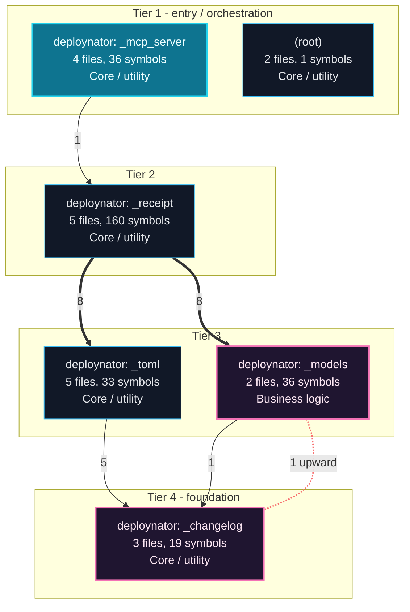
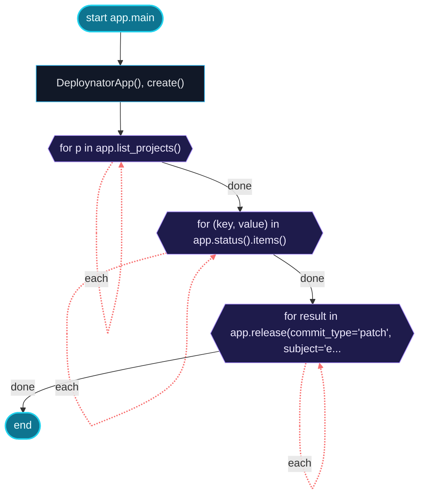
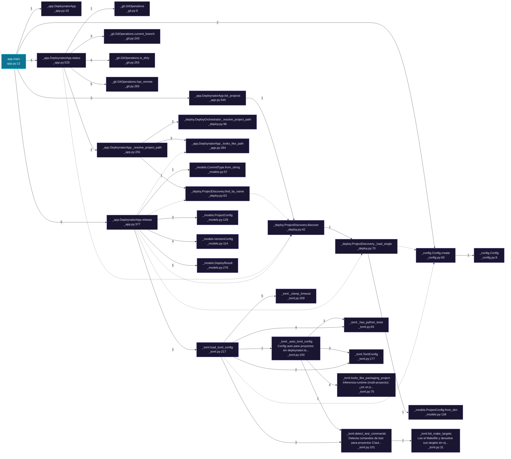
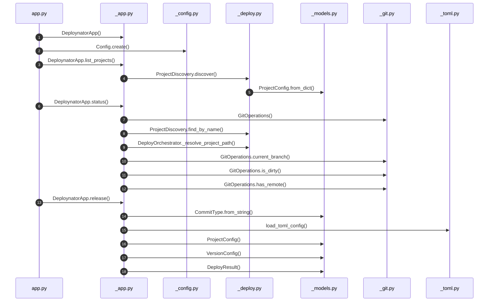
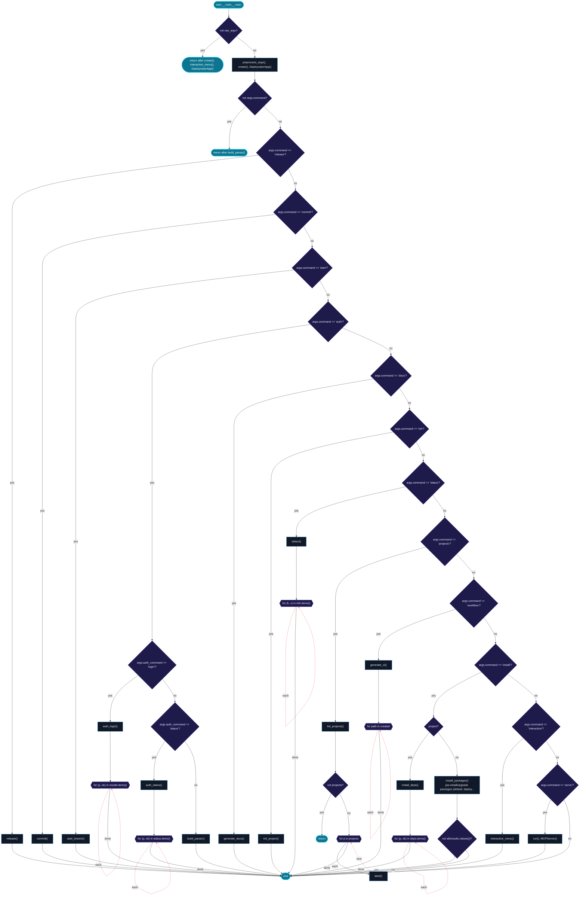
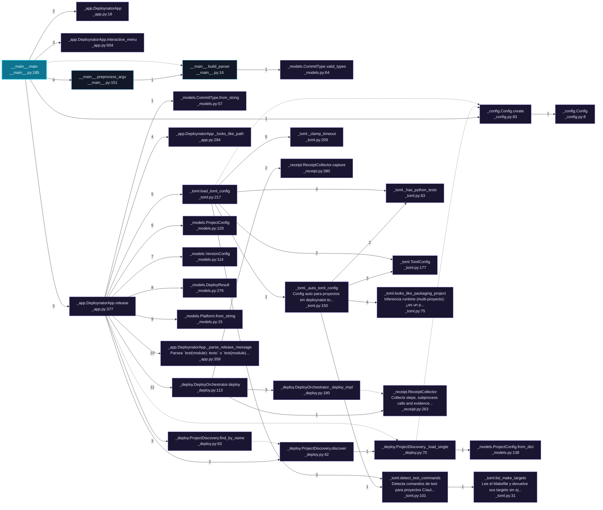
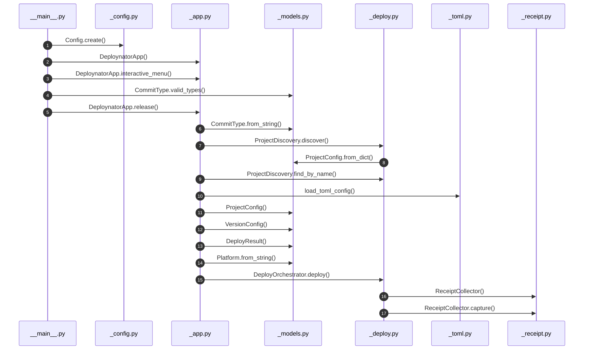
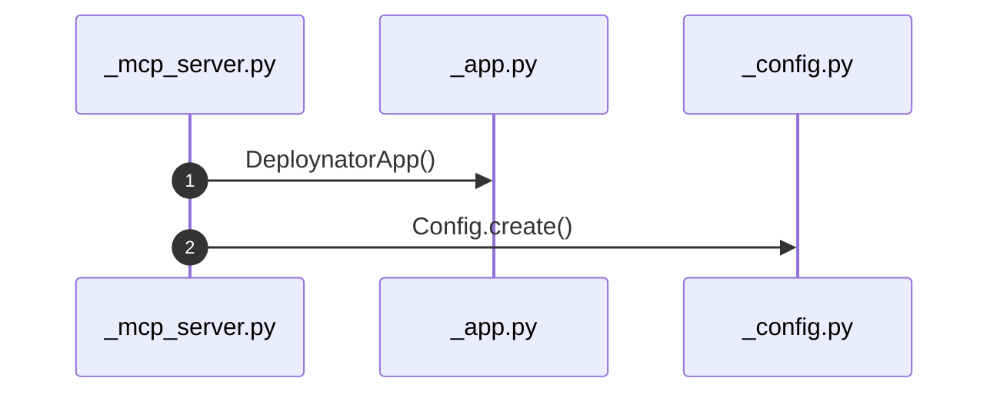

# deploynator Architecture and Execution Flows

[Back to index](index.md)

## Architecture Overview

6 components stacked in 4 dependency tiers (weighted Eades-Lin-Smyth ordering: arrows point from dependent to dependency, top to bottom). Labels are import counts, thick arrows the top quartile; 3 transitively implied edges are omitted. Dashed red arrows are upward dependencies: the smallest set of imports that closes every cycle and breaks the layering. Cyan components hold entry points. Interactive version: `readmenator-apidocs/index.html#/flows`.

Upward dependencies to fix first: `deploynator: _changelog` -> `deploynator: _models` (1 imports)

---

## Execution Flows

Entry points are scored from `__main__` guards, `main` functions, entry-style names and files, and call-graph sources. Each flow walks resolved calls in call-site order (depth <= 4, <= 40 steps); numbers give the call order, dashed arrows revisit an already expanded callee, red arrows are recursion. Interactive version with zoom and per-node docs: `readmenator-apidocs/index.html#/flows`.

### `app.main`

`app.py:12`, score 9: entry-style name `main`; defined in entry file `app.py`; called from the `__main__` guard.

Control flow:

Call tree:

Cross-file sequence:

### `__main__.main`

`deploynator/__main__.py:185`, score 9: entry-style name `main`; defined in entry file `__main__.py`; called from the `__main__` guard.

Control flow:

Call tree:

Cross-file sequence:

### `_mcp_server (__main__)`

`deploynator/_mcp_server.py:285`, score 8: `if __name__ == "__main__"` guard.

Call tree:

Cross-file sequence:

---
