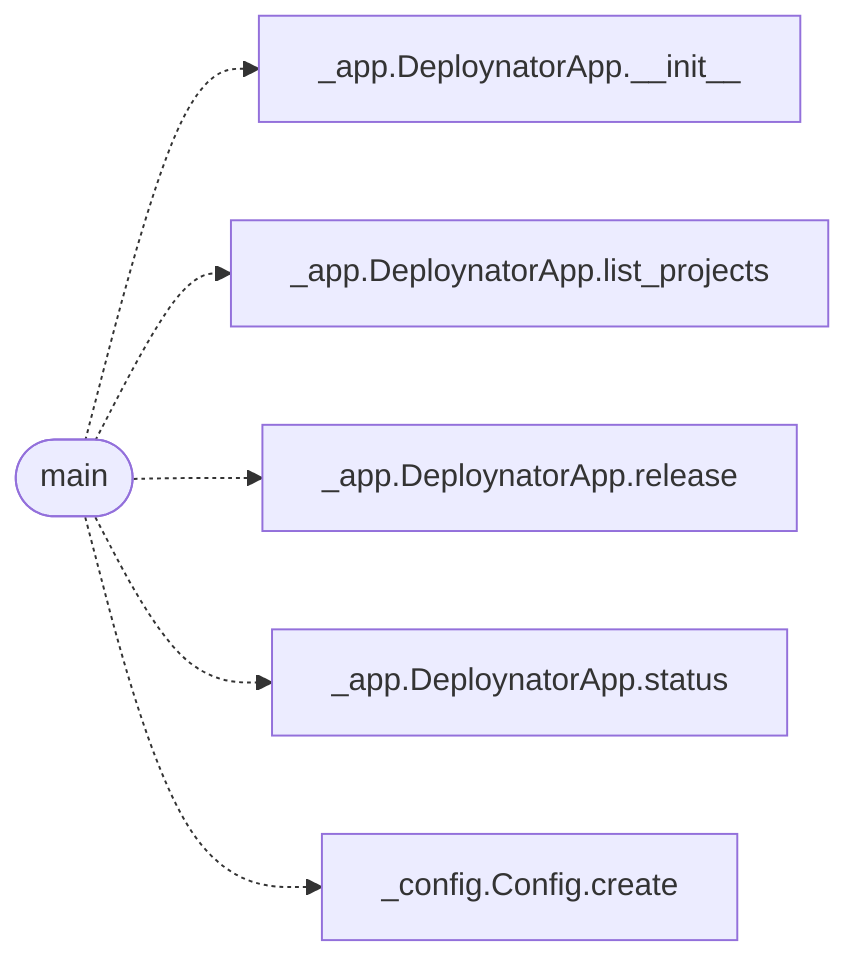

# `app`

> Source: [app.py:1](../../app.py#L1) | language `py` | coverage 50.0% | [API index](../index.md)

app.py -- example: use deploynator programmatically as a library.

Install first:  pip install deploynator
Run:            python app.py            # safe: everything below is dry-run

## Contents

- **Functions:** [`main`](#main)

## Call Graph

Solid arrows stay in this module, dashed arrows leave it.



## Functions

<a id="main"></a>

### `main`

`function` | [app.py:12](../../app.py#L12)

```python
def main() -> None
```

*Calls:* [`DeploynatorApp.__init__`](deploynator._app.py.md#deploynatorapp-__init__), [`DeploynatorApp.list_projects`](deploynator._app.py.md#deploynatorapp-list_projects), [`DeploynatorApp.release`](deploynator._app.py.md#deploynatorapp-release), [`DeploynatorApp.status`](deploynator._app.py.md#deploynatorapp-status), [`Config.create`](deploynator._config.py.md#config-create)

---
