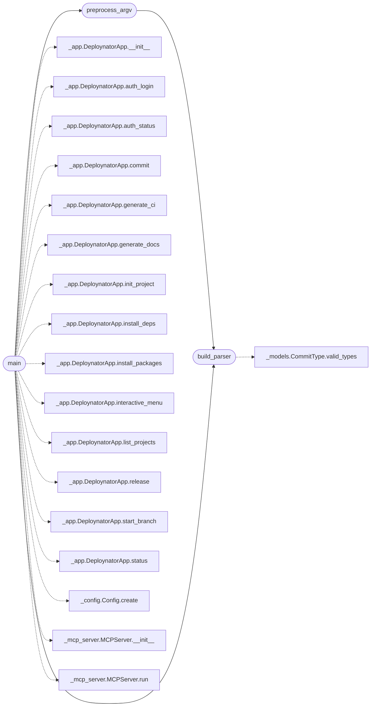

# `deploynator.__main__`

> Source: [deploynator/__main__.py:1](../../deploynator/__main__.py#L1) | language `py` | coverage 0.0% | [API index](../index.md)

## Contents

- **Functions:** [`build_parser`](#build_parser), [`preprocess_argv`](#preprocess_argv), [`main`](#main)
- **Constants:** [`KNOWN_COMMANDS`](#known_commands)

## Call Graph

Solid arrows stay in this module, dashed arrows leave it.



## Functions

<a id="build_parser"></a>

### `build_parser`

`function` | [deploynator/__main__.py:16](../../deploynator/__main__.py#L16)

```python
def build_parser() -> argparse.ArgumentParser
```

**Returns:** `argparse.ArgumentParser`

*Calls:* [`CommitType.valid_types`](deploynator._models.py.md#committype-valid_types)

*Called by:* [`main`](#main), [`preprocess_argv`](#preprocess_argv)

---

<a id="preprocess_argv"></a>

### `preprocess_argv`

`function` | [deploynator/__main__.py:151](../../deploynator/__main__.py#L151)

```python
def preprocess_argv(argv: list[str]) -> tuple[argparse.Namespace, str]
```

**Parameters**

| Name | Type | Default | Description |
|---|---|---|---|
| `argv` | `list[str]` |  |  |

**Returns:** `tuple[argparse.Namespace, str]`

*Calls:* [`build_parser`](#build_parser)

*Called by:* [`main`](#main)

---

<a id="main"></a>

### `main`

`function` | [deploynator/__main__.py:185](../../deploynator/__main__.py#L185)

```python
def main(argv: list[str] | None = None) -> None
```

**Parameters**

| Name | Type | Default | Description |
|---|---|---|---|
| `argv` | `list[str] \| None` | `None` |  |

*Calls:* [`build_parser`](#build_parser), [`preprocess_argv`](#preprocess_argv), [`DeploynatorApp.__init__`](deploynator._app.py.md#deploynatorapp-__init__), [`DeploynatorApp.auth_login`](deploynator._app.py.md#deploynatorapp-auth_login), [`DeploynatorApp.auth_status`](deploynator._app.py.md#deploynatorapp-auth_status), [`DeploynatorApp.commit`](deploynator._app.py.md#deploynatorapp-commit), [`DeploynatorApp.generate_ci`](deploynator._app.py.md#deploynatorapp-generate_ci), [`DeploynatorApp.generate_docs`](deploynator._app.py.md#deploynatorapp-generate_docs), [`DeploynatorApp.init_project`](deploynator._app.py.md#deploynatorapp-init_project), [`DeploynatorApp.install_deps`](deploynator._app.py.md#deploynatorapp-install_deps), [`DeploynatorApp.install_packages`](deploynator._app.py.md#deploynatorapp-install_packages), [`DeploynatorApp.interactive_menu`](deploynator._app.py.md#deploynatorapp-interactive_menu) and 7 more

---

## Constants

<a id="known_commands"></a>

### `KNOWN_COMMANDS`

`constant` | [deploynator/__main__.py:10](../../deploynator/__main__.py#L10)

```python
KNOWN_COMMANDS
```

---
