# `deploynator._app`

> Source: [deploynator/_app.py:1](../../deploynator/_app.py#L1) | language `py` | coverage 6.2% | [API index](../index.md)

## Contents

- **Classes:** [`DeploynatorApp`](#deploynatorapp)

## Call Graph

Solid arrows stay in this module, dashed arrows leave it.

```mermaid
flowchart LR
    n_deploynator__app_py__DeploynatorApp___init__(["DeploynatorApp.__init__"])
    n_deploynator__config_py__Config_create["_config.Config.create"]
    n_deploynator__deploy_py__DeployOrchestrator___init__["_deploy.DeployOrchestrator.__init__"]
    n_deploynator__deploy_py__ProjectDiscovery___init__["_deploy.ProjectDiscovery.__init__"]
    n_deploynator__app_py__DeploynatorApp_auth_status(["DeploynatorApp.auth_status"])
    n_deploynator__models_py__Platform_from_string["_models.Platform.from_string"]
    n_deploynator__platforms_py__PlatformFactory_create["_platforms.PlatformFactory.create"]
    n_deploynator__app_py__DeploynatorApp_init_project(["DeploynatorApp.init_project"])
    n_deploynator__toml_py__detect_test_commands["_toml.detect_test_commands"]
    n_deploynator__app_py__DeploynatorApp_start_branch(["DeploynatorApp.start_branch"])
    n_deploynator__git_py__GitOperations___init__["_git.GitOperations.__init__"]
    n_deploynator__git_py__GitOperations_create_branch["_git.GitOperations.create_branch"]
    n_deploynator__git_py__GitOperations_push["_git.GitOperations.push"]
    n_deploynator__models_py__CommitType_from_string["_models.CommitType.from_string"]
    n_deploynator__app_py__DeploynatorApp_commit(["DeploynatorApp.commit"])
    n_deploynator__changelog_py__ChangelogGenerator_generate_from_messages["_changelog.ChangelogGenerator.generate_from_messages"]
    n_deploynator__git_py__GitOperations_commit["_git.GitOperations.commit"]
    n_deploynator__git_py__GitOperations_is_dirty["_git.GitOperations.is_dirty"]
    n_deploynator__models_py__CommitMessage["_models.CommitMessage"]
    n_deploynator__app_py__DeploynatorApp_release(["DeploynatorApp.release"])
    n_deploynator__deploy_py__DeployOrchestrator_deploy["_deploy.DeployOrchestrator.deploy"]
    n_deploynator__deploy_py__ProjectDiscovery_discover["_deploy.ProjectDiscovery.discover"]
    n_deploynator__deploy_py__ProjectDiscovery_find_by_name["_deploy.ProjectDiscovery.find_by_name"]
    n_deploynator__models_py__DeployResult["_models.DeployResult"]
    n_deploynator__models_py__ProjectConfig["_models.ProjectConfig"]
    n_deploynator__models_py__VersionConfig["_models.VersionConfig"]
    n_deploynator__app_py__DeploynatorApp___init__ -.-> n_deploynator__config_py__Config_create
    n_deploynator__app_py__DeploynatorApp___init__ -.-> n_deploynator__deploy_py__DeployOrchestrator___init__
    n_deploynator__app_py__DeploynatorApp___init__ -.-> n_deploynator__deploy_py__ProjectDiscovery___init__
    n_deploynator__app_py__DeploynatorApp_auth_status -.-> n_deploynator__models_py__Platform_from_string
    n_deploynator__app_py__DeploynatorApp_auth_status -.-> n_deploynator__platforms_py__PlatformFactory_create
    n_deploynator__app_py__DeploynatorApp_init_project -.-> n_deploynator__toml_py__detect_test_commands
    n_deploynator__app_py__DeploynatorApp_start_branch -.-> n_deploynator__git_py__GitOperations___init__
    n_deploynator__app_py__DeploynatorApp_start_branch -.-> n_deploynator__git_py__GitOperations_create_branch
    n_deploynator__app_py__DeploynatorApp_start_branch -.-> n_deploynator__git_py__GitOperations_push
    n_deploynator__app_py__DeploynatorApp_start_branch -.-> n_deploynator__models_py__CommitType_from_string
    n_deploynator__app_py__DeploynatorApp_commit -.-> n_deploynator__changelog_py__ChangelogGenerator_generate_from_messages
    n_deploynator__app_py__DeploynatorApp_commit -.-> n_deploynator__git_py__GitOperations___init__
    n_deploynator__app_py__DeploynatorApp_commit -.-> n_deploynator__git_py__GitOperations_commit
    n_deploynator__app_py__DeploynatorApp_commit -.-> n_deploynator__git_py__GitOperations_is_dirty
    n_deploynator__app_py__DeploynatorApp_commit -.-> n_deploynator__models_py__CommitMessage
    n_deploynator__app_py__DeploynatorApp_commit -.-> n_deploynator__models_py__CommitType_from_string
    n_deploynator__app_py__DeploynatorApp_release -.-> n_deploynator__deploy_py__DeployOrchestrator_deploy
    n_deploynator__app_py__DeploynatorApp_release -.-> n_deploynator__deploy_py__ProjectDiscovery_discover
    n_deploynator__app_py__DeploynatorApp_release -.-> n_deploynator__deploy_py__ProjectDiscovery_find_by_name
    n_deploynator__app_py__DeploynatorApp_release -.-> n_deploynator__models_py__CommitType_from_string
    n_deploynator__app_py__DeploynatorApp_release -.-> n_deploynator__models_py__DeployResult
    n_deploynator__app_py__DeploynatorApp_release -.-> n_deploynator__models_py__Platform_from_string
    n_deploynator__app_py__DeploynatorApp_release -.-> n_deploynator__models_py__ProjectConfig
    n_deploynator__app_py__DeploynatorApp_release -.-> n_deploynator__models_py__VersionConfig
```



## Classes

<a id="deploynatorapp"></a>

### `DeploynatorApp`

`class` | [deploynator/_app.py:18](../../deploynator/_app.py#L18)

```python
class DeploynatorApp
```

**Attributes**

| Name | Type | Default | Description |
|---|---|---|---|
| [`DEPLOY_SH_TEMPLATE`](#deploynatorapp-deploy_sh_template) |  | `'#!/bin/bash\n# deploy.sh -- one-liner deploy via deploynator (generic per-repo script).\n# Deployed by deploynator: detects its own directory, ensures tooling,\n# then releases this repo. Usage:\n# ./deploy.sh # patch release (smallest bump)\n# ./deploy.sh feat --dry-run # preview a minor release\n# ./deploy.sh fix --no-test # patch release skipping tests\nset -euo pipefail\n\nDIR="$(cd "$(dirname "${BASH_SOURCE[0]}")" && pwd)"\nTYPE="patch"\nif [ $# -gt 0 ]; then\n TYPE="$1"\n shift\nfi\n\nPIP_BIN="pip"\ncommand -v pip >/dev/null 2>&1 \|\| PIP_BIN="pip3"\n\n# Install or update one package (best effort: works offline with current versions,\n# on PEP 668 systems, and before the PyPI upload via git fallback).\nensure_pkg() {\n if python3 -c "import $1" 2>/dev/null; then\n "$PIP_BIN" install -U "$2" 2>/dev/null \|\| true\n else\n "$PIP_BIN" install "$2" 2>/dev/null \\\n \|\| "$PIP_BIN" install "$3" 2>/dev/null \\\n \|\| "$PIP_BIN" install --break-system-packages "$2" 2>/dev/null \\\n \|\| "$PIP_BIN" install --break-system-packages "$3" 2>/dev/null \\\n \|\| true\n fi\n}\n\nensure_pkg deploynator deploynator "git+https://github.com/grisuno/deploynator.git"\nensure_pkg readmenator readmenator readmenator\nensure_pkg build build build\nensure_pkg twine twine twine\n\nif ! python3 -c "import deploynator" 2>/dev/null; then\n echo "[!] deploynator not available and install failed (offline?)." >&2\n exit 1\nfi\n\nexec python3 -m deploynator release --type "$TYPE" --project "$DIR" "$@"\n'` |  |
| [`DEPLOY_TOML_TEMPLATE`](#deploynatorapp-deploy_toml_template) |  | `` '# deploynator.toml -- per-project deploy config (created by `deploynator init`).\n# Docs: specify version file, tests, docs and PyPI behaviour for this repo.\n\n[project]\nname = "{name}"\nversion_file = "version.json"\n\n[tests]\ncommands = ["python -m pytest tests/ -q"]\ntimeout_s = 300\nallow_no_tests = false\n\n[docs]\nauto = true\ncommand = "python -m readmenator . --rebuild"\ntimeout_s = 300\n\n[deploy]\nbranch = "main"\nremote = "origin"\n# Default release message when CLI gives no --subject/--message\n# nor trailing words (e.g. message = "chore: nightly sync").\n# CLI always wins over this value.\nmessage = ""\n\n[pypi]\nenabled = true\nrepo = "pypi"\nclean_dist = true\ntimeout_s = 600\n\n[deb]\n# Proyectos C (Makefile): si hay debian/control o un target\n# deb\|package-deb\|dist-deb\|deb-package\|package, construye el .deb\n# y lo sube como asset del release (equivalente PyPI para apt/dpkg).\n# build = "" -> auto (`make <target>` o dpkg-buildpackage).\n# Ej. C explícito: build = "make deb".\nenabled = true\nbuild = ""\noutdir = "dist-deb"\nclean_dist = true\ntimeout_s = 600\nupload_assets = true\n' `` |  |

**Members**

| Member | Kind | Summary |
|---|---|---|
| [`__init__`](#deploynatorapp-__init__) | constructor |  |
| [`auth_login`](#deploynatorapp-auth_login) | method |  |
| [`auth_status`](#deploynatorapp-auth_status) | method |  |
| [`init_project`](#deploynatorapp-init_project) | method |  |
| [`start_branch`](#deploynatorapp-start_branch) | method |  |
| [`commit`](#deploynatorapp-commit) | method |  |
| [`release`](#deploynatorapp-release) | method |  |
| [`generate_docs`](#deploynatorapp-generate_docs) | method |  |
| [`status`](#deploynatorapp-status) | method |  |
| [`list_projects`](#deploynatorapp-list_projects) | method |  |
| [`generate_ci`](#deploynatorapp-generate_ci) | method |  |
| [`install_deps`](#deploynatorapp-install_deps) | method |  |
| [`install_packages`](#deploynatorapp-install_packages) | method | pip install/upgrade packages (default: deploynator from PyPI). |
| [`interactive_menu`](#deploynatorapp-interactive_menu) | method |  |

<a id="deploynatorapp-__init__"></a>

#### `DeploynatorApp.__init__`

`constructor` | [deploynator/_app.py:19](../../deploynator/_app.py#L19)

```python
def __init__(self, config: Config | None = None, workdir: str = '') -> None
```

**Parameters**

| Name | Type | Default | Description |
|---|---|---|---|
| `config` | `Config \| None` | `None` |  |
| `workdir` | `str` | `''` |  |

*Calls:* [`Config.create`](deploynator._config.py.md#config-create), [`DeployOrchestrator.__init__`](deploynator._deploy.py.md#deployorchestrator-__init__), [`ProjectDiscovery.__init__`](deploynator._deploy.py.md#projectdiscovery-__init__)

*Called by:* [`main`](app.py.md#main), [`main`](deploynator.__main__.py.md#main), [`main`](deploynator._mcp_server.py.md#main)

<a id="deploynatorapp-auth_login"></a>

#### `DeploynatorApp.auth_login`

`method` | [deploynator/_app.py:29](../../deploynator/_app.py#L29)

```python
def auth_login(self, platforms: list[str] | None = None) -> dict[str, bool]
```

**Parameters**

| Name | Type | Default | Description |
|---|---|---|---|
| `platforms` | `list[str] \| None` | `None` |  |

**Returns:** `dict[str, bool]`

*Called by:* [`main`](deploynator.__main__.py.md#main)

<a id="deploynatorapp-auth_status"></a>

#### `DeploynatorApp.auth_status`

`method` | [deploynator/_app.py:43](../../deploynator/_app.py#L43)

```python
def auth_status(self) -> dict[str, bool]
```

**Returns:** `dict[str, bool]`

*Calls:* [`Platform.from_string`](deploynator._models.py.md#platform-from_string), [`PlatformFactory.create`](deploynator._platforms.py.md#platformfactory-create)

*Called by:* [`main`](deploynator.__main__.py.md#main)

<a id="deploynatorapp-init_project"></a>

#### `DeploynatorApp.init_project`

`method` | [deploynator/_app.py:185](../../deploynator/_app.py#L185)

```python
def init_project(self, project_path: str = '', name: str = '') -> str
```

**Parameters**

| Name | Type | Default | Description |
|---|---|---|---|
| `project_path` | `str` | `''` |  |
| `name` | `str` | `''` |  |

**Returns:** `str`

*Calls:* [`detect_test_commands`](deploynator._toml.py.md#detect_test_commands)

*Called by:* [`main`](deploynator.__main__.py.md#main)

<a id="deploynatorapp-start_branch"></a>

#### `DeploynatorApp.start_branch`

`method` | [deploynator/_app.py:262](../../deploynator/_app.py#L262)

```python
def start_branch(self, commit_type: str, description: str, project_path: str = '', project_name: str = '', remote: bool = False) -> str
```

**Parameters**

| Name | Type | Default | Description |
|---|---|---|---|
| `commit_type` | `str` |  |  |
| `description` | `str` |  |  |
| `project_path` | `str` | `''` |  |
| `project_name` | `str` | `''` |  |
| `remote` | `bool` | `False` |  |

**Returns:** `str`

*Calls:* [`GitOperations.__init__`](deploynator._git.py.md#gitoperations-__init__), [`GitOperations.create_branch`](deploynator._git.py.md#gitoperations-create_branch), [`GitOperations.push`](deploynator._git.py.md#gitoperations-push), [`CommitType.from_string`](deploynator._models.py.md#committype-from_string)

*Called by:* [`main`](deploynator.__main__.py.md#main)

<a id="deploynatorapp-commit"></a>

#### `DeploynatorApp.commit`

`method` | [deploynator/_app.py:320](../../deploynator/_app.py#L320)

```python
def commit(self, commit_type: str, subject: str, scope: str = '', body: str = '', project_path: str = '', project_name: str = '', dry_run: bool = False) -> str
```

**Parameters**

| Name | Type | Default | Description |
|---|---|---|---|
| `commit_type` | `str` |  |  |
| `subject` | `str` |  |  |
| `scope` | `str` | `''` |  |
| `body` | `str` | `''` |  |
| `project_path` | `str` | `''` |  |
| `project_name` | `str` | `''` |  |
| `dry_run` | `bool` | `False` |  |

**Returns:** `str`

*Calls:* [`ChangelogGenerator.generate_from_messages`](deploynator._changelog.py.md#changeloggenerator-generate_from_messages), [`GitOperations.__init__`](deploynator._git.py.md#gitoperations-__init__), [`GitOperations.commit`](deploynator._git.py.md#gitoperations-commit), [`GitOperations.is_dirty`](deploynator._git.py.md#gitoperations-is_dirty), [`CommitMessage`](deploynator._models.py.md#commitmessage), [`CommitType.from_string`](deploynator._models.py.md#committype-from_string)

*Called by:* [`main`](deploynator.__main__.py.md#main)

<a id="deploynatorapp-release"></a>

#### `DeploynatorApp.release`

`method` | [deploynator/_app.py:379](../../deploynator/_app.py#L379)

```python
def release(self, commit_type: str = 'release', subject: str = '', scope: str = '', body: str = '', message: str = '', project_name: str = '', bump: str = '', dry_run: bool = False, platforms: list[str] | None = None, all_projects: bool = False, no_test: bool = False, no_docs: bool = False, no_pypi: bool = False, no_deb: bool = False, verbose: bool = False, receipt_path: str | None = None, trace: bool = False) -> list[DeployResult]
```

**Parameters**

| Name | Type | Default | Description |
|---|---|---|---|
| `commit_type` | `str` | `'release'` |  |
| `subject` | `str` | `''` |  |
| `scope` | `str` | `''` |  |
| `body` | `str` | `''` |  |
| `message` | `str` | `''` |  |
| `project_name` | `str` | `''` |  |
| `bump` | `str` | `''` |  |
| `dry_run` | `bool` | `False` |  |
| `platforms` | `list[str] \| None` | `None` |  |
| `all_projects` | `bool` | `False` |  |
| `no_test` | `bool` | `False` |  |
| `no_docs` | `bool` | `False` |  |
| `no_pypi` | `bool` | `False` |  |
| `no_deb` | `bool` | `False` |  |
| `verbose` | `bool` | `False` |  |
| `receipt_path` | `str \| None` | `None` |  |
| `trace` | `bool` | `False` |  |

**Returns:** `list[DeployResult]`

*Calls:* [`DeployOrchestrator.deploy`](deploynator._deploy.py.md#deployorchestrator-deploy), [`ProjectDiscovery.discover`](deploynator._deploy.py.md#projectdiscovery-discover), [`ProjectDiscovery.find_by_name`](deploynator._deploy.py.md#projectdiscovery-find_by_name), [`CommitType.from_string`](deploynator._models.py.md#committype-from_string), [`DeployResult`](deploynator._models.py.md#deployresult), [`Platform.from_string`](deploynator._models.py.md#platform-from_string), [`ProjectConfig`](deploynator._models.py.md#projectconfig), [`VersionConfig`](deploynator._models.py.md#versionconfig), [`load_toml_config`](deploynator._toml.py.md#load_toml_config)

*Called by:* [`main`](app.py.md#main), [`main`](deploynator.__main__.py.md#main)

<a id="deploynatorapp-generate_docs"></a>

#### `DeploynatorApp.generate_docs`

`method` | [deploynator/_app.py:521](../../deploynator/_app.py#L521)

```python
def generate_docs(self, project_path: str = '', project_name: str = '') -> bool
```

**Parameters**

| Name | Type | Default | Description |
|---|---|---|---|
| `project_path` | `str` | `''` |  |
| `project_name` | `str` | `''` |  |

**Returns:** `bool`

*Calls:* [`DeployOrchestrator.integrate_readmenator`](deploynator._deploy.py.md#deployorchestrator-integrate_readmenator)

*Called by:* [`main`](deploynator.__main__.py.md#main)

<a id="deploynatorapp-status"></a>

#### `DeploynatorApp.status`

`method` | [deploynator/_app.py:527](../../deploynator/_app.py#L527)

```python
def status(self, project_path: str = '', project_name: str = '') -> dict
```

**Parameters**

| Name | Type | Default | Description |
|---|---|---|---|
| `project_path` | `str` | `''` |  |
| `project_name` | `str` | `''` |  |

**Returns:** `dict`

*Calls:* [`ProjectDiscovery.discover`](deploynator._deploy.py.md#projectdiscovery-discover), [`GitOperations.__init__`](deploynator._git.py.md#gitoperations-__init__), [`GitOperations.current_branch`](deploynator._git.py.md#gitoperations-current_branch), [`GitOperations.has_remote`](deploynator._git.py.md#gitoperations-has_remote), [`GitOperations.is_dirty`](deploynator._git.py.md#gitoperations-is_dirty)

*Called by:* [`main`](app.py.md#main), [`main`](deploynator.__main__.py.md#main)

<a id="deploynatorapp-list_projects"></a>

#### `DeploynatorApp.list_projects`

`method` | [deploynator/_app.py:547](../../deploynator/_app.py#L547)

```python
def list_projects(self, search_path: str = '') -> list[ProjectConfig]
```

**Parameters**

| Name | Type | Default | Description |
|---|---|---|---|
| `search_path` | `str` | `''` |  |

**Returns:** `list[ProjectConfig]`

*Calls:* [`ProjectDiscovery.discover`](deploynator._deploy.py.md#projectdiscovery-discover)

*Called by:* [`main`](app.py.md#main), [`main`](deploynator.__main__.py.md#main)

<a id="deploynatorapp-generate_ci"></a>

#### `DeploynatorApp.generate_ci`

`method` | [deploynator/_app.py:552](../../deploynator/_app.py#L552)

```python
def generate_ci(self, project_name: str = '', all_projects: bool = False) -> list[str]
```

**Parameters**

| Name | Type | Default | Description |
|---|---|---|---|
| `project_name` | `str` | `''` |  |
| `all_projects` | `bool` | `False` |  |

**Returns:** `list[str]`

*Calls:* [`DeployOrchestrator.generate_workflows`](deploynator._deploy.py.md#deployorchestrator-generate_workflows), [`ProjectDiscovery.discover`](deploynator._deploy.py.md#projectdiscovery-discover), [`ProjectDiscovery.find_by_name`](deploynator._deploy.py.md#projectdiscovery-find_by_name)

*Called by:* [`main`](deploynator.__main__.py.md#main)

<a id="deploynatorapp-install_deps"></a>

#### `DeploynatorApp.install_deps`

`method` | [deploynator/_app.py:568](../../deploynator/_app.py#L568)

```python
def install_deps(self, project_name: str = '') -> dict[str, bool]
```

**Parameters**

| Name | Type | Default | Description |
|---|---|---|---|
| `project_name` | `str` | `''` |  |

**Returns:** `dict[str, bool]`

*Calls:* [`DeployOrchestrator.install_dependencies`](deploynator._deploy.py.md#deployorchestrator-install_dependencies), [`ProjectDiscovery.discover`](deploynator._deploy.py.md#projectdiscovery-discover), [`ProjectDiscovery.find_by_name`](deploynator._deploy.py.md#projectdiscovery-find_by_name)

*Called by:* [`main`](deploynator.__main__.py.md#main)

<a id="deploynatorapp-install_packages"></a>

#### `DeploynatorApp.install_packages`

`method` | [deploynator/_app.py:579](../../deploynator/_app.py#L579)

```python
def install_packages(self, packages: list[str] | None = None) -> dict[str, bool]
```

pip install/upgrade packages (default: deploynator from PyPI).

**Parameters**

| Name | Type | Default | Description |
|---|---|---|---|
| `packages` | `list[str] \| None` | `None` |  |

**Returns:** `dict[str, bool]`

*Called by:* [`main`](deploynator.__main__.py.md#main)

<a id="deploynatorapp-interactive_menu"></a>

#### `DeploynatorApp.interactive_menu`

`method` | [deploynator/_app.py:606](../../deploynator/_app.py#L606)

```python
def interactive_menu(self) -> None
```

*Called by:* [`main`](deploynator.__main__.py.md#main)

---
