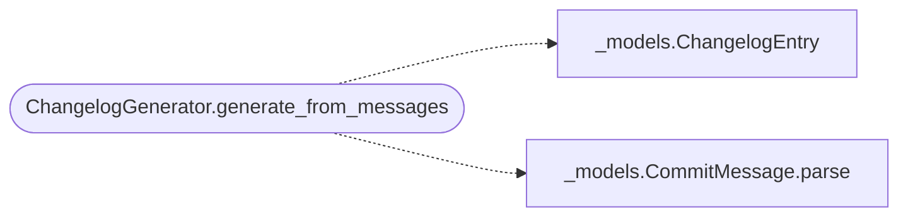

# `deploynator._changelog`

> Source: [deploynator/_changelog.py:1](../../deploynator/_changelog.py#L1) | language `py` | coverage 0.0% | [API index](../index.md)

## Contents

- **Classes:** [`ChangelogGenerator`](#changeloggenerator)

## Call Graph

Solid arrows stay in this module, dashed arrows leave it.



## Classes

<a id="changeloggenerator"></a>

### `ChangelogGenerator`

`class` | [deploynator/_changelog.py:11](../../deploynator/_changelog.py#L11)

```python
class ChangelogGenerator
```

**Members**

| Member | Kind | Summary |
|---|---|---|
| [`__init__`](#changeloggenerator-__init__) | constructor |  |
| [`generate_from_log`](#changeloggenerator-generate_from_log) | method |  |
| [`generate_from_messages`](#changeloggenerator-generate_from_messages) | method |  |
| [`generate_header`](#changeloggenerator-generate_header) | method |  |
| [`write_changelog`](#changeloggenerator-write_changelog) | method |  |
| [`format_for_release`](#changeloggenerator-format_for_release) | method |  |

<a id="changeloggenerator-__init__"></a>

#### `ChangelogGenerator.__init__`

`constructor` | [deploynator/_changelog.py:12](../../deploynator/_changelog.py#L12)

```python
def __init__(self, config: Config) -> None
```

**Parameters**

| Name | Type | Default | Description |
|---|---|---|---|
| `config` | `Config` |  |  |

*Called by:* [`DeployOrchestrator.__init__`](deploynator._deploy.py.md#deployorchestrator-__init__)

<a id="changeloggenerator-generate_from_log"></a>

#### `ChangelogGenerator.generate_from_log`

`method` | [deploynator/_changelog.py:15](../../deploynator/_changelog.py#L15)

```python
def generate_from_log(self, repo_path: str, from_ref: str, to_ref: str = 'HEAD') -> str
```

**Parameters**

| Name | Type | Default | Description |
|---|---|---|---|
| `repo_path` | `str` |  |  |
| `from_ref` | `str` |  |  |
| `to_ref` | `str` | `'HEAD'` |  |

**Returns:** `str`

<a id="changeloggenerator-generate_from_messages"></a>

#### `ChangelogGenerator.generate_from_messages`

`method` | [deploynator/_changelog.py:24](../../deploynator/_changelog.py#L24)

```python
def generate_from_messages(self, messages: list[str]) -> str
```

**Parameters**

| Name | Type | Default | Description |
|---|---|---|---|
| `messages` | `list[str]` |  |  |

**Returns:** `str`

*Calls:* [`ChangelogEntry`](deploynator._models.py.md#changelogentry), [`CommitMessage.parse`](deploynator._models.py.md#commitmessage-parse)

*Called by:* [`DeploynatorApp.commit`](deploynator._app.py.md#deploynatorapp-commit)

<a id="changeloggenerator-generate_header"></a>

#### `ChangelogGenerator.generate_header`

`method` | [deploynator/_changelog.py:44](../../deploynator/_changelog.py#L44)

```python
def generate_header(self) -> str
```

**Returns:** `str`

<a id="changeloggenerator-write_changelog"></a>

#### `ChangelogGenerator.write_changelog`

`method` | [deploynator/_changelog.py:99](../../deploynator/_changelog.py#L99)

```python
def write_changelog(self, repo_path: str, content: str, filename: str | None = None) -> str
```

**Parameters**

| Name | Type | Default | Description |
|---|---|---|---|
| `repo_path` | `str` |  |  |
| `content` | `str` |  |  |
| `filename` | `str \| None` | `None` |  |

**Returns:** `str`

**Raises**

- `OSError`: (raised in the body, not documented)

<a id="changeloggenerator-format_for_release"></a>

#### `ChangelogGenerator.format_for_release`

`method` | [deploynator/_changelog.py:108](../../deploynator/_changelog.py#L108)

```python
def format_for_release(self, changelog_content: str, max_chars: int | None = None) -> str
```

**Parameters**

| Name | Type | Default | Description |
|---|---|---|---|
| `changelog_content` | `str` |  |  |
| `max_chars` | `int \| None` | `None` |  |

**Returns:** `str`

---
