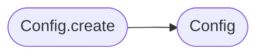

# `deploynator._config`

> Source: [deploynator/_config.py:1](../../deploynator/_config.py#L1) | language `py` | coverage 0.0% | [API index](../index.md)

## Contents

- **Classes:** [`Config`](#config)

## Call Graph

Solid arrows stay in this module, dashed arrows leave it.



## Classes

<a id="config"></a>

### `Config`

`class` `dataclass` | [deploynator/_config.py:8](../../deploynator/_config.py#L8)

Decorators: `@dataclass(frozen=True)`

```python
class Config
```

**Attributes**

| Name | Type | Default | Description |
|---|---|---|---|
| [`changelog_file`](#config-changelog_file) | `str` | `'CHANGELOG.md'` |  |
| [`changelog_html`](#config-changelog_html) | `str` | `'docs/CHANGELOG.html'` |  |
| [`version_file`](#config-version_file) | `str` | `'version.json'` |  |
| [`readme_file`](#config-readme_file) | `str` | `'README.md'` |  |
| [`knowledge_base`](#config-knowledge_base) | `str` | `'KNOWLEDGE_BASE.md'` |  |
| [`projects_dir`](#config-projects_dir) | `str` | `'projects'` |  |
| [`modules_dir`](#config-modules_dir) | `str` | `'modules'` |  |
| [`workflows_dir`](#config-workflows_dir) | `str` | `'.github/workflows'` |  |
| [`default_branch`](#config-default_branch) | `str` | `'main'` |  |
| [`default_remote`](#config-default_remote) | `str` | `'origin'` |  |
| [`release_branch`](#config-release_branch) | `str` | `'main'` |  |
| [`max_release_chars`](#config-max_release_chars) | `int` | `120000` |  |
| [`max_file_size_bytes`](#config-max_file_size_bytes) | `int` | `10485760` |  |
| [`max_dir_depth`](#config-max_dir_depth) | `int` | `20` |  |
| [`changelog_header`](#config-changelog_header) | `str` | `'# Changelog'` |  |
| [`deploynator_badge_url`](#config-deploynator_badge_url) | `str` | `'https://github.com/grisuno/deploynator'` |  |
| [`deploynator_badge_text`](#config-deploynator_badge_text) | `str` | `'Deployed with deploynator'` |  |
| [`lazygit_config_key`](#config-lazygit_config_key) | `str` | `'deploynator.lazygit.enabled'` |  |
| [`gh_cli`](#config-gh_cli) | `str` | `'gh'` |  |
| [`glab_cli`](#config-glab_cli) | `str` | `'glab'` |  |
| [`bb_cli`](#config-bb_cli) | `str` | `'bb'` |  |
| [`lazygit_cli`](#config-lazygit_cli) | `str` | `'lazygit'` |  |
| [`jq_cli`](#config-jq_cli) | `str` | `'jq'` |  |
| [`pandoc_cli`](#config-pandoc_cli) | `str` | `'pandoc'` |  |
| [`sponge_cli`](#config-sponge_cli) | `str` | `'sponge'` |  |
| [`gpg_signing_key_env`](#config-gpg_signing_key_env) | `str` | `'GPG_SIGNING_KEY'` |  |
| [`github_token_env`](#config-github_token_env) | `str` | `'GITHUB_TOKEN'` |  |
| [`gitlab_token_env`](#config-gitlab_token_env) | `str` | `'GITLAB_TOKEN'` |  |
| [`bitbucket_token_env`](#config-bitbucket_token_env) | `str` | `'BITBUCKET_TOKEN'` |  |
| [`semver_pattern`](#config-semver_pattern) | `str` | `'^\\d+\\.\\d+\\.\\d+$'` |  |
| [`commit_type_pattern`](#config-commit_type_pattern) | `str` | `'^(feat\|fix\|hotfix\|docs\|refactor\|style\|chore\|test\|release\|patch)(\\(.+\\))?: .+'` |  |
| [`conventional_types`](#config-conventional_types) | `dict[str, str]` | `field(default_factory=lambda: {'feat': 'Features', 'fix': 'Bug Fixes', 'hotfix': 'Hotfixes', 'docs': 'Documentation', 'refactor': 'Code Refactoring', 'style': 'Style Changes', 'chore': 'Chores', 'test': 'Tests', 'release': 'Releases', 'patch': 'Patches'})` |  |
| [`version_bump_map`](#config-version_bump_map) | `dict[str, str]` | `field(default_factory=lambda: {'feat': 'minor', 'fix': 'patch', 'hotfix': 'patch', 'docs': None, 'refactor': None, 'style': None, 'chore': None, 'test': None, 'release': 'major', 'patch': 'patch'})` |  |

**Members**

| Member | Kind | Summary |
|---|---|---|
| [`create`](#config-create) | staticmethod |  |
| [`resolve_path`](#config-resolve_path) | method |  |
| [`gh_authd`](#config-gh_authd) | property |  |
| [`glab_authd`](#config-glab_authd) | property |  |
| [`bb_authd`](#config-bb_authd) | property |  |

<a id="config-create"></a>

#### `Config.create`

`staticmethod` | [deploynator/_config.py:79](../../deploynator/_config.py#L79)

Decorators: `@staticmethod`

```python
def create(overrides: dict | None = None) -> Config
```

**Parameters**

| Name | Type | Default | Description |
|---|---|---|---|
| `overrides` | `dict \| None` | `None` |  |

**Returns:** `Config`

*Calls:* [`Config`](#config)

*Called by:* [`main`](app.py.md#main), [`main`](deploynator.__main__.py.md#main), [`DeploynatorApp.__init__`](deploynator._app.py.md#deploynatorapp-__init__), [`main`](deploynator._mcp_server.py.md#main), [`load_toml_config`](deploynator._toml.py.md#load_toml_config)

<a id="config-resolve_path"></a>

#### `Config.resolve_path`

`method` | [deploynator/_config.py:85](../../deploynator/_config.py#L85)

```python
def resolve_path(self, *parts: str) -> str
```

**Parameters**

| Name | Type | Default | Description |
|---|---|---|---|
| `*parts` | `str` |  |  |

**Returns:** `str`

<a id="config-gh_authd"></a>

#### `Config.gh_authd`

`property` | [deploynator/_config.py:91](../../deploynator/_config.py#L91)

Decorators: `@property`

```python
def gh_authd(self) -> bool
```

**Returns:** `bool`

<a id="config-glab_authd"></a>

#### `Config.glab_authd`

`property` | [deploynator/_config.py:95](../../deploynator/_config.py#L95)

Decorators: `@property`

```python
def glab_authd(self) -> bool
```

**Returns:** `bool`

<a id="config-bb_authd"></a>

#### `Config.bb_authd`

`property` | [deploynator/_config.py:99](../../deploynator/_config.py#L99)

Decorators: `@property`

```python
def bb_authd(self) -> bool
```

**Returns:** `bool`

---
