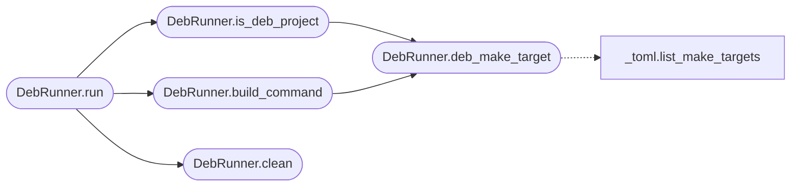

# `deploynator._deb`

> Source: [deploynator/_deb.py:1](../../deploynator/_deb.py#L1) | language `py` | coverage 12.5% | [API index](../index.md)

## Contents

- **Classes:** [`DebRunner`](#debrunner)

## Call Graph

Solid arrows stay in this module, dashed arrows leave it.



## Classes

<a id="debrunner"></a>

### `DebRunner`

`class` | [deploynator/_deb.py:12](../../deploynator/_deb.py#L12)

```python
class DebRunner
```

Construye paquetes .deb desde fuentes C, espejo del flujo PyPI.

Detección (is_deb_project):
  - debian/control existe, o
  - Makefile expone un target de paquetización
    (deb | package-deb | dist-deb | deb-package | package).

Build (run):
  - [deb] build explícito (shlex, shell=False) manda,
  - si no: `make <target-deb>` si existe,
  - si no: `dpkg-buildpackage -us -uc -b` si hay debian/control,
  - artefactos *.deb se consolidan en [deb] outdir (default dist-deb/).

**Attributes**

| Name | Type | Default | Description |
|---|---|---|---|
| [`DEB_MAKE_TARGETS`](#debrunner-deb_make_targets) | `tuple[str, ...]` | `('deb', 'package-deb', 'dist-deb', 'deb-package', 'package')` |  |

**Members**

| Member | Kind | Summary |
|---|---|---|
| [`__init__`](#debrunner-__init__) | constructor |  |
| [`deb_make_target`](#debrunner-deb_make_target) | method |  |
| [`is_deb_project`](#debrunner-is_deb_project) | method |  |
| [`clean`](#debrunner-clean) | method |  |
| [`build_command`](#debrunner-build_command) | method |  |
| [`run`](#debrunner-run) | method |  |

<a id="debrunner-__init__"></a>

#### `DebRunner.__init__`

`constructor` | [deploynator/_deb.py:35](../../deploynator/_deb.py#L35)

```python
def __init__(self, config: Config) -> None
```

**Parameters**

| Name | Type | Default | Description |
|---|---|---|---|
| `config` | `Config` |  |  |

*Called by:* [`DeployOrchestrator.__init__`](deploynator._deploy.py.md#deployorchestrator-__init__)

<a id="debrunner-deb_make_target"></a>

#### `DebRunner.deb_make_target`

`method` | [deploynator/_deb.py:38](../../deploynator/_deb.py#L38)

```python
def deb_make_target(self, project_path: str) -> str | None
```

**Parameters**

| Name | Type | Default | Description |
|---|---|---|---|
| `project_path` | `str` |  |  |

**Returns:** `str | None`

*Calls:* [`list_make_targets`](deploynator._toml.py.md#list_make_targets)

*Called by:* [`DebRunner.build_command`](#debrunner-build_command), [`DebRunner.is_deb_project`](#debrunner-is_deb_project)

<a id="debrunner-is_deb_project"></a>

#### `DebRunner.is_deb_project`

`method` | [deploynator/_deb.py:48](../../deploynator/_deb.py#L48)

```python
def is_deb_project(self, project_path: str) -> bool
```

**Parameters**

| Name | Type | Default | Description |
|---|---|---|---|
| `project_path` | `str` |  |  |

**Returns:** `bool`

*Calls:* [`DebRunner.deb_make_target`](#debrunner-deb_make_target)

*Called by:* [`DebRunner.run`](#debrunner-run)

<a id="debrunner-clean"></a>

#### `DebRunner.clean`

`method` | [deploynator/_deb.py:62](../../deploynator/_deb.py#L62)

```python
def clean(self, project_path: str, toml: TomlConfig) -> None
```

**Parameters**

| Name | Type | Default | Description |
|---|---|---|---|
| `project_path` | `str` |  |  |
| `toml` | `TomlConfig` |  |  |

**Raises**

- `ValueError`: (raised in the body, not documented)

*Called by:* [`DebRunner.run`](#debrunner-run)

<a id="debrunner-build_command"></a>

#### `DebRunner.build_command`

`method` | [deploynator/_deb.py:110](../../deploynator/_deb.py#L110)

```python
def build_command(self, project_path: str, toml: TomlConfig) -> list[str] | None
```

**Parameters**

| Name | Type | Default | Description |
|---|---|---|---|
| `project_path` | `str` |  |  |
| `toml` | `TomlConfig` |  |  |

**Returns:** `list[str] | None`

*Calls:* [`DebRunner.deb_make_target`](#debrunner-deb_make_target)

*Called by:* [`DebRunner.run`](#debrunner-run)

<a id="debrunner-run"></a>

#### `DebRunner.run`

`method` | [deploynator/_deb.py:126](../../deploynator/_deb.py#L126)

```python
def run(self, project_path: str, toml: TomlConfig, version: str, verbose: bool = False) -> tuple[bool, str, list[str]]
```

**Parameters**

| Name | Type | Default | Description |
|---|---|---|---|
| `project_path` | `str` |  |  |
| `toml` | `TomlConfig` |  |  |
| `version` | `str` |  |  |
| `verbose` | `bool` | `False` |  |

**Returns:** `tuple[bool, str, list[str]]`

*Calls:* [`DebRunner.build_command`](#debrunner-build_command), [`DebRunner.clean`](#debrunner-clean), [`DebRunner.is_deb_project`](#debrunner-is_deb_project)

---
