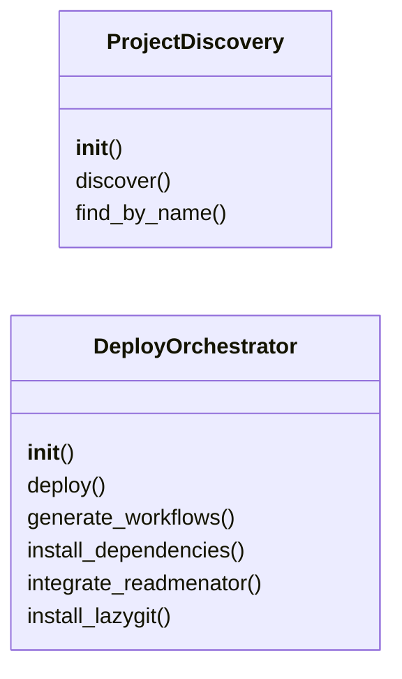

# `deploynator._deploy`

> Source: [deploynator/_deploy.py:1](../../deploynator/_deploy.py#L1) | language `py` | coverage 0.0% | [API index](../index.md)

## Contents

- **Classes:** [`ProjectDiscovery`](#projectdiscovery), [`DeployOrchestrator`](#deployorchestrator)

## Type Diagram



## Call Graph

Solid arrows stay in this module, dashed arrows leave it.

```mermaid
flowchart LR
    n_deploynator__deploy_py__ProjectDiscovery_find_by_name(["ProjectDiscovery.find_by_name"])
    n_deploynator__deploy_py__ProjectDiscovery_discover(["ProjectDiscovery.discover"])
    n_deploynator__deploy_py__DeployOrchestrator___init__(["DeployOrchestrator.__init__"])
    n_deploynator__deploy_py__ProjectDiscovery___init__(["ProjectDiscovery.__init__"])
    n_deploynator__changelog_py__ChangelogGenerator___init__["_changelog.ChangelogGenerator.__init__"]
    n_deploynator__deb_py__DebRunner___init__["_deb.DebRunner.__init__"]
    n_deploynator__docs_py__DocsRunner___init__["_docs.DocsRunner.__init__"]
    n_deploynator__git_py__GitOperations___init__["_git.GitOperations.__init__"]
    n_deploynator__pypi_py__PyPIRunner___init__["_pypi.PyPIRunner.__init__"]
    n_deploynator__runner_py__TestRunner___init__["_runner.TestRunner.__init__"]
    n_deploynator__semver_py__SemverManager___init__["_semver.SemverManager.__init__"]
    n_deploynator__deploy_py__DeployOrchestrator_deploy(["DeployOrchestrator.deploy"])
    n_deploynator__models_py__DeployResult["_models.DeployResult"]
    n_deploynator__receipt_py__ReceiptCollector___init__["_receipt.ReceiptCollector.__init__"]
    n_deploynator__receipt_py__ReceiptCollector_capture["_receipt.ReceiptCollector.capture"]
    n_deploynator__receipt_py__ReceiptCollector_finalize["_receipt.ReceiptCollector.finalize"]
    n_deploynator__receipt_py__ReceiptCollector_write["_receipt.ReceiptCollector.write"]
    n_deploynator__receipt_py__build_receipt_from_result["_receipt.build_receipt_from_result"]
    n_deploynator__receipt_py__default_receipt_path["_receipt.default_receipt_path"]
    n_deploynator__deploy_py__DeployOrchestrator_install_dependencies(["DeployOrchestrator.install_dependencies"])
    n_deploynator__platforms_py__PlatformFactory_create["_platforms.PlatformFactory.create"]
    n_deploynator__deploy_py__DeployOrchestrator_integrate_readmenator(["DeployOrchestrator.integrate_readmenator"])
    n_deploynator__docs_py__DocsRunner_run["_docs.DocsRunner.run"]
    n_deploynator__toml_py__load_toml_config["_toml.load_toml_config"]
    n_deploynator__deploy_py__ProjectDiscovery_find_by_name --> n_deploynator__deploy_py__ProjectDiscovery_discover
    n_deploynator__deploy_py__DeployOrchestrator___init__ --> n_deploynator__deploy_py__ProjectDiscovery___init__
    n_deploynator__deploy_py__DeployOrchestrator___init__ -.-> n_deploynator__changelog_py__ChangelogGenerator___init__
    n_deploynator__deploy_py__DeployOrchestrator___init__ -.-> n_deploynator__deb_py__DebRunner___init__
    n_deploynator__deploy_py__DeployOrchestrator___init__ -.-> n_deploynator__docs_py__DocsRunner___init__
    n_deploynator__deploy_py__DeployOrchestrator___init__ -.-> n_deploynator__git_py__GitOperations___init__
    n_deploynator__deploy_py__DeployOrchestrator___init__ -.-> n_deploynator__pypi_py__PyPIRunner___init__
    n_deploynator__deploy_py__DeployOrchestrator___init__ -.-> n_deploynator__runner_py__TestRunner___init__
    n_deploynator__deploy_py__DeployOrchestrator___init__ -.-> n_deploynator__semver_py__SemverManager___init__
    n_deploynator__deploy_py__DeployOrchestrator_deploy -.-> n_deploynator__models_py__DeployResult
    n_deploynator__deploy_py__DeployOrchestrator_deploy -.-> n_deploynator__receipt_py__ReceiptCollector___init__
    n_deploynator__deploy_py__DeployOrchestrator_deploy -.-> n_deploynator__receipt_py__ReceiptCollector_capture
    n_deploynator__deploy_py__DeployOrchestrator_deploy -.-> n_deploynator__receipt_py__ReceiptCollector_finalize
    n_deploynator__deploy_py__DeployOrchestrator_deploy -.-> n_deploynator__receipt_py__ReceiptCollector_write
    n_deploynator__deploy_py__DeployOrchestrator_deploy -.-> n_deploynator__receipt_py__build_receipt_from_result
    n_deploynator__deploy_py__DeployOrchestrator_deploy -.-> n_deploynator__receipt_py__default_receipt_path
    n_deploynator__deploy_py__DeployOrchestrator_install_dependencies -.-> n_deploynator__platforms_py__PlatformFactory_create
    n_deploynator__deploy_py__DeployOrchestrator_integrate_readmenator -.-> n_deploynator__docs_py__DocsRunner_run
    n_deploynator__deploy_py__DeployOrchestrator_integrate_readmenator -.-> n_deploynator__toml_py__load_toml_config
```



## Classes

<a id="projectdiscovery"></a>

### `ProjectDiscovery`

`class` | [deploynator/_deploy.py:38](../../deploynator/_deploy.py#L38)

```python
class ProjectDiscovery
```

**Members**

| Member | Kind | Summary |
|---|---|---|
| [`__init__`](#projectdiscovery-__init__) | constructor |  |
| [`discover`](#projectdiscovery-discover) | method |  |
| [`find_by_name`](#projectdiscovery-find_by_name) | method |  |

<a id="projectdiscovery-__init__"></a>

#### `ProjectDiscovery.__init__`

`constructor` | [deploynator/_deploy.py:39](../../deploynator/_deploy.py#L39)

```python
def __init__(self, config: Config) -> None
```

**Parameters**

| Name | Type | Default | Description |
|---|---|---|---|
| `config` | `Config` |  |  |

*Called by:* [`DeploynatorApp.__init__`](deploynator._app.py.md#deploynatorapp-__init__), [`DeployOrchestrator.__init__`](#deployorchestrator-__init__)

<a id="projectdiscovery-discover"></a>

#### `ProjectDiscovery.discover`

`method` | [deploynator/_deploy.py:42](../../deploynator/_deploy.py#L42)

```python
def discover(self, search_path: str = '') -> list[ProjectConfig]
```

**Parameters**

| Name | Type | Default | Description |
|---|---|---|---|
| `search_path` | `str` | `''` |  |

**Returns:** `list[ProjectConfig]`

*Called by:* [`DeploynatorApp.generate_ci`](deploynator._app.py.md#deploynatorapp-generate_ci), [`DeploynatorApp.install_deps`](deploynator._app.py.md#deploynatorapp-install_deps), [`DeploynatorApp.list_projects`](deploynator._app.py.md#deploynatorapp-list_projects), [`DeploynatorApp.release`](deploynator._app.py.md#deploynatorapp-release), [`DeploynatorApp.status`](deploynator._app.py.md#deploynatorapp-status), [`ProjectDiscovery.find_by_name`](#projectdiscovery-find_by_name)

<a id="projectdiscovery-find_by_name"></a>

#### `ProjectDiscovery.find_by_name`

`method` | [deploynator/_deploy.py:63](../../deploynator/_deploy.py#L63)

```python
def find_by_name(self, name: str, search_path: str = '') -> ProjectConfig | None
```

**Parameters**

| Name | Type | Default | Description |
|---|---|---|---|
| `name` | `str` |  |  |
| `search_path` | `str` | `''` |  |

**Returns:** `ProjectConfig | None`

*Calls:* [`ProjectDiscovery.discover`](#projectdiscovery-discover)

*Called by:* [`DeploynatorApp.generate_ci`](deploynator._app.py.md#deploynatorapp-generate_ci), [`DeploynatorApp.install_deps`](deploynator._app.py.md#deploynatorapp-install_deps), [`DeploynatorApp.release`](deploynator._app.py.md#deploynatorapp-release)

---

<a id="deployorchestrator"></a>

### `DeployOrchestrator`

`class` | [deploynator/_deploy.py:83](../../deploynator/_deploy.py#L83)

```python
class DeployOrchestrator
```

**Members**

| Member | Kind | Summary |
|---|---|---|
| [`__init__`](#deployorchestrator-__init__) | constructor |  |
| [`deploy`](#deployorchestrator-deploy) | method |  |
| [`generate_workflows`](#deployorchestrator-generate_workflows) | method |  |
| [`install_dependencies`](#deployorchestrator-install_dependencies) | method |  |
| [`integrate_readmenator`](#deployorchestrator-integrate_readmenator) | method |  |
| [`install_lazygit`](#deployorchestrator-install_lazygit) | method |  |

<a id="deployorchestrator-__init__"></a>

#### `DeployOrchestrator.__init__`

`constructor` | [deploynator/_deploy.py:84](../../deploynator/_deploy.py#L84)

```python
def __init__(self, config: Config) -> None
```

**Parameters**

| Name | Type | Default | Description |
|---|---|---|---|
| `config` | `Config` |  |  |

*Calls:* [`ChangelogGenerator.__init__`](deploynator._changelog.py.md#changeloggenerator-__init__), [`DebRunner.__init__`](deploynator._deb.py.md#debrunner-__init__), [`ProjectDiscovery.__init__`](#projectdiscovery-__init__), [`DocsRunner.__init__`](deploynator._docs.py.md#docsrunner-__init__), [`GitOperations.__init__`](deploynator._git.py.md#gitoperations-__init__), [`PyPIRunner.__init__`](deploynator._pypi.py.md#pypirunner-__init__), [`TestRunner.__init__`](deploynator._runner.py.md#testrunner-__init__), [`SemverManager.__init__`](deploynator._semver.py.md#semvermanager-__init__)

*Called by:* [`DeploynatorApp.__init__`](deploynator._app.py.md#deploynatorapp-__init__)

<a id="deployorchestrator-deploy"></a>

#### `DeployOrchestrator.deploy`

`method` | [deploynator/_deploy.py:105](../../deploynator/_deploy.py#L105)

```python
def deploy(self, project: ProjectConfig, commit_type: CommitType, subject: str, scope: str = '', body: str = '', dry_run: bool = False, platforms_override: list[Platform] | None = None, run_tests: bool = True, run_docs: bool = True, force_bump: str | None = None, run_pypi: bool = True, run_deb: bool = True, verbose: bool = False, receipt_path: str | None = None, trace: bool = False) -> DeployResult
```

**Parameters**

| Name | Type | Default | Description |
|---|---|---|---|
| `project` | `ProjectConfig` |  |  |
| `commit_type` | `CommitType` |  |  |
| `subject` | `str` |  |  |
| `scope` | `str` | `''` |  |
| `body` | `str` | `''` |  |
| `dry_run` | `bool` | `False` |  |
| `platforms_override` | `list[Platform] \| None` | `None` |  |
| `run_tests` | `bool` | `True` |  |
| `run_docs` | `bool` | `True` |  |
| `force_bump` | `str \| None` | `None` |  |
| `run_pypi` | `bool` | `True` |  |
| `run_deb` | `bool` | `True` |  |
| `verbose` | `bool` | `False` |  |
| `receipt_path` | `str \| None` | `None` |  |
| `trace` | `bool` | `False` |  |

**Returns:** `DeployResult`

*Calls:* [`DeployResult`](deploynator._models.py.md#deployresult), [`ReceiptCollector.__init__`](deploynator._receipt.py.md#receiptcollector-__init__), [`ReceiptCollector.capture`](deploynator._receipt.py.md#receiptcollector-capture), [`ReceiptCollector.finalize`](deploynator._receipt.py.md#receiptcollector-finalize), [`ReceiptCollector.write`](deploynator._receipt.py.md#receiptcollector-write), [`build_receipt_from_result`](deploynator._receipt.py.md#build_receipt_from_result), [`default_receipt_path`](deploynator._receipt.py.md#default_receipt_path)

*Called by:* [`DeploynatorApp.release`](deploynator._app.py.md#deploynatorapp-release)

<a id="deployorchestrator-generate_workflows"></a>

#### `DeployOrchestrator.generate_workflows`

`method` | [deploynator/_deploy.py:707](../../deploynator/_deploy.py#L707)

```python
def generate_workflows(self, project: ProjectConfig, output_dir: str = '.github/workflows') -> list[str]
```

**Parameters**

| Name | Type | Default | Description |
|---|---|---|---|
| `project` | `ProjectConfig` |  |  |
| `output_dir` | `str` | `'.github/workflows'` |  |

**Returns:** `list[str]`

*Called by:* [`DeploynatorApp.generate_ci`](deploynator._app.py.md#deploynatorapp-generate_ci)

<a id="deployorchestrator-install_dependencies"></a>

#### `DeployOrchestrator.install_dependencies`

`method` | [deploynator/_deploy.py:774](../../deploynator/_deploy.py#L774)

```python
def install_dependencies(self, project: ProjectConfig) -> dict[str, bool]
```

**Parameters**

| Name | Type | Default | Description |
|---|---|---|---|
| `project` | `ProjectConfig` |  |  |

**Returns:** `dict[str, bool]`

*Calls:* [`PlatformFactory.create`](deploynator._platforms.py.md#platformfactory-create)

*Called by:* [`DeploynatorApp.install_deps`](deploynator._app.py.md#deploynatorapp-install_deps)

<a id="deployorchestrator-integrate_readmenator"></a>

#### `DeployOrchestrator.integrate_readmenator`

`method` | [deploynator/_deploy.py:784](../../deploynator/_deploy.py#L784)

```python
def integrate_readmenator(self, project_path: str) -> bool
```

**Parameters**

| Name | Type | Default | Description |
|---|---|---|---|
| `project_path` | `str` |  |  |

**Returns:** `bool`

**Raises**

- `ImportError`: (raised in the body, not documented)

*Calls:* [`DocsRunner.run`](deploynator._docs.py.md#docsrunner-run), [`load_toml_config`](deploynator._toml.py.md#load_toml_config)

*Called by:* [`DeploynatorApp.generate_docs`](deploynator._app.py.md#deploynatorapp-generate_docs)

<a id="deployorchestrator-install_lazygit"></a>

#### `DeployOrchestrator.install_lazygit`

`method` | [deploynator/_deploy.py:820](../../deploynator/_deploy.py#L820)

```python
def install_lazygit(self) -> bool
```

**Returns:** `bool`

---
