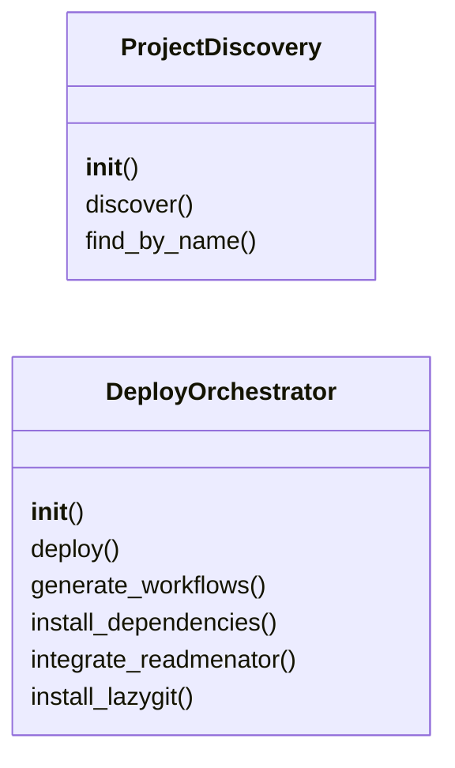

# `deploynator._deploy`

> Source: [deploynator/_deploy.py:1](../../deploynator/_deploy.py#L1) | language `py` | coverage 0.0% | [API index](../index.md)

## Contents

- **Classes:** [`ProjectDiscovery`](#projectdiscovery), [`DeployOrchestrator`](#deployorchestrator)

## Type Diagram



## Call Graph

Solid arrows stay in this module, dashed arrows leave it.

```mermaid
flowchart LR
    n_deploynator__deploy_py__ProjectDiscovery_find_by_name(["ProjectDiscovery.find_by_name"])
    n_deploynator__deploy_py__ProjectDiscovery_discover(["ProjectDiscovery.discover"])
    n_deploynator__deploy_py__DeployOrchestrator___init__(["DeployOrchestrator.__init__"])
    n_deploynator__deploy_py__ProjectDiscovery___init__(["ProjectDiscovery.__init__"])
    n_deploynator__changelog_py__ChangelogGenerator___init__["_changelog.ChangelogGenerator.__init__"]
    n_deploynator__docs_py__DocsRunner___init__["_docs.DocsRunner.__init__"]
    n_deploynator__git_py__GitOperations___init__["_git.GitOperations.__init__"]
    n_deploynator__pypi_py__PyPIRunner___init__["_pypi.PyPIRunner.__init__"]
    n_deploynator__runner_py__TestRunner___init__["_runner.TestRunner.__init__"]
    n_deploynator__semver_py__SemverManager___init__["_semver.SemverManager.__init__"]
    n_deploynator__deploy_py__DeployOrchestrator_deploy(["DeployOrchestrator.deploy"])
    n_deploynator__changelog_py__ChangelogGenerator_format_for_release["_changelog.ChangelogGenerator.format_for_release"]
    n_deploynator__changelog_py__ChangelogGenerator_generate_from_log["_changelog.ChangelogGenerator.generate_from_log"]
    n_deploynator__changelog_py__ChangelogGenerator_write_changelog["_changelog.ChangelogGenerator.write_changelog"]
    n_deploynator__docs_py__DocsRunner_run["_docs.DocsRunner.run"]
    n_deploynator__git_py__GitOperations_add_all["_git.GitOperations.add_all"]
    n_deploynator__git_py__GitOperations_commit["_git.GitOperations.commit"]
    n_deploynator__git_py__GitOperations_current_branch["_git.GitOperations.current_branch"]
    n_deploynator__git_py__GitOperations_get_changed_files["_git.GitOperations.get_changed_files"]
    n_deploynator__git_py__GitOperations_get_start_ref["_git.GitOperations.get_start_ref"]
    n_deploynator__git_py__GitOperations_has_remote["_git.GitOperations.has_remote"]
    n_deploynator__git_py__GitOperations_push["_git.GitOperations.push"]
    n_deploynator__git_py__GitOperations_tag["_git.GitOperations.tag"]
    n_deploynator__git_py__GitOperations_tag_exists["_git.GitOperations.tag_exists"]
    n_deploynator__models_py__CommitMessage["_models.CommitMessage"]
    n_deploynator__models_py__DeployResult["_models.DeployResult"]
    n_deploynator__models_py__ReleaseInfo["_models.ReleaseInfo"]
    n_deploynator__deploy_py__ProjectDiscovery_find_by_name --> n_deploynator__deploy_py__ProjectDiscovery_discover
    n_deploynator__deploy_py__DeployOrchestrator___init__ --> n_deploynator__deploy_py__ProjectDiscovery___init__
    n_deploynator__deploy_py__DeployOrchestrator___init__ -.-> n_deploynator__changelog_py__ChangelogGenerator___init__
    n_deploynator__deploy_py__DeployOrchestrator___init__ -.-> n_deploynator__docs_py__DocsRunner___init__
    n_deploynator__deploy_py__DeployOrchestrator___init__ -.-> n_deploynator__git_py__GitOperations___init__
    n_deploynator__deploy_py__DeployOrchestrator___init__ -.-> n_deploynator__pypi_py__PyPIRunner___init__
    n_deploynator__deploy_py__DeployOrchestrator___init__ -.-> n_deploynator__runner_py__TestRunner___init__
    n_deploynator__deploy_py__DeployOrchestrator___init__ -.-> n_deploynator__semver_py__SemverManager___init__
    n_deploynator__deploy_py__DeployOrchestrator_deploy -.-> n_deploynator__changelog_py__ChangelogGenerator_format_for_release
    n_deploynator__deploy_py__DeployOrchestrator_deploy -.-> n_deploynator__changelog_py__ChangelogGenerator_generate_from_log
    n_deploynator__deploy_py__DeployOrchestrator_deploy -.-> n_deploynator__changelog_py__ChangelogGenerator_write_changelog
    n_deploynator__deploy_py__DeployOrchestrator_deploy -.-> n_deploynator__docs_py__DocsRunner_run
    n_deploynator__deploy_py__DeployOrchestrator_deploy -.-> n_deploynator__git_py__GitOperations_add_all
    n_deploynator__deploy_py__DeployOrchestrator_deploy -.-> n_deploynator__git_py__GitOperations_commit
    n_deploynator__deploy_py__DeployOrchestrator_deploy -.-> n_deploynator__git_py__GitOperations_current_branch
    n_deploynator__deploy_py__DeployOrchestrator_deploy -.-> n_deploynator__git_py__GitOperations_get_changed_files
    n_deploynator__deploy_py__DeployOrchestrator_deploy -.-> n_deploynator__git_py__GitOperations_get_start_ref
    n_deploynator__deploy_py__DeployOrchestrator_deploy -.-> n_deploynator__git_py__GitOperations_has_remote
    n_deploynator__deploy_py__DeployOrchestrator_deploy -.-> n_deploynator__git_py__GitOperations_push
    n_deploynator__deploy_py__DeployOrchestrator_deploy -.-> n_deploynator__git_py__GitOperations_tag
    n_deploynator__deploy_py__DeployOrchestrator_deploy -.-> n_deploynator__git_py__GitOperations_tag_exists
    n_deploynator__deploy_py__DeployOrchestrator_deploy -.-> n_deploynator__models_py__CommitMessage
    n_deploynator__deploy_py__DeployOrchestrator_deploy -.-> n_deploynator__models_py__DeployResult
    n_deploynator__deploy_py__DeployOrchestrator_deploy -.-> n_deploynator__models_py__ReleaseInfo
```



## Classes

<a id="projectdiscovery"></a>

### `ProjectDiscovery`

`class` | [deploynator/_deploy.py:31](../../deploynator/_deploy.py#L31)

```python
class ProjectDiscovery
```

**Members**

| Member | Kind | Summary |
|---|---|---|
| [`__init__`](#projectdiscovery-__init__) | constructor |  |
| [`discover`](#projectdiscovery-discover) | method |  |
| [`find_by_name`](#projectdiscovery-find_by_name) | method |  |

<a id="projectdiscovery-__init__"></a>

#### `ProjectDiscovery.__init__`

`constructor` | [deploynator/_deploy.py:32](../../deploynator/_deploy.py#L32)

```python
def __init__(self, config: Config) -> None
```

**Parameters**

| Name | Type | Default | Description |
|---|---|---|---|
| `config` | `Config` |  |  |

*Called by:* [`DeploynatorApp.__init__`](deploynator._app.py.md#deploynatorapp-__init__), [`DeployOrchestrator.__init__`](#deployorchestrator-__init__)

<a id="projectdiscovery-discover"></a>

#### `ProjectDiscovery.discover`

`method` | [deploynator/_deploy.py:35](../../deploynator/_deploy.py#L35)

```python
def discover(self, search_path: str = '') -> list[ProjectConfig]
```

**Parameters**

| Name | Type | Default | Description |
|---|---|---|---|
| `search_path` | `str` | `''` |  |

**Returns:** `list[ProjectConfig]`

*Called by:* [`DeploynatorApp.generate_ci`](deploynator._app.py.md#deploynatorapp-generate_ci), [`DeploynatorApp.install_deps`](deploynator._app.py.md#deploynatorapp-install_deps), [`DeploynatorApp.list_projects`](deploynator._app.py.md#deploynatorapp-list_projects), [`DeploynatorApp.release`](deploynator._app.py.md#deploynatorapp-release), [`DeploynatorApp.status`](deploynator._app.py.md#deploynatorapp-status), [`ProjectDiscovery.find_by_name`](#projectdiscovery-find_by_name)

<a id="projectdiscovery-find_by_name"></a>

#### `ProjectDiscovery.find_by_name`

`method` | [deploynator/_deploy.py:56](../../deploynator/_deploy.py#L56)

```python
def find_by_name(self, name: str, search_path: str = '') -> Optional[ProjectConfig]
```

**Parameters**

| Name | Type | Default | Description |
|---|---|---|---|
| `name` | `str` |  |  |
| `search_path` | `str` | `''` |  |

**Returns:** `Optional[ProjectConfig]`

*Calls:* [`ProjectDiscovery.discover`](#projectdiscovery-discover)

*Called by:* [`DeploynatorApp.generate_ci`](deploynator._app.py.md#deploynatorapp-generate_ci), [`DeploynatorApp.install_deps`](deploynator._app.py.md#deploynatorapp-install_deps), [`DeploynatorApp.release`](deploynator._app.py.md#deploynatorapp-release)

---

<a id="deployorchestrator"></a>

### `DeployOrchestrator`

`class` | [deploynator/_deploy.py:76](../../deploynator/_deploy.py#L76)

```python
class DeployOrchestrator
```

**Members**

| Member | Kind | Summary |
|---|---|---|
| [`__init__`](#deployorchestrator-__init__) | constructor |  |
| [`deploy`](#deployorchestrator-deploy) | method |  |
| [`generate_workflows`](#deployorchestrator-generate_workflows) | method |  |
| [`install_dependencies`](#deployorchestrator-install_dependencies) | method |  |
| [`integrate_readmenator`](#deployorchestrator-integrate_readmenator) | method |  |
| [`install_lazygit`](#deployorchestrator-install_lazygit) | method |  |

<a id="deployorchestrator-__init__"></a>

#### `DeployOrchestrator.__init__`

`constructor` | [deploynator/_deploy.py:77](../../deploynator/_deploy.py#L77)

```python
def __init__(self, config: Config) -> None
```

**Parameters**

| Name | Type | Default | Description |
|---|---|---|---|
| `config` | `Config` |  |  |

*Calls:* [`ChangelogGenerator.__init__`](deploynator._changelog.py.md#changeloggenerator-__init__), [`ProjectDiscovery.__init__`](#projectdiscovery-__init__), [`DocsRunner.__init__`](deploynator._docs.py.md#docsrunner-__init__), [`GitOperations.__init__`](deploynator._git.py.md#gitoperations-__init__), [`PyPIRunner.__init__`](deploynator._pypi.py.md#pypirunner-__init__), [`TestRunner.__init__`](deploynator._runner.py.md#testrunner-__init__), [`SemverManager.__init__`](deploynator._semver.py.md#semvermanager-__init__)

*Called by:* [`DeploynatorApp.__init__`](deploynator._app.py.md#deploynatorapp-__init__)

<a id="deployorchestrator-deploy"></a>

#### `DeployOrchestrator.deploy`

`method` | [deploynator/_deploy.py:97](../../deploynator/_deploy.py#L97)

```python
def deploy(self, project: ProjectConfig, commit_type: CommitType, subject: str, scope: str = '', body: str = '', dry_run: bool = False, platforms_override: Optional[list[Platform]] = None, run_tests: bool = True, run_docs: bool = True, force_bump: Optional[str] = None, run_pypi: bool = True, verbose: bool = False) -> DeployResult
```

**Parameters**

| Name | Type | Default | Description |
|---|---|---|---|
| `project` | `ProjectConfig` |  |  |
| `commit_type` | `CommitType` |  |  |
| `subject` | `str` |  |  |
| `scope` | `str` | `''` |  |
| `body` | `str` | `''` |  |
| `dry_run` | `bool` | `False` |  |
| `platforms_override` | `Optional[list[Platform]]` | `None` |  |
| `run_tests` | `bool` | `True` |  |
| `run_docs` | `bool` | `True` |  |
| `force_bump` | `Optional[str]` | `None` |  |
| `run_pypi` | `bool` | `True` |  |
| `verbose` | `bool` | `False` |  |

**Returns:** `DeployResult`

*Calls:* [`ChangelogGenerator.format_for_release`](deploynator._changelog.py.md#changeloggenerator-format_for_release), [`ChangelogGenerator.generate_from_log`](deploynator._changelog.py.md#changeloggenerator-generate_from_log), [`ChangelogGenerator.write_changelog`](deploynator._changelog.py.md#changeloggenerator-write_changelog), [`DocsRunner.run`](deploynator._docs.py.md#docsrunner-run), [`GitOperations.add_all`](deploynator._git.py.md#gitoperations-add_all), [`GitOperations.commit`](deploynator._git.py.md#gitoperations-commit), [`GitOperations.current_branch`](deploynator._git.py.md#gitoperations-current_branch), [`GitOperations.get_changed_files`](deploynator._git.py.md#gitoperations-get_changed_files), [`GitOperations.get_start_ref`](deploynator._git.py.md#gitoperations-get_start_ref), [`GitOperations.has_remote`](deploynator._git.py.md#gitoperations-has_remote), [`GitOperations.push`](deploynator._git.py.md#gitoperations-push), [`GitOperations.tag`](deploynator._git.py.md#gitoperations-tag) and 18 more

*Called by:* [`DeploynatorApp.release`](deploynator._app.py.md#deploynatorapp-release)

<a id="deployorchestrator-generate_workflows"></a>

#### `DeployOrchestrator.generate_workflows`

`method` | [deploynator/_deploy.py:435](../../deploynator/_deploy.py#L435)

```python
def generate_workflows(self, project: ProjectConfig, output_dir: str = '.github/workflows') -> list[str]
```

**Parameters**

| Name | Type | Default | Description |
|---|---|---|---|
| `project` | `ProjectConfig` |  |  |
| `output_dir` | `str` | `'.github/workflows'` |  |

**Returns:** `list[str]`

*Called by:* [`DeploynatorApp.generate_ci`](deploynator._app.py.md#deploynatorapp-generate_ci)

<a id="deployorchestrator-install_dependencies"></a>

#### `DeployOrchestrator.install_dependencies`

`method` | [deploynator/_deploy.py:503](../../deploynator/_deploy.py#L503)

```python
def install_dependencies(self, project: ProjectConfig) -> dict[str, bool]
```

**Parameters**

| Name | Type | Default | Description |
|---|---|---|---|
| `project` | `ProjectConfig` |  |  |

**Returns:** `dict[str, bool]`

*Calls:* [`PlatformFactory.create`](deploynator._platforms.py.md#platformfactory-create)

*Called by:* [`DeploynatorApp.install_deps`](deploynator._app.py.md#deploynatorapp-install_deps)

<a id="deployorchestrator-integrate_readmenator"></a>

#### `DeployOrchestrator.integrate_readmenator`

`method` | [deploynator/_deploy.py:513](../../deploynator/_deploy.py#L513)

```python
def integrate_readmenator(self, project_path: str) -> bool
```

**Parameters**

| Name | Type | Default | Description |
|---|---|---|---|
| `project_path` | `str` |  |  |

**Returns:** `bool`

*Calls:* [`DocsRunner.run`](deploynator._docs.py.md#docsrunner-run), [`load_toml_config`](deploynator._toml.py.md#load_toml_config)

*Called by:* [`DeploynatorApp.generate_docs`](deploynator._app.py.md#deploynatorapp-generate_docs)

<a id="deployorchestrator-install_lazygit"></a>

#### `DeployOrchestrator.install_lazygit`

`method` | [deploynator/_deploy.py:547](../../deploynator/_deploy.py#L547)

```python
def install_lazygit(self) -> bool
```

**Returns:** `bool`

---
