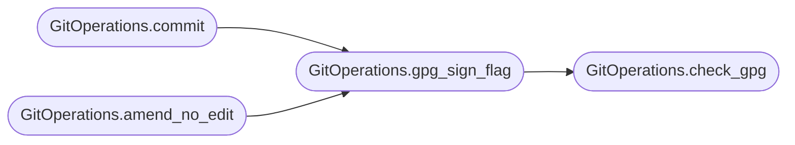

# `deploynator._git`

> Source: [deploynator/_git.py:1](../../deploynator/_git.py#L1) | language `py` | coverage 0.0% | [API index](../index.md)

## Contents

- **Classes:** [`GitOperations`](#gitoperations)

## Call Graph

Solid arrows stay in this module, dashed arrows leave it.



## Classes

<a id="gitoperations"></a>

### `GitOperations`

`class` | [deploynator/_git.py:10](../../deploynator/_git.py#L10)

```python
class GitOperations
```

**Members**

| Member | Kind | Summary |
|---|---|---|
| [`__init__`](#gitoperations-__init__) | constructor |  |
| [`check_gpg`](#gitoperations-check_gpg) | method |  |
| [`gpg_sign_flag`](#gitoperations-gpg_sign_flag) | method |  |
| [`clone`](#gitoperations-clone) | method |  |
| [`add_all`](#gitoperations-add_all) | method |  |
| [`commit`](#gitoperations-commit) | method |  |
| [`amend_no_edit`](#gitoperations-amend_no_edit) | method |  |
| [`tag`](#gitoperations-tag) | method |  |
| [`delete_tag`](#gitoperations-delete_tag) | method |  |
| [`tag_exists`](#gitoperations-tag_exists) | method |  |
| [`push`](#gitoperations-push) | method |  |
| [`push_tags`](#gitoperations-push_tags) | method |  |
| [`create_branch`](#gitoperations-create_branch) | method |  |
| [`checkout`](#gitoperations-checkout) | method |  |
| [`get_changed_files`](#gitoperations-get_changed_files) | method |  |
| [`get_log`](#gitoperations-get_log) | method |  |
| [`get_start_ref`](#gitoperations-get_start_ref) | method |  |
| [`current_branch`](#gitoperations-current_branch) | method |  |
| [`is_dirty`](#gitoperations-is_dirty) | method |  |
| [`has_remote`](#gitoperations-has_remote) | method |  |

<a id="gitoperations-__init__"></a>

#### `GitOperations.__init__`

`constructor` | [deploynator/_git.py:11](../../deploynator/_git.py#L11)

```python
def __init__(self, config: Config) -> None
```

**Parameters**

| Name | Type | Default | Description |
|---|---|---|---|
| `config` | `Config` |  |  |

*Called by:* [`DeploynatorApp.commit`](deploynator._app.py.md#deploynatorapp-commit), [`DeploynatorApp.start_branch`](deploynator._app.py.md#deploynatorapp-start_branch), [`DeploynatorApp.status`](deploynator._app.py.md#deploynatorapp-status), [`DeployOrchestrator.__init__`](deploynator._deploy.py.md#deployorchestrator-__init__)

<a id="gitoperations-check_gpg"></a>

#### `GitOperations.check_gpg`

`method` | [deploynator/_git.py:14](../../deploynator/_git.py#L14)

```python
def check_gpg(self) -> tuple[bool, str]
```

**Returns:** `tuple[bool, str]`

*Called by:* [`GitOperations.gpg_sign_flag`](#gitoperations-gpg_sign_flag)

<a id="gitoperations-gpg_sign_flag"></a>

#### `GitOperations.gpg_sign_flag`

`method` | [deploynator/_git.py:32](../../deploynator/_git.py#L32)

```python
def gpg_sign_flag(self) -> list[str]
```

**Returns:** `list[str]`

*Calls:* [`GitOperations.check_gpg`](#gitoperations-check_gpg)

*Called by:* [`GitOperations.amend_no_edit`](#gitoperations-amend_no_edit), [`GitOperations.commit`](#gitoperations-commit)

<a id="gitoperations-clone"></a>

#### `GitOperations.clone`

`method` | [deploynator/_git.py:36](../../deploynator/_git.py#L36)

```python
def clone(self, url: str, dest: str, depth: int = 1) -> bool
```

**Parameters**

| Name | Type | Default | Description |
|---|---|---|---|
| `url` | `str` |  |  |
| `dest` | `str` |  |  |
| `depth` | `int` | `1` |  |

**Returns:** `bool`

<a id="gitoperations-add_all"></a>

#### `GitOperations.add_all`

`method` | [deploynator/_git.py:46](../../deploynator/_git.py#L46)

```python
def add_all(self, repo_path: str) -> bool
```

**Parameters**

| Name | Type | Default | Description |
|---|---|---|---|
| `repo_path` | `str` |  |  |

**Returns:** `bool`

*Called by:* [`DeployOrchestrator.deploy`](deploynator._deploy.py.md#deployorchestrator-deploy)

<a id="gitoperations-commit"></a>

#### `GitOperations.commit`

`method` | [deploynator/_git.py:59](../../deploynator/_git.py#L59)

```python
def commit(self, repo_path: str, message: str) -> tuple[bool, str]
```

**Parameters**

| Name | Type | Default | Description |
|---|---|---|---|
| `repo_path` | `str` |  |  |
| `message` | `str` |  |  |

**Returns:** `tuple[bool, str]`

*Calls:* [`GitOperations.gpg_sign_flag`](#gitoperations-gpg_sign_flag)

*Called by:* [`DeploynatorApp.commit`](deploynator._app.py.md#deploynatorapp-commit), [`DeployOrchestrator.deploy`](deploynator._deploy.py.md#deployorchestrator-deploy)

<a id="gitoperations-amend_no_edit"></a>

#### `GitOperations.amend_no_edit`

`method` | [deploynator/_git.py:88](../../deploynator/_git.py#L88)

```python
def amend_no_edit(self, repo_path: str) -> bool
```

**Parameters**

| Name | Type | Default | Description |
|---|---|---|---|
| `repo_path` | `str` |  |  |

**Returns:** `bool`

*Calls:* [`GitOperations.gpg_sign_flag`](#gitoperations-gpg_sign_flag)

<a id="gitoperations-tag"></a>

#### `GitOperations.tag`

`method` | [deploynator/_git.py:97](../../deploynator/_git.py#L97)

```python
def tag(self, repo_path: str, tag_name: str, message: str) -> bool
```

**Parameters**

| Name | Type | Default | Description |
|---|---|---|---|
| `repo_path` | `str` |  |  |
| `tag_name` | `str` |  |  |
| `message` | `str` |  |  |

**Returns:** `bool`

*Called by:* [`DeployOrchestrator.deploy`](deploynator._deploy.py.md#deployorchestrator-deploy)

<a id="gitoperations-delete_tag"></a>

#### `GitOperations.delete_tag`

`method` | [deploynator/_git.py:107](../../deploynator/_git.py#L107)

```python
def delete_tag(self, repo_path: str, tag_name: str) -> bool
```

**Parameters**

| Name | Type | Default | Description |
|---|---|---|---|
| `repo_path` | `str` |  |  |
| `tag_name` | `str` |  |  |

**Returns:** `bool`

<a id="gitoperations-tag_exists"></a>

#### `GitOperations.tag_exists`

`method` | [deploynator/_git.py:117](../../deploynator/_git.py#L117)

```python
def tag_exists(self, repo_path: str, tag_name: str) -> bool
```

**Parameters**

| Name | Type | Default | Description |
|---|---|---|---|
| `repo_path` | `str` |  |  |
| `tag_name` | `str` |  |  |

**Returns:** `bool`

*Called by:* [`DeployOrchestrator.deploy`](deploynator._deploy.py.md#deployorchestrator-deploy)

<a id="gitoperations-push"></a>

#### `GitOperations.push`

`method` | [deploynator/_git.py:127](../../deploynator/_git.py#L127)

```python
def push(self, repo_path: str, remote: str, branch: str, follow_tags: bool = True) -> bool
```

**Parameters**

| Name | Type | Default | Description |
|---|---|---|---|
| `repo_path` | `str` |  |  |
| `remote` | `str` |  |  |
| `branch` | `str` |  |  |
| `follow_tags` | `bool` | `True` |  |

**Returns:** `bool`

*Called by:* [`DeploynatorApp.start_branch`](deploynator._app.py.md#deploynatorapp-start_branch), [`DeployOrchestrator.deploy`](deploynator._deploy.py.md#deployorchestrator-deploy)

<a id="gitoperations-push_tags"></a>

#### `GitOperations.push_tags`

`method` | [deploynator/_git.py:137](../../deploynator/_git.py#L137)

```python
def push_tags(self, repo_path: str, remote: str = 'origin') -> bool
```

**Parameters**

| Name | Type | Default | Description |
|---|---|---|---|
| `repo_path` | `str` |  |  |
| `remote` | `str` | `'origin'` |  |

**Returns:** `bool`

<a id="gitoperations-create_branch"></a>

#### `GitOperations.create_branch`

`method` | [deploynator/_git.py:147](../../deploynator/_git.py#L147)

```python
def create_branch(self, repo_path: str, branch_name: str, base: Optional[str] = None) -> bool
```

**Parameters**

| Name | Type | Default | Description |
|---|---|---|---|
| `repo_path` | `str` |  |  |
| `branch_name` | `str` |  |  |
| `base` | `Optional[str]` | `None` |  |

**Returns:** `bool`

*Called by:* [`DeploynatorApp.start_branch`](deploynator._app.py.md#deploynatorapp-start_branch)

<a id="gitoperations-checkout"></a>

#### `GitOperations.checkout`

`method` | [deploynator/_git.py:163](../../deploynator/_git.py#L163)

```python
def checkout(self, repo_path: str, branch: str) -> bool
```

**Parameters**

| Name | Type | Default | Description |
|---|---|---|---|
| `repo_path` | `str` |  |  |
| `branch` | `str` |  |  |

**Returns:** `bool`

<a id="gitoperations-get_changed_files"></a>

#### `GitOperations.get_changed_files`

`method` | [deploynator/_git.py:173](../../deploynator/_git.py#L173)

```python
def get_changed_files(self, repo_path: str, from_ref: str, to_ref: str = 'HEAD') -> dict[str, list[str]]
```

**Parameters**

| Name | Type | Default | Description |
|---|---|---|---|
| `repo_path` | `str` |  |  |
| `from_ref` | `str` |  |  |
| `to_ref` | `str` | `'HEAD'` |  |

**Returns:** `dict[str, list[str]]`

*Called by:* [`DeployOrchestrator.deploy`](deploynator._deploy.py.md#deployorchestrator-deploy)

<a id="gitoperations-get_log"></a>

#### `GitOperations.get_log`

`method` | [deploynator/_git.py:204](../../deploynator/_git.py#L204)

```python
def get_log(self, repo_path: str, from_ref: str, to_ref: str = 'HEAD', format_str: str = '%s|||%an|||%h') -> list[str]
```

**Parameters**

| Name | Type | Default | Description |
|---|---|---|---|
| `repo_path` | `str` |  |  |
| `from_ref` | `str` |  |  |
| `to_ref` | `str` | `'HEAD'` |  |
| `format_str` | `str` | `'%s\|\|\|%an\|\|\|%h'` |  |

**Returns:** `list[str]`

<a id="gitoperations-get_start_ref"></a>

#### `GitOperations.get_start_ref`

`method` | [deploynator/_git.py:216](../../deploynator/_git.py#L216)

```python
def get_start_ref(self, repo_path: str) -> Optional[str]
```

**Parameters**

| Name | Type | Default | Description |
|---|---|---|---|
| `repo_path` | `str` |  |  |

**Returns:** `Optional[str]`

*Called by:* [`DeployOrchestrator.deploy`](deploynator._deploy.py.md#deployorchestrator-deploy)

<a id="gitoperations-current_branch"></a>

#### `GitOperations.current_branch`

`method` | [deploynator/_git.py:234](../../deploynator/_git.py#L234)

```python
def current_branch(self, repo_path: str) -> Optional[str]
```

**Parameters**

| Name | Type | Default | Description |
|---|---|---|---|
| `repo_path` | `str` |  |  |

**Returns:** `Optional[str]`

*Called by:* [`DeploynatorApp.status`](deploynator._app.py.md#deploynatorapp-status), [`DeployOrchestrator.deploy`](deploynator._deploy.py.md#deployorchestrator-deploy)

<a id="gitoperations-is_dirty"></a>

#### `GitOperations.is_dirty`

`method` | [deploynator/_git.py:246](../../deploynator/_git.py#L246)

```python
def is_dirty(self, repo_path: str) -> bool
```

**Parameters**

| Name | Type | Default | Description |
|---|---|---|---|
| `repo_path` | `str` |  |  |

**Returns:** `bool`

*Called by:* [`DeploynatorApp.commit`](deploynator._app.py.md#deploynatorapp-commit), [`DeploynatorApp.status`](deploynator._app.py.md#deploynatorapp-status)

<a id="gitoperations-has_remote"></a>

#### `GitOperations.has_remote`

`method` | [deploynator/_git.py:256](../../deploynator/_git.py#L256)

```python
def has_remote(self, repo_path: str, remote: str = 'origin') -> bool
```

**Parameters**

| Name | Type | Default | Description |
|---|---|---|---|
| `repo_path` | `str` |  |  |
| `remote` | `str` | `'origin'` |  |

**Returns:** `bool`

*Called by:* [`DeploynatorApp.status`](deploynator._app.py.md#deploynatorapp-status), [`DeployOrchestrator.deploy`](deploynator._deploy.py.md#deployorchestrator-deploy)

---
