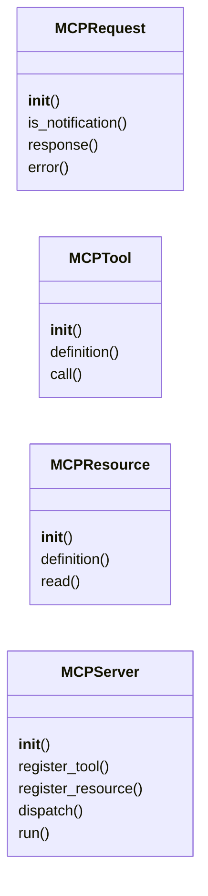
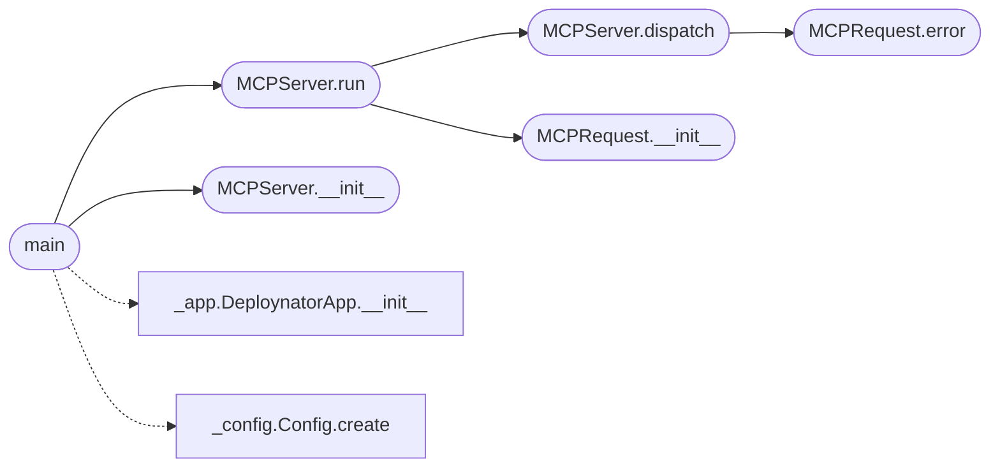

# `deploynator._mcp_server`

> Source: [deploynator/_mcp_server.py:1](../../deploynator/_mcp_server.py#L1) | language `py` | coverage 4.8% | [API index](../index.md)

MCP (Model Context Protocol) stdio server for deploynator.

Exposes headless deploy operations as MCP tools so AI harnesses
(claude code, codex, opencode) can release without interactive prompts.

Tools:
  deploynator.release  — full pipeline (tests gate, docs, semver, tag, push)
  deploynator.commit   — conventional commit only
  deploynator.status   — repo status JSON
  deploynator.projects — list discovered projects
  deploynator.docs     — regenerate docs via readmenator

Resources:
  deploynator://projects — discovered projects JSON
  deploynator://status   — status JSON

Rule: bare [`deploynator`](deploynator.__init__.py.md) (no args) = interactive menu.
Any flags = headless. MCP tools always headless (dry_run supported).

## Contents

- **Classes:** [`MCPRequest`](#mcprequest), [`MCPTool`](#mcptool), [`MCPResource`](#mcpresource), [`MCPServer`](#mcpserver)
- **Functions:** [`main`](#main)
- **Constants:** [`METHOD_NOT_FOUND`](#method_not_found), [`INVALID_PARAMS`](#invalid_params), [`INTERNAL_ERROR`](#internal_error)

## Type Diagram



## Call Graph

Solid arrows stay in this module, dashed arrows leave it.



## Classes

<a id="mcprequest"></a>

### `MCPRequest`

`class` | [deploynator/_mcp_server.py:35](../../deploynator/_mcp_server.py#L35)

```python
class MCPRequest
```

**Members**

| Member | Kind | Summary |
|---|---|---|
| [`__init__`](#mcprequest-__init__) | constructor |  |
| [`is_notification`](#mcprequest-is_notification) | property |  |
| [`response`](#mcprequest-response) | method |  |
| [`error`](#mcprequest-error) | method |  |

<a id="mcprequest-__init__"></a>

#### `MCPRequest.__init__`

`constructor` | [deploynator/_mcp_server.py:36](../../deploynator/_mcp_server.py#L36)

```python
def __init__(self, msg: Dict[str, Any])
```

**Parameters**

| Name | Type | Default | Description |
|---|---|---|---|
| `msg` | `Dict[str, Any]` |  |  |

*Called by:* [`MCPServer.run`](#mcpserver-run)

<a id="mcprequest-is_notification"></a>

#### `MCPRequest.is_notification`

`property` | [deploynator/_mcp_server.py:43](../../deploynator/_mcp_server.py#L43)

Decorators: `@property`

```python
def is_notification(self) -> bool
```

**Returns:** `bool`

<a id="mcprequest-response"></a>

#### `MCPRequest.response`

`method` | [deploynator/_mcp_server.py:46](../../deploynator/_mcp_server.py#L46)

```python
def response(self, result: Any = None) -> Dict[str, Any]
```

**Parameters**

| Name | Type | Default | Description |
|---|---|---|---|
| `result` | `Any` | `None` |  |

**Returns:** `Dict[str, Any]`

<a id="mcprequest-error"></a>

#### `MCPRequest.error`

`method` | [deploynator/_mcp_server.py:49](../../deploynator/_mcp_server.py#L49)

```python
def error(self, code: int, message: str, data: Any = None) -> Dict[str, Any]
```

**Parameters**

| Name | Type | Default | Description |
|---|---|---|---|
| `code` | `int` |  |  |
| `message` | `str` |  |  |
| `data` | `Any` | `None` |  |

**Returns:** `Dict[str, Any]`

*Called by:* [`MCPServer.dispatch`](#mcpserver-dispatch)

---

<a id="mcptool"></a>

### `MCPTool`

`class` | [deploynator/_mcp_server.py:56](../../deploynator/_mcp_server.py#L56)

```python
class MCPTool
```

**Members**

| Member | Kind | Summary |
|---|---|---|
| [`__init__`](#mcptool-__init__) | constructor |  |
| [`definition`](#mcptool-definition) | method |  |
| [`call`](#mcptool-call) | method |  |

<a id="mcptool-__init__"></a>

#### `MCPTool.__init__`

`constructor` | [deploynator/_mcp_server.py:57](../../deploynator/_mcp_server.py#L57)

```python
def __init__(self, name: str, description: str, handler: Callable, input_schema: Optional[Dict[str, Any]] = None)
```

**Parameters**

| Name | Type | Default | Description |
|---|---|---|---|
| `name` | `str` |  |  |
| `description` | `str` |  |  |
| `handler` | `Callable` |  |  |
| `input_schema` | `Optional[Dict[str, Any]]` | `None` |  |

<a id="mcptool-definition"></a>

#### `MCPTool.definition`

`method` | [deploynator/_mcp_server.py:64](../../deploynator/_mcp_server.py#L64)

```python
def definition(self) -> Dict[str, Any]
```

**Returns:** `Dict[str, Any]`

<a id="mcptool-call"></a>

#### `MCPTool.call`

`method` | [deploynator/_mcp_server.py:67](../../deploynator/_mcp_server.py#L67)

```python
def call(self, arguments: Dict[str, Any]) -> Any
```

**Parameters**

| Name | Type | Default | Description |
|---|---|---|---|
| `arguments` | `Dict[str, Any]` |  |  |

**Returns:** `Any`

---

<a id="mcpresource"></a>

### `MCPResource`

`class` | [deploynator/_mcp_server.py:71](../../deploynator/_mcp_server.py#L71)

```python
class MCPResource
```

**Members**

| Member | Kind | Summary |
|---|---|---|
| [`__init__`](#mcpresource-__init__) | constructor |  |
| [`definition`](#mcpresource-definition) | method |  |
| [`read`](#mcpresource-read) | method |  |

<a id="mcpresource-__init__"></a>

#### `MCPResource.__init__`

`constructor` | [deploynator/_mcp_server.py:72](../../deploynator/_mcp_server.py#L72)

```python
def __init__(self, uri: str, name: str, description: str, mime_type: str, handler: Callable)
```

**Parameters**

| Name | Type | Default | Description |
|---|---|---|---|
| `uri` | `str` |  |  |
| `name` | `str` |  |  |
| `description` | `str` |  |  |
| `mime_type` | `str` |  |  |
| `handler` | `Callable` |  |  |

<a id="mcpresource-definition"></a>

#### `MCPResource.definition`

`method` | [deploynator/_mcp_server.py:79](../../deploynator/_mcp_server.py#L79)

```python
def definition(self) -> Dict[str, Any]
```

**Returns:** `Dict[str, Any]`

<a id="mcpresource-read"></a>

#### `MCPResource.read`

`method` | [deploynator/_mcp_server.py:82](../../deploynator/_mcp_server.py#L82)

```python
def read(self) -> Any
```

**Returns:** `Any`

---

<a id="mcpserver"></a>

### `MCPServer`

`class` | [deploynator/_mcp_server.py:86](../../deploynator/_mcp_server.py#L86)

```python
class MCPServer
```

**Members**

| Member | Kind | Summary |
|---|---|---|
| [`__init__`](#mcpserver-__init__) | constructor |  |
| [`register_tool`](#mcpserver-register_tool) | method |  |
| [`register_resource`](#mcpserver-register_resource) | method |  |
| [`dispatch`](#mcpserver-dispatch) | method |  |
| [`run`](#mcpserver-run) | method |  |

<a id="mcpserver-__init__"></a>

#### `MCPServer.__init__`

`constructor` | [deploynator/_mcp_server.py:87](../../deploynator/_mcp_server.py#L87)

```python
def __init__(self, app: Any, target_dir: str)
```

**Parameters**

| Name | Type | Default | Description |
|---|---|---|---|
| `app` | `Any` |  |  |
| `target_dir` | `str` |  |  |

*Called by:* [`main`](deploynator.__main__.py.md#main), [`main`](#main)

<a id="mcpserver-register_tool"></a>

#### `MCPServer.register_tool`

`method` | [deploynator/_mcp_server.py:94](../../deploynator/_mcp_server.py#L94)

```python
def register_tool(self, tool: MCPTool) -> None
```

**Parameters**

| Name | Type | Default | Description |
|---|---|---|---|
| `tool` | `MCPTool` |  |  |

<a id="mcpserver-register_resource"></a>

#### `MCPServer.register_resource`

`method` | [deploynator/_mcp_server.py:97](../../deploynator/_mcp_server.py#L97)

```python
def register_resource(self, resource: MCPResource) -> None
```

**Parameters**

| Name | Type | Default | Description |
|---|---|---|---|
| `resource` | `MCPResource` |  |  |

<a id="mcpserver-dispatch"></a>

#### `MCPServer.dispatch`

`method` | [deploynator/_mcp_server.py:144](../../deploynator/_mcp_server.py#L144)

```python
def dispatch(self, req: MCPRequest) -> Optional[Dict[str, Any]]
```

**Parameters**

| Name | Type | Default | Description |
|---|---|---|---|
| `req` | `MCPRequest` |  |  |

**Returns:** `Optional[Dict[str, Any]]`

*Calls:* [`MCPRequest.error`](#mcprequest-error)

*Called by:* [`MCPServer.run`](#mcpserver-run)

<a id="mcpserver-run"></a>

#### `MCPServer.run`

`method` | [deploynator/_mcp_server.py:162](../../deploynator/_mcp_server.py#L162)

```python
def run(self) -> None
```

*Calls:* [`MCPRequest.__init__`](#mcprequest-__init__), [`MCPServer.dispatch`](#mcpserver-dispatch)

*Called by:* [`main`](deploynator.__main__.py.md#main), [`main`](#main)

---

## Functions

<a id="main"></a>

### `main`

`function` | [deploynator/_mcp_server.py:270](../../deploynator/_mcp_server.py#L270)

```python
def main() -> None
```

*Calls:* [`DeploynatorApp.__init__`](deploynator._app.py.md#deploynatorapp-__init__), [`Config.create`](deploynator._config.py.md#config-create), [`MCPServer.__init__`](#mcpserver-__init__), [`MCPServer.run`](#mcpserver-run)

---

## Constants

<a id="method_not_found"></a>

### `METHOD_NOT_FOUND`

`constant` | [deploynator/_mcp_server.py:30](../../deploynator/_mcp_server.py#L30)

```python
METHOD_NOT_FOUND = -32601
```

---

<a id="invalid_params"></a>

### `INVALID_PARAMS`

`constant` | [deploynator/_mcp_server.py:31](../../deploynator/_mcp_server.py#L31)

```python
INVALID_PARAMS = -32602
```

---

<a id="internal_error"></a>

### `INTERNAL_ERROR`

`constant` | [deploynator/_mcp_server.py:32](../../deploynator/_mcp_server.py#L32)

```python
INTERNAL_ERROR = -32603
```

---
