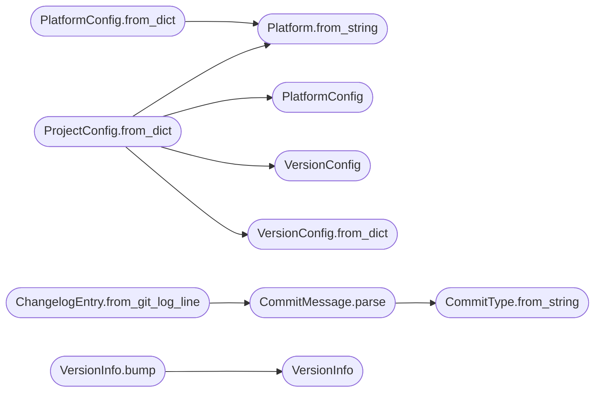

# `deploynator._models`

> Source: [deploynator/_models.py:1](../../deploynator/_models.py#L1) | language `py` | coverage 0.0% | [API index](../index.md)

## Contents

- **Classes:** [`PlatformConfig`](#platformconfig), [`VersionConfig`](#versionconfig), [`ProjectConfig`](#projectconfig), [`CommitMessage`](#commitmessage), [`VersionInfo`](#versioninfo), [`ChangelogEntry`](#changelogentry), [`ReleaseInfo`](#releaseinfo), [`DeployResult`](#deployresult)
- **Enums:** [`Platform`](#platform), [`CommitType`](#committype)

## Type Diagram

```mermaid
classDiagram
    direction LR
    class Platform
    <<enum>> Platform
    Platform : GITHUB
    Platform : GITLAB
    Platform : BITBUCKET
    Platform : from_string()
    Platform : label()
    Platform : cli_name()
    Platform : auth_env_var()
    class CommitType
    <<enum>> CommitType
    CommitType : FEAT
    CommitType : FIX
    CommitType : HOTFIX
    CommitType : DOCS
    CommitType : REFACTOR
    CommitType : STYLE
    CommitType : CHORE
    CommitType : TEST
    CommitType : RELEASE
    CommitType : PATCH
    CommitType : from_string()
    CommitType : valid_types()
    CommitType : bump_strategy()
    CommitType : section_header()
    class PlatformConfig
    PlatformConfig : Platform platform
    PlatformConfig : str repo
    PlatformConfig : bool enabled
    PlatformConfig : str  None auth_env
    PlatformConfig : from_dict()
    class VersionConfig
    VersionConfig : str file
    VersionConfig : str file_type
    VersionConfig : str pattern
    VersionConfig : from_dict()
    class ProjectConfig
    ProjectConfig : str name
    ProjectConfig : str description
    ProjectConfig : list[PlatformConfig] platforms
    ProjectConfig : VersionConfig version
    ProjectConfig : str path
    ProjectConfig : str repo_url
    ProjectConfig : from_dict()
    class CommitMessage
    CommitMessage : CommitType commit_type
    CommitMessage : str scope
    CommitMessage : str subject
    CommitMessage : str body
    CommitMessage : str footer
    CommitMessage : str version
    CommitMessage : format()
    CommitMessage : parse()
    class VersionInfo
    VersionInfo : int major
    VersionInfo : int minor
    VersionInfo : int patch
    VersionInfo : parse()
    VersionInfo : bump()
    class ChangelogEntry
    ChangelogEntry : CommitType commit_type
    ChangelogEntry : str message
    ChangelogEntry : str author
    ChangelogEntry : datetime date
    ChangelogEntry : str sha
    ChangelogEntry : from_git_log_line()
    class ReleaseInfo
    ReleaseInfo : str version
    ReleaseInfo : str title
    ReleaseInfo : str notes
    ReleaseInfo : str target_branch
    ReleaseInfo : bool prerelease
    ReleaseInfo : bool draft
    class DeployResult
    DeployResult : str project
    DeployResult : str version
    DeployResult : bool success
    DeployResult : list[str] platforms_pushed
    DeployResult : list[str] releases_created
    DeployResult : str  None error
```



## Call Graph

Solid arrows stay in this module, dashed arrows leave it.



## Classes

<a id="platformconfig"></a>

### `PlatformConfig`

`class` `dataclass` | [deploynator/_models.py:97](../../deploynator/_models.py#L97)

Decorators: `@dataclass(frozen=True)`

```python
class PlatformConfig
```

**Attributes**

| Name | Type | Default | Description |
|---|---|---|---|
| [`platform`](#platformconfig-platform) | `Platform` |  |  |
| [`repo`](#platformconfig-repo) | `str` |  |  |
| [`enabled`](#platformconfig-enabled) | `bool` | `True` |  |
| [`auth_env`](#platformconfig-auth_env) | `str \| None` | `None` |  |

**Members**

| Member | Kind | Summary |
|---|---|---|
| [`from_dict`](#platformconfig-from_dict) | classmethod |  |

<a id="platformconfig-from_dict"></a>

#### `PlatformConfig.from_dict`

`classmethod` | [deploynator/_models.py:104](../../deploynator/_models.py#L104)

Decorators: `@classmethod`

```python
def from_dict(cls, data: dict) -> PlatformConfig
```

**Parameters**

| Name | Type | Default | Description |
|---|---|---|---|
| `data` | `dict` |  |  |

**Returns:** `PlatformConfig`

*Calls:* [`Platform.from_string`](#platform-from_string)

---

<a id="versionconfig"></a>

### `VersionConfig`

`class` `dataclass` | [deploynator/_models.py:114](../../deploynator/_models.py#L114)

Decorators: `@dataclass(frozen=True)`

```python
class VersionConfig
```

**Attributes**

| Name | Type | Default | Description |
|---|---|---|---|
| [`file`](#versionconfig-file) | `str` | `'version.json'` |  |
| [`file_type`](#versionconfig-file_type) | `str` | `'json'` |  |
| [`pattern`](#versionconfig-pattern) | `str` | `'(\\d+)\\.(\\d+)\\.(\\d+)'` |  |

**Members**

| Member | Kind | Summary |
|---|---|---|
| [`from_dict`](#versionconfig-from_dict) | classmethod |  |

<a id="versionconfig-from_dict"></a>

#### `VersionConfig.from_dict`

`classmethod` | [deploynator/_models.py:120](../../deploynator/_models.py#L120)

Decorators: `@classmethod`

```python
def from_dict(cls, data: dict) -> VersionConfig
```

**Parameters**

| Name | Type | Default | Description |
|---|---|---|---|
| `data` | `dict` |  |  |

**Returns:** `VersionConfig`

*Called by:* [`ProjectConfig.from_dict`](#projectconfig-from_dict)

---

<a id="projectconfig"></a>

### `ProjectConfig`

`class` `dataclass` | [deploynator/_models.py:129](../../deploynator/_models.py#L129)

Decorators: `@dataclass(frozen=True)`

```python
class ProjectConfig
```

**Attributes**

| Name | Type | Default | Description |
|---|---|---|---|
| [`name`](#projectconfig-name) | `str` |  |  |
| [`description`](#projectconfig-description) | `str` | `''` |  |
| [`platforms`](#projectconfig-platforms) | `list[PlatformConfig]` | `field(default_factory=list)` |  |
| [`version`](#projectconfig-version) | `VersionConfig` | `field(default_factory=VersionConfig)` |  |
| [`path`](#projectconfig-path) | `str` | `''` |  |
| [`repo_url`](#projectconfig-repo_url) | `str` | `''` |  |

**Members**

| Member | Kind | Summary |
|---|---|---|
| [`from_dict`](#projectconfig-from_dict) | classmethod |  |

<a id="projectconfig-from_dict"></a>

#### `ProjectConfig.from_dict`

`classmethod` | [deploynator/_models.py:138](../../deploynator/_models.py#L138)

Decorators: `@classmethod`

```python
def from_dict(cls, data: dict) -> ProjectConfig
```

**Parameters**

| Name | Type | Default | Description |
|---|---|---|---|
| `data` | `dict` |  |  |

**Returns:** `ProjectConfig`

*Calls:* [`Platform.from_string`](#platform-from_string), [`PlatformConfig`](#platformconfig), [`VersionConfig`](#versionconfig), [`VersionConfig.from_dict`](#versionconfig-from_dict)

---

<a id="commitmessage"></a>

### `CommitMessage`

`class` `dataclass` | [deploynator/_models.py:174](../../deploynator/_models.py#L174)

Decorators: `@dataclass(frozen=True)`

```python
class CommitMessage
```

**Attributes**

| Name | Type | Default | Description |
|---|---|---|---|
| [`commit_type`](#commitmessage-commit_type) | `CommitType` |  |  |
| [`scope`](#commitmessage-scope) | `str` |  |  |
| [`subject`](#commitmessage-subject) | `str` |  |  |
| [`body`](#commitmessage-body) | `str` | `''` |  |
| [`footer`](#commitmessage-footer) | `str` | `''` |  |
| [`version`](#commitmessage-version) | `str` | `''` |  |

**Members**

| Member | Kind | Summary |
|---|---|---|
| [`format`](#commitmessage-format) | method |  |
| [`parse`](#commitmessage-parse) | classmethod |  |

<a id="commitmessage-format"></a>

#### `CommitMessage.format`

`method` | [deploynator/_models.py:182](../../deploynator/_models.py#L182)

```python
def format(self) -> str
```

**Returns:** `str`

<a id="commitmessage-parse"></a>

#### `CommitMessage.parse`

`classmethod` | [deploynator/_models.py:194](../../deploynator/_models.py#L194)

Decorators: `@classmethod`

```python
def parse(cls, raw: str) -> CommitMessage
```

**Parameters**

| Name | Type | Default | Description |
|---|---|---|---|
| `raw` | `str` |  |  |

**Returns:** `CommitMessage`

**Raises**

- `ValueError`: (raised in the body, not documented)

*Calls:* [`CommitType.from_string`](#committype-from_string)

*Called by:* [`ChangelogGenerator.generate_from_messages`](deploynator._changelog.py.md#changeloggenerator-generate_from_messages), [`ChangelogEntry.from_git_log_line`](#changelogentry-from_git_log_line)

---

<a id="versioninfo"></a>

### `VersionInfo`

`class` `dataclass` | [deploynator/_models.py:207](../../deploynator/_models.py#L207)

Decorators: `@dataclass(frozen=True)`

```python
class VersionInfo
```

**Attributes**

| Name | Type | Default | Description |
|---|---|---|---|
| [`major`](#versioninfo-major) | `int` |  |  |
| [`minor`](#versioninfo-minor) | `int` |  |  |
| [`patch`](#versioninfo-patch) | `int` |  |  |

**Members**

| Member | Kind | Summary |
|---|---|---|
| [`parse`](#versioninfo-parse) | classmethod |  |
| [`bump`](#versioninfo-bump) | method |  |

<a id="versioninfo-parse"></a>

#### `VersionInfo.parse`

`classmethod` | [deploynator/_models.py:216](../../deploynator/_models.py#L216)

Decorators: `@classmethod`

```python
def parse(cls, version_str: str) -> VersionInfo
```

**Parameters**

| Name | Type | Default | Description |
|---|---|---|---|
| `version_str` | `str` |  |  |

**Returns:** `VersionInfo`

**Raises**

- `ValueError`: (raised in the body, not documented)

*Called by:* [`DeployOrchestrator.deploy`](deploynator._deploy.py.md#deployorchestrator-deploy), [`SemverManager.get_current_version`](deploynator._semver.py.md#semvermanager-get_current_version)

<a id="versioninfo-bump"></a>

#### `VersionInfo.bump`

`method` | [deploynator/_models.py:227](../../deploynator/_models.py#L227)

```python
def bump(self, strategy: str | None) -> VersionInfo
```

**Parameters**

| Name | Type | Default | Description |
|---|---|---|---|
| `strategy` | `str \| None` |  |  |

**Returns:** `VersionInfo`

*Calls:* [`VersionInfo`](#versioninfo)

*Called by:* [`SemverManager.calculate_next_version`](deploynator._semver.py.md#semvermanager-calculate_next_version)

---

<a id="changelogentry"></a>

### `ChangelogEntry`

`class` `dataclass` | [deploynator/_models.py:238](../../deploynator/_models.py#L238)

Decorators: `@dataclass(frozen=True)`

```python
class ChangelogEntry
```

**Attributes**

| Name | Type | Default | Description |
|---|---|---|---|
| [`commit_type`](#changelogentry-commit_type) | `CommitType` |  |  |
| [`message`](#changelogentry-message) | `str` |  |  |
| [`author`](#changelogentry-author) | `str` | `''` |  |
| [`date`](#changelogentry-date) | `datetime` | `field(default_factory=datetime.now)` |  |
| [`sha`](#changelogentry-sha) | `str` | `''` |  |

**Members**

| Member | Kind | Summary |
|---|---|---|
| [`from_git_log_line`](#changelogentry-from_git_log_line) | classmethod |  |

<a id="changelogentry-from_git_log_line"></a>

#### `ChangelogEntry.from_git_log_line`

`classmethod` | [deploynator/_models.py:246](../../deploynator/_models.py#L246)

Decorators: `@classmethod`

```python
def from_git_log_line(cls, line: str, author: str = '', sha: str = '') -> ChangelogEntry
```

**Parameters**

| Name | Type | Default | Description |
|---|---|---|---|
| `line` | `str` |  |  |
| `author` | `str` | `''` |  |
| `sha` | `str` | `''` |  |

**Returns:** `ChangelogEntry`

*Calls:* [`CommitMessage.parse`](#commitmessage-parse)

---

<a id="releaseinfo"></a>

### `ReleaseInfo`

`class` `dataclass` | [deploynator/_models.py:265](../../deploynator/_models.py#L265)

Decorators: `@dataclass(frozen=True)`

```python
class ReleaseInfo
```

**Attributes**

| Name | Type | Default | Description |
|---|---|---|---|
| [`version`](#releaseinfo-version) | `str` |  |  |
| [`title`](#releaseinfo-title) | `str` |  |  |
| [`notes`](#releaseinfo-notes) | `str` |  |  |
| [`target_branch`](#releaseinfo-target_branch) | `str` | `'main'` |  |
| [`prerelease`](#releaseinfo-prerelease) | `bool` | `False` |  |
| [`draft`](#releaseinfo-draft) | `bool` | `False` |  |

---

<a id="deployresult"></a>

### `DeployResult`

`class` `dataclass` | [deploynator/_models.py:275](../../deploynator/_models.py#L275)

Decorators: `@dataclass`

```python
class DeployResult
```

**Attributes**

| Name | Type | Default | Description |
|---|---|---|---|
| [`project`](#deployresult-project) | `str` |  |  |
| [`version`](#deployresult-version) | `str` |  |  |
| [`success`](#deployresult-success) | `bool` |  |  |
| [`platforms_pushed`](#deployresult-platforms_pushed) | `list[str]` | `field(default_factory=list)` |  |
| [`releases_created`](#deployresult-releases_created) | `list[str]` | `field(default_factory=list)` |  |
| [`error`](#deployresult-error) | `str \| None` | `None` |  |

---

## Enums

<a id="platform"></a>

### `Platform`

`enum` | [deploynator/_models.py:9](../../deploynator/_models.py#L9)

```python
class Platform(Enum)
```

Bases: `Enum`

**Attributes**

| Name | Type | Default | Description |
|---|---|---|---|
| [`GITHUB`](#platform-github) |  | `auto()` |  |
| [`GITLAB`](#platform-gitlab) |  | `auto()` |  |
| [`BITBUCKET`](#platform-bitbucket) |  | `auto()` |  |

**Members**

| Member | Kind | Summary |
|---|---|---|
| [`from_string`](#platform-from_string) | classmethod |  |
| [`label`](#platform-label) | method |  |
| [`cli_name`](#platform-cli_name) | method |  |
| [`auth_env_var`](#platform-auth_env_var) | method |  |

<a id="platform-from_string"></a>

#### `Platform.from_string`

`classmethod` | [deploynator/_models.py:15](../../deploynator/_models.py#L15)

Decorators: `@classmethod`

```python
def from_string(cls, name: str) -> Platform
```

**Parameters**

| Name | Type | Default | Description |
|---|---|---|---|
| `name` | `str` |  |  |

**Returns:** `Platform`

**Raises**

- `ValueError`: (raised in the body, not documented)

*Called by:* [`DeploynatorApp.auth_status`](deploynator._app.py.md#deploynatorapp-auth_status), [`DeploynatorApp.release`](deploynator._app.py.md#deploynatorapp-release), [`PlatformConfig.from_dict`](#platformconfig-from_dict), [`ProjectConfig.from_dict`](#projectconfig-from_dict)

<a id="platform-label"></a>

#### `Platform.label`

`method` | [deploynator/_models.py:26](../../deploynator/_models.py#L26)

```python
def label(self) -> str
```

**Returns:** `str`

<a id="platform-cli_name"></a>

#### `Platform.cli_name`

`method` | [deploynator/_models.py:29](../../deploynator/_models.py#L29)

```python
def cli_name(self) -> str
```

**Returns:** `str`

<a id="platform-auth_env_var"></a>

#### `Platform.auth_env_var`

`method` | [deploynator/_models.py:36](../../deploynator/_models.py#L36)

```python
def auth_env_var(self) -> str
```

**Returns:** `str`

---

<a id="committype"></a>

### `CommitType`

`enum` | [deploynator/_models.py:44](../../deploynator/_models.py#L44)

```python
class CommitType(Enum)
```

Bases: `Enum`

**Attributes**

| Name | Type | Default | Description |
|---|---|---|---|
| [`FEAT`](#committype-feat) |  | `'feat'` |  |
| [`FIX`](#committype-fix) |  | `'fix'` |  |
| [`HOTFIX`](#committype-hotfix) |  | `'hotfix'` |  |
| [`DOCS`](#committype-docs) |  | `'docs'` |  |
| [`REFACTOR`](#committype-refactor) |  | `'refactor'` |  |
| [`STYLE`](#committype-style) |  | `'style'` |  |
| [`CHORE`](#committype-chore) |  | `'chore'` |  |
| [`TEST`](#committype-test) |  | `'test'` |  |
| [`RELEASE`](#committype-release) |  | `'release'` |  |
| [`PATCH`](#committype-patch) |  | `'patch'` |  |

**Members**

| Member | Kind | Summary |
|---|---|---|
| [`from_string`](#committype-from_string) | classmethod |  |
| [`valid_types`](#committype-valid_types) | classmethod |  |
| [`bump_strategy`](#committype-bump_strategy) | method |  |
| [`section_header`](#committype-section_header) | method |  |

<a id="committype-from_string"></a>

#### `CommitType.from_string`

`classmethod` | [deploynator/_models.py:57](../../deploynator/_models.py#L57)

Decorators: `@classmethod`

```python
def from_string(cls, value: str) -> CommitType
```

**Parameters**

| Name | Type | Default | Description |
|---|---|---|---|
| `value` | `str` |  |  |

**Returns:** `CommitType`

**Raises**

- `ValueError`: (raised in the body, not documented)

*Called by:* [`DeploynatorApp.commit`](deploynator._app.py.md#deploynatorapp-commit), [`DeploynatorApp.release`](deploynator._app.py.md#deploynatorapp-release), [`DeploynatorApp.start_branch`](deploynator._app.py.md#deploynatorapp-start_branch), [`CommitMessage.parse`](#commitmessage-parse)

<a id="committype-valid_types"></a>

#### `CommitType.valid_types`

`classmethod` | [deploynator/_models.py:64](../../deploynator/_models.py#L64)

Decorators: `@classmethod`

```python
def valid_types(cls) -> list[str]
```

**Returns:** `list[str]`

*Called by:* [`build_parser`](deploynator.__main__.py.md#build_parser)

<a id="committype-bump_strategy"></a>

#### `CommitType.bump_strategy`

`method` | [deploynator/_models.py:67](../../deploynator/_models.py#L67)

```python
def bump_strategy(self) -> str | None
```

**Returns:** `str | None`

*Called by:* [`SemverManager.determine_bump`](deploynator._semver.py.md#semvermanager-determine_bump)

<a id="committype-section_header"></a>

#### `CommitType.section_header`

`method` | [deploynator/_models.py:81](../../deploynator/_models.py#L81)

```python
def section_header(self) -> str
```

**Returns:** `str`

---
