# `deploynator._platforms`

> Source: [deploynator/_platforms.py:1](../../deploynator/_platforms.py#L1) | language `py` | coverage 0.0% | [API index](../index.md)

## Contents

- **Classes:** [`PlatformClient`](#platformclient), [`GitHubCLI`](#githubcli), [`GitLabCLI`](#gitlabcli), [`BitbucketCLI`](#bitbucketcli), [`PlatformFactory`](#platformfactory)

## Type Diagram

```mermaid
classDiagram
    direction LR
    class PlatformClient
    PlatformClient : __init__()
    PlatformClient : name()
    PlatformClient : is_available()
    PlatformClient : is_authenticated()
    PlatformClient : create_release()
    PlatformClient : create_pull_request()
    PlatformClient : push_changes()
    class GitHubCLI
    GitHubCLI : name()
    GitHubCLI : is_available()
    GitHubCLI : is_authenticated()
    GitHubCLI : create_release()
    GitHubCLI : create_pull_request()
    GitHubCLI : push_changes()
    class GitLabCLI
    GitLabCLI : name()
    GitLabCLI : is_available()
    GitLabCLI : is_authenticated()
    GitLabCLI : create_release()
    GitLabCLI : create_pull_request()
    GitLabCLI : push_changes()
    class BitbucketCLI
    BitbucketCLI : name()
    BitbucketCLI : is_available()
    BitbucketCLI : is_authenticated()
    BitbucketCLI : create_release()
    BitbucketCLI : create_pull_request()
    BitbucketCLI : push_changes()
    class PlatformFactory
    PlatformFactory : register()
    PlatformFactory : create()
    PlatformFactory : create_all_available()
    PlatformClient <|-- GitHubCLI
    PlatformClient <|-- GitLabCLI
    PlatformClient <|-- BitbucketCLI
```



## Classes

<a id="platformclient"></a>

### `PlatformClient`

`class` `abstract` | [deploynator/_platforms.py:14](../../deploynator/_platforms.py#L14)

```python
class PlatformClient(ABC)
```

Bases: `ABC`

Subclasses: [`BitbucketCLI`](#bitbucketcli), [`GitHubCLI`](#githubcli), [`GitLabCLI`](#gitlabcli)

**Members**

| Member | Kind | Summary |
|---|---|---|
| [`__init__`](#platformclient-__init__) | constructor |  |
| [`name`](#platformclient-name) | method |  |
| [`is_available`](#platformclient-is_available) | method |  |
| [`is_authenticated`](#platformclient-is_authenticated) | method |  |
| [`create_release`](#platformclient-create_release) | method |  |
| [`create_pull_request`](#platformclient-create_pull_request) | method |  |
| [`push_changes`](#platformclient-push_changes) | method |  |

<a id="platformclient-__init__"></a>

#### `PlatformClient.__init__`

`constructor` | [deploynator/_platforms.py:15](../../deploynator/_platforms.py#L15)

```python
def __init__(self, config: Config) -> None
```

**Parameters**

| Name | Type | Default | Description |
|---|---|---|---|
| `config` | `Config` |  |  |

<a id="platformclient-name"></a>

#### `PlatformClient.name`

`method` `abstract` | [deploynator/_platforms.py:19](../../deploynator/_platforms.py#L19)

Decorators: `@abstractmethod`

```python
def name(self) -> str
```

**Returns:** `str`

<a id="platformclient-is_available"></a>

#### `PlatformClient.is_available`

`method` `abstract` | [deploynator/_platforms.py:23](../../deploynator/_platforms.py#L23)

Decorators: `@abstractmethod`

```python
def is_available(self) -> bool
```

**Returns:** `bool`

<a id="platformclient-is_authenticated"></a>

#### `PlatformClient.is_authenticated`

`method` `abstract` | [deploynator/_platforms.py:27](../../deploynator/_platforms.py#L27)

Decorators: `@abstractmethod`

```python
def is_authenticated(self) -> bool
```

**Returns:** `bool`

<a id="platformclient-create_release"></a>

#### `PlatformClient.create_release`

`method` `abstract` | [deploynator/_platforms.py:31](../../deploynator/_platforms.py#L31)

Decorators: `@abstractmethod`

```python
def create_release(self, repo: str, release: ReleaseInfo) -> bool
```

**Parameters**

| Name | Type | Default | Description |
|---|---|---|---|
| `repo` | `str` |  |  |
| `release` | `ReleaseInfo` |  |  |

**Returns:** `bool`

<a id="platformclient-create_pull_request"></a>

#### `PlatformClient.create_pull_request`

`method` `abstract` | [deploynator/_platforms.py:35](../../deploynator/_platforms.py#L35)

Decorators: `@abstractmethod`

```python
def create_pull_request(self, repo: str, title: str, body: str, head: str, base: str) -> Optional[str]
```

**Parameters**

| Name | Type | Default | Description |
|---|---|---|---|
| `repo` | `str` |  |  |
| `title` | `str` |  |  |
| `body` | `str` |  |  |
| `head` | `str` |  |  |
| `base` | `str` |  |  |

**Returns:** `Optional[str]`

<a id="platformclient-push_changes"></a>

#### `PlatformClient.push_changes`

`method` `abstract` | [deploynator/_platforms.py:39](../../deploynator/_platforms.py#L39)

Decorators: `@abstractmethod`

```python
def push_changes(self, repo_path: str, remote: str, branch: str, tags: bool) -> bool
```

**Parameters**

| Name | Type | Default | Description |
|---|---|---|---|
| `repo_path` | `str` |  |  |
| `remote` | `str` |  |  |
| `branch` | `str` |  |  |
| `tags` | `bool` |  |  |

**Returns:** `bool`

---

<a id="githubcli"></a>

### `GitHubCLI`

`class` | [deploynator/_platforms.py:49](../../deploynator/_platforms.py#L49)

```python
class GitHubCLI(PlatformClient)
```

Bases: [`PlatformClient`](#platformclient)

**Members**

| Member | Kind | Summary |
|---|---|---|
| [`name`](#githubcli-name) | method |  |
| [`is_available`](#githubcli-is_available) | method |  |
| [`is_authenticated`](#githubcli-is_authenticated) | method |  |
| [`create_release`](#githubcli-create_release) | method |  |
| [`create_pull_request`](#githubcli-create_pull_request) | method |  |
| [`push_changes`](#githubcli-push_changes) | method |  |

<a id="githubcli-name"></a>

#### `GitHubCLI.name`

`method` | [deploynator/_platforms.py:50](../../deploynator/_platforms.py#L50)

```python
def name(self) -> str
```

**Returns:** `str`

<a id="githubcli-is_available"></a>

#### `GitHubCLI.is_available`

`method` | [deploynator/_platforms.py:53](../../deploynator/_platforms.py#L53)

```python
def is_available(self) -> bool
```

**Returns:** `bool`

<a id="githubcli-is_authenticated"></a>

#### `GitHubCLI.is_authenticated`

`method` | [deploynator/_platforms.py:60](../../deploynator/_platforms.py#L60)

```python
def is_authenticated(self) -> bool
```

**Returns:** `bool`

<a id="githubcli-create_release"></a>

#### `GitHubCLI.create_release`

`method` | [deploynator/_platforms.py:67](../../deploynator/_platforms.py#L67)

```python
def create_release(self, repo: str, release: ReleaseInfo) -> bool
```

**Parameters**

| Name | Type | Default | Description |
|---|---|---|---|
| `repo` | `str` |  |  |
| `release` | `ReleaseInfo` |  |  |

**Returns:** `bool`

<a id="githubcli-create_pull_request"></a>

#### `GitHubCLI.create_pull_request`

`method` | [deploynator/_platforms.py:91](../../deploynator/_platforms.py#L91)

```python
def create_pull_request(self, repo: str, title: str, body: str, head: str, base: str) -> Optional[str]
```

**Parameters**

| Name | Type | Default | Description |
|---|---|---|---|
| `repo` | `str` |  |  |
| `title` | `str` |  |  |
| `body` | `str` |  |  |
| `head` | `str` |  |  |
| `base` | `str` |  |  |

**Returns:** `Optional[str]`

<a id="githubcli-push_changes"></a>

#### `GitHubCLI.push_changes`

`method` | [deploynator/_platforms.py:105](../../deploynator/_platforms.py#L105)

```python
def push_changes(self, repo_path: str, remote: str, branch: str, tags: bool) -> bool
```

**Parameters**

| Name | Type | Default | Description |
|---|---|---|---|
| `repo_path` | `str` |  |  |
| `remote` | `str` |  |  |
| `branch` | `str` |  |  |
| `tags` | `bool` |  |  |

**Returns:** `bool`

---

<a id="gitlabcli"></a>

### `GitLabCLI`

`class` | [deploynator/_platforms.py:113](../../deploynator/_platforms.py#L113)

```python
class GitLabCLI(PlatformClient)
```

Bases: [`PlatformClient`](#platformclient)

**Members**

| Member | Kind | Summary |
|---|---|---|
| [`name`](#gitlabcli-name) | method |  |
| [`is_available`](#gitlabcli-is_available) | method |  |
| [`is_authenticated`](#gitlabcli-is_authenticated) | method |  |
| [`create_release`](#gitlabcli-create_release) | method |  |
| [`create_pull_request`](#gitlabcli-create_pull_request) | method |  |
| [`push_changes`](#gitlabcli-push_changes) | method |  |

<a id="gitlabcli-name"></a>

#### `GitLabCLI.name`

`method` | [deploynator/_platforms.py:114](../../deploynator/_platforms.py#L114)

```python
def name(self) -> str
```

**Returns:** `str`

<a id="gitlabcli-is_available"></a>

#### `GitLabCLI.is_available`

`method` | [deploynator/_platforms.py:117](../../deploynator/_platforms.py#L117)

```python
def is_available(self) -> bool
```

**Returns:** `bool`

<a id="gitlabcli-is_authenticated"></a>

#### `GitLabCLI.is_authenticated`

`method` | [deploynator/_platforms.py:124](../../deploynator/_platforms.py#L124)

```python
def is_authenticated(self) -> bool
```

**Returns:** `bool`

<a id="gitlabcli-create_release"></a>

#### `GitLabCLI.create_release`

`method` | [deploynator/_platforms.py:131](../../deploynator/_platforms.py#L131)

```python
def create_release(self, repo: str, release: ReleaseInfo) -> bool
```

**Parameters**

| Name | Type | Default | Description |
|---|---|---|---|
| `repo` | `str` |  |  |
| `release` | `ReleaseInfo` |  |  |

**Returns:** `bool`

<a id="gitlabcli-create_pull_request"></a>

#### `GitLabCLI.create_pull_request`

`method` | [deploynator/_platforms.py:142](../../deploynator/_platforms.py#L142)

```python
def create_pull_request(self, repo: str, title: str, body: str, head: str, base: str) -> Optional[str]
```

**Parameters**

| Name | Type | Default | Description |
|---|---|---|---|
| `repo` | `str` |  |  |
| `title` | `str` |  |  |
| `body` | `str` |  |  |
| `head` | `str` |  |  |
| `base` | `str` |  |  |

**Returns:** `Optional[str]`

<a id="gitlabcli-push_changes"></a>

#### `GitLabCLI.push_changes`

`method` | [deploynator/_platforms.py:156](../../deploynator/_platforms.py#L156)

```python
def push_changes(self, repo_path: str, remote: str, branch: str, tags: bool) -> bool
```

**Parameters**

| Name | Type | Default | Description |
|---|---|---|---|
| `repo_path` | `str` |  |  |
| `remote` | `str` |  |  |
| `branch` | `str` |  |  |
| `tags` | `bool` |  |  |

**Returns:** `bool`

---

<a id="bitbucketcli"></a>

### `BitbucketCLI`

`class` | [deploynator/_platforms.py:164](../../deploynator/_platforms.py#L164)

```python
class BitbucketCLI(PlatformClient)
```

Bases: [`PlatformClient`](#platformclient)

**Members**

| Member | Kind | Summary |
|---|---|---|
| [`name`](#bitbucketcli-name) | method |  |
| [`is_available`](#bitbucketcli-is_available) | method |  |
| [`is_authenticated`](#bitbucketcli-is_authenticated) | method |  |
| [`create_release`](#bitbucketcli-create_release) | method |  |
| [`create_pull_request`](#bitbucketcli-create_pull_request) | method |  |
| [`push_changes`](#bitbucketcli-push_changes) | method |  |

<a id="bitbucketcli-name"></a>

#### `BitbucketCLI.name`

`method` | [deploynator/_platforms.py:165](../../deploynator/_platforms.py#L165)

```python
def name(self) -> str
```

**Returns:** `str`

<a id="bitbucketcli-is_available"></a>

#### `BitbucketCLI.is_available`

`method` | [deploynator/_platforms.py:168](../../deploynator/_platforms.py#L168)

```python
def is_available(self) -> bool
```

**Returns:** `bool`

<a id="bitbucketcli-is_authenticated"></a>

#### `BitbucketCLI.is_authenticated`

`method` | [deploynator/_platforms.py:178](../../deploynator/_platforms.py#L178)

```python
def is_authenticated(self) -> bool
```

**Returns:** `bool`

<a id="bitbucketcli-create_release"></a>

#### `BitbucketCLI.create_release`

`method` | [deploynator/_platforms.py:181](../../deploynator/_platforms.py#L181)

```python
def create_release(self, repo: str, release: ReleaseInfo) -> bool
```

**Parameters**

| Name | Type | Default | Description |
|---|---|---|---|
| `repo` | `str` |  |  |
| `release` | `ReleaseInfo` |  |  |

**Returns:** `bool`

<a id="bitbucketcli-create_pull_request"></a>

#### `BitbucketCLI.create_pull_request`

`method` | [deploynator/_platforms.py:201](../../deploynator/_platforms.py#L201)

```python
def create_pull_request(self, repo: str, title: str, body: str, head: str, base: str) -> Optional[str]
```

**Parameters**

| Name | Type | Default | Description |
|---|---|---|---|
| `repo` | `str` |  |  |
| `title` | `str` |  |  |
| `body` | `str` |  |  |
| `head` | `str` |  |  |
| `base` | `str` |  |  |

**Returns:** `Optional[str]`

<a id="bitbucketcli-push_changes"></a>

#### `BitbucketCLI.push_changes`

`method` | [deploynator/_platforms.py:215](../../deploynator/_platforms.py#L215)

```python
def push_changes(self, repo_path: str, remote: str, branch: str, tags: bool) -> bool
```

**Parameters**

| Name | Type | Default | Description |
|---|---|---|---|
| `repo_path` | `str` |  |  |
| `remote` | `str` |  |  |
| `branch` | `str` |  |  |
| `tags` | `bool` |  |  |

**Returns:** `bool`

---

<a id="platformfactory"></a>

### `PlatformFactory`

`class` | [deploynator/_platforms.py:223](../../deploynator/_platforms.py#L223)

```python
class PlatformFactory
```

**Members**

| Member | Kind | Summary |
|---|---|---|
| [`register`](#platformfactory-register) | classmethod |  |
| [`create`](#platformfactory-create) | classmethod |  |
| [`create_all_available`](#platformfactory-create_all_available) | classmethod |  |

<a id="platformfactory-register"></a>

#### `PlatformFactory.register`

`classmethod` | [deploynator/_platforms.py:231](../../deploynator/_platforms.py#L231)

Decorators: `@classmethod`

```python
def register(cls, platform: Platform, client_class: type[PlatformClient]) -> None
```

**Parameters**

| Name | Type | Default | Description |
|---|---|---|---|
| `platform` | `Platform` |  |  |
| `client_class` | `type[PlatformClient]` |  |  |

<a id="platformfactory-create"></a>

#### `PlatformFactory.create`

`classmethod` | [deploynator/_platforms.py:235](../../deploynator/_platforms.py#L235)

Decorators: `@classmethod`

```python
def create(cls, platform: Platform, config: Config) -> PlatformClient
```

**Parameters**

| Name | Type | Default | Description |
|---|---|---|---|
| `platform` | `Platform` |  |  |
| `config` | `Config` |  |  |

**Returns:** `PlatformClient`

**Raises**

- `ValueError`: (raised in the body, not documented)

*Called by:* [`DeploynatorApp.auth_status`](deploynator._app.py.md#deploynatorapp-auth_status), [`DeployOrchestrator.deploy`](deploynator._deploy.py.md#deployorchestrator-deploy), [`DeployOrchestrator.install_dependencies`](deploynator._deploy.py.md#deployorchestrator-install_dependencies)

<a id="platformfactory-create_all_available"></a>

#### `PlatformFactory.create_all_available`

`classmethod` | [deploynator/_platforms.py:242](../../deploynator/_platforms.py#L242)

Decorators: `@classmethod`

```python
def create_all_available(cls, config: Config) -> list[PlatformClient]
```

**Parameters**

| Name | Type | Default | Description |
|---|---|---|---|
| `config` | `Config` |  |  |

**Returns:** `list[PlatformClient]`

---
