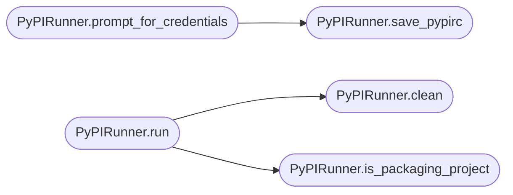

# `deploynator._pypi`

> Source: [deploynator/_pypi.py:1](../../deploynator/_pypi.py#L1) | language `py` | coverage 22.2% | [API index](../index.md)

## Contents

- **Classes:** [`PyPIRunner`](#pypirunner)

## Call Graph

Solid arrows stay in this module, dashed arrows leave it.



## Classes

<a id="pypirunner"></a>

### `PyPIRunner`

`class` | [deploynator/_pypi.py:12](../../deploynator/_pypi.py#L12)

```python
class PyPIRunner
```

**Members**

| Member | Kind | Summary |
|---|---|---|
| [`__init__`](#pypirunner-__init__) | constructor |  |
| [`is_packaging_project`](#pypirunner-is_packaging_project) | method |  |
| [`has_credentials`](#pypirunner-has_credentials) | method |  |
| [`prompt_for_credentials`](#pypirunner-prompt_for_credentials) | method | Pide el token PyPI por input oculto solo si hay TTY. |
| [`save_pypirc`](#pypirunner-save_pypirc) | method | Guarda el token en ~/.pypirc (username __token__, modo 600). |
| [`clean`](#pypirunner-clean) | method |  |
| [`run`](#pypirunner-run) | method |  |

<a id="pypirunner-__init__"></a>

#### `PyPIRunner.__init__`

`constructor` | [deploynator/_pypi.py:13](../../deploynator/_pypi.py#L13)

```python
def __init__(self, config: Config) -> None
```

**Parameters**

| Name | Type | Default | Description |
|---|---|---|---|
| `config` | `Config` |  |  |

*Called by:* [`DeployOrchestrator.__init__`](deploynator._deploy.py.md#deployorchestrator-__init__)

<a id="pypirunner-is_packaging_project"></a>

#### `PyPIRunner.is_packaging_project`

`method` | [deploynator/_pypi.py:16](../../deploynator/_pypi.py#L16)

```python
def is_packaging_project(self, project_path: str) -> bool
```

**Parameters**

| Name | Type | Default | Description |
|---|---|---|---|
| `project_path` | `str` |  |  |

**Returns:** `bool`

*Called by:* [`DeployOrchestrator.deploy`](deploynator._deploy.py.md#deployorchestrator-deploy), [`PyPIRunner.run`](#pypirunner-run)

<a id="pypirunner-has_credentials"></a>

#### `PyPIRunner.has_credentials`

`method` | [deploynator/_pypi.py:33](../../deploynator/_pypi.py#L33)

```python
def has_credentials(self) -> bool
```

**Returns:** `bool`

*Called by:* [`DeployOrchestrator.deploy`](deploynator._deploy.py.md#deployorchestrator-deploy)

<a id="pypirunner-prompt_for_credentials"></a>

#### `PyPIRunner.prompt_for_credentials`

`method` | [deploynator/_pypi.py:39](../../deploynator/_pypi.py#L39)

```python
def prompt_for_credentials(self) -> str | None
```

Pide el token PyPI por input oculto solo si hay TTY.

Sin TTY (harness, CI, MCP) devuelve None para no bloquear.
Pregunta si guardar en ~/.pypirc (modo 600, fuera de git).

**Returns:** `str | None`

*Calls:* [`PyPIRunner.save_pypirc`](#pypirunner-save_pypirc)

*Called by:* [`DeployOrchestrator.deploy`](deploynator._deploy.py.md#deployorchestrator-deploy)

<a id="pypirunner-save_pypirc"></a>

#### `PyPIRunner.save_pypirc`

`method` | [deploynator/_pypi.py:72](../../deploynator/_pypi.py#L72)

```python
def save_pypirc(self, token: str, path: str | None = None) -> str
```

Guarda el token en ~/.pypirc (username __token__, modo 600).

**Parameters**

| Name | Type | Default | Description |
|---|---|---|---|
| `token` | `str` |  |  |
| `path` | `str \| None` | `None` |  |

**Returns:** `str`

**Raises**

- `ValueError`: (raised in the body, not documented)

*Called by:* [`PyPIRunner.prompt_for_credentials`](#pypirunner-prompt_for_credentials)

<a id="pypirunner-clean"></a>

#### `PyPIRunner.clean`

`method` | [deploynator/_pypi.py:90](../../deploynator/_pypi.py#L90)

```python
def clean(self, project_path: str, toml: TomlConfig) -> None
```

**Parameters**

| Name | Type | Default | Description |
|---|---|---|---|
| `project_path` | `str` |  |  |
| `toml` | `TomlConfig` |  |  |

**Raises**

- `ValueError`: (raised in the body, not documented)

*Called by:* [`PyPIRunner.run`](#pypirunner-run)

<a id="pypirunner-run"></a>

#### `PyPIRunner.run`

`method` | [deploynator/_pypi.py:107](../../deploynator/_pypi.py#L107)

```python
def run(self, project_path: str, toml: TomlConfig, version: str, token: str | None = None) -> tuple[bool, str]
```

**Parameters**

| Name | Type | Default | Description |
|---|---|---|---|
| `project_path` | `str` |  |  |
| `toml` | `TomlConfig` |  |  |
| `version` | `str` |  |  |
| `token` | `str \| None` | `None` |  |

**Returns:** `tuple[bool, str]`

*Calls:* [`PyPIRunner.clean`](#pypirunner-clean), [`PyPIRunner.is_packaging_project`](#pypirunner-is_packaging_project)

*Called by:* [`DeployOrchestrator.deploy`](deploynator._deploy.py.md#deployorchestrator-deploy)

---
