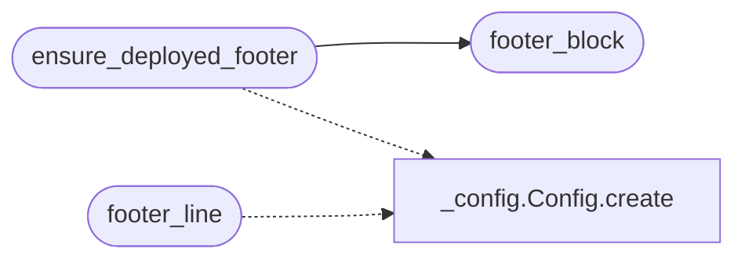

# `deploynator._readme`

> Source: [deploynator/_readme.py:1](../../deploynator/_readme.py#L1) | language `py` | coverage 75.0% | [API index](../index.md)

## Contents

- **Functions:** [`footer_block`](#footer_block), [`ensure_deployed_footer`](#ensure_deployed_footer), [`footer_line`](#footer_line)
- **Constants:** [`FOOTER_START`](#footer_start), [`FOOTER_END`](#footer_end), [`README_CANDIDATES`](#readme_candidates)

## Call Graph

Solid arrows stay in this module, dashed arrows leave it.



## Functions

<a id="footer_block"></a>

### `footer_block`

`function` | [deploynator/_readme.py:19](../../deploynator/_readme.py#L19)

```python
def footer_block(config: Config) -> str
```

Return the anchored deploy footer block.

**Parameters**

| Name | Type | Default | Description |
|---|---|---|---|
| `config` | `Config` |  | Centralized configuration with badge URL and text. |

**Returns:** `str` - Anchored footer text in English without emojis.

*Called by:* [`ensure_deployed_footer`](#ensure_deployed_footer)

---

<a id="ensure_deployed_footer"></a>

### `ensure_deployed_footer`

`function` | [deploynator/_readme.py:49](../../deploynator/_readme.py#L49)

```python
def ensure_deployed_footer(repo_path: str, config: Config | None = None) -> bool
```

Append or refresh the deploy footer in the repository README.

**Parameters**

| Name | Type | Default | Description |
|---|---|---|---|
| `repo_path` | `str` |  | Repository root directory holding the README. |
| `config` | `Config \| None` | `None` | Optional configuration override. |

**Returns:** `bool` - True when the README was created or modified, False otherwise.

*Calls:* [`Config.create`](deploynator._config.py.md#config-create), [`footer_block`](#footer_block)

*Called by:* [`DeployOrchestrator.deploy`](deploynator._deploy.py.md#deployorchestrator-deploy)

---

<a id="footer_line"></a>

### `footer_line`

`function` | [deploynator/_readme.py:96](../../deploynator/_readme.py#L96)

```python
def footer_line(config: Config | None = None) -> str
```

Return the plain deploy footer line.

**Parameters**

| Name | Type | Default | Description |
|---|---|---|---|
| `config` | `Config \| None` | `None` | Optional configuration override. |

**Returns:** `str` - English footer line without emojis.

*Calls:* [`Config.create`](deploynator._config.py.md#config-create)

---

## Constants

<a id="footer_start"></a>

### `FOOTER_START`

`constant` | [deploynator/_readme.py:8](../../deploynator/_readme.py#L8)

```python
FOOTER_START = '<!-- deploynator-footer -->'
```

---

<a id="footer_end"></a>

### `FOOTER_END`

`constant` | [deploynator/_readme.py:9](../../deploynator/_readme.py#L9)

```python
FOOTER_END = '<!-- /deploynator-footer -->'
```

---

<a id="readme_candidates"></a>

### `README_CANDIDATES`

`constant` | [deploynator/_readme.py:11](../../deploynator/_readme.py#L11)

```python
README_CANDIDATES = ('README.md', 'README.rst', 'Readme.md', 'readme.md')
```

---
