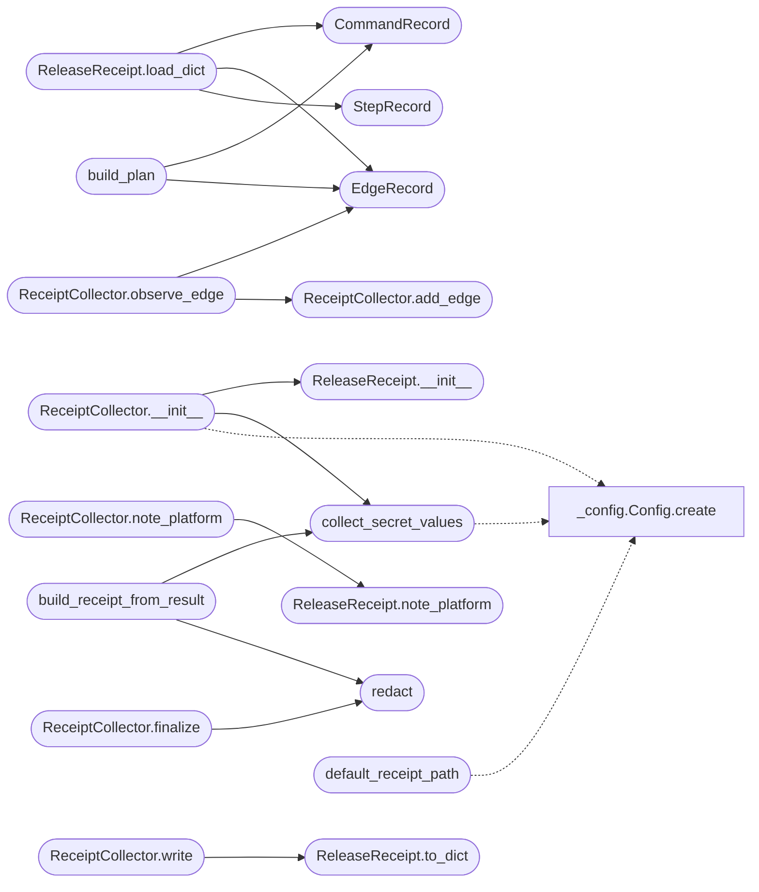

# `deploynator._receipt`

> Source: [deploynator/_receipt.py:1](../../deploynator/_receipt.py#L1) | language `py` | coverage 39.4% | [API index](../index.md)

Receipt contract: operational trace of a deploynator release.

Evidence hierarchy (golden rule):
  Fact      = step observed at runtime (exit_code recorded)      -> observed
  Candidate = feasible set from config / CLI / interface contract -> candidate
  Predicted = scored by a model; labeled, never presented as fact -> predicted

Every edge follows: (caller, callee, kind, evidence, confidence, provenance).

Receipts are written atomically, streams are tail-truncated and token
environment values are redacted before persisting. Receipt paths (and
their parents) must not be symlinks. With ``--receipt`` omitted, receipts
land in ``<cwd>/release-receipts/`` so target repos are never polluted
by ``git add -A``; if you point the receipt inside a managed repo, add
the directory to its .gitignore.

## Contents

- **Classes:** [`StepRecord`](#steprecord), [`CommandRecord`](#commandrecord), [`EdgeRecord`](#edgerecord), [`ReleaseReceipt`](#releasereceipt), [`ReceiptCollector`](#receiptcollector)
- **Functions:** [`collect_secret_values`](#collect_secret_values), [`redact`](#redact), [`default_receipt_path`](#default_receipt_path), [`build_receipt_from_result`](#build_receipt_from_result), [`build_plan`](#build_plan)
- **Constants:** [`RECEIPT_SCHEMA`](#receipt_schema), [`KIND_OBSERVED`](#kind_observed), [`KIND_CANDIDATE`](#kind_candidate), [`STATUS_RUNNING`](#status_running), [`STATUS_SUCCESS`](#status_success), [`STATUS_FAILED`](#status_failed), [`STATUS_PARTIAL`](#status_partial), [`MODE_RUN`](#mode_run), [`MODE_PLAN`](#mode_plan), [`REDACTED`](#redacted)

## Type Diagram

```mermaid
classDiagram
    direction LR
    class StepRecord
    StepRecord : str step
    StepRecord : str status
    StepRecord : str caller
    StepRecord : str error
    StepRecord : str started_at
    StepRecord : int duration_ms
    StepRecord : to_dict()
    class CommandRecord
    CommandRecord : list[str] command
    CommandRecord : int  None exit_code
    CommandRecord : bool  None success
    CommandRecord : str stage
    CommandRecord : str kind
    CommandRecord : str cwd
    CommandRecord : str stdout_tail
    CommandRecord : str stderr_tail
    CommandRecord : str exception
    CommandRecord : str started_at
    CommandRecord : int duration_ms
    CommandRecord : to_dict()
    class EdgeRecord
    EdgeRecord : str caller
    EdgeRecord : str callee
    EdgeRecord : str kind
    EdgeRecord : str evidence
    EdgeRecord : float confidence
    EdgeRecord : str provenance
    EdgeRecord : to_dict()
    class ReleaseReceipt
    ReleaseReceipt : __init__()
    ReleaseReceipt : note_platform()
    ReleaseReceipt : to_dict()
    ReleaseReceipt : load_dict()
    class ReceiptCollector
    ReceiptCollector : __init__()
    ReceiptCollector : stage()
    ReceiptCollector : mark_failure()
    ReceiptCollector : note_platform()
    ReceiptCollector : current_stage()
    ReceiptCollector : observe_edge()
    ReceiptCollector : add_edge()
    ReceiptCollector : add_edges()
    ReceiptCollector : add_commands()
    ReceiptCollector : set_run_context()
    ReceiptCollector : set_tag()
    ReceiptCollector : set_commit()
    ReceiptCollector : finalize()
    ReceiptCollector : capture()
    ReceiptCollector : write()
```



## Call Graph

Solid arrows stay in this module, dashed arrows leave it.



## Classes

<a id="steprecord"></a>

### `StepRecord`

`class` `dataclass` | [deploynator/_receipt.py:106](../../deploynator/_receipt.py#L106)

Decorators: `@dataclass(frozen=True)`

```python
class StepRecord
```

**Attributes**

| Name | Type | Default | Description |
|---|---|---|---|
| [`step`](#steprecord-step) | `str` |  |  |
| [`status`](#steprecord-status) | `str` |  |  |
| [`caller`](#steprecord-caller) | `str` | `''` |  |
| [`error`](#steprecord-error) | `str` | `''` |  |
| [`started_at`](#steprecord-started_at) | `str` | `field(default_factory=_utc_now_iso)` |  |
| [`duration_ms`](#steprecord-duration_ms) | `int` | `0` |  |

**Members**

| Member | Kind | Summary |
|---|---|---|
| [`to_dict`](#steprecord-to_dict) | method |  |

<a id="steprecord-to_dict"></a>

#### `StepRecord.to_dict`

`method` | [deploynator/_receipt.py:114](../../deploynator/_receipt.py#L114)

```python
def to_dict(self) -> dict
```

**Returns:** `dict`

---

<a id="commandrecord"></a>

### `CommandRecord`

`class` `dataclass` | [deploynator/_receipt.py:119](../../deploynator/_receipt.py#L119)

Decorators: `@dataclass(frozen=True)`

```python
class CommandRecord
```

**Attributes**

| Name | Type | Default | Description |
|---|---|---|---|
| [`command`](#commandrecord-command) | `list[str]` |  |  |
| [`exit_code`](#commandrecord-exit_code) | `int \| None` |  |  |
| [`success`](#commandrecord-success) | `bool \| None` |  |  |
| [`stage`](#commandrecord-stage) | `str` | `''` |  |
| [`kind`](#commandrecord-kind) | `str` | `KIND_OBSERVED` |  |
| [`cwd`](#commandrecord-cwd) | `str` | `''` |  |
| [`stdout_tail`](#commandrecord-stdout_tail) | `str` | `''` |  |
| [`stderr_tail`](#commandrecord-stderr_tail) | `str` | `''` |  |
| [`exception`](#commandrecord-exception) | `str` | `''` |  |
| [`started_at`](#commandrecord-started_at) | `str` | `field(default_factory=_utc_now_iso)` |  |
| [`duration_ms`](#commandrecord-duration_ms) | `int` | `0` |  |

**Members**

| Member | Kind | Summary |
|---|---|---|
| [`to_dict`](#commandrecord-to_dict) | method |  |

<a id="commandrecord-to_dict"></a>

#### `CommandRecord.to_dict`

`method` | [deploynator/_receipt.py:132](../../deploynator/_receipt.py#L132)

```python
def to_dict(self) -> dict
```

**Returns:** `dict`

---

<a id="edgerecord"></a>

### `EdgeRecord`

`class` `dataclass` | [deploynator/_receipt.py:137](../../deploynator/_receipt.py#L137)

Decorators: `@dataclass(frozen=True)`

```python
class EdgeRecord
```

**Attributes**

| Name | Type | Default | Description |
|---|---|---|---|
| [`caller`](#edgerecord-caller) | `str` |  |  |
| [`callee`](#edgerecord-callee) | `str` |  |  |
| [`kind`](#edgerecord-kind) | `str` |  |  |
| [`evidence`](#edgerecord-evidence) | `str` |  |  |
| [`confidence`](#edgerecord-confidence) | `float` |  |  |
| [`provenance`](#edgerecord-provenance) | `str` | `''` |  |

**Members**

| Member | Kind | Summary |
|---|---|---|
| [`to_dict`](#edgerecord-to_dict) | method |  |

<a id="edgerecord-to_dict"></a>

#### `EdgeRecord.to_dict`

`method` | [deploynator/_receipt.py:145](../../deploynator/_receipt.py#L145)

```python
def to_dict(self) -> dict
```

**Returns:** `dict`

---

<a id="releasereceipt"></a>

### `ReleaseReceipt`

`class` | [deploynator/_receipt.py:149](../../deploynator/_receipt.py#L149)

```python
class ReleaseReceipt
```

Full release record.

Mutable by design: the orchestrator mutates it while running;
`[`write`](#receiptcollector-write)` serializes the final state. `[`load_dict`](#releasereceipt-load_dict)` supports
round-trips from plain JSON data.

**Members**

| Member | Kind | Summary |
|---|---|---|
| [`__init__`](#releasereceipt-__init__) | constructor |  |
| [`note_platform`](#releasereceipt-note_platform) | method | Insert or merge a platform state entry (insertion only once). |
| [`to_dict`](#releasereceipt-to_dict) | method |  |
| [`load_dict`](#releasereceipt-load_dict) | method | Restore state from a plain dict (round-trip support). |

<a id="releasereceipt-__init__"></a>

#### `ReleaseReceipt.__init__`

`constructor` | [deploynator/_receipt.py:157](../../deploynator/_receipt.py#L157)

```python
def __init__(self, project: str, mode: str = MODE_RUN, dry_run: bool = False, trace: bool = False, flags: dict | None = None) -> None
```

**Parameters**

| Name | Type | Default | Description |
|---|---|---|---|
| `project` | `str` |  |  |
| `mode` | `str` | `MODE_RUN` |  |
| `dry_run` | `bool` | `False` |  |
| `trace` | `bool` | `False` |  |
| `flags` | `dict \| None` | `None` |  |

*Called by:* [`ReceiptCollector.__init__`](#receiptcollector-__init__)

<a id="releasereceipt-note_platform"></a>

#### `ReleaseReceipt.note_platform`

`method` | [deploynator/_receipt.py:185](../../deploynator/_receipt.py#L185)

```python
def note_platform(self, label: str, repo: str, enabled: bool, pushed: bool | None = None, released: bool | None = None, error: str | None = None) -> None
```

Insert or merge a platform state entry (insertion only once).

**Parameters**

| Name | Type | Default | Description |
|---|---|---|---|
| `label` | `str` |  |  |
| `repo` | `str` |  |  |
| `enabled` | `bool` |  |  |
| `pushed` | `bool \| None` | `None` |  |
| `released` | `bool \| None` | `None` |  |
| `error` | `str \| None` | `None` |  |

*Called by:* [`ReceiptCollector.note_platform`](#receiptcollector-note_platform)

<a id="releasereceipt-to_dict"></a>

#### `ReleaseReceipt.to_dict`

`method` | [deploynator/_receipt.py:213](../../deploynator/_receipt.py#L213)

```python
def to_dict(self) -> dict
```

**Returns:** `dict`

*Called by:* [`ReceiptCollector.write`](#receiptcollector-write)

<a id="releasereceipt-load_dict"></a>

#### `ReleaseReceipt.load_dict`

`method` | [deploynator/_receipt.py:236](../../deploynator/_receipt.py#L236)

```python
def load_dict(self, data: dict) -> None
```

Restore state from a plain dict (round-trip support).

**Parameters**

| Name | Type | Default | Description |
|---|---|---|---|
| `data` | `dict` |  |  |

*Calls:* [`CommandRecord`](#commandrecord), [`EdgeRecord`](#edgerecord), [`StepRecord`](#steprecord)

---

<a id="receiptcollector"></a>

### `ReceiptCollector`

`class` | [deploynator/_receipt.py:263](../../deploynator/_receipt.py#L263)

```python
class ReceiptCollector
```

Collects steps, subprocess calls and evidence edges for one deploy.

`[`capture`](#receiptcollector-capture)` wraps ``subprocess.run`` with a recorder so every external
command executed during the deploy (git, gh, glab, bb, pytest, pandoc,
dpkg, twine...) is captured with argv, exit code and output tails
without modifying any other contract. Swaps the module attribute and
always restores it; not reentrant across threads (deploynator deploys
are CLI-serial).

**Members**

| Member | Kind | Summary |
|---|---|---|
| [`__init__`](#receiptcollector-__init__) | constructor |  |
| [`stage`](#receiptcollector-stage) | method | Record a logical step. |
| [`mark_failure`](#receiptcollector-mark_failure) | method | Record a guard/condition failure occurring outside stage blocks. |
| [`note_platform`](#receiptcollector-note_platform) | method | Insert or merge platform state on the underlying receipt. |
| [`current_stage`](#receiptcollector-current_stage) | method |  |
| [`observe_edge`](#receiptcollector-observe_edge) | method |  |
| [`add_edge`](#receiptcollector-add_edge) | method |  |
| [`add_edges`](#receiptcollector-add_edges) | method |  |
| [`add_commands`](#receiptcollector-add_commands) | method |  |
| [`set_run_context`](#receiptcollector-set_run_context) | method |  |
| [`set_tag`](#receiptcollector-set_tag) | method |  |
| [`set_commit`](#receiptcollector-set_commit) | method |  |
| [`finalize`](#receiptcollector-finalize) | method |  |
| [`capture`](#receiptcollector-capture) | method |  |
| [`write`](#receiptcollector-write) | method | Atomic write. |

<a id="receiptcollector-__init__"></a>

#### `ReceiptCollector.__init__`

`constructor` | [deploynator/_receipt.py:274](../../deploynator/_receipt.py#L274)

```python
def __init__(self, project: str, mode: str = MODE_RUN, dry_run: bool = False, trace: bool = False, flags: dict | None = None, secrets: list[str] | None = None, tail_chars: int | None = None) -> None
```

**Parameters**

| Name | Type | Default | Description |
|---|---|---|---|
| `project` | `str` |  |  |
| `mode` | `str` | `MODE_RUN` |  |
| `dry_run` | `bool` | `False` |  |
| `trace` | `bool` | `False` |  |
| `flags` | `dict \| None` | `None` |  |
| `secrets` | `list[str] \| None` | `None` |  |
| `tail_chars` | `int \| None` | `None` |  |

*Calls:* [`Config.create`](deploynator._config.py.md#config-create), [`ReleaseReceipt.__init__`](#releasereceipt-__init__), [`collect_secret_values`](#collect_secret_values)

*Called by:* [`DeployOrchestrator.deploy`](deploynator._deploy.py.md#deployorchestrator-deploy)

<a id="receiptcollector-stage"></a>

#### `ReceiptCollector.stage`

`method` `generator` | [deploynator/_receipt.py:295](../../deploynator/_receipt.py#L295)

Decorators: `@contextmanager`

```python
def stage(self, label: str, caller: str = '')
```

Record a logical step.

Yields a handle; handle.fail(msg) marks the stage as failed explicitly, exceptions mark it as failed too.

**Parameters**

| Name | Type | Default | Description |
|---|---|---|---|
| `label` | `str` |  |  |
| `caller` | `str` | `''` |  |

<a id="receiptcollector-mark_failure"></a>

#### `ReceiptCollector.mark_failure`

`method` | [deploynator/_receipt.py:313](../../deploynator/_receipt.py#L313)

```python
def mark_failure(self, label: str, error: str, caller: str = '') -> None
```

Record a guard/condition failure occurring outside stage blocks.

**Parameters**

| Name | Type | Default | Description |
|---|---|---|---|
| `label` | `str` |  |  |
| `error` | `str` |  |  |
| `caller` | `str` | `''` |  |

<a id="receiptcollector-note_platform"></a>

#### `ReceiptCollector.note_platform`

`method` | [deploynator/_receipt.py:319](../../deploynator/_receipt.py#L319)

```python
def note_platform(self, label: str, repo: str, enabled: bool, pushed: bool | None = None, released: bool | None = None, error: str | None = None) -> None
```

Insert or merge platform state on the underlying receipt.

**Parameters**

| Name | Type | Default | Description |
|---|---|---|---|
| `label` | `str` |  |  |
| `repo` | `str` |  |  |
| `enabled` | `bool` |  |  |
| `pushed` | `bool \| None` | `None` |  |
| `released` | `bool \| None` | `None` |  |
| `error` | `str \| None` | `None` |  |

*Calls:* [`ReleaseReceipt.note_platform`](#releasereceipt-note_platform)

<a id="receiptcollector-current_stage"></a>

#### `ReceiptCollector.current_stage`

`method` | [deploynator/_receipt.py:326](../../deploynator/_receipt.py#L326)

```python
def current_stage(self) -> str
```

**Returns:** `str`

<a id="receiptcollector-observe_edge"></a>

#### `ReceiptCollector.observe_edge`

`method` | [deploynator/_receipt.py:331](../../deploynator/_receipt.py#L331)

```python
def observe_edge(self, caller: str, callee: str, evidence: str) -> None
```

**Parameters**

| Name | Type | Default | Description |
|---|---|---|---|
| `caller` | `str` |  |  |
| `callee` | `str` |  |  |
| `evidence` | `str` |  |  |

*Calls:* [`EdgeRecord`](#edgerecord), [`ReceiptCollector.add_edge`](#receiptcollector-add_edge)

<a id="receiptcollector-add_edge"></a>

#### `ReceiptCollector.add_edge`

`method` | [deploynator/_receipt.py:342](../../deploynator/_receipt.py#L342)

```python
def add_edge(self, edge: EdgeRecord) -> None
```

**Parameters**

| Name | Type | Default | Description |
|---|---|---|---|
| `edge` | `EdgeRecord` |  |  |

*Called by:* [`ReceiptCollector.observe_edge`](#receiptcollector-observe_edge)

<a id="receiptcollector-add_edges"></a>

#### `ReceiptCollector.add_edges`

`method` | [deploynator/_receipt.py:345](../../deploynator/_receipt.py#L345)

```python
def add_edges(self, edges: list[EdgeRecord]) -> None
```

**Parameters**

| Name | Type | Default | Description |
|---|---|---|---|
| `edges` | `list[EdgeRecord]` |  |  |

<a id="receiptcollector-add_commands"></a>

#### `ReceiptCollector.add_commands`

`method` | [deploynator/_receipt.py:348](../../deploynator/_receipt.py#L348)

```python
def add_commands(self, commands: list[CommandRecord]) -> None
```

**Parameters**

| Name | Type | Default | Description |
|---|---|---|---|
| `commands` | `list[CommandRecord]` |  |  |

<a id="receiptcollector-set_run_context"></a>

#### `ReceiptCollector.set_run_context`

`method` | [deploynator/_receipt.py:353](../../deploynator/_receipt.py#L353)

```python
def set_run_context(self, version_from: str, version_to: str, commit: str = '', branch: str = '') -> None
```

**Parameters**

| Name | Type | Default | Description |
|---|---|---|---|
| `version_from` | `str` |  |  |
| `version_to` | `str` |  |  |
| `commit` | `str` | `''` |  |
| `branch` | `str` | `''` |  |

<a id="receiptcollector-set_tag"></a>

#### `ReceiptCollector.set_tag`

`method` | [deploynator/_receipt.py:362](../../deploynator/_receipt.py#L362)

```python
def set_tag(self, tag: str) -> None
```

**Parameters**

| Name | Type | Default | Description |
|---|---|---|---|
| `tag` | `str` |  |  |

<a id="receiptcollector-set_commit"></a>

#### `ReceiptCollector.set_commit`

`method` | [deploynator/_receipt.py:367](../../deploynator/_receipt.py#L367)

```python
def set_commit(self, commit: str) -> None
```

**Parameters**

| Name | Type | Default | Description |
|---|---|---|---|
| `commit` | `str` |  |  |

<a id="receiptcollector-finalize"></a>

#### `ReceiptCollector.finalize`

`method` | [deploynator/_receipt.py:371](../../deploynator/_receipt.py#L371)

```python
def finalize(self, status: str, error: str = '') -> None
```

**Parameters**

| Name | Type | Default | Description |
|---|---|---|---|
| `status` | `str` |  |  |
| `error` | `str` | `''` |  |

*Calls:* [`redact`](#redact)

*Called by:* [`DeployOrchestrator.deploy`](deploynator._deploy.py.md#deployorchestrator-deploy)

<a id="receiptcollector-capture"></a>

#### `ReceiptCollector.capture`

`method` `generator` | [deploynator/_receipt.py:380](../../deploynator/_receipt.py#L380)

Decorators: `@contextmanager`

```python
def capture(self)
```

*Called by:* [`DeployOrchestrator.deploy`](deploynator._deploy.py.md#deployorchestrator-deploy)

<a id="receiptcollector-write"></a>

#### `ReceiptCollector.write`

`method` | [deploynator/_receipt.py:438](../../deploynator/_receipt.py#L438)

```python
def write(self, path: str) -> str
```

Atomic write.

Rejects symlink targets and symlink parents.

**Parameters**

| Name | Type | Default | Description |
|---|---|---|---|
| `path` | `str` |  |  |

**Returns:** `str`

**Raises**

- `ValueError`: (raised in the body, not documented)

*Calls:* [`ReleaseReceipt.to_dict`](#releasereceipt-to_dict)

*Called by:* [`DeployOrchestrator.deploy`](deploynator._deploy.py.md#deployorchestrator-deploy)

---

## Functions

<a id="collect_secret_values"></a>

### `collect_secret_values`

`function` | [deploynator/_receipt.py:80](../../deploynator/_receipt.py#L80)

```python
def collect_secret_values() -> list[str]
```

Current env token values worth redacting (length >= threshold).

**Returns:** `list[str]`

*Calls:* [`Config.create`](deploynator._config.py.md#config-create)

*Called by:* [`ReceiptCollector.__init__`](#receiptcollector-__init__), [`build_receipt_from_result`](#build_receipt_from_result)

---

<a id="redact"></a>

### `redact`

`function` | [deploynator/_receipt.py:96](../../deploynator/_receipt.py#L96)

```python
def redact(text: str, secrets: list[str]) -> str
```

**Parameters**

| Name | Type | Default | Description |
|---|---|---|---|
| `text` | `str` |  |  |
| `secrets` | `list[str]` |  |  |

**Returns:** `str`

*Called by:* [`ReceiptCollector.finalize`](#receiptcollector-finalize), [`build_receipt_from_result`](#build_receipt_from_result)

---

<a id="default_receipt_path"></a>

### `default_receipt_path`

`function` | [deploynator/_receipt.py:476](../../deploynator/_receipt.py#L476)

```python
def default_receipt_path(base_dir: str, project: str, mode: str, status: str, version: str = '') -> str
```

Default atomic receipt location: <base_dir>/<receipts_dir>/.

**Parameters**

| Name | Type | Default | Description |
|---|---|---|---|
| `base_dir` | `str` |  |  |
| `project` | `str` |  |  |
| `mode` | `str` |  |  |
| `status` | `str` |  |  |
| `version` | `str` | `''` |  |

**Returns:** `str`

**Raises**

- `ValueError`: (raised in the body, not documented)

*Calls:* [`Config.create`](deploynator._config.py.md#config-create)

*Called by:* [`DeployOrchestrator.deploy`](deploynator._deploy.py.md#deployorchestrator-deploy)

---

<a id="build_receipt_from_result"></a>

### `build_receipt_from_result`

`function` | [deploynator/_receipt.py:491](../../deploynator/_receipt.py#L491)

```python
def build_receipt_from_result(receipt: ReleaseReceipt, result, error: str = '') -> None
```

Stay consistent with the DeployResult before writing.

**Parameters**

| Name | Type | Default | Description |
|---|---|---|---|
| `receipt` | `ReleaseReceipt` |  |  |
| `result` |  |  |  |
| `error` | `str` | `''` |  |

*Calls:* [`collect_secret_values`](#collect_secret_values), [`redact`](#redact)

*Called by:* [`DeployOrchestrator.deploy`](deploynator._deploy.py.md#deployorchestrator-deploy)

---

<a id="build_plan"></a>

### `build_plan`

`function` | [deploynator/_receipt.py:510](../../deploynator/_receipt.py#L510)

```python
def build_plan(config: Config, project, toml, platforms_override: list | None = None, run_tests: bool = True, run_docs: bool = True, run_pypi: bool = True, run_deb: bool = True, version: str = '') -> tuple[list[EdgeRecord], list[CommandRecord]]
```

Feasible set from effective config + CLI flags + interface contract.

Never claims what ran: every result is a candidate with provenance.

**Parameters**

| Name | Type | Default | Description |
|---|---|---|---|
| `config` | `Config` |  |  |
| `project` |  |  |  |
| `toml` |  |  |  |
| `platforms_override` | `list \| None` | `None` |  |
| `run_tests` | `bool` | `True` |  |
| `run_docs` | `bool` | `True` |  |
| `run_pypi` | `bool` | `True` |  |
| `run_deb` | `bool` | `True` |  |
| `version` | `str` | `''` |  |

**Returns:** `tuple[list[EdgeRecord], list[CommandRecord]]`

*Calls:* [`CommandRecord`](#commandrecord), [`EdgeRecord`](#edgerecord)

---

## Constants

<a id="receipt_schema"></a>

### `RECEIPT_SCHEMA`

`constant` | [deploynator/_receipt.py:32](../../deploynator/_receipt.py#L32)

```python
RECEIPT_SCHEMA = 'deploynator/receipt@v1'
```

---

<a id="kind_observed"></a>

### `KIND_OBSERVED`

`constant` | [deploynator/_receipt.py:34](../../deploynator/_receipt.py#L34)

```python
KIND_OBSERVED = 'observed'
```

---

<a id="kind_candidate"></a>

### `KIND_CANDIDATE`

`constant` | [deploynator/_receipt.py:35](../../deploynator/_receipt.py#L35)

```python
KIND_CANDIDATE = 'candidate'
```

---

<a id="status_running"></a>

### `STATUS_RUNNING`

`constant` | [deploynator/_receipt.py:36](../../deploynator/_receipt.py#L36)

```python
STATUS_RUNNING = 'running'
```

---

<a id="status_success"></a>

### `STATUS_SUCCESS`

`constant` | [deploynator/_receipt.py:37](../../deploynator/_receipt.py#L37)

```python
STATUS_SUCCESS = 'success'
```

---

<a id="status_failed"></a>

### `STATUS_FAILED`

`constant` | [deploynator/_receipt.py:38](../../deploynator/_receipt.py#L38)

```python
STATUS_FAILED = 'failed'
```

---

<a id="status_partial"></a>

### `STATUS_PARTIAL`

`constant` | [deploynator/_receipt.py:39](../../deploynator/_receipt.py#L39)

```python
STATUS_PARTIAL = 'partial'
```

---

<a id="mode_run"></a>

### `MODE_RUN`

`constant` | [deploynator/_receipt.py:40](../../deploynator/_receipt.py#L40)

```python
MODE_RUN = 'run'
```

---

<a id="mode_plan"></a>

### `MODE_PLAN`

`constant` | [deploynator/_receipt.py:41](../../deploynator/_receipt.py#L41)

```python
MODE_PLAN = 'plan'
```

---

<a id="redacted"></a>

### `REDACTED`

`constant` | [deploynator/_receipt.py:43](../../deploynator/_receipt.py#L43)

```python
REDACTED = '***REDACTED***'
```

---
