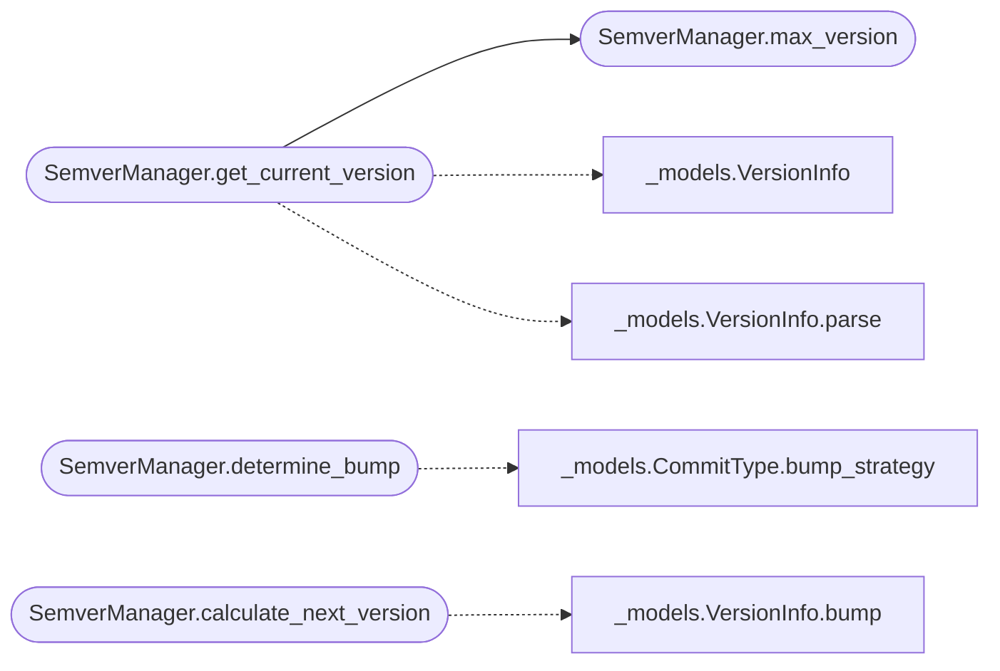

# `deploynator._semver`

> Source: [deploynator/_semver.py:1](../../deploynator/_semver.py#L1) | language `py` | coverage 0.0% | [API index](../index.md)

## Contents

- **Classes:** [`SemverManager`](#semvermanager)

## Call Graph

Solid arrows stay in this module, dashed arrows leave it.



## Classes

<a id="semvermanager"></a>

### `SemverManager`

`class` | [deploynator/_semver.py:12](../../deploynator/_semver.py#L12)

```python
class SemverManager
```

**Members**

| Member | Kind | Summary |
|---|---|---|
| [`__init__`](#semvermanager-__init__) | constructor |  |
| [`max_version`](#semvermanager-max_version) | method |  |
| [`get_current_version`](#semvermanager-get_current_version) | method |  |
| [`write_version_file`](#semvermanager-write_version_file) | method |  |
| [`determine_bump`](#semvermanager-determine_bump) | method |  |
| [`calculate_next_version`](#semvermanager-calculate_next_version) | method |  |
| [`is_valid_version`](#semvermanager-is_valid_version) | staticmethod |  |

<a id="semvermanager-__init__"></a>

#### `SemverManager.__init__`

`constructor` | [deploynator/_semver.py:13](../../deploynator/_semver.py#L13)

```python
def __init__(self, config: Config) -> None
```

**Parameters**

| Name | Type | Default | Description |
|---|---|---|---|
| `config` | `Config` |  |  |

*Called by:* [`DeployOrchestrator.__init__`](deploynator._deploy.py.md#deployorchestrator-__init__)

<a id="semvermanager-max_version"></a>

#### `SemverManager.max_version`

`method` | [deploynator/_semver.py:16](../../deploynator/_semver.py#L16)

```python
def max_version(self, a: VersionInfo, b: VersionInfo) -> VersionInfo
```

**Parameters**

| Name | Type | Default | Description |
|---|---|---|---|
| `a` | `VersionInfo` |  |  |
| `b` | `VersionInfo` |  |  |

**Returns:** `VersionInfo`

*Called by:* [`SemverManager.get_current_version`](#semvermanager-get_current_version)

<a id="semvermanager-get_current_version"></a>

#### `SemverManager.get_current_version`

`method` | [deploynator/_semver.py:21](../../deploynator/_semver.py#L21)

```python
def get_current_version(self, project_path: str, version_file: str = 'version.json', version_pattern: str = '(\\d+)\\.(\\d+)\\.(\\d+)') -> VersionInfo
```

**Parameters**

| Name | Type | Default | Description |
|---|---|---|---|
| `project_path` | `str` |  |  |
| `version_file` | `str` | `'version.json'` |  |
| `version_pattern` | `str` | `'(\\d+)\\.(\\d+)\\.(\\d+)'` |  |

**Returns:** `VersionInfo`

*Calls:* [`VersionInfo`](deploynator._models.py.md#versioninfo), [`VersionInfo.parse`](deploynator._models.py.md#versioninfo-parse), [`SemverManager.max_version`](#semvermanager-max_version)

*Called by:* [`DeployOrchestrator.deploy`](deploynator._deploy.py.md#deployorchestrator-deploy)

<a id="semvermanager-write_version_file"></a>

#### `SemverManager.write_version_file`

`method` | [deploynator/_semver.py:66](../../deploynator/_semver.py#L66)

```python
def write_version_file(self, project_path: str, version: VersionInfo, version_file: str = 'version.json') -> str
```

**Parameters**

| Name | Type | Default | Description |
|---|---|---|---|
| `project_path` | `str` |  |  |
| `version` | `VersionInfo` |  |  |
| `version_file` | `str` | `'version.json'` |  |

**Returns:** `str`

**Raises**

- `OSError`: (raised in the body, not documented)
- `ValueError`: (raised in the body, not documented)

*Called by:* [`DeployOrchestrator.deploy`](deploynator._deploy.py.md#deployorchestrator-deploy)

<a id="semvermanager-determine_bump"></a>

#### `SemverManager.determine_bump`

`method` | [deploynator/_semver.py:111](../../deploynator/_semver.py#L111)

```python
def determine_bump(self, commit_type: CommitType) -> Optional[str]
```

**Parameters**

| Name | Type | Default | Description |
|---|---|---|---|
| `commit_type` | `CommitType` |  |  |

**Returns:** `Optional[str]`

*Calls:* [`CommitType.bump_strategy`](deploynator._models.py.md#committype-bump_strategy)

*Called by:* [`DeployOrchestrator.deploy`](deploynator._deploy.py.md#deployorchestrator-deploy)

<a id="semvermanager-calculate_next_version"></a>

#### `SemverManager.calculate_next_version`

`method` | [deploynator/_semver.py:114](../../deploynator/_semver.py#L114)

```python
def calculate_next_version(self, current: VersionInfo, strategy: Optional[str]) -> VersionInfo
```

**Parameters**

| Name | Type | Default | Description |
|---|---|---|---|
| `current` | `VersionInfo` |  |  |
| `strategy` | `Optional[str]` |  |  |

**Returns:** `VersionInfo`

*Calls:* [`VersionInfo.bump`](deploynator._models.py.md#versioninfo-bump)

*Called by:* [`DeployOrchestrator.deploy`](deploynator._deploy.py.md#deployorchestrator-deploy)

<a id="semvermanager-is_valid_version"></a>

#### `SemverManager.is_valid_version`

`staticmethod` | [deploynator/_semver.py:118](../../deploynator/_semver.py#L118)

Decorators: `@staticmethod`

```python
def is_valid_version(version_str: str) -> bool
```

**Parameters**

| Name | Type | Default | Description |
|---|---|---|---|
| `version_str` | `str` |  |  |

**Returns:** `bool`

---
