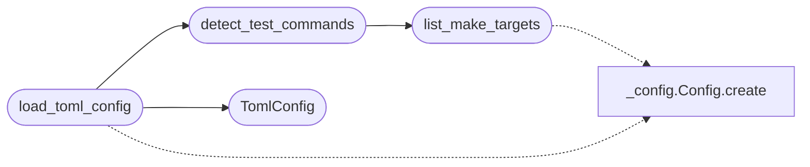

# `deploynator._toml`

> Source: [deploynator/_toml.py:1](../../deploynator/_toml.py#L1) | language `py` | coverage 50.0% | [API index](../index.md)

## Contents

- **Classes:** [`TomlConfig`](#tomlconfig)
- **Functions:** [`list_make_targets`](#list_make_targets), [`looks_like_packaging_project`](#looks_like_packaging_project), [`detect_test_commands`](#detect_test_commands), [`load_toml_config`](#load_toml_config)
- **Constants:** [`TOML_FILENAME`](#toml_filename), [`DEFAULT_TEST_COMMANDS`](#default_test_commands), [`DEFAULT_DOCS_COMMAND`](#default_docs_command), [`MAKEFILE_NAMES`](#makefile_names), [`MAKE_TEST_PRIORITY`](#make_test_priority), [`C_TEST_TIMEOUT_S`](#c_test_timeout_s)

## Call Graph

Solid arrows stay in this module, dashed arrows leave it.



## Classes

<a id="tomlconfig"></a>

### `TomlConfig`

`class` `dataclass` | [deploynator/_toml.py:177](../../deploynator/_toml.py#L177)

Decorators: `@dataclass(frozen=True)`

```python
class TomlConfig
```

**Attributes**

| Name | Type | Default | Description |
|---|---|---|---|
| [`project_name`](#tomlconfig-project_name) | `str` | `''` |  |
| [`version_file`](#tomlconfig-version_file) | `str` | `'version.json'` |  |
| [`test_commands`](#tomlconfig-test_commands) | `list[str]` | `None` |  |
| [`test_timeout_s`](#tomlconfig-test_timeout_s) | `int` | `300` |  |
| [`allow_no_tests`](#tomlconfig-allow_no_tests) | `bool` | `False` |  |
| [`docs_auto`](#tomlconfig-docs_auto) | `bool` | `True` |  |
| [`docs_command`](#tomlconfig-docs_command) | `str` | `DEFAULT_DOCS_COMMAND` |  |
| [`docs_timeout_s`](#tomlconfig-docs_timeout_s) | `int` | `300` |  |
| [`deploy_branch`](#tomlconfig-deploy_branch) | `str` | `'main'` |  |
| [`deploy_remote`](#tomlconfig-deploy_remote) | `str` | `'origin'` |  |
| [`deploy_message`](#tomlconfig-deploy_message) | `str` | `''` |  |
| [`pypi_enabled`](#tomlconfig-pypi_enabled) | `bool` | `True` |  |
| [`pypi_repo`](#tomlconfig-pypi_repo) | `str` | `'pypi'` |  |
| [`pypi_clean_dist`](#tomlconfig-pypi_clean_dist) | `bool` | `True` |  |
| [`pypi_timeout_s`](#tomlconfig-pypi_timeout_s) | `int` | `600` |  |
| [`deb_enabled`](#tomlconfig-deb_enabled) | `bool` | `True` |  |
| [`deb_build`](#tomlconfig-deb_build) | `str` | `''` |  |
| [`deb_outdir`](#tomlconfig-deb_outdir) | `str` | `'dist-deb'` |  |
| [`deb_clean_dist`](#tomlconfig-deb_clean_dist) | `bool` | `True` |  |
| [`deb_timeout_s`](#tomlconfig-deb_timeout_s) | `int` | `600` |  |
| [`deb_upload_assets`](#tomlconfig-deb_upload_assets) | `bool` | `True` |  |

---

## Functions

<a id="list_make_targets"></a>

### `list_make_targets`

`function` | [deploynator/_toml.py:31](../../deploynator/_toml.py#L31)

```python
def list_make_targets(project_path: str) -> list[str]
```

Lee el Makefile y devuelve sus targets sin ejecutar nada.

Seguro: rechaza symlinks, limita tamaño (Config.max_file_size_bytes).

**Parameters**

| Name | Type | Default | Description |
|---|---|---|---|
| `project_path` | `str` |  |  |

**Returns:** `list[str]`

**Raises**

- `ValueError`: (raised in the body, not documented)

*Calls:* [`Config.create`](deploynator._config.py.md#config-create)

*Called by:* [`DebRunner.deb_make_target`](deploynator._deb.py.md#debrunner-deb_make_target), [`detect_test_commands`](#detect_test_commands)

---

<a id="looks_like_packaging_project"></a>

### `looks_like_packaging_project`

`function` | [deploynator/_toml.py:75](../../deploynator/_toml.py#L75)

```python
def looks_like_packaging_project(project_path: str) -> bool
```

Inferencia runtime (multi-proyecto): ¿es un paquete PyPI?

Espejo liviano de PyPIRunner.is_packaging_project sin importar
_pypi (evita ciclo). El gate final sigue en PyPIRunner al
desplegar; aquí solo se usa para el default de pypi_enabled.

**Parameters**

| Name | Type | Default | Description |
|---|---|---|---|
| `project_path` | `str` |  |  |

**Returns:** `bool`

---

<a id="detect_test_commands"></a>

### `detect_test_commands`

`function` | [deploynator/_toml.py:101](../../deploynator/_toml.py#L101)

```python
def detect_test_commands(project_path: str) -> list[str] | None
```

Detecta comandos de test para proyectos C/autotools sin toml.

Runtime multi-proyecto, sin hardcodear nombres de proyecto:
Makefile (test-host canónico solo; si no, TODOS los targets de
test en una sola invocación `make test test-* ...`, p. ej.
`make test test-dsp test-transport`) → CMake (build+ctest) →
meson (setup+test).
Devuelve None si no hay nada detectable (caller usa pytest default).

**Parameters**

| Name | Type | Default | Description |
|---|---|---|---|
| `project_path` | `str` |  |  |

**Returns:** `list[str] | None`

*Calls:* [`list_make_targets`](#list_make_targets)

*Called by:* [`DeploynatorApp.init_project`](deploynator._app.py.md#deploynatorapp-init_project), [`load_toml_config`](#load_toml_config)

---

<a id="load_toml_config"></a>

### `load_toml_config`

`function` | [deploynator/_toml.py:217](../../deploynator/_toml.py#L217)

```python
def load_toml_config(project_path: str) -> TomlConfig
```

**Parameters**

| Name | Type | Default | Description |
|---|---|---|---|
| `project_path` | `str` |  |  |

**Returns:** `TomlConfig`

**Raises**

- `TypeError`: (raised in the body, not documented)
- `ValueError`: (raised in the body, not documented)

*Calls:* [`Config.create`](deploynator._config.py.md#config-create), [`TomlConfig`](#tomlconfig), [`detect_test_commands`](#detect_test_commands)

*Called by:* [`DeploynatorApp.release`](deploynator._app.py.md#deploynatorapp-release), [`DeployOrchestrator.deploy`](deploynator._deploy.py.md#deployorchestrator-deploy), [`DeployOrchestrator.integrate_readmenator`](deploynator._deploy.py.md#deployorchestrator-integrate_readmenator)

---

## Constants

<a id="toml_filename"></a>

### `TOML_FILENAME`

`constant` | [deploynator/_toml.py:8](../../deploynator/_toml.py#L8)

```python
TOML_FILENAME = 'deploynator.toml'
```

---

<a id="default_test_commands"></a>

### `DEFAULT_TEST_COMMANDS`

`constant` | [deploynator/_toml.py:9](../../deploynator/_toml.py#L9)

```python
DEFAULT_TEST_COMMANDS: list[str] = ['python -m pytest tests/ -q']
```

---

<a id="default_docs_command"></a>

### `DEFAULT_DOCS_COMMAND`

`constant` | [deploynator/_toml.py:10](../../deploynator/_toml.py#L10)

```python
DEFAULT_DOCS_COMMAND = 'python -m readmenator . --rebuild'
```

---

<a id="makefile_names"></a>

### `MAKEFILE_NAMES`

`constant` | [deploynator/_toml.py:16](../../deploynator/_toml.py#L16)

```python
MAKEFILE_NAMES: tuple[str, ...] = ('Makefile', 'makefile', 'GNUmakefile')
```

---

<a id="make_test_priority"></a>

### `MAKE_TEST_PRIORITY`

`constant` | [deploynator/_toml.py:17](../../deploynator/_toml.py#L17)

```python
MAKE_TEST_PRIORITY: list[str] = ['test-host', 'test', 'check', 'tests']
```

---

<a id="c_test_timeout_s"></a>

### `C_TEST_TIMEOUT_S`

`constant` | [deploynator/_toml.py:18](../../deploynator/_toml.py#L18)

```python
C_TEST_TIMEOUT_S: int = 900
```

---
