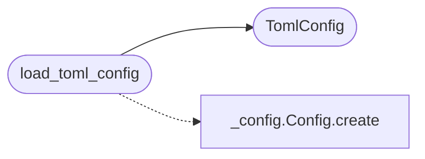

# `deploynator._toml`

> Source: [deploynator/_toml.py:1](../../deploynator/_toml.py#L1) | language `py` | coverage 0.0% | [API index](../index.md)

## Contents

- **Classes:** [`TomlConfig`](#tomlconfig)
- **Functions:** [`load_toml_config`](#load_toml_config)
- **Constants:** [`TOML_FILENAME`](#toml_filename), [`DEFAULT_TEST_COMMANDS`](#default_test_commands), [`DEFAULT_DOCS_COMMAND`](#default_docs_command)

## Call Graph

Solid arrows stay in this module, dashed arrows leave it.



## Classes

<a id="tomlconfig"></a>

### `TomlConfig`

`class` `dataclass` | [deploynator/_toml.py:14](../../deploynator/_toml.py#L14)

Decorators: `@dataclass(frozen=True)`

```python
class TomlConfig
```

**Attributes**

| Name | Type | Default | Description |
|---|---|---|---|
| [`project_name`](#tomlconfig-project_name) | `str` | `''` |  |
| [`version_file`](#tomlconfig-version_file) | `str` | `'version.json'` |  |
| [`test_commands`](#tomlconfig-test_commands) | `list[str]` | `None` |  |
| [`test_timeout_s`](#tomlconfig-test_timeout_s) | `int` | `300` |  |
| [`allow_no_tests`](#tomlconfig-allow_no_tests) | `bool` | `False` |  |
| [`docs_auto`](#tomlconfig-docs_auto) | `bool` | `True` |  |
| [`docs_command`](#tomlconfig-docs_command) | `str` | `DEFAULT_DOCS_COMMAND` |  |
| [`docs_timeout_s`](#tomlconfig-docs_timeout_s) | `int` | `300` |  |
| [`deploy_branch`](#tomlconfig-deploy_branch) | `str` | `'main'` |  |
| [`deploy_remote`](#tomlconfig-deploy_remote) | `str` | `'origin'` |  |
| [`pypi_enabled`](#tomlconfig-pypi_enabled) | `bool` | `True` |  |
| [`pypi_repo`](#tomlconfig-pypi_repo) | `str` | `'pypi'` |  |
| [`pypi_clean_dist`](#tomlconfig-pypi_clean_dist) | `bool` | `True` |  |
| [`pypi_timeout_s`](#tomlconfig-pypi_timeout_s) | `int` | `600` |  |

---

## Functions

<a id="load_toml_config"></a>

### `load_toml_config`

`function` | [deploynator/_toml.py:46](../../deploynator/_toml.py#L46)

```python
def load_toml_config(project_path: str) -> TomlConfig
```

**Parameters**

| Name | Type | Default | Description |
|---|---|---|---|
| `project_path` | `str` |  |  |

**Returns:** `TomlConfig`

**Raises**

- `ValueError`: (raised in the body, not documented)

*Calls:* [`Config.create`](deploynator._config.py.md#config-create), [`TomlConfig`](#tomlconfig)

*Called by:* [`DeploynatorApp.release`](deploynator._app.py.md#deploynatorapp-release), [`DeployOrchestrator.deploy`](deploynator._deploy.py.md#deployorchestrator-deploy), [`DeployOrchestrator.integrate_readmenator`](deploynator._deploy.py.md#deployorchestrator-integrate_readmenator)

---

## Constants

<a id="toml_filename"></a>

### `TOML_FILENAME`

`constant` | [deploynator/_toml.py:8](../../deploynator/_toml.py#L8)

```python
TOML_FILENAME = 'deploynator.toml'
```

---

<a id="default_test_commands"></a>

### `DEFAULT_TEST_COMMANDS`

`constant` | [deploynator/_toml.py:9](../../deploynator/_toml.py#L9)

```python
DEFAULT_TEST_COMMANDS: list[str] = ['python -m pytest tests/ -q']
```

---

<a id="default_docs_command"></a>

### `DEFAULT_DOCS_COMMAND`

`constant` | [deploynator/_toml.py:10](../../deploynator/_toml.py#L10)

```python
DEFAULT_DOCS_COMMAND = 'python -m readmenator . --rebuild'
```

---
