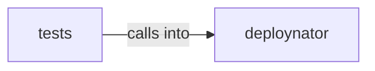

# deploynator: _changelog

deploynator: _changelog groups 6 files (py) around Config, create, resolve_path, gh_authd, glab_authd. prompt_for_credentials: Pide el token PyPI por input oculto solo si hay TTY.

## deploynator (1.1)

deploynator groups 3 files (py) around Config, create, resolve_path, gh_authd, glab_authd. prompt_for_credentials: Pide el token PyPI por input oculto solo si hay TTY.

## tests (1.2)

tests groups 3 files (py) around TestChangelogGenerator, generator, test_generate_header, test_generate_from_messages, test_generate_from_messages_organizes_by_type. RED: PyPI runner — detecta packaging, build limpio, upload twine.

**Files**:

- deploynator/_changelog.py
- deploynator/_config.py
- deploynator/_pypi.py
- tests/test_changelog.py
- tests/test_config.py
- tests/test_pypi.py
