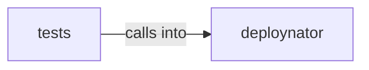

# deploynator: _changelog

deploynator: _changelog groups 6 files (py) around Config, create, resolve_path, gh_authd, glab_authd. footer_block: Return the anchored deploy footer block.

## deploynator (4.1)

deploynator groups 3 files (py) around Config, create, resolve_path, gh_authd, glab_authd. footer_block: Return the anchored deploy footer block.

## tests (4.2)

tests groups 3 files (py) around TestChangelogGenerator, generator, test_generate_header, test_generate_from_messages, test_generate_from_messages_organizes_by_type. Tests for the deploy README footer injector.

**Files**:

- deploynator/_changelog.py
- deploynator/_config.py
- deploynator/_readme.py
- tests/test_changelog.py
- tests/test_config.py
- tests/test_readme_footer.py
