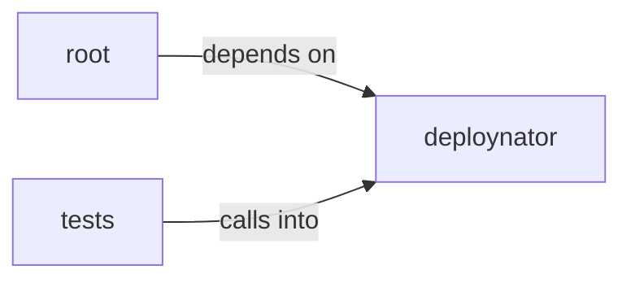

# deploynator: _mcp_server

deploynator: _mcp_server groups 7 files (py) around MCPRequest, __init__, is_notification, response, error. example: use deploynator programmatically as a library.

## deploynator (3.1)

deploynator groups 3 files (py) around MCPRequest, __init__, is_notification, response, error. MCP (Model Context Protocol) stdio server for deploynator.

## root (3.2)

root groups 1 files (py) around main. example: use deploynator programmatically as a library.

## tests (3.3)

tests groups 3 files (py) around TestCliMode, test_bare_invokes_interactive, test_explicit_interactive_still_works, test_release_flags_headless, test_serve_command_exists. RED: bare = interactive, flags = headless + MCP server.

**Files**:

- app.py
- deploynator/__init__.py
- deploynator/__main__.py
- deploynator/_mcp_server.py
- tests/test_cli_mcp.py
- tests/test_init.py
- tests/test_install_example.py
