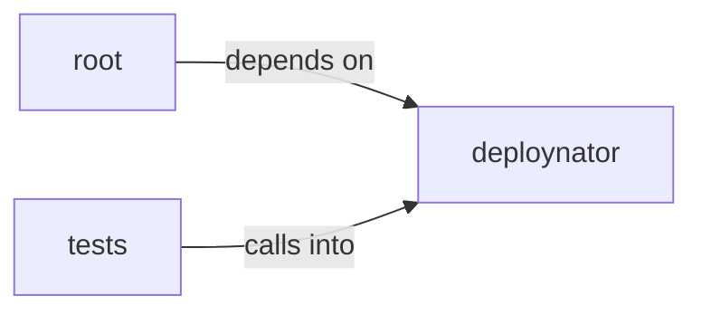

# deploynator: _mcp_server

deploynator: _mcp_server groups 11 files (py) around Config, create, resolve_path, gh_authd, glab_authd. example: use deploynator programmatically as a library.

## deploynator (1.1)

deploynator groups 5 files (py) around Config, create, resolve_path, gh_authd, glab_authd.

## root (1.2)

root groups 1 files (py) around main. example: use deploynator programmatically as a library.

## tests (1.3)

tests groups 5 files (py) around TestChangelogGenerator, generator, test_generate_header, test_generate_from_messages, test_generate_from_messages_organizes_by_type. RED: bare = interactive, flags = headless + MCP server.

**Files**:

- app.py
- deploynator/__init__.py
- deploynator/__main__.py
- deploynator/_changelog.py
- deploynator/_config.py
- deploynator/_mcp_server.py
- tests/test_changelog.py
- tests/test_cli_mcp.py
- tests/test_config.py
- tests/test_init.py
- tests/test_install_example.py
