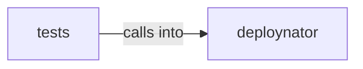

# deploynator: _models

deploynator: _models groups 6 files (py) around Platform, from_string, label, cli_name, auth_env_var.

## deploynator (3.1)

deploynator groups 2 files (py) around Platform, from_string, label, cli_name, auth_env_var.

## tests (3.2)

tests groups 4 files (py) around TestPlatformContract, test_platform_from_string, test_platform_from_string_case, test_platform_from_string_invalid, test_platform_cli_name. Path-direct deploy + tag prefijos + version_file toml (ReadMenator real).

**Files**:

- deploynator/_models.py
- deploynator/_semver.py
- tests/test_models.py
- tests/test_path_deploy.py
- tests/test_pipeline.py
- tests/test_semver.py
