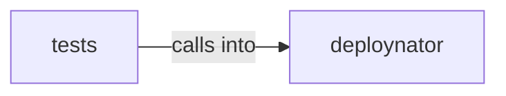

# deploynator: _receipt

deploynator: _receipt groups 7 files (py) around DeploynatorApp, __init__, auth_login, auth_status, _auth_github. install_packages: pip install/upgrade packages (default: deploynator from PyPI).

## deploynator (3.1)

deploynator groups 5 files (py) around DeploynatorApp, __init__, auth_login, auth_status, _auth_github. install_packages: pip install/upgrade packages (default: deploynator from PyPI).

## tests (3.2)

tests groups 2 files (py) around _config_git, TestGitSync, _make_repo, test_branch_exists_is_behind, test_sync_dev_to_main_force_pushes.

**Files**:

- deploynator/_app.py
- deploynator/_deploy.py
- deploynator/_git.py
- deploynator/_platforms.py
- deploynator/_receipt.py
- tests/test_git_sync.py
- tests/test_receipt.py
