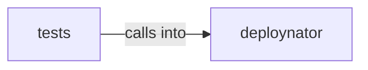

# deploynator: _toml

deploynator: _toml groups 6 files (py) around TomlConfig, __post_init__, _clamp_timeout, load_toml_config, TestRunner.

## deploynator (2.1)

deploynator groups 3 files (py) around TomlConfig, __post_init__, _clamp_timeout, load_toml_config, TestRunner.

## tests (2.2)

tests groups 3 files (py) around TestBDDDeployScenarios, project, test_version_bump_by_commit_type, test_conventional_commit_parsing, test_commit_message_format_is_consistent. BDD-style tests for deploynator using behavior-driven patterns.

**Files**:

- deploynator/_docs.py
- deploynator/_runner.py
- deploynator/_toml.py
- tests/bdd_test_deploy.py
- tests/test_runner.py
- tests/test_toml.py
