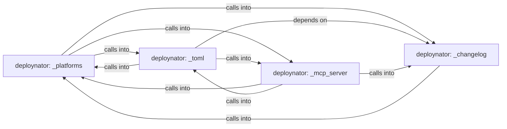

## Details

Static architecture map of 35 files (py, sh) in 4 components: deploynator: _platforms, deploynator: _toml, deploynator: _mcp_server, deploynator: _changelog. Structure is extracted statically without LLM calls; component prose may be enriched locally.

### deploynator: _platforms (1)

deploynator: _platforms groups 11 files (py) around Platform, from_string, label, cli_name, auth_env_var. install_packages: pip install/upgrade packages (default: deploynator from PyPI).

**Related Classes/Methods**:

- <a href="../deploynator/_models.py#L10-L15">deploynator/_models.py::Platform</a>
- <a href="../deploynator/_models.py#L16-L26">deploynator/_models.py::from_string</a>
- <a href="../deploynator/_models.py#L27-L29">deploynator/_models.py::label</a>
- <a href="../deploynator/_models.py#L30-L36">deploynator/_models.py::cli_name</a>
- <a href="../deploynator/_models.py#L37-L44">deploynator/_models.py::auth_env_var</a>
- <a href="../deploynator/_models.py#L45-L57">deploynator/_models.py::CommitType</a>
- <a href="../deploynator/_models.py#L58-L64">deploynator/_models.py::from_string</a>
- <a href="../deploynator/_models.py#L65-L67">deploynator/_models.py::valid_types</a>

### deploynator: _toml (2)

deploynator: _toml groups 8 files (py) around _target_regex, list_make_targets, _has_python_tests, detect_test_commands, _auto_toml_config. prompt_for_credentials: Pide el token PyPI por input oculto solo si hay TTY.

**Related Classes/Methods**:

- <a href="../deploynator/_toml.py#L23-L30">deploynator/_toml.py::_target_regex</a>
- <a href="../deploynator/_toml.py#L31-L63">deploynator/_toml.py::list_make_targets</a>
- <a href="../deploynator/_toml.py#L64-L76">deploynator/_toml.py::_has_python_tests</a>
- <a href="../deploynator/_toml.py#L77-L109">deploynator/_toml.py::detect_test_commands</a>
- <a href="../deploynator/_toml.py#L110-L131">deploynator/_toml.py::_auto_toml_config</a>
- <a href="../deploynator/_toml.py#L132-L147">deploynator/_toml.py::TomlConfig</a>
- <a href="../deploynator/_toml.py#L148-L155">deploynator/_toml.py::__post_init__</a>
- <a href="../deploynator/_toml.py#L156-L163">deploynator/_toml.py::_clamp_timeout</a>

### deploynator: _mcp_server (3)

deploynator: _mcp_server groups 7 files (py) around MCPRequest, __init__, is_notification, response, error. example: use deploynator programmatically as a library.

**Related Classes/Methods**:

- <a href="../deploynator/_mcp_server.py">deploynator/_mcp_server.py::MCPRequest</a>
- <a href="../deploynator/_mcp_server.py#L36-L42">deploynator/_mcp_server.py::__init__</a>
- <a href="../deploynator/_mcp_server.py#L43-L45">deploynator/_mcp_server.py::is_notification</a>
- <a href="../deploynator/_mcp_server.py#L46-L48">deploynator/_mcp_server.py::response</a>
- <a href="../deploynator/_mcp_server.py#L49-L55">deploynator/_mcp_server.py::error</a>
- <a href="../deploynator/_mcp_server.py">deploynator/_mcp_server.py::MCPTool</a>
- <a href="../deploynator/_mcp_server.py#L57-L63">deploynator/_mcp_server.py::__init__</a>
- <a href="../deploynator/_mcp_server.py#L64-L66">deploynator/_mcp_server.py::definition</a>

### deploynator: _changelog (4)

deploynator: _changelog groups 6 files (py) around Config, create, resolve_path, gh_authd, glab_authd. footer_block: Return the anchored deploy footer block.

**Related Classes/Methods**:

- <a href="../deploynator/_config.py#L8-L78">deploynator/_config.py::Config</a>
- <a href="../deploynator/_config.py#L79-L84">deploynator/_config.py::create</a>
- <a href="../deploynator/_config.py#L85-L90">deploynator/_config.py::resolve_path</a>
- <a href="../deploynator/_config.py#L91-L94">deploynator/_config.py::gh_authd</a>
- <a href="../deploynator/_config.py#L95-L98">deploynator/_config.py::glab_authd</a>
- <a href="../deploynator/_config.py#L99-L100">deploynator/_config.py::bb_authd</a>
- <a href="../deploynator/_readme.py#L19-L31">deploynator/_readme.py::footer_block</a>
- <a href="../deploynator/_readme.py#L32-L48">deploynator/_readme.py::_find_readme</a>
