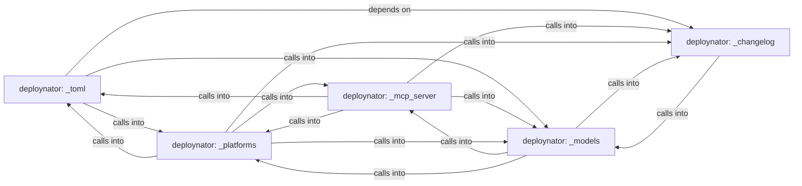

## Details

Static architecture map of 38 files (py, sh) in 5 components: deploynator: _toml, deploynator: _mcp_server, deploynator: _platforms, deploynator: _models, deploynator: _changelog. Structure is extracted statically without LLM calls; component prose may be enriched locally.

### deploynator: _toml (1)

deploynator: _toml groups 8 files (py) around _target_regex, list_make_targets, _has_python_tests, looks_like_packaging_project, detect_test_commands. DebRunner: Construye paquetes .deb desde fuentes C, espejo del flujo PyPI.

**Related Classes/Methods**:

- <a href="../deploynator/_toml.py#L23-L30">deploynator/_toml.py::_target_regex</a>
- <a href="../deploynator/_toml.py#L31-L62">deploynator/_toml.py::list_make_targets</a>
- <a href="../deploynator/_toml.py#L63-L74">deploynator/_toml.py::_has_python_tests</a>
- <a href="../deploynator/_toml.py#L75-L100">deploynator/_toml.py::looks_like_packaging_project</a>
- <a href="../deploynator/_toml.py#L101-L149">deploynator/_toml.py::detect_test_commands</a>
- <a href="../deploynator/_toml.py#L150-L176">deploynator/_toml.py::_auto_toml_config</a>
- <a href="../deploynator/_toml.py#L177-L199">deploynator/_toml.py::TomlConfig</a>
- <a href="../deploynator/_toml.py#L200-L208">deploynator/_toml.py::__post_init__</a>

### deploynator: _mcp_server (2)

deploynator: _mcp_server groups 7 files (py) around MCPRequest, __init__, is_notification, response, error. example: use deploynator programmatically as a library.

**Related Classes/Methods**:

- <a href="../deploynator/_mcp_server.py">deploynator/_mcp_server.py::MCPRequest</a>
- <a href="../deploynator/_mcp_server.py#L37-L43">deploynator/_mcp_server.py::__init__</a>
- <a href="../deploynator/_mcp_server.py#L44-L46">deploynator/_mcp_server.py::is_notification</a>
- <a href="../deploynator/_mcp_server.py#L47-L49">deploynator/_mcp_server.py::response</a>
- <a href="../deploynator/_mcp_server.py#L50-L56">deploynator/_mcp_server.py::error</a>
- <a href="../deploynator/_mcp_server.py">deploynator/_mcp_server.py::MCPTool</a>
- <a href="../deploynator/_mcp_server.py#L58-L64">deploynator/_mcp_server.py::__init__</a>
- <a href="../deploynator/_mcp_server.py#L65-L67">deploynator/_mcp_server.py::definition</a>

### deploynator: _platforms (3)

deploynator: _platforms groups 7 files (py) around DeploynatorApp, __init__, auth_login, auth_status, _auth_github. install_packages: pip install/upgrade packages (default: deploynator from PyPI).

**Related Classes/Methods**:

- <a href="../deploynator/_app.py">deploynator/_app.py::DeploynatorApp</a>
- <a href="../deploynator/_app.py#L19-L28">deploynator/_app.py::__init__</a>
- <a href="../deploynator/_app.py#L29-L42">deploynator/_app.py::auth_login</a>
- <a href="../deploynator/_app.py#L43-L53">deploynator/_app.py::auth_status</a>
- <a href="../deploynator/_app.py#L54-L66">deploynator/_app.py::_auth_github</a>
- <a href="../deploynator/_app.py#L67-L83">deploynator/_app.py::_auth_gitlab</a>
- <a href="../deploynator/_app.py#L84-L184">deploynator/_app.py::_auth_bitbucket</a>
- <a href="../deploynator/_app.py#L185-L261">deploynator/_app.py::init_project</a>

### deploynator: _models (4)

deploynator: _models groups 7 files (py) around Platform, from_string, label, cli_name, auth_env_var.

**Related Classes/Methods**:

- <a href="../deploynator/_models.py#L9-L14">deploynator/_models.py::Platform</a>
- <a href="../deploynator/_models.py#L15-L25">deploynator/_models.py::from_string</a>
- <a href="../deploynator/_models.py#L26-L28">deploynator/_models.py::label</a>
- <a href="../deploynator/_models.py#L29-L35">deploynator/_models.py::cli_name</a>
- <a href="../deploynator/_models.py#L36-L43">deploynator/_models.py::auth_env_var</a>
- <a href="../deploynator/_models.py#L44-L56">deploynator/_models.py::CommitType</a>
- <a href="../deploynator/_models.py#L57-L63">deploynator/_models.py::from_string</a>
- <a href="../deploynator/_models.py#L64-L66">deploynator/_models.py::valid_types</a>

### deploynator: _changelog (5)

deploynator: _changelog groups 6 files (py) around Config, create, resolve_path, gh_authd, glab_authd. footer_block: Return the anchored deploy footer block.

**Related Classes/Methods**:

- <a href="../deploynator/_config.py#L8-L79">deploynator/_config.py::Config</a>
- <a href="../deploynator/_config.py#L80-L85">deploynator/_config.py::create</a>
- <a href="../deploynator/_config.py#L86-L91">deploynator/_config.py::resolve_path</a>
- <a href="../deploynator/_config.py#L92-L95">deploynator/_config.py::gh_authd</a>
- <a href="../deploynator/_config.py#L96-L99">deploynator/_config.py::glab_authd</a>
- <a href="../deploynator/_config.py#L100-L101">deploynator/_config.py::bb_authd</a>
- <a href="../deploynator/_changelog.py">deploynator/_changelog.py::ChangelogGenerator</a>
- <a href="../deploynator/_changelog.py#L12-L14">deploynator/_changelog.py::__init__</a>
