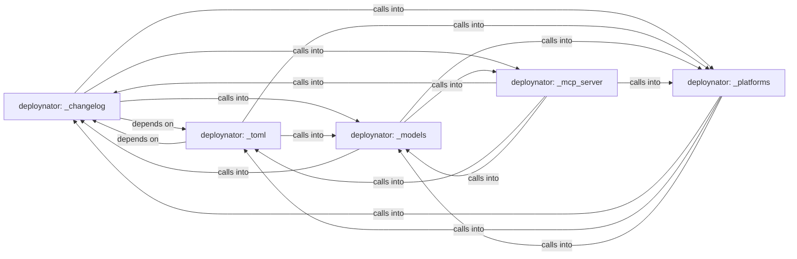

## Details

Static architecture map of 32 files (py, sh) in 5 components: deploynator: _changelog, deploynator: _toml, deploynator: _models, deploynator: _mcp_server, deploynator: _platforms. Structure is extracted statically without LLM calls; component prose may be enriched locally.

### deploynator: _changelog (1)

deploynator: _changelog groups 6 files (py) around Config, create, resolve_path, gh_authd, glab_authd. prompt_for_credentials: Pide el token PyPI por input oculto solo si hay TTY.

**Related Classes/Methods**:

- <a href="../deploynator/_config.py#L8-L78">deploynator/_config.py::Config</a>
- <a href="../deploynator/_config.py#L79-L84">deploynator/_config.py::create</a>
- <a href="../deploynator/_config.py#L85-L90">deploynator/_config.py::resolve_path</a>
- <a href="../deploynator/_config.py#L91-L94">deploynator/_config.py::gh_authd</a>
- <a href="../deploynator/_config.py#L95-L98">deploynator/_config.py::glab_authd</a>
- <a href="../deploynator/_config.py#L99-L100">deploynator/_config.py::bb_authd</a>
- <a href="../deploynator/_pypi.py">deploynator/_pypi.py::PyPIRunner</a>
- <a href="../deploynator/_pypi.py#L13-L15">deploynator/_pypi.py::__init__</a>

### deploynator: _toml (2)

deploynator: _toml groups 6 files (py) around TomlConfig, __post_init__, _clamp_timeout, load_toml_config, TestRunner.

**Related Classes/Methods**:

- <a href="../deploynator/_toml.py#L14-L29">deploynator/_toml.py::TomlConfig</a>
- <a href="../deploynator/_toml.py#L30-L37">deploynator/_toml.py::__post_init__</a>
- <a href="../deploynator/_toml.py#L38-L45">deploynator/_toml.py::_clamp_timeout</a>
- <a href="../deploynator/_toml.py#L46-L100">deploynator/_toml.py::load_toml_config</a>
- <a href="../deploynator/_runner.py">deploynator/_runner.py::TestRunner</a>
- <a href="../deploynator/_runner.py#L12-L14">deploynator/_runner.py::__init__</a>
- <a href="../deploynator/_runner.py#L15-L51">deploynator/_runner.py::run</a>
- <a href="../deploynator/_docs.py">deploynator/_docs.py::DocsRunner</a>

### deploynator: _models (3)

deploynator: _models groups 6 files (py) around Platform, from_string, label, cli_name, auth_env_var.

**Related Classes/Methods**:

- <a href="../deploynator/_models.py#L10-L15">deploynator/_models.py::Platform</a>
- <a href="../deploynator/_models.py#L16-L26">deploynator/_models.py::from_string</a>
- <a href="../deploynator/_models.py#L27-L29">deploynator/_models.py::label</a>
- <a href="../deploynator/_models.py#L30-L36">deploynator/_models.py::cli_name</a>
- <a href="../deploynator/_models.py#L37-L44">deploynator/_models.py::auth_env_var</a>
- <a href="../deploynator/_models.py#L45-L57">deploynator/_models.py::CommitType</a>
- <a href="../deploynator/_models.py#L58-L64">deploynator/_models.py::from_string</a>
- <a href="../deploynator/_models.py#L65-L67">deploynator/_models.py::valid_types</a>

### deploynator: _mcp_server (4)

deploynator: _mcp_server groups 5 files (py) around MCPRequest, __init__, is_notification, response, error. MCP (Model Context Protocol) stdio server for deploynator.

**Related Classes/Methods**:

- <a href="../deploynator/_mcp_server.py">deploynator/_mcp_server.py::MCPRequest</a>
- <a href="../deploynator/_mcp_server.py#L36-L42">deploynator/_mcp_server.py::__init__</a>
- <a href="../deploynator/_mcp_server.py#L43-L45">deploynator/_mcp_server.py::is_notification</a>
- <a href="../deploynator/_mcp_server.py#L46-L48">deploynator/_mcp_server.py::response</a>
- <a href="../deploynator/_mcp_server.py#L49-L55">deploynator/_mcp_server.py::error</a>
- <a href="../deploynator/_mcp_server.py">deploynator/_mcp_server.py::MCPTool</a>
- <a href="../deploynator/_mcp_server.py#L57-L63">deploynator/_mcp_server.py::__init__</a>
- <a href="../deploynator/_mcp_server.py#L64-L66">deploynator/_mcp_server.py::definition</a>

### deploynator: _platforms (5)

deploynator: _platforms groups 5 files (py) around DeploynatorApp, __init__, auth_login, auth_status, _auth_github. _gh_release_in_repo: Best-effort `gh release create` inferring repo from origin.

**Related Classes/Methods**:

- <a href="../deploynator/_app.py">deploynator/_app.py::DeploynatorApp</a>
- <a href="../deploynator/_app.py#L21-L30">deploynator/_app.py::__init__</a>
- <a href="../deploynator/_app.py#L31-L44">deploynator/_app.py::auth_login</a>
- <a href="../deploynator/_app.py#L45-L55">deploynator/_app.py::auth_status</a>
- <a href="../deploynator/_app.py#L56-L68">deploynator/_app.py::_auth_github</a>
- <a href="../deploynator/_app.py#L69-L85">deploynator/_app.py::_auth_gitlab</a>
- <a href="../deploynator/_app.py#L86-L167">deploynator/_app.py::_auth_bitbucket</a>
- <a href="../deploynator/_app.py#L168-L217">deploynator/_app.py::init_project</a>
